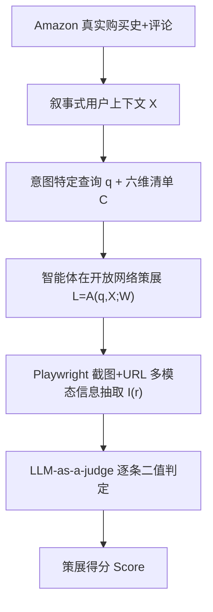
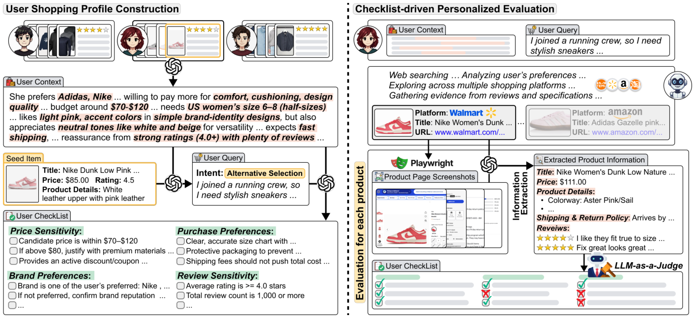

# AgenticShop: Benchmarking Agentic Product Curation for Personalized Web Shopping (开放网络个性化商品策展智能体基准)

- **会议/期刊**: WWW 2026 (Dubai, UAE)
- **作者与机构**: Sunghwan Kim, Ryang Heo, Yongsik Seo, Jinyoung Yeo, Dongha Lee (Yonsei University / ParamitaAI)
- **推荐链路定位**: 端到端生成式（用户侧跨平台策展，非平台内召回/精排）
- **研究方向**: 对话推荐与智能体仿真 / 大语言模型推荐
- **论文原文**: [arXiv:2602.12315v1](https://arxiv.org/abs/2602.12315v1)
- **开源代码**: [happysnail06/AgenticShop](https://github.com/happysnail06/AgenticShop)

## TL;DR (1分钟核心速览)

现有电商智能体基准只测"单平台找指定商品"，既不覆盖探索式跨平台购物，也完全不评估个性化。本文提出 AgenticShop：以 Amazon Review 真实购买史+评论文本生成叙事式用户购物上下文，按 Target Finding / Alternative Selection / Open Exploration 三类意图构造查询，并用六维个性化清单 + LLM-as-a-judge 做可验证打分。在 8 个主流智能体（ChatGPT Search、Claude Sonnet 4 Search、SeeAct、Browser Use 等）上，最佳系统策展得分仅约 38%，开放探索场景更跌至 14–21%，证明开放网络个性化策展远未解决。

## Background & Motivation (背景与核心矛盾)

- **主流范式**: 推荐系统与商品搜索长期聚焦"平台内商品发现"（WebShop、ShoppingBench、DeepShop 等基准），智能体评测则多为单站点导航或固定商品查找。
- **前人局限**: ① 场景覆盖窄——只测单平台 look-up，无法检验跨平台比较与探索式浏览；② 评估无个性化——只比对"是否找到目标商品"，不检验是否满足价格、评论、审美等细粒度偏好（PersonalWAB 虽引入个性化概念却未落到评估环节）。
- **核心洞察 (Key Insight)**: 真实网购是"高卷入决策"——用户跨博客/社区/多平台比对，认知负担极重；而开放网络缺乏商业平台的结构化类目体系，因此"搜得准"不等于"荐得对"。
- **本文切入点**: 把评估对象从"商品检索正确性"转为"用户清单满足度"，用真实购买史锚定个性化、用清单把偏好原子化可验证。

## Method (核心方法设计)

### 1. 整体框架 (Overall Architecture)

基准构建分两条流水线。**画像构建侧**：从 Amazon Review 采样评论数 ≥100 的用户，统计其最常购子类作为 target product type，仅保留该类购买史，交由 GPT-5-mini 结合商品元数据与评论文本生成叙事式购物上下文 $X$；再从历史中随机抽 seed item，按意图生成查询 $q$（TF 三种粒度 / AS 宽泛类目 / OE 无查询），并生成六维个性化清单 $C$。**评估侧**：智能体 $\mathcal{A}$ 在开放网络 $\mathcal{W}$ 上产出商品列表 $L=\mathcal{A}(q,X;\mathcal{W})$；对每个商品用 Playwright 全页渲染截图 + URL 送入带搜索能力的抽取器得到结构化信息 $I(r_i)$，再由 LLM-as-a-judge 逐条二值判定清单项，聚合为策展得分。

<figure class="paper-figure" markdown="span">
  <figcaption>图2：AgenticShop概览。在用户画像构建方面，使用真实用户购买历史和评论文本构建叙事式用户购物上下文，并据此生成意图特定查询和个性化清单。在清单驱动的个性化评估方面，LLM-as-a-judge验证精选结果是否满足每位用户的购物上下文，其判断依据为智能体提供的精选商品链接页面中提取的产品信息。</figcaption>
</figure>

### 2. 关键设计拆解 (Key Designs)

1. **三类购物意图的场景化任务分解**：痛点在于旧基准把"购物"压扁成单一查找任务，无法区分决策努力程度。本文将意图形式化为 TF（Explicit Title / Attribute-Specific / Brand-Categorical 三档查询粒度）、AS（按 Low-Involvement=Home&Kitchen、High-Involvement=Electronics、Aesthetic-Driven=Fashion 三域划分）、OE（无查询、跨域主动策展）。其价值在于把"查询具体度"与"决策卷入度"解耦成可控实验变量，从而定位失败来源。

2. **六维原子化个性化清单**：偏好若停留在自由文本则不可验证。本文将偏好拆为 brand / price / review / functional / aesthetic / purchase 六维原子准则 $C=\{C_1,\dots,C_K\}$，每条可被二值判定。元评估显示清单与真实评分的偏好对齐准确率达 **0.81**，显著高于 query(0.54)、购买史(0.70)、叙事上下文(0.78)，证明"清单"是最忠实的偏好载体。

3. **多模态抽取 + 清单驱动的可验证评分**：纯 URL 判定会因动态加载与广告噪声失真。本文用 Playwright 渲染全页截图集 $S_i$ 与 URL 联合输入抽取器：
$$I(r_i)=\mathcal{M}_{\text{extract}}\big(\mathrm{URL}(r_i), S_i\big),\quad \text{Score}=\frac{1}{|\mathcal{U}|MK}\sum_{u}\sum_{m}\sum_{k} J\big(I(r_m),C_k\big)$$
其中 $J\in\{0,1\}$ 为 judge 判定。与人类标注的 Cohen's $\kappa=0.732$、Spearman $\rho=0.743$（接近人际一致性 0.774），而去掉抽取信息后骤降至 0.44/0.38——说明"证据落地"是可靠评估的前提。该框架无需训练、无负采样，成本集中在网页渲染与 judge 调用。

## Experimental Setup & Evaluation Protocol (实验设置与评估协议)

- **数据集与预处理**: 源数据为 Amazon Review，用户筛选三步：评论数 ≥100 → 取最常购子类为 target product type → 仅保留该类历史。域覆盖 Grocery（TF）、Home&Kitchen / Electronics / Fashion（AS 三档）、全域聚合（OE）。

| 数据集/子集 | 域 | 意图类型 | 说明 |
| :--- | :---: | :---: | :--- |
| Grocery & Gourmet Food | Food | Target Finding | 明确商品查找，三档查询粒度 |
| Home & Kitchen | Home | AS-Low Involvement | 效用+审美中度比较 |
| Electronics | Elec. | AS-High Involvement | 技术规格权衡 |
| Clothing, Shoes & Jewelry | Fashion | AS-Aesthetic-Driven | 主观风格主导 |
| 全域聚合 | All | Open Exploration | 无查询主动策展 |

- **数据划分与防穿越 (Splitting Strategy)**: 非传统训练/测试划分，而是"用户级场景实例"划分；seed item 取自用户历史，但目标商品不预先给定，避免答案泄漏；元评估另采 250 样本做清单对齐、50 样本做人工一致性研究。
- **排名评测协议 (Ranking Protocol)**: 非 Full-Ranking 亦非 Sampled Ranking，而是**清单满足率打分**（每商品逐条二值判定后取平均），并辅以 Hit Ratio（品牌+品类匹配即算命中）单独度量检索能力。
- **对比基线与超参设置**: 两类共 8 个系统——搜索增强 LLM（ChatGPT Search、Claude Sonnet 4 Search、Gemini-2.5 flash-grounding、Perplexity-pro）与自主网页智能体（Agent-E、SeeAct、Web Voyager、Browser Use）；judge 与画像生成统一用 GPT-5-mini；显著性 $p<0.05$。

## Key Experimental Results (实验关键数据)

### 1. 主实验对比 (Main Results)

各意图场景下的策展得分（%）：

| Agent | TF-Exp.Title | TF-Attr.Spec. | TF-Brand Cat. | AS-High Inv. | AS-Low Inv. | AS-Aesthe. | OE-Cas.Brow. |
| :--- | :---: | :---: | :---: | :---: | :---: | :---: | :---: |
| ChatGPT Search | 37.81 | 35.35 | 34.79 | 30.13 | 29.47 | 27.55 | 14.51 |
| **Claude Sonnet 4 Search** | **37.93** | **36.44** | **34.96** | **29.66** | **29.08** | 20.58 | **21.20** |
| Gemini-2.5 flash-grounding | 22.29 | 21.52 | 23.60 | 18.04 | 19.72 | 16.62 | 16.06 |
| Perplexity-pro | 22.85 | 22.04 | 21.03 | 19.95 | 22.57 | 14.36 | 14.36 |
| Agent-E | 19.75 | 20.65 | 14.85 | 16.15 | 21.76 | 19.98 | 13.56 |
| SeeAct | 37.13 | 36.32 | 34.92 | 25.50 | 27.47 | 20.80 | 20.79 |
| Web Voyager | 34.25 | 30.34 | 27.22 | 25.87 | 25.68 | 18.76 | 15.57 |
| Browser Use | 31.48 | 34.52 | 30.58 | 22.61 | 23.45 | 16.24 | 18.41 |

检索能力（Hit Ratio）与个性化得分严重脱节：Claude 在 Explicit Title 下命中率高达 **0.86**，但同场景策展得分仅 37.93；Agent-E 命中率仅 0.24，SeeAct 达 0.88 却得分 37.13。

### 2. 消融实验 (Ablation Study)

评估框架自身的消融（对齐人类判断，250/50 样本）：

| 配置 | 清单偏好对齐 Acc | Cohen's $\kappa$ | Spearman $\rho$ |
| :--- | :---: | :---: | :---: |
| Query 表征 | 0.54 | — | — |
| 购买史表征 | 0.70 | — | — |
| 叙事上下文 | 0.78 | — | — |
| **完整清单 (Ours)** | **0.81** | **0.732** | **0.743** |
| w/o 抽取商品信息 | — | 0.440 | 0.441 |
| w/o 截图（仅 URL） | — | 0.379 | 0.389 |
| 人际一致性上界 | — | 0.774 | 0.774 |

### 3. 关键实验发现 (Key Findings)

1. **"搜得准"≠"荐得对"**：Claude 在 Explicit Title 下 Hit Ratio 0.86，但策展得分仅 37.93；SeeAct 命中率 0.88 而得分 37.13。检索能力与个性化质量近乎正交，瓶颈在偏好归因与比较而非定位。
2. **查询具体度几乎无增益**：TF 三档查询得分差异普遍在 1–3 个百分点内（ChatGPT 37.81→34.79），因开放网络缺乏商业平台的结构化类目，查询改写难以带来互补检索结果。
3. **失败集中在评论与价格两维**：约 70% 价格失败源于超预算推荐（动态价格 + 运费/税/折扣难以聚合）；评论失败主因是策展到"无评论页面"（No Review Page 比例 0.16–0.53），即找不到评论丰富的商品而非读不懂评论；此外 ChatGPT Search 仍有约 20% 商品链接为幻觉/无效页，Gemini 失败率高达 51.14%。

## Highlights, Limitations & Rating (亮点、对比与审稿评价)

- **与代表作对比 (vs. Prior Work)**: 相较 WebShop（单平台、平均奖励、无个性化）与 DeepShop（仅加查询复杂度、无个性化），AgenticShop 首次同时覆盖 TF/AS/OE 三类意图 + 开放网络 + 清单级个性化；相较 PersonalWAB 仅在任务侧引入个性化，本文将个性化真正落到评估环节。
- **可迁移亮点**: ① "真实行为史 → 叙事上下文 → 原子清单"的三级偏好蒸馏管线，可直接迁移到对话推荐/可解释推荐的用户建模；② 截图+URL 多模态抽取后再判定的"证据落地"范式，可复用于任何开放网页的 LLM 评估。
- **审稿级局限批判**: ① 画像、查询、清单、judge 全部依赖 GPT-5-mini，存在自偏好与生成偏差，且 judge 与人类 $\kappa$ 仅 0.73，仍有约 1/4 判定分歧；② 评估成本高（Playwright 全页渲染 + 多次 LLM 调用），且网页动态变化导致基准不可完全复现；③ 仅 8 个系统、单一 judge 模型，缺少跨 judge 鲁棒性与多语言/多地区电商覆盖。
- **四维评分**: 创新性 ⭐⭐⭐⭐ | 实验扎实度 ⭐⭐⭐⭐ | 方法清晰度 ⭐⭐⭐⭐⭐ | 落地价值 ⭐⭐⭐⭐

