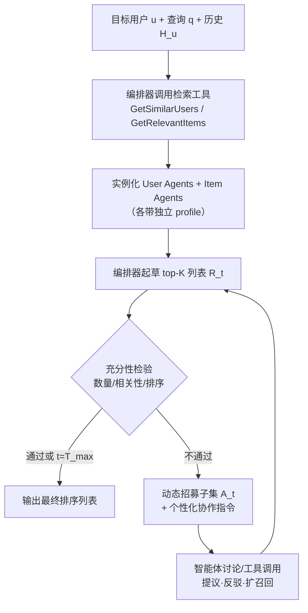
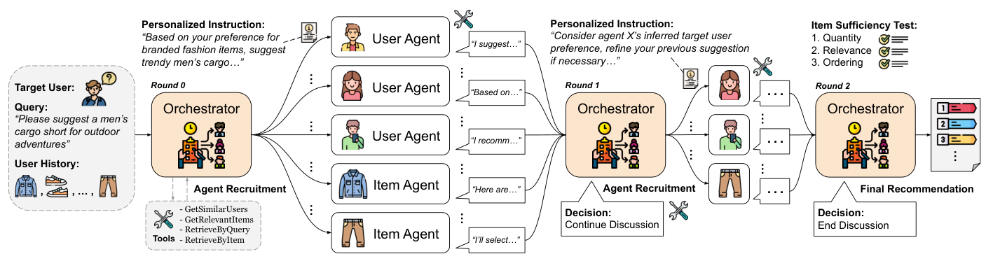

# Multi-Agent Collaborative Filtering: Orchestrating Users and Items for Agentic Recommendations (多智能体协同过滤：编排用户与物品智能体实现智能体化推荐)

- **会议/期刊**: WWW 2026
- **作者与机构**: Yu Xia, Julian McAuley (UCSD); Sungchul Kim, Tong Yu, Ryan A. Rossi (Adobe Research)
- **推荐链路定位**: 重排（候选生成 + 列表级重排，端到端由 LLM 智能体讨论产出）
- **研究方向**: 对话推荐与智能体仿真 / 大语言模型推荐
- **论文原文**: [https://arxiv.org/abs/2511.18413v3](https://arxiv.org/abs/2511.18413v3)
- **开源代码**: 暂未开源

## TL;DR (1分钟核心速览)

现有智能体推荐要么是单智能体 plan-execute，要么是通用角色分解的多智能体流水线，二者都把用户-物品历史仅当作 prompt 上下文，**未像协同过滤那样结构化地聚合邻域证据**。MACF 将相似用户与查询相关历史物品分别实例化为带独立 profile 的 LLM 智能体，由中心编排器动态招募、下发个性化指令、多轮讨论并做充分性检验后输出排序列表。在 Amazon Clothing/Beauty/Music 三域、用户模拟器驱动的 H@10/N@10 协议下，MACF 相对最强基线 TAIRA 的 HR@10 分别提升 17.8%/16.5%/54.9%。

## Background & Motivation (背景与核心矛盾)

- **主流范式**: 智能体推荐分两支——单智能体 plan-and-execute 循环（ReAct/InteRecAgent）与通用角色分解的多智能体流水线（MACRec/MACRS/TAIRA），后者已引入角色分工与协调。
- **前人局限**: ① 单智能体是唯一决策者，难以同时吸收多样化的偏好信号；② 多智能体的角色（如"检索员/分析员"）与偏好信号源（相似用户、相关物品）**松散解耦**，协同信号只能以原始历史文本形式塞进 prompt，无法像 CF 那样按邻域结构组织与加权。
- **核心洞察 (Key Insight)**: 传统 CF 的 UserCF/ItemCF 本质是"从相似用户侧与相关物品侧各取证据再做聚合"；LLM 多智能体恰好提供了"多视角独立推理 + 语言化协商"的机制，可以把 CF 的静态加权聚合替换为**可自适应调整的对话式聚合**。
- **本文切入点**: 让智能体的**身份**直接对应 CF 的邻域元素（user agent ↔ 相似用户，item agent ↔ 相关历史物品），再由编排器按查询动态决定谁参与、如何发言。

## Method (核心方法设计)

### 1. 整体框架 (Overall Architecture)

给定目标用户 $u$、自然语言查询$q$与历史$H_u$，编排器先调用四个检索工具（`GetSimilarUsers`、`GetRelevantItems`、`RetrieveByQuery`、`RetrieveByItem`）选出$n$个相似用户与$n$个查询相关历史物品，分别实例化为 user agent 与 item agent，各自携带紧凑 profile。随后进入至多$T_{\max}=5$轮讨论：每轮编排器先基于累积候选起草 top-$K$列表$\hat{R}_t$，做充分性检验；不通过则招募子集$\mathcal{A}_t \subseteq \mathcal{A}$并下发个性化指令，各智能体在共享讨论历史下提议、反驳、调用工具扩召回；通过或轮次耗尽即输出$\hat{R}_t$ 为最终列表。

<figure class="paper-figure" markdown="span">
  <figcaption>图1：以Amazon Clothing中的商品推荐示例展示的MACF工作流程概览。</figcaption>
</figure>

### 2. 关键设计拆解 (Key Designs)

1. **动态智能体招募 (Dynamic Agent Recruitment, DAR)**：痛点在于通用多智能体的角色模板与偏好信号无关，且固定邻域规模无法适配查询难度。MACF 在 $t=0$ 时以
   $$\mathcal{N}_u=\text{GetSimilarUsers}(u,n),\quad H_{u,q}=\text{GetRelevantItems}(u,q,n)$$
   取候选邻域，再按与 $q$的相关性二次过滤后才实例化智能体；后续轮次仅保留对改进$\hat{R}_t$最有用的子集$\mathcal{A}_t$。直觉：把 CF 的"邻居选择"从离线固定 top-$n$ 变成查询条件下的在线选择，避免无关邻居污染讨论。

2. **个性化协作指令 (Personalized Collaboration Instruction, PCI)**：痛点在于统一指令会让所有智能体输出同质化证据。编排器为每个 $a\in\mathcal{A}$依据其 profile、目标用户信息与当前$\hat{R}_t$的缺陷（并列、冲突、低相关项）生成差异化任务——user agent 侧重从$\mathcal{N}_u$提炼邻域偏好模式，item agent 侧重沿$H_u$ 追溯相关性路径。直觉：指令即"注意力权重"的语言化实现，把聚合权重从标量变成可解释的任务描述。

3. **充分性检验与自适应工具调用 (Sufficiency Test + ATU)**：终止条件要求同时满足 (i) 至少 $K$个与$q$ 及推断偏好明确相关的唯一物品、(ii) 物品与智能体给出的理由对齐、(iii) 排序清晰。未通过时智能体可多次调用 `RetrieveByItem` 围绕强锚点扩展、或用 `RetrieveByQuery` 替换跑题项。训练侧无参数学习（全部为 gpt-4o 提示工程，temperature 0.3），成本控制完全依赖该检验——图 2 显示绝大多数查询在第 3 轮前终止。

## Experimental Setup & Evaluation Protocol (实验设置与评估协议)

- **数据集**: 三个 Amazon 域（Clothing / Beauty / Music），沿用 TAIRA 的数据划分与自然语言查询集；原文未给出交互量统计表，此处不臆造数值。

| 数据集 | 域 | 查询来源 | 评估方式 |
| :--- | :---: | :---: | :---: |
| Amazon Clothing | 服饰 | TAIRA 查询集 | 用户模拟器驱动 |
| Amazon Beauty | 美妆 | TAIRA 查询集 | 用户模拟器驱动 |
| Amazon Music | 音乐 | TAIRA 查询集 | 用户模拟器驱动 |

- **数据划分与防穿越**: 沿用 Yu et al. (TAIRA) 的划分与查询集，采用**用户模拟器驱动评估**（模拟用户对推荐列表反馈），而非离线 Leave-One-Out。
- **排名评测协议**: 报告 **H@10 (HitRatio@10)** 与 **N@10 (NDCG@10)**；由模拟器判定相关性，属于采样式/模拟交互评估而非全库 Full-Ranking，跨方法可比性依赖同一模拟器。
- **对比基线与超参**: 三类基线——检索类（BM25、BGE-M3、BGE-Reranker）、传统 CF（ItemCF、UserCF，均用 embedding 对 CF 结果按查询重排）、智能体类（ReAct、Reflexion、InteRecAgent、MACRec、MACRS、TAIRA）。所有方法共享 BGE-M3 嵌入以保证公平；$n=5$、$k=15$、$T_{\max}=5$、$K=10$；智能体以 MCP 服务异步 HTTP 流式部署。

## Key Experimental Results (实验关键数据)

### 1. 主实验对比 (Main Results)

| 方法 | Clothing H@10 | Clothing N@10 | Beauty H@10 | Beauty N@10 | Music H@10 | Music N@10 |
| :--- | :---: | :---: | :---: | :---: | :---: | :---: |
| BM25 | 0.0801 | 0.2543 | 0.2171 | 0.4546 | 0.1628 | 0.3336 |
| BGE-Reranker | 0.2970 | 0.5031 | 0.2980 | 0.4946 | 0.1763 | 0.3516 |
| ItemCF | 0.3804 | 0.6258 | 0.3199 | 0.5141 | 0.3106 | 0.5105 |
| UserCF | 0.3687 | 0.5926 | 0.3037 | 0.4998 | 0.2988 | 0.4780 |
| Reflexion | 0.4218 | 0.7002 | 0.4001 | 0.6203 | 0.3234 | 0.4900 |
| InteRecAgent | 0.4207 | 0.7035 | 0.3919 | 0.6136 | 0.2919 | 0.4585 |
| MACRec | 0.4205 | 0.6846 | 0.3834 | 0.5999 | 0.2634 | 0.4876 |
| TAIRA | 0.4447 | **0.7182** | 0.4655 | 0.7520 | 0.3519 | 0.5540 |
| MACF$_{item}$ | 0.4363 | 0.7963 | 0.5027 | 0.8179 | 0.5088 | 0.7614 |
| MACF$_{user}$ | 0.5134 | 0.7927 | 0.5368 | **0.8244** | 0.5134 | 0.7574 |
| **MACF** | **0.5238** | 0.7942 | **0.5421** | 0.8215 | **0.5450** | **0.7668** |
| **Improv. vs TAIRA** | **+17.8%** | +10.6% | **+16.5%** | +9.2% | **+54.9%** | **+38.4%** |

### 2. 消融实验 (Ablation Study)

| 变体 | Clothing H@10 | Clothing N@10 | Beauty H@10 | Beauty N@10 | Music H@10 | Music N@10 |
| :--- | :---: | :---: | :---: | :---: | :---: | :---: |
| MACF 完整 | **0.5238** | **0.7942** | **0.5421** | **0.8215** | **0.5450** | **0.7668** |
| w/o PCI | 0.5165 | 0.7902 | 0.5147 | 0.7836 | 0.5372 | 0.7417 |
| w/o DAR | 0.5029 | 0.7462 | 0.5053 | 0.7753 | 0.5448 | 0.7129 |
| w/o ATU | 0.4300 | 0.7516 | 0.4890 | 0.7882 | 0.4884 | 0.6682 |

### 3. 关键实验发现 (Key Findings)

1. **协同信号的结构化注入是主要增益来源，而非"多智能体"本身**：同为多智能体框架的 MACRec/MACRS 在 Music 上 H@10 仅 0.2634/0.2348，甚至低于 ItemCF 的 0.3106；而 MACF 达 0.5450。说明把智能体身份绑定到 CF 邻域元素（而非通用角色）才是关键，Music 域因物品语义跨度大、通用角色最易失效，故增益最大（+54.9%）。
2. **user 侧与 item 侧证据互补，且各自单独使用已能超越全部基线**：MACF$_{user}$在 Beauty 的 N@10 达 0.8244（略高于完整模型的 0.8215），MACF$_{item}$ 在 Clothing/Beauty 的 N@10 达 0.7963/0.8179，均远超 TAIRA 的 0.7182/0.7520；但完整模型在三个域的 H@10 全部最优，说明双侧融合主要提升"命中覆盖"，单侧则在特定域更利于排序精度。
3. **自适应工具调用 (ATU) 是最脆弱模块，且域间敏感度差异显著**：移除 ATU 后 Music 的 N@10 从 0.7668 骤降至 0.6682（−12.8%），Clothing H@10 从 0.5238 降至 0.4300（−17.9%）；而 DAR 的移除对 Music H@10 几乎无损（0.5448 vs 0.5450）却使 N@10 掉 7.0%，表明"招募谁"影响排序质量、"能否反复检索"影响候选覆盖，二者作用维度不同。图 2 的轮次分布（多数查询 3 轮内终止）进一步说明充分性检验有效抑制了无效交互开销。

## Highlights & Limitations (亮点、对比与审稿批判)

- **与代表作对比 (vs. Prior Work)**: 与 **TAIRA** 的本质区别在于 TAIRA 仍是任务分解式流水线、协同信号停留在 prompt 上下文，MACF 则把邻域元素提升为智能体本体并引入查询条件下的动态招募；与 **AgentCF** 的区别在于 AgentCF 用用户/物品智能体做行为**模拟**，MACF 直接面向**推荐产出**并加入编排器的多轮协商与终止判据；与 **InteRecAgent/MACRec** 相比，MACF 的增益不来自更强的工具链，而来自 CF 结构的显式对齐。
- **可迁移亮点**: ① "充分性检验 + 轮次上限"的双终止机制可直接移植到任何多轮 LLM 推荐/追问系统以控成本；② 把召回侧的邻居选择做成"编排器在线决策 + 个性化指令"，可作为传统召回-重排级联中重排器的语言化替代方案。
- **审稿级局限批判**: ① **评估可信度**：全部指标依赖用户模拟器，缺少真实用户或离线全库排序对照，且未报告模拟器与真实偏好的相关性验证，跨方法比较存在系统性偏差风险；② **成本与可复现性**：每查询需多轮多智能体 gpt-4o 调用（$T_{\max}=5$、$n=5$双侧智能体），论文未报告 token 消耗、延迟与美元成本，也无开源代码，工业落地与复现均受限；③ 仅 4 页短文，缺少显著性检验、超参（$n$、$T_{\max}$、$K$）敏感性分析与失败案例剖析。

## Rating (四维评分)

- **方法创新性 (Novelty)**: ⭐⭐⭐⭐ （核心机制与方法设计具备明确创新性，理论与实验动机支撑充分）
- **评估协议与实验扎实度 (Protocol & Experiments)**: ⭐⭐⭐ （主流公开数据集评测完整，包含多基线对比与消融实验验证）
- **写作与数学规范度 (Clarity & Rigor)**: ⭐⭐⭐⭐ （问题形式化定义清晰，核心模块数学推导与架构阐述严谨易读）
- **工业落地与复现价值 (Industrial & Practical Value)**: ⭐⭐⭐ （兼顾推荐效果增益与训练/推理效率，具备实际场景迁移参考价值）
