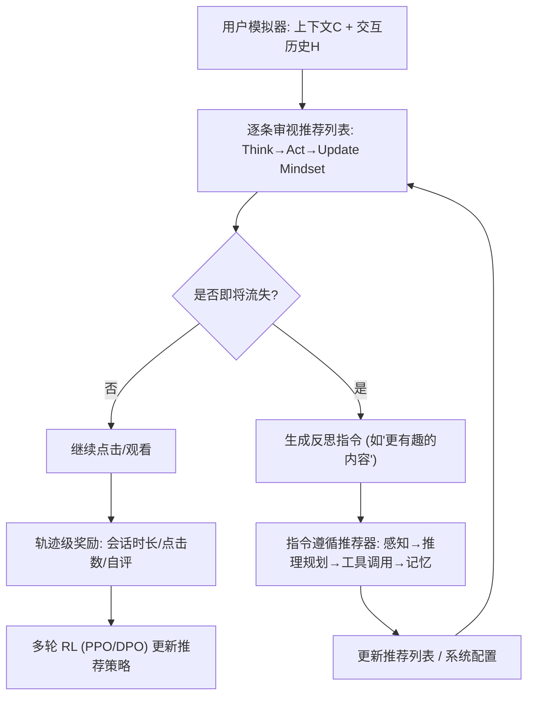
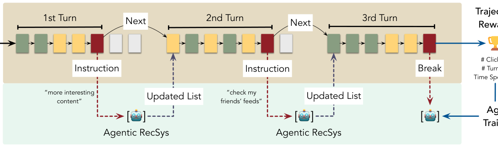

# RecoWorld: Building Simulated Environments for Agentic Recommender Systems (为智能体推荐系统构建仿真环境)

- **会议/期刊**: WWW Companion '26 (HCRS Workshop, Best Paper Award)
- **作者与机构**: Fei Liu, Xinyu Lin, Hanchao Yu, Mingyuan Wu 等（Meta Platforms 主导，NUS / UIUC 合作）
- **推荐链路定位**: 端到端生成式（仿真环境 + 指令遵循重排）
- **研究方向**: 对话推荐与智能体仿真 / 大语言模型推荐
- **论文原文**: [arXiv:2509.10397v3](https://arxiv.org/abs/2509.10397v3)
- **开源代码**: 暂未开源

## TL;DR (1分钟核心速览)

针对智能体推荐系统缺乏安全训练/评测沙盒、离线指标（NDCG/Recall）存在曝光偏差且无法刻画长期留存的问题，本文提出 RecoWorld——一个**双视角 LLM 仿真环境**：用户模拟器逐条审视推荐列表、更新 mindset，在感知到即将流失时主动发出"反思指令"（如"给我更有趣的内容"），指令遵循推荐器据此重排列表，形成多轮闭环。论文给出文本/多模态/语义 ID 三种历史建模方案、动态记忆与偏好演化公式，以及多智能体群体仿真框架，并以轨迹级留存奖励支撑多轮 RL 训练。**注意：本文为 position/blueprint 论文，不含定量实验，仅给出评测设计。**

## Background & Motivation (背景与核心矛盾)

- **主流范式**: 推荐系统依赖离线指标（Recall@N、NDCG）+ 在线 A/B 测试；近年生成式推荐（HSTU、OneRec）与智能体推荐兴起，能力更强但评测更难。
- **前人局限**: ① 离线指标基于历史行为，存在**曝光偏差**，系统只会强化已知模式而非发现新兴趣；② A/B 测试反馈回路慢、成本高，且不可能让真实用户承受每一个激进策略的风险。
- **核心洞察 (Key Insight)**: 用户偏好并非只通过显式指令表达，**隐式行为（完播率、连续不中断、久未回访）同样携带指令信号**；且 NDCG 与留存是正交维度——高 NDCG + 低留存意味着内容重复/多样性不足，低 NDCG + 高留存则可能是有效探索。
- **本文切入点**: 借鉴 OpenAI Gym / 生成式智能体（Park et al.）思路，用 LLM 构建"用户可发指令、推荐器可响应"的 Gym 式仿真环境，把**会话级留存**作为奖励信号，让智能体在无真实用户风险下试错。

## Method (核心方法设计)

### 1. 整体框架 (Overall Architecture)

RecoWorld 采用**双视角架构**：左侧是 LLM 驱动的用户模拟器，接收推荐列表后对每个 item 执行"思考→行动→更新 mindset"三步；右侧是指令遵循推荐器（自主智能体，具备感知/推理规划/行动/记忆四能力）。会话开始时用户打开 App，推荐器给出 k 个 item 的有序列表；用户逐条点击/跳过/观看/离开，若选择离开则被提示反思不满原因并生成一条指令；推荐器解析指令、推理用户历史与人口属性，生成新的推荐配置并返回更新列表。该循环持续至用户不再给指令直接退出，整条 (item, action) 序列构成**交互轨迹**，从中抽取会话时长、点击数等作为 RL 奖励。

<figure class="paper-figure" markdown="span">
  <figcaption>图1：模拟用户在一个会话中通过多轮交互与智能体式RecSys进行互动。</figcaption>
</figure>

### 2. 关键设计拆解 (Key Designs)

1. **反思式指令生成（Reflective Instruction）**：痛点在于传统模拟器只会"打分/离开"，无法给推荐器改进信号。本文让用户在离开前反思并输出自然语言指令，把"流失"转化为"可执行的反馈"，使模拟器与推荐器形成协同增益闭环——成功的模拟器触发准确指令，有效的推荐器回以提升满意度的列表。

2. **动态记忆与偏好演化（Dynamic Memory & Evolving Preference）**：用户历史近似无限且噪声大，本文定义带重要性阈值的参与记忆
$$\mathcal{M}^t_u=\{(a_k,i_k,\tau_k)\in\mathcal{H}_u \mid \alpha_k>\delta\},\quad \alpha_k=h(a_k,i_k,\tau_k\mid \mathcal{C}^t)$$
并分交互级 $\mathcal{M}^{t,\text{int}}_u$ 与会话级 $\mathcal{M}^{t,\text{sess}}_u=\{\boldsymbol{s}_1,\dots,\boldsymbol{s}_m\}$ 两层组织；偏好状态按 $\boldsymbol{z}^t=\boldsymbol{z}^{t-1}+\Delta\boldsymbol{m}^t$ 增量更新，$\Delta\boldsymbol{m}^t=f(\mathcal{M}^t_u,\mathcal{C}^t,r^t,\Delta^t)$。直觉：只保留与当前上下文相关的行为，用"mindset 增量"而非全量重算刻画兴趣漂移。

3. **三种历史建模范式与训练目标**：文本建模（全文本 prompt，灵活但丢失语气/音乐等细节）、多模态建模（MLLM 直接摄入音视频，表征丰富但推理弱、token 开销大）、语义 ID 建模（RQ 式 SID 压缩，需持续预训练与周期重训）。推荐器侧建模为 MDP：状态 $s_t$ 为用户 mindset，转移 $p_\theta(s_{t+1}|s_t,a_t)$ 由模拟器实现，策略 $a_t\sim p_\phi(a|s_t)$，用 PPO（on-policy）或 DPO（off-policy）优化累计奖励；奖励融合会话总时长、点击数、自评分数，并采用多次 rollout + LLM judge 按 rubric 过滤高质量轨迹。

## Experimental Setup & Evaluation Protocol (实验设置与评估协议)

- **数据集与预处理**: 本文**未报告任何定量实验**，仅提出评测设计：① 用现有 RecSys 数据集（如 Yelp/Goodreads/Amazon 类多域数据）驱动模拟器；② 用真实 item 内容 + 合成用户群体，规避隐私。
- **数据划分与防穿越 (Splitting Strategy)**: 未涉及传统划分；提出以"初始列表 vs. 多轮重排后列表 vs. ground-truth 列表"的对比作为评测路径。
- **排名评测协议 (Ranking Protocol)**: 设计上采用**列表级重排对比**——模拟用户在断点（如 $i_3$）发指令，推荐器重排剩余 item（$\{i_4,i_5\}\to\{i_5,i_4\}$），最终列表与初始列表、真值列表用 Recall@N / NDCG@N 比较；同时以**会话级交互统计**（点击数、轮数、停留时长）与人类标注者做 sanity check。
- **对比基线与超参设置**: 论文给出三种消融式配置——(a) 模拟用户换真人标注者（等价线上实验）；(b) 推荐器换传统 RecSys（忽略指令）；(c) 禁用指令（退化为单轮打分评估器）。骨干模型示例为 GPT-4.1、Llama4、Qwen3、Qwen3-Omni、Gemini-2.5-Pro。

## Key Experimental Results (实验关键数据)

### 1. 主实验对比 (Main Results)

**本文为蓝图/position paper，正文明确声明 "Our paper does not present experimental results"，无主实验表。** 唯一带具体数值的内容是 Table 2 的模拟器行为示例（GPT-4.1，30 岁男性，兴趣深海钓鱼 + UFC）：

| Item | 推理 | 动作 | Mindset 更新 |
| :--- | :--- | :--- | :--- |
| 龙虾捕捞 | 与钓鱼兴趣相关 | Watch (20s) | 对更多钓鱼内容开放 |
| UFC Fight Night | 强兴趣、有历史 | Watch (30s), Like | UFC 为顶级兴趣 |
| 发型造型 | 无关、测试新内容 | Skip | 不感兴趣，减少曝光 |
| UFC Fight Night | 有兴趣但避免过度 | Watch (15s), Skip | 对 UFC 挑剔，想要多样性 |
| 发型造型 | 无关、已跳过 | Skip | 期望更少此类推荐 |

该示例展示了"选择性消费 + 多样性诉求"的细粒度建模能力，是全文唯一可核验的行为证据。

### 2. 消融实验 (Ablation Study)

无定量消融。论文以**概念性消融**替代：禁用指令 → 退化为单轮评估器；替换为传统 RecSys → 指令被忽略；替换模拟用户为真人 → 等价线上 A/B。三者构成"指令有效性 / 智能体性 / 仿真保真度"的三维检验框架，但均未给出数值。

### 3. 关键实验发现 (Key Findings)

1. **留存与相关性正交**：作者提出 NDCG 与留存的四象限假设（高 NDCG+高留存=强利用；高 NDCG+低留存=内容重复导致流失；低 NDCG+高留存=有效探索），这是对"离线指标好≠线上好"的机制化解释，但**尚无数据验证**。
2. **指令是流失的转化器**：Table 2 显示模拟器能在第 4 条 item 上主动"选择性降级"（Watch 15s 后 Skip），说明 LLM 可模拟"有兴趣但怕腻"的微妙状态，这是传统点击模型无法表达的信号。
3. **多智能体可做创作者沙盒**：通过 $u_i(t+1)=f(u_i(t),\cup_{j\in\mathcal{N}(i)}s_{ij}(t),e(t))$ 的邻居传播更新，可在 6h/12h/24h/2d/1w 多时间点预测内容表现，为创作者提供发布策略预演——属设计愿景而非实测结论。

## Highlights, Limitations & Rating (亮点、对比与审稿评价)

- **与代表作对比 (vs. Prior Work)**: 相比 KuaiSim（多行为反馈 + 跨会话，但用户不主动发指令）与 AgentRecBench（标准化 world API，偏任务求解），RecoWorld 的差异在于**把"用户主动指令"作为一等公民**；相比 Agent4Rec / AgentCF 等非对话式模拟器，它补上了"反思—指令—重排"的闭环；与 CRS（如 RecAgent）的区别在于 InFoRec 是**被动精确执行指令**，而非主动说服式推荐。
- **可迁移亮点**: ① "离开前反思生成指令"可迁移到任何需要负反馈信号的 RL 推荐训练；② 双层记忆（交互级 + 会话级摘要）是长行为序列压缩的通用技巧；③ 用 LLM judge + rubric 过滤轨迹，可直接复用到生成式推荐的 SFT 数据清洗。
- **审稿级局限批判**: ① **零定量实验**是最大短板——所有关于留存提升、指令遵循能力的论断均无数据支撑，作为 Best Paper 更多是愿景价值；② 语义 ID 方案需持续预训练与周期重训，多模态方案 token 开销大、推理弱，三者均未给出效率/成本对比；③ 模拟器保真度仅靠"与人类标注者统计对比"的 sanity check，缺乏系统性校准方法；④ 多智能体部分公式 (6)(7) 停留在符号层面，未说明 $f,g$ 的具体实现与规模可行性。
- **四维评分**: 创新性 ⭐⭐⭐⭐ | 实验扎实度 ⭐⭐ | 方法清晰度 ⭐⭐⭐⭐ | 落地价值 ⭐⭐⭐⭐

