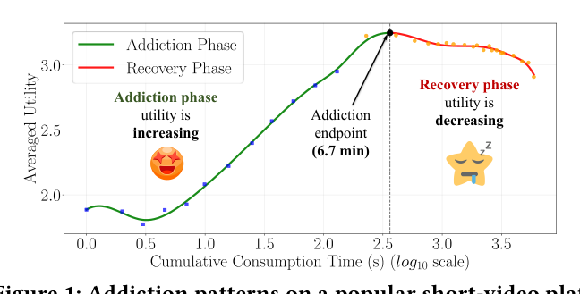
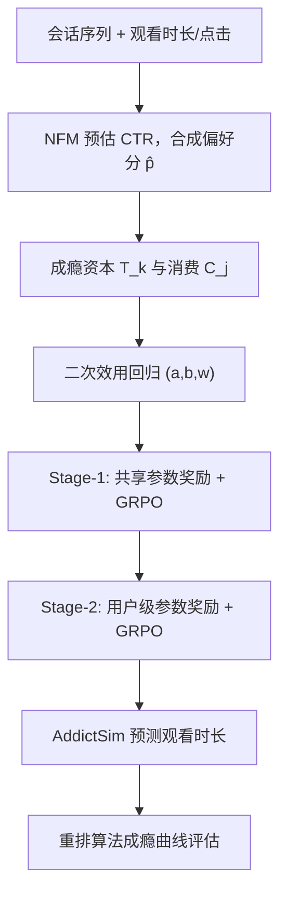

# Unveiling and Simulating Short-Video Addiction Behaviors via Economic Addiction Theory (基于经济学成瘾理论揭示与仿真短视频成瘾行为)

- **会议/期刊**: WWW 2026 (The Web Conference)
- **作者与机构**: Chen Xu, Jun Xu (中国人民大学)；Zhipeng Yi, Ruizi Wang, Wenjie Wang (中国科学技术大学)；Maarten de Rijke (阿姆斯特丹大学)
- **推荐链路定位**: 端到端生成式（用户模拟器 / 算法离线评估沙盒）
- **研究方向**: 对话推荐与智能体仿真 / 强化学习与动态探索推荐
- **论文原文**: [https://arxiv.org/abs/2601.15975v1](https://arxiv.org/abs/2601.15975v1)
- **开源代码**: [https://github.com/XuChen0427/AddictSim](https://github.com/XuChen0427/AddictSim)（数据集：[ShortVideo_dataset](https://github.com/tsinghua-fib-lab/ShortVideo_dataset)）

## TL;DR (1分钟核心速览)

短视频成瘾研究长期依赖问卷与小样本自报告，缺乏大规模行为证据与可控实验平台。本文把经济学成瘾理论（Becker-Murphy 型二次效用）映射到推荐系统的隐式反馈上，用 NFM 预估偏好 $\hat p_j=\hat c_j+r_j$作为"效用"标签，回归出成瘾强度$w$与成瘾时长$a/b$，在 THU/KuaiRec 上测得成瘾时长 6.7/4.9 分钟，与社会科学结论吻合。随后以该成瘾模型为奖励函数，提出"均值→个性化"两阶段（M2A）+ GRPO 训练 LLM 模拟器 AddictSim，会话级 MAE 由 PPO 的 2.28 降至 2.03（THU）、1.96 降至 1.72（KuaiRec），并借模拟证明多样性重排可将成瘾峰值从 6.7 分钟压到约 2.3 分钟。

## Background & Motivation (背景与核心矛盾)

- **主流范式**: 成瘾研究以问卷、志愿者自报告、受控实验室观察为主；推荐侧的用户建模则以点击/观看时长为监督信号做监督学习或 PPO 式 RL 微调。
- **前人局限**: ①问卷法样本小、存在回忆偏差与社会赞许性偏差，无法覆盖平台级用户；②现有 LLM 模拟器（prompt-based 或 PPO-based）只拟合"平均观看行为"，无法刻画**个性化成瘾强度与成瘾时长**的异质性，且缺少可解释的成瘾目标函数。
- **核心洞察 (Key Insight)**: 隐式反馈可视为理性经济决策的产物，因此经济学成瘾理论中的"成瘾资本 $S_t$ 提升当前边际效用（强化）、过量后压低基线效用（耐受/戒断）"这一双相结构，恰好能解释图 1 中"效用先升后降"的倒 U 型曲线。
- **本文切入点**: 先用可解释的二次效用回归把成瘾"量化成一个奖励函数"，再用它驱动 LLM 模拟器学习，从而把"分析"与"仿真"串成闭环。

<figure class="paper-figure" markdown="span">
  <figcaption>图1：某热门短视频平台上的成瘾模式。x轴表示用户累计观看时长，y轴表示用户效用。</figcaption>
</figure>

## Method (核心方法设计)

### 1. 整体框架 (Overall Architecture)

两步走：**Step 1 建成瘾模型**——用 NFM 预估 CTR $\hat c_j$，结合完成率$r_j=t_j/l_j$得到偏好分$\hat p_j$作为效用标签；再以会话内累计观看时长构造成瘾资本$T_k$，用最小二乘拟合二次效用函数，得到$(a,b,w)$。**Step 2 训练模拟器**——把该成瘾函数当作奖励模型，先拟合全体用户共享参数$(\bar a,\bar b,\bar w)$做 Stage-1 GRPO 预训练，再拟合每用户参数$(a_u,b_u,w_u)$ 做 Stage-2 个性化微调；训练完成后用 AddictSim 回放不同重排算法的曝光序列，预测观看时长并反算成瘾曲线，实现"算法级"成瘾评估。

### 2. 关键设计拆解 (Key Designs)

1. **成瘾资本映射与二次效用回归（把"成瘾"变成可估参数）**：痛点在于推荐数据只有隐式反馈、没有经济学意义上的效用。作者令 $C_j=\log_{10}(1+t_j)$、$T_k=\sum_{j<k}(1-\sigma)^j C_j$（$\sigma=0.9$），并采用经典二次型
$$\hat p_j(C_j,T_j)=aC_j-\tfrac12 bC_j^2+wC_jT_j+\epsilon$$
其中 $a$为首期边际收益、$b$为饱和衰减速率、$w$为成瘾强化强度。直觉：$wC_jT_j$项让"看得越久越想看"，$-\tfrac12bC_j^2$项保证边际效用递减，二者叠加自然产生倒 U 型；$a/b$即"成瘾时长"，$w$ 即"成瘾强度"，把抽象成瘾拆成两个可跨数据集比较的标量。

2. **M2A 两阶段奖励 + 折扣奖励分配（解决个性化与奖励稀疏）**：直接对每用户做 RL 会因单用户会话稀少而方差爆炸。Stage-1 用共享参数构造会话级奖励 $R^1_s=\sum_j \phi^j(\bar aC_j-\tfrac12\bar bC_j^2+\bar wC_jT_j)$学到"平均成瘾者"，为 Stage-2 提供低方差初始化；Stage-2 换成用户级$(a_u,b_u,w_u)$得到$R^2_s$。由于奖励只在会话末尾给出，作者按$\eta^{n_s-j}$把会话奖励摊到每个视频：$R^m_{*,j}=\eta^{n_s-j}R^m_s$，缓解稀疏奖励。GRPO 侧用组内相对优势$\hat A_{g,j}=\frac{R_{g,j}-\text{mean}(R_{g,\cdot})}{\text{std}(R_{g,\cdot})}$ 替代 critic，省去价值网络。

3. **训练目标与推理开销**：总目标为 GRPO 裁剪目标加 KL 正则
$$\mathcal{L}(\theta)=\mathbb{E}\Big[\tfrac1G\textstyle\sum_j\{\min(\tilde\pi_j\hat A_{g,j},\text{clip}(\tilde\pi_j,1-\epsilon,1+\epsilon)\hat A_{g,j})\}-\beta D_{KL}(\pi_\theta\|\pi_{ref})\Big]$$
奖励来自解析成瘾函数，**无需人工偏好标注、无需额外奖励模型训练**；采用 LoRA 微调 Qwen3，4×A800 可完成训练。推理时模拟器逐视频自回归预测观看时长，成本与序列长度线性相关，属离线沙盒用途而非在线服务。

## Experimental Setup & Evaluation Protocol (实验设置与评估协议)

- **数据集与预处理**:

| 数据集 | #Users | #Items | #Interactions | 稀疏度/密度 | 特征/场景说明 |
| :--- | :---: | :---: | :---: | :---: | :--- |
| THU | 10,000 | — | 1,019,568 | — | 真实移动短视频平台，10k 志愿者，三级类目 |
| KuaiRec | 1,411 | 3,327 | ~4.7M（近全曝光） | 高密度 | 快手在线环境，45 字段，2020.07–09 |
| Qilin / Ali | — | — | — | — | 仅用于跨场景成瘾对比（混合内容 / 传统电商） |

- **数据划分与防穿越**: 过滤交互数 <5 的用户（`5-core`）；按 **80%/20% 比例划分**训练/测试；会话切分规则为相邻视频间隔 >60 分钟即断开；成瘾参数估计采用 **10 折交叉验证**。
- **排名评测协议**: 本文不做 Top-N 排序评测，而是**观看时长回归**，指标为会话级与视频级的 MAE / RMSE（会话级对 $\sum_j \hat c_j$与$\sum_j c_j$求差），并做$t$-test（$p<0.05$，表中 `*` 标注显著性）。
- **对比基线与超参**: Base（Qwen3 纯 prompt）、SFT（真值监督）、PPO、GRPO（后两者奖励同为成瘾模型效用，保证公平）；学习率 $[2\times10^{-5},2\times10^{-6}]$，$\epsilon=0.3$、$\beta=0.9$，batch$[4,64]$，$\sigma\in[0.1,0.9]$，全部使用 LoRA。

## Key Experimental Results (实验关键数据)

### 1. 主实验对比 (Main Results)

| 方法 | THU Session MAE | THU Session RMSE | THU Video MAE | KuaiRec Session MAE | KuaiRec Session RMSE | KuaiRec Video MAE |
| :--- | :---: | :---: | :---: | :---: | :---: | :---: |
| Base | 6.84 | 9.57 | 0.96 | 2.79 | 3.19 | 0.35 |
| SFT | 3.12 | 4.64 | 0.77 | 2.25 | 2.60 | 0.31 |
| PPO | 2.28 | 3.70 | 0.65 | 1.96 | 2.40 | 0.30 |
| GRPO | 2.33 | 3.87 | 0.65 | 2.02 | 2.46 | 0.32 |
| **AddictSim** | **2.03\*** | **3.31\*** | **0.63\*** | **1.72\*** | **2.35\*** | **0.29\*** |
| Improv. vs PPO | 11.0% | 10.5% | 3.1% | 12.2% | 2.1% | 3.3% |

跨骨干稳健性（THU 会话级 MAE）：Falcon3-7B 2.26→2.07、Llama-3 8B 2.53→2.35、Mistral 7B 2.31→2.08，相对 GRPO 稳定提升 8–12%，而 Base 模型跨骨干波动高达 55%。

### 2. 消融实验 (Ablation Study)

| 配置 | THU Session MAE | THU Session RMSE | THU Video MAE | THU Video RMSE |
| :--- | :---: | :---: | :---: | :---: |
| w/o stage-1 | 2.24 | 3.87 | 0.66 | 0.82 |
| w/o stage-2 | 2.33 | 3.65 | 0.65 | 0.81 |
| sparse-reward | 2.33 | 3.75 | 0.64 | 0.80 |
| **full (AddictSim)** | **2.03** | **3.31** | **0.63** | **0.79** |

### 3. 关键实验发现 (Key Findings)

1. **两阶段缺一不可，但作用不同**：去掉 Stage-1 后 RMSE 从 3.31 恶化到 3.87（+16.9%），远大于去掉 Stage-2 的 3.65，说明共享参数预训练主要贡献的是**方差抑制**；而去掉 Stage-2 后 MAE 回到 2.33（等同纯 GRPO），说明个性化奖励才是**偏差下降**的来源——二者分别对应"稳"与"准"。
2. **折扣奖励分配是低成本高回报的工程技巧**：仅去掉 $\eta^{n_s-j}$ 摊派（sparse-reward），MAE 即从 2.03 退化到 2.33、RMSE 从 3.31 退化到 3.75，几乎抹平 Stage-2 的全部收益，证明会话级稀疏奖励是 LLM 模拟器训练的主要瓶颈。
3. **成瘾是短视频场景的特有现象，且多样性可有效干预**：跨场景对比中传统电商（Ali）边际效用近乎恒定、混合场景（Qilin）视频内容成瘾期 2–3 分钟、纯短视频（THU）最长；模拟实验中 CP-Fair / P-MMF 将成瘾峰值从 6.7 分钟压至 2.33/2.34 分钟，成瘾强度 $w$ 由 +0.024 翻转为 −0.026/−0.047，即从"越看越想看"变为"越看越疲劳"。

## Highlights & Limitations (亮点、对比与审稿批判)

- **与代表作对比 (vs. Prior Work)**: 相比问卷/自报告研究，本文首次在百万级真实交互上给出可复现的成瘾参数估计；相比 PPO 式 LLM 模拟器（如 PPO/GRPO 直接以效用为奖励），本文的差异在于**奖励函数本身带个性化参数**且用 M2A 分阶段降方差；相比纯 prompt 模拟，AddictSim 能复现"恢复期"这一关键形态（图 6 中 Base 模型只有单调上升、无疲劳回落）。
- **可迁移亮点**: ①"用可解释参数化效用函数替代黑盒奖励模型"的思路可迁移到留存/LTV、疲劳度、信息茧房等长期价值建模；②折扣奖励摊派（把轨迹级奖励按 $\eta^{n-j}$ 分配到每步）是任何稀疏奖励 LLM-RL 场景的通用技巧。
- **审稿级局限批判**: ①成瘾模型是**相关性拟合而非因果识别**，$w>0$无法排除"高偏好用户本就看得久"的混淆，缺少 IV 或断点设计；②模拟器评估仅以观看时长 MAE/RMSE 为准，未验证模拟轨迹的分布保真度（如成瘾曲线的形状误差、长尾用户覆盖），且 Stage-2 的每用户回归在会话数少的用户上参数估计不稳；③$\sigma$与$\eta$等折扣因子对$w$的影响呈非单调（$\sigma\approx0.5$时$w$ 峰值），跨平台迁移时需重新调参。

## Rating (四维评分)

- **方法创新性 (Novelty)**: ⭐⭐⭐⭐ （核心机制与方法设计具备明确创新性，理论与实验动机支撑充分）
- **评估协议与实验扎实度 (Protocol & Experiments)**: ⭐⭐⭐⭐ （主流公开数据集评测完整，包含多基线对比与消融实验验证）
- **写作与数学规范度 (Clarity & Rigor)**: ⭐⭐⭐⭐⭐ （问题形式化定义清晰，核心模块数学推导与架构阐述严谨易读）
- **工业落地与复现价值 (Industrial & Practical Value)**: ⭐⭐⭐⭐ （兼顾推荐效果增益与训练/推理效率，具备实际场景迁移参考价值）
