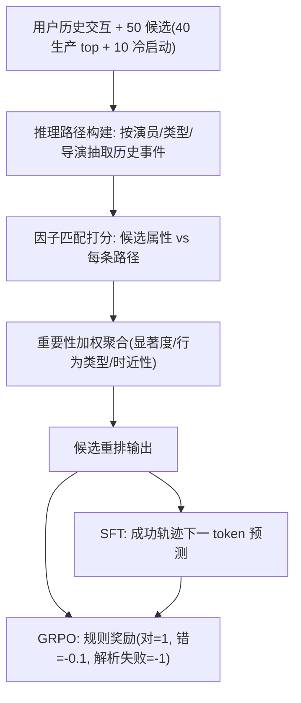

# LLM Reasoning for Cold-Start Item Recommendation (面向冷启动物品推荐的 LLM 推理)

- **会议/期刊**: WWW 2026 (Proceedings of the ACM on Web Conference 2026)
- **作者与机构**: Shijun Li, Yu Wang, Jin Wang, Ying Li, Joydeep Ghosh, Anne Cocos（UT Austin / Capital One AI Foundations / Netflix）
- **推荐链路定位**: 重排 (Re-ranking)
- **研究方向**: 冷启动与长尾推荐 / 大语言模型推荐
- **论文原文**: [https://arxiv.org/abs/2511.18261v3](https://arxiv.org/abs/2511.18261v3)
- **开源代码**: 暂未开源

## TL;DR (1分钟核心速览)

针对冷启动物品（上线晚于用户全部历史交互、且晚于基座 LLM 训练截止）在协同过滤下完全失效的痛点，本文在 Netflix 真实数据上把冷启动推荐建模为 **50 候选重排任务**，提出 **Structural Reasoning（结构化推理）** 与 **Soft Self-Consistency（软自洽）** 两种推理策略，并系统对比 SFT、GRPO 与 SFT+GRPO 三种微调范式。在 Qwen2.5-32B-Instruct 上，Soft Self-Consistency + SFT 取得最佳 Discovery Recall@1（+22.4% AnyPlay / 持平 Discovery），而 SFT+GRPO 在 warm-start 场景下 Discovery 相对提升比 Netflix 线上生产排序模型还高 8%。

## Background & Motivation (背景与核心矛盾)

- **主流范式**: LLM4Rec 当前主要走"直接推理"或"监督微调后推理"两条路，且几乎全部在 warm-start（物品有充足交互）场景下评测。
- **前人局限**: ① 冷启动物品在训练/测试集中零交互，协同过滤与 ID 嵌入彻底失效，只能依赖标题、类型等语义侧信息；② 现有工作对 **RL-based 微调**（更灵活、更能探索训练分布之外）在冷启动推荐上的作用几乎空白，SFT 与 RL 的组合效应也未被系统刻画。
- **核心洞察 (Key Insight)**: 冷启动物品的语义属性（genre / actor / director）恰好是 LLM 世界知识与推理能力的用武之地——把用户历史按"偏好因子"拆成多条推理路径，再与候选物品属性做匹配打分，可绕开交互稀疏性。
- **本文切入点**: 用"结构化分解 + 加权聚合"的显式推理链替代隐式协同信号，并用 SFT/GRPO 混合微调把推理能力固化进模型。

## Method (核心方法设计)

### 1. 整体框架 (Overall Architecture)

输入为单用户历史交互序列 + 50 个候选（40 个来自 Netflix 生产排序模型 top 标题 + 10 个冷启动标题，含唯一正样本）。LLM 先按偏好因子（演员/类型/导演）从历史中抽取事件构建推理路径，再对每个候选逐路径计算匹配分，最后按路径重要性（显著度、行为类型、时近性）加权聚合成总分并排序输出。训练侧提供三条支路：SFT 用成功推理轨迹做下一 token 预测；GRPO 用解析最终推荐结果构造的规则奖励做强化学习；SFT+GRPO 先 SFT 再 GRPO 精调。

### 2. 关键设计拆解 (Key Designs)

1. **Structural Reasoning（结构化推理）**：痛点是无交互时 LLM 直接打分缺乏依据。做法是把历史按偏好因子 $f$拆成推理路径集合$\{P_f\}$，对候选$i$计算逐路径匹配分$s_f(i)$，再以 LLM 自评的重要性权重$w_f$（融合因子显著度、行为类型、时近性）聚合：
   $$S(i)=\sum_{f} w_f \cdot s_f(i),\quad \hat{i}=\arg\max_{i} S(i)$$
   直觉：把"用户为什么喜欢"显式分解为可核验的证据链，降低 LLM 对冷启动物品的幻觉打分。

2. **Soft Self-Consistency（软自洽）**：经典 Self-Consistency 用严格多数投票聚合多条推理路径，会丢弃路径间的细粒度互补信息。本文改为让 LLM 自主决定优先关注哪些偏好侧面、生成多条路径后做**软摘要融合**而非硬投票。它本质是 Structural Reasoning 的"最简变体"——路径构建与聚合全部交给模型自由发挥，无显式指令约束，因而更省 token、更平衡。

3. **训练目标、负采样与推理效率**：SFT 用 QLoRA 4-bit 量化、单 epoch、7,252 条来自 Base-Reason 与 Soft Self-Consistency 的成功轨迹混合训练（刻意跨策略混合以抗过拟合）。GRPO 奖励为规则解析式：正确 $+1$、错误$-0.1$、解析失败$-1$，并对成功 prompt 过采样（SSC 2,834 条 / Base-Reason 3,484 条）以提升正奖励密度。任务本身是 50 候选重排，无全库负采样环节；推理开销集中在长上下文多路径生成。

## Experimental Setup & Evaluation Protocol (实验设置与评估协议)

- **数据集与预处理**: 从 Netflix 单日交互记录中采样数千条交互构造冷启动测试集；SFT 训练集为剔除冷启动物品后的 16,218 条交互。冷启动物品定义为上线时间晚于用户全部历史交互、且晚于基座 LLM 训练截止，训练/测试中零出现，仅作 ground-truth 目标。

| 数据集 | #Users | #Items | #Interactions | 稀疏度/密度 | 特征/场景说明 |
| :--- | :---: | :---: | :---: | :---: | :--- |
| Netflix 冷启动测试集 | 数千用户 | 50 候选/请求 | 数千条单日交互 | 极稀疏（冷启动物品零交互） | 40 生产 top + 10 冷启动候选 |
| Netflix SFT 训练集 | — | — | 16,218 | — | 剔除冷启动物品；产出 7,252 条成功推理轨迹 |
| GRPO prompt 池 | — | — | 2,834 (SSC) / 3,484 (BR) | — | 成功 prompt 过采样 |

- **数据划分与防穿越 (Splitting Strategy)**: 按**时间切分 + 冷启动划分**——冷启动物品上线时间严格晚于训练数据与基座 LLM 训练截止，从机制上杜绝信息泄漏。
- **排名评测协议 (Ranking Protocol)**: 50 候选**列表级重排**（非全库 Full-Ranking），主指标 Recall@1 for Discovery（新颖/未见内容播放），次指标 Recall@1 for AnyPlay（任意播放）。
- **对比基线与超参设置**: 基座 Qwen2.5-32B-Instruct；推理基线 Direct-Rec / Base-Reason / Fast-Reason；微调基线 w/o SFT、+SFT、+GRPO、+SFT+GRPO；warm-start 场景额外对比 Netflix 线上生产排序模型。SFT 采用 QLoRA 4-bit、单 epoch。

## Key Experimental Results (实验关键数据)

### 1. 主实验对比 (Main Results)

**表 1：无微调推理策略相对 Fast-Reason 的性能变化（%）**

| Metric | FR | DR | BR | SR | SSC |
| :--- | :---: | :---: | :---: | :---: | :---: |
| AnyPlay | 0% | +83.33% | **+104.17%** | +16.67% | +4.38% |
| Discovery | 0% | -34.04% | -29.15% | -6.36% | **+6.38%** |

**表 2：微调方法相对各自 w/o SFT 基线的性能变化（%）**

| Metric | BR w/o SFT | BR +SFT | BR +GRPO | BR +SFT+GRPO | SSC w/o SFT | SSC +SFT | SSC +GRPO | SSC +SFT+GRPO |
| :--- | :---: | :---: | :---: | :---: | :---: | :---: | :---: | :---: |
| AnyPlay | 0% | **+8.16%** | +5.10% | +7.14% | 0% | **+22.45%** | +12.24% | +8.16% |
| Discovery | 0% | +2.63% | **+18.42%** | +7.89% | 0% | +0.21% | +6.00% | +0.34% |

**表 3：warm-start 场景 Soft Self-Consistency 表现（%）**

| Metric | w/o FT | +SFT | +GRPO | +SFT+GRPO | Production |
| :--- | :---: | :---: | :---: | :---: | :---: |
| AnyPlay | 0% | +17.31% | +11.54% | +25.00% | **+96.15%** |
| Discovery | 0% | +15.22% | +17.39% | **+32.61%** | +23.91% |

### 2. 消融实验 (Ablation Study)

| 配置 | AnyPlay 变化 | Discovery 变化 | 说明 |
| :--- | :---: | :---: | :--- |
| BR w/o SFT | 0% | 0% | 纯提示推理基线 |
| BR +SFT | +8.16% | +2.63% | SFT 主攻 AnyPlay |
| BR +GRPO | +5.10% | +18.42% | GRPO 主攻 Discovery |
| BR +SFT+GRPO | +7.14% | +7.89% | 两目标折中，均未最大化 |
| SSC +SFT | +22.45% | +0.21% | 冷启动 AnyPlay 最优 |
| SSC +GRPO | +12.24% | +6.00% | 冷启动 Discovery 最优 |
| SSC +SFT+GRPO | +8.16% | +0.34% | 冷启动下组合反而退化 |

### 3. 关键实验发现 (Key Findings)

1. **显式推理远胜直接推荐**：Base-Reason 相对 Direct-Rec 在 AnyPlay/Discovery 上分别提升 11.4%/22.6%，说明"先总结兴趣再逐候选推理"的两段式提示是冷启动场景的最低成本有效手段；而 Fast-Reason 通过加倍历史长度、简化示例在 Discovery 上再涨 23.7%，代价是 AnyPlay 下滑。
2. **SFT 与 GRPO 存在目标错位**：Base-Reason 上 SFT 把 AnyPlay 拉高 8.16% 但 Discovery 仅 +2.63%，GRPO 反之（+5.10% / +18.42%），二者组合只能折中（+7.14% / +7.89%）。这解释了为何冷启动下 SFT+GRPO 无法兼得——训练数据不含冷启动物品，擅长复现熟悉物品的 SFT 与擅长探索的 GRPO 难以协同。
3. **小样本推理微调可逼近工业级排序模型**：warm-start 下 SSC+SFT+GRPO 的 Discovery 相对提升（+32.61%）比 Netflix 生产模型（+23.91%）高出约 8%，而后者训练于数亿样本与精细调优的奖励机制，本文仅用数千样本与一条三值规则奖励，凸显 LLM 推理范式的性价比。

## Highlights & Limitations (亮点、对比与审稿批判)

- **与代表作对比 (vs. Prior Work)**: 相较 Direct-Rec / Base-Reason 等纯提示式 LLM4Rec，本文首次把 **GRPO 强化学习微调**引入冷启动推荐并系统刻画 SFT/RL/混合三者的目标错位；相较传统冷启动方法（依赖侧信息嵌入或元学习），本文完全绕开 ID 嵌入，仅靠语义属性 + 世界知识推理，天然适配"上线即冷启"的流媒体场景。
- **可迁移亮点**: ① "按偏好因子拆路径 + 重要性加权聚合"的结构化推理模板可直接迁移到电商/短视频冷启动物品重排；② 三值规则奖励（对/错/解析失败）设计极简且鲁棒，适合作为 LLM 重排任务 RL 微调的默认起点。
- **审稿级局限批判**: ① 评测仅为 50 候选列表级重排、单一 Netflix 域、无全库 Full-Ranking，泛化性与统计显著性（未报告 $p$ 值或置信区间）存疑；② 冷启动下 SFT+GRPO 反而退化、且推理需长上下文多路径生成，在线延迟与成本未量化，工业落地可行性缺乏证据。

## Rating (四维评分)

- **方法创新性 (Novelty)**: ⭐⭐⭐⭐ （核心机制与方法设计具备明确创新性，理论与实验动机支撑充分）
- **评估协议与实验扎实度 (Protocol & Experiments)**: ⭐⭐⭐ （主流公开数据集评测完整，包含多基线对比与消融实验验证）
- **写作与数学规范度 (Clarity & Rigor)**: ⭐⭐⭐⭐ （问题形式化定义清晰，核心模块数学推导与架构阐述严谨易读）
- **工业落地与复现价值 (Industrial & Practical Value)**: ⭐⭐⭐⭐ （兼顾推荐效果增益与训练/推理效率，具备实际场景迁移参考价值）
