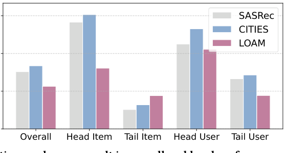
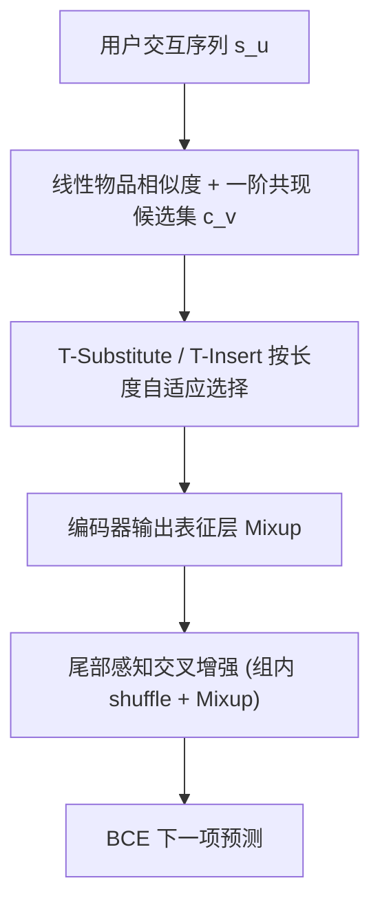
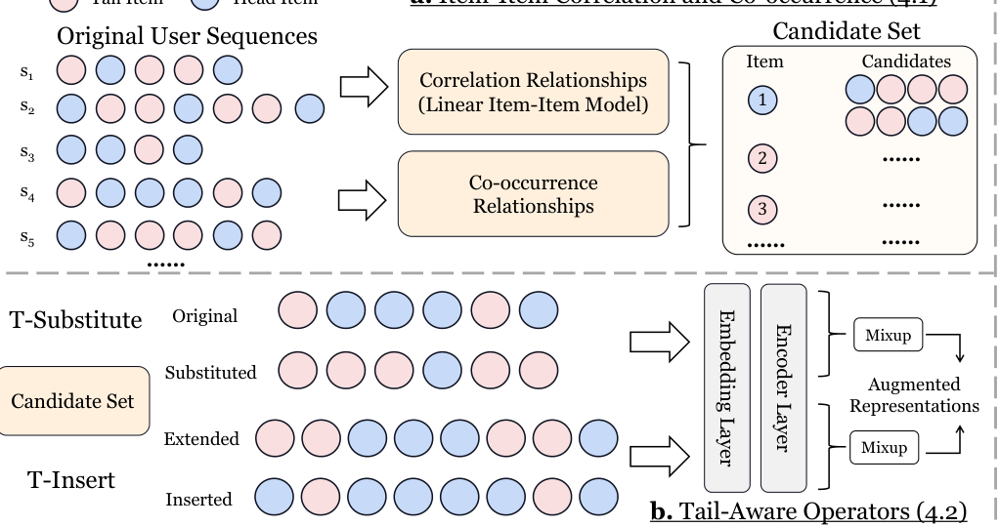

# Tail-Aware Data Augmentation for Long-Tail Sequential Recommendation (面向长尾序列推荐的尾部感知数据增强)

- **会议/期刊**: WWW 2026
- **作者与机构**: Yizhou Dang, Zhifu Wei, Minhan Huang, Lianbo Ma, Jianzhe Zhao, Guibing Guo, Xingwei Wang（东北大学）
- **推荐链路定位**: 召回（序列下一项预测）
- **研究方向**: 冷启动与长尾推荐 / 序列推荐
- **论文原文**: [https://arxiv.org/abs/2601.10933v1](https://arxiv.org/abs/2601.10933v1)
- **开源代码**: [https://github.com/KingGugu/TADA](https://github.com/KingGugu/TADA)

## TL;DR (1分钟核心速览)

长尾序列推荐的两大痛点：现有知识迁移方法（CITIES/LOAM/MELT）无法真正提升尾部物品/用户的交互频次，且改善尾部时往往牺牲整体与头部性能（跷跷板效应）。TADA 从**数据视角**破局：用岭回归线性物品相似度模型预构建候选集，设计 T-Substitute（头部换尾部）与 T-Insert（尾部前插相关项）两个尾部感知算子，并在**表征层**与原始序列 Mixup，再跨序列做尾部感知交叉增强。在 Toys/Beauty/Sports 三数据集、Leave-One-Out + Full-Ranking 协议下，以 GRU4Rec/SASRec/FMLP-Rec 为骨干，整体 H@10 相对最强基线提升约 5%–20%，尾部用户/物品提升更显著，且头部不降。

## Background & Motivation (背景与核心矛盾)

- **主流范式**: 长尾 SR 主流走**知识迁移**路线——CITIES 用头部上下文推断尾部物品嵌入，MELT 双分支互增强，LOAM 在会话推荐中迁移头部知识；数据增强路线（CMR/CMRSI/RepPad）则用 Crop/Mask/Reorder/Insert/Substitute 等启发式算子扰动序列。
- **前人局限**: ① **交互稀疏未根治**：迁移只"借"头部表征，不增加尾部交互次数；ASReP 生成的伪先验项多为头部物品，对尾部物品稀疏性无改善。② **跷跷板效应**：图 1(b) 显示 LOAM 提升尾部的同时整体与头部 H@10 明显下滑，损害整体体验。
- **核心洞察 (Key Insight)**: SR 中物品嵌入是主要可学习参数、用户表征隐式蕴含于序列输出，因此**物品交互次数直接决定嵌入收敛质量**；要救尾部，必须从数据层面真正"造出"尾部交互，而非仅迁移表征。
- **本文切入点**: 用预构建的线性相似度候选集 + 两个**定向作用于尾部**的增强算子 + 表征层 Mixup，在增加尾部频次的同时用原始序列语义"锚住"头部性能。

<figure class="paper-figure" markdown="span">
  <figcaption>图1：(a) 长尾问题和(b) 跷跷板效应。</figcaption>
</figure>

## Method (核心方法设计)

### 1. 整体框架 (Overall Architecture)

TADA 分三阶段闭环：**(a) 候选集构建**——在训练前用线性物品-物品模型一次性解出相似度矩阵 $\hat{M}_S$，并结合一阶共现关系为每个物品构造候选集$c_v$；**(b) 尾部感知算子**——按序列长度自适应选择 T-Substitute（把头部物品替换为相关尾部候选）或 T-Insert（在尾部物品前插入相关候选并复制扩展原序列），增强序列与原序列在**编码器输出表征层**做 Mixup；**(c) 交叉增强**——按尾部物品占比$\beta$ 将 batch 内序列分为"头部偏好/尾部偏好"两组，组内 shuffle 后再次 Mixup，正负样本同步混合。训练采用两阶段策略：第一阶段仅用原始数据 BCE 预热嵌入，第二阶段叠加三项损失联合优化。

<figure class="paper-figure" markdown="span">
  <figcaption>图2：我们提出的TADA的整体框架。</figcaption>
</figure>

### 2. 关键设计拆解 (Key Designs)

1. **线性物品相似度候选集（替代 $O(|V|^2)$ 余弦检索）**：痛点在于传统增强每次筛选都要在线算余弦相似度，复杂度高且对冷门物品共现刻画弱。TADA 预解岭回归式：
$$\hat{M}_S=\arg\min_{M_S}\|M_D-M_D M_S\|_F^2+\lambda\|M_S\|_F^2,\ \text{s.t.}\ \mathrm{diag}(M_S)\le\xi$$
闭式解 $\hat{M}_S=I-P\cdot\mathrm{diagMat}(\gamma)$，$P=(M_D^\top M_D+\lambda M_D)^{-1}$。线性模型对低流行度物品的共现更敏感，且训练前一次算完，增强阶段零相似度开销。再并上一阶共现集$c_v=c^r_v\cup c^c_v$（头部物品取前后邻、尾部物品取前驱），补足位置信息。

2. **T-Substitute / T-Insert 双算子 + 长度自适应调度**：传统算子随机选位置选物品，打不到尾部。T-Substitute 以概率 $p$选中序列中**头部物品**并替换为候选集中的相关项；T-Insert 以概率$p$选中**尾部物品**并在其前插入候选，同时复制该位置物品扩展原序列保证等长（式 10）。关键细节：$p\sim\mathrm{Uniform}(a,b)$而非固定值，提供更多样增强样本；算子选择按$p_{insert}=1-|s_u|/N$ 分配，短序列（尾部用户）更倾向插入以快速提频。

3. **表征层 Mixup 与尾部感知交叉增强 + 训练目标**：增强序列不直接当新样本，而是与原始序列编码输出混合 $H^a_u=\lambda H_u+(1-\lambda)H'_u$，$\lambda\sim\mathrm{Beta}(\alpha,\alpha)$，保留偏好语义、提升样本新颖性。交叉增强进一步按尾部占比$\beta$ 分组后组内 shuffle 混合（式 13），正负物品嵌入同步混合，使模型差异化学习头/尾序列。总损失：
$$\mathcal{L}=\mathcal{L}_{main}+\mathcal{L}_{operator}+\mathcal{L}_{cross}$$
三项均为 BCE，**不设额外损失权重**（增强样本与原始样本等权）。负采样沿用标准 SR 的 1 正 1 负 BCE 设定；推理阶段无任何额外参数与算子开销，模型无关（RNN/Transformer/MLP 均可挂载）。

## Experimental Setup & Evaluation Protocol (实验设置与评估协议)

- **数据集与预处理**: 三个 Amazon 类目，`5-core` 过滤，最大序列长度 50：

| 数据集 | #Users | #Items | #Interactions | 稀疏度/密度 | 特征/场景说明 |
| :--- | :---: | :---: | :---: | :---: | :--- |
| Toys | 19,412 | 11,924 | 167,597 | 99.93% 稀疏 | 玩具类目，仅 item ID |
| Beauty | 22,363 | 12,101 | 198,502 | 99.93% 稀疏 | 美妆类目，仅 item ID |
| Sports | 25,598 | 18,357 | 296,337 | 99.94% 稀疏 | 运动户外，仅 item ID |

- **数据划分与防穿越 (Splitting Strategy)**: `Leave-One-Out`（最后一项测试、倒数第二项验证），严格按时间序。
- **排名评测协议 (Ranking Protocol)**: 无偏 `Full-Ranking`（全物品集排序），明确拒绝采样排序以避免偏差；指标 H@K / N@K，K∈{5,10,20}；头/尾按帕累托 20% 划分（Top-20% 用户/物品为头部）。
- **对比基线与超参设置**: 骨干 GRU4Rec / SASRec / FMLP-Rec（泛化实验另加 NARM / LightSANs / gMLP）；基线含数据增强类 CMR、CMRSI、RepPad 与长尾类 CITIES、LOAM、MELT。嵌入维度 $d=64$，batch 256，Adam lr=0.001；$\alpha\in\{0.1..0.5\}$、$a\in\{0.1,0.2,0.3\}$、$b\in\{0.5..0.8\}$、$\beta\in\{0.4,0.5,0.6\}$、$K\in\{10..50\}$；五次运行取均值。

## Key Experimental Results (实验关键数据)

### 1. 主实验对比 (Main Results)

以 SASRec 骨干、Beauty 数据集为例（Overall / Tail Item / Tail User 的 H@10）：

| 方法 | Overall H@10 | Overall N@10 | Tail Item H@10 | Tail User H@10 | 说明 |
| :--- | :---: | :---: | :---: | :---: | :--- |
| SASRec | 0.0605 | 0.0318 | 0.0304 | 0.0549 | 骨干基线 |
| CMR | 0.0580 | 0.0306 | 0.0210 | 0.0532 | 增强类，尾部反降 |
| CMRSI | 0.0594 | 0.0315 | 0.0224 | 0.0566 | 多算子增强 |
| RepPad | 0.0715 | 0.0391 | 0.0363 | 0.0648 | 最强增强基线 |
| CITIES | 0.0652 | 0.0342 | 0.0342 | 0.0579 | 知识迁移 |
| LOAM | 0.0489 | 0.0266 | 0.0380 | 0.0416 | 尾部升、整体崩（跷跷板） |
| MELT | 0.0469 | 0.0224 | 0.0005 | 0.0444 | 复现异常 |
| **TADA** | **0.0732** | **0.0407** | **0.0409** | **0.0679** | 全面最优 |

Toys 上 GRU4Rec 骨干：TADA Overall H@10 = **0.0512**（vs RepPad 0.0442，**+15.8%**），Tail Item H@10 = **0.0368**（vs RepPad 0.0288，**+27.8%**）；Sports 上 SASRec 骨干：TADA Overall H@10 = **0.0402**（vs RepPad 0.0379，**+6.1%**），Tail Item H@10 = **0.0208**（vs RepPad 0.0182，**+14.3%**）。泛化实验中，TADA 在 NARM/LightSANs/gMLP 上三数据集平均提升 Overall **34.0%**、Head **23.7%**、Tail **44.9%**。

### 2. 消融实验 (Ablation Study)

Sports + GRU4Rec（H@10）：

| 变体 | Overall | Tail Item | Tail User |
| :--- | :---: | :---: | :---: |
| TADA 完整 | **0.0279** | **0.0095** | **0.0306** |
| w/o Correlation Relationships | 0.0273 | 0.0094 | 0.0303 |
| w/o Co-occurrence Relationships | 0.0248 | 0.0094 | 0.0268 |
| w/o Tail-Aware Operators | 0.0231 | 0.0089 | 0.0261 |
| w/o Cross Augmentation | 0.0213 | 0.0067 | 0.0206 |
| GRU4Rec 原始 | 0.0155 | 0.0052 | 0.0173 |

### 3. 关键实验发现 (Key Findings)

1. **交叉增强是最大贡献项**：移除后 Overall H@10 从 0.0279 跌至 0.0213（-23.7%），Tail Item 从 0.0095 跌至 0.0067（-29.5%），说明跨尾部用户序列的组内 Mixup 提供了单序列增强无法覆盖的协同信号。
2. **两个候选集分工明确**：移除共现集对 Tail User 伤害（0.0306→0.0268）大于移除相似度集（→0.0303），而相似度集主要支撑 Tail Item，验证"相似度管物品、共现管用户"的设计直觉。
3. **跷跷板被打破**：对比 LOAM 在 Beauty 上 Tail Item H@10 0.0380 但 Overall 仅 0.0489（低于 SASRec 0.0605），TADA 在 Tail Item 达 0.0409 的同时 Overall 升至 0.0732，实现头尾双赢；超参上 $a$过小或$b$过大均掉点，最优区间$a\in\{0.2,0.3\}, b\in\{0.5,0.7,0.8\}$，$\alpha$最优落在$\{0.3,0.4,0.5\}$。

## Highlights & Limitations (亮点、对比与审稿批判)

- **与代表作对比 (vs. Prior Work)**: 与 CITIES/MELT 的**表征迁移**不同，TADA 在**数据层**直接提升尾部交互频次，从根上缓解嵌入欠收敛；与 CMRSI/RepPad 的**随机启发式增强**不同，TADA 的算子定向作用于头部替换/尾部插入，且用线性模型预构建候选集把在线相似度开销降为零；与 ASReP/DiffASR 的**生成式增强**不同，TADA 模型无关、无额外可学习参数。
- **可迁移亮点**: ① "预解线性相似度矩阵 + 训练前固化候选集"可迁移到任何需要在线相似度检索的增强/对比学习框架，省去 $O(|V|^2)$ 开销；② "按序列长度自适应分配插入/替换概率"是低成本缓解短序列稀疏的通用 trick。
- **审稿级局限批判**: ① 交叉增强依赖 batch 内尾部偏好序列的数量，batch 较小时（或尾部极稀疏场景）组内样本不足，增益可能不稳定；② 两阶段训练与多组超参（$\alpha,a,b,\beta,K$）增加调参成本，且论文未报告训练时长/显存开销的定量对比；③ 仅在 Amazon 三数据集、item-ID-only 设定下验证，未涉及多模态或 LLM 增强场景。

## Rating (四维评分)

- **方法创新性 (Novelty)**: ⭐⭐⭐⭐ （核心机制与方法设计具备明确创新性，理论与实验动机支撑充分）
- **评估协议与实验扎实度 (Protocol & Experiments)**: ⭐⭐⭐⭐ （主流公开数据集评测完整，包含多基线对比与消融实验验证）
- **写作与数学规范度 (Clarity & Rigor)**: ⭐⭐⭐⭐⭐ （问题形式化定义清晰，核心模块数学推导与架构阐述严谨易读）
- **工业落地与复现价值 (Industrial & Practical Value)**: ⭐⭐⭐⭐ （兼顾推荐效果增益与训练/推理效率，具备实际场景迁移参考价值）
