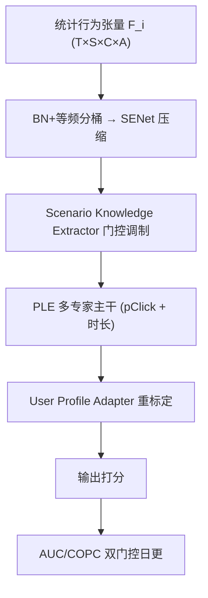
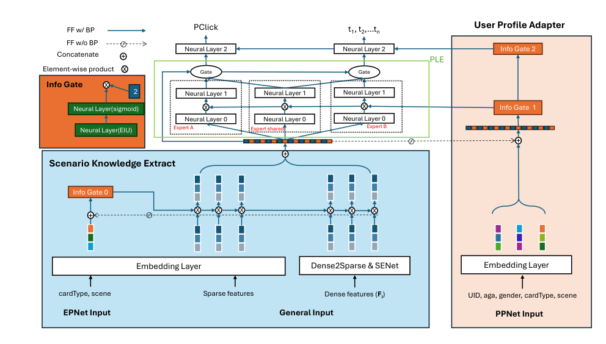

# Trinity: A Scenario-Aware Recommendation Framework for Large-Scale Cold-Start Users (面向大规模冷启动用户的场景感知推荐框架)

- **会议/期刊**: WWW 2026 (The Web Conference)
- **作者与机构**: Wenhao Zheng, Wang Lu, Fangshuang Tang, Yiyang Lu, Jun Yang, Pengcheng Xiong, Yulan Yan（Microsoft Corp）
- **推荐链路定位**: 精排（pClick / 时长多任务预估）
- **研究方向**: 冷启动与长尾推荐 / 跨域与多场景推荐
- **论文原文**: [https://arxiv.org/abs/2603.00502v1](https://arxiv.org/abs/2603.00502v1)
- **开源代码**: 暂未开源

## TL;DR (1分钟核心速览)

本文针对“新产品迁移”这一极端冷启动场景（新场景 + 新用户 + 样本极度不均衡），指出仅靠改模型结构不够，提出 Trinity 框架，从**特征（跨场景统计行为张量）、架构（场景知识提取器 + 用户画像适配器）、更新（AUC/COPC 双门控日更）** 三处协同破局。在 Microsoft MSN 十亿级用户迁移中，Copilot 新场景 AUC 从 PLE 的 0.564 提升至 0.726（+28.7%），COPC 从 0.13 校准至 0.95，线上 A/B 时长 +5.61%、iDAU +3.04%，仅增约 10ms 推理延迟。

## Background & Motivation (背景与核心矛盾)

- **主流范式**: 多场景推荐以 MMoE / PLE 的 task-specific gating 处理多场景多目标，PePNet 进一步引入场景-特征交互；模型更新沿用日/小时级连续全量热更。
- **前人局限**: ① 场景样本严重失衡（Classic 1.2B vs. Copilot 185M 训练样本，pClick 1% vs. 0.1%）时，gate 无法有效拟合，新场景输出被旧场景主导；② PePNet 的场景信号未进入 dense tower，预测偏向主导场景；③ 连续日更在行为剧烈漂移的冷启动场景下引发模型抖动与局部最优。
- **核心洞察 (Key Insight)**: 冷启动用户的行为信号并非“没有”，而是**分散在其他场景与其他内容类型上**——Copilot 卡片在 Classic 布局中根本不存在，导致目标物品对齐的序列特征几乎全空；同时活跃用户的长序列会主导优化，使表征过拟合于老用户。
- **本文切入点**: 放弃“只对齐目标物品”的序列特征范式，改用**固定维度的跨场景统计张量**统一新老用户特征空间，再用场景门控 + 画像适配器纠偏，最后用双指标门控更新兜底稳定性。

## Method (核心方法设计)

### 1. 整体框架 (Overall Architecture)

输入侧为每个用户构造统计行为张量 $\mathbf{F}_i$，经 BatchNorm + 等频分桶的 dense-to-sparse 转换与 SENet 压缩后进入 Scenario Knowledge Extractor，用 cardType/scene 嵌入做门控调制；主干为 PLE 多专家（pClick + 多分类时长多任务），其共享层输出再由 User Profile Adapter 以用户画像、cardType、scene 嵌入二次重标定；训练侧每日产出候选 checkpoint，经 AUC 与 COPC 双门控决定是否上线。

<figure class="paper-figure" markdown="span">
  <figcaption>图2：模型结构。该模型为多任务模型，其中 𝑡1,𝑡2, . . . ,𝑡𝑛 表示多分类的时长。由于时长与点击类似，且受篇幅限制，时长相关内容不再进一步阐述。</figcaption>
</figure>

### 2. 关键设计拆解 (Key Designs)

1. **跨场景统计行为张量（特征层破局）**：序列特征在冷启动下短而稀疏、且被活跃用户长序列主导。本文改为对每个用户构造 $\mathbf{F}_i \in \mathbb{R}^{|\mathcal{T}|\times|\mathcal{S}|\times|\mathcal{C}|\times|\mathcal{A}|}$，其中$\mathcal{T}=\{1h,1d,7d,30d\}$、$\mathcal{S}=\{classic,copilot,all\}$、$\mathcal{C}$为卡片类型、$\mathcal{A}=\{view,click\}$。固定维度保证新老用户共享同一特征空间，且天然携带跨场景、跨内容的偏好信号——这正是冷启动用户唯一可用的“富矿”。

2. **场景门控 + 画像适配器（架构层纠偏）**：dense 特征先 BN 再等频分桶（而非等宽/纯等频），使桶边界自适应数据分布；SENet 将笛卡尔积膨胀的特征压至 1/3 维。门控用 sigmoid 输出后**乘 2 重标定**，把原本聚集在 0.5 的强度中心移到 1，避免整体信号被均匀削弱：$\mathbf{h}' = 2\sigma(\mathbf{W}[\mathbf{e}_{card};\mathbf{e}_{scene}])\odot\mathbf{h}$。User Profile Adapter 再以画像+场景嵌入重标定 PLE 共享层输出，使同一 user-item 对在不同场景下打分语义一致，抑制 COPC 漂移。

3. **稳定性感知更新与训练目标**：总损失为 pClick 交叉熵与时长多分类交叉熵之和 $\mathcal{L}=\mathcal{L}_{click}+\sum_{k}\mathcal{L}_{dur_k}$，负样本来自真实曝光未点击（无额外负采样）。更新策略为：候选模型$M_{new}$仅在$\text{AUC}_{new}>\text{AUC}_{old}$且$|1-\text{COPC}_{new}|\le|1-\text{COPC}_{old}|+\delta$ 时才替换线上 checkpoint，否则保留旧模型。直觉是：冷启动场景的日增量数据信噪比低，用“排序能力 + 校准一致性”双闸门过滤噪声更新，防止模型被短期波动拖入局部最优。

## Experimental Setup & Evaluation Protocol (实验设置与评估协议)

- **数据集与预处理**: 取自 Microsoft MSN 十亿级 MAU 生态，训练 7/14–7/28，测试 8/1–8/7。

| 数据集 | #Users | #Train | #Test | pClick | 场景说明 |
| :--- | :---: | :---: | :---: | :---: | :--- |
| Classic style | 280M | 1.2B | 0.6B | 1% | 成熟老场景，数据充足 |
| Copilot (Ruby) style | 14M | 185M | 95M | 0.1% | 新布局，冷启动用户主导 |

- **数据划分与防穿越 (Splitting Strategy)**: **全局时间戳切分**，且严格按部署实践做逐日滚动评估——评估 8 月 5 日时仅用 8 月 4 日及之前数据训练，最终取 7 个测试日均值。
- **排名评测协议 (Ranking Protocol)**: 工业在线日志的**全量曝光样本评估**（非采样负例），指标为 AUC 与校准指标 $\text{COPC}=\frac{\text{real }ctr}{\text{pred }ctr}$（越接近 1 越好）。
- **对比基线与超参设置**: 基线 PLE、PePNet；消融变体 $Trinity_{small}$（仅保留目标物品相关行为特征）、$Trinity_{w/o\ check}$（去掉双门控）、$Trinity_{w\ PLE}$（换回 PLE 主干）。ELU 激活，batch 1024，Adam（$\beta_1{=}0.9,\beta_2{=}0.999,\epsilon{=}10^{-6}$），lr$10^{-4}$。

## Key Experimental Results (实验关键数据)

### 1. 主实验对比 (Main Results)

| 模型 | Classic AUC | Classic COPC | Copilot AUC | Copilot COPC |
| :--- | :---: | :---: | :---: | :---: |
| PLE | 0.838 | 1.12 | 0.564 | 0.13 |
| PePNet | 0.845 | 1.05 | 0.584 | 0.12 |
| $Trinity_{small}$ | 0.841 | 1.23 | 0.701 | 0.82 |
| $Trinity_{w/o\ check}$ | 0.852 | 1.18 | 0.543 | 0.12 |
| $Trinity_{w\ PLE}$ | 0.861 | 1.04 | 0.616 | 1.81 |
| **Trinity** | **0.869** | **1.02** | **0.726** | **0.95** |
| Improv. (vs. best baseline) | +2.8% | — | **+24.3%** | — |

### 2. 消融实验 (Ablation Study)

| 变体 | Copilot AUC | Copilot COPC | 关键退化原因 |
| :--- | :---: | :---: | :--- |
| 完整 Trinity | **0.726** | **0.95** | — |
| w/o 跨场景全量行为特征 ($small$) | 0.701 (-3.4%) | 0.82 | 丢失跨内容偏好信号 |
| w/o 双门控更新 ($w/o\ check$) | 0.543 (-25.2%) | 0.12 | 日更抖动、模型漂移 |
| w/ PLE 主干 ($w\ PLE$) | 0.616 (-15.2%) | 1.81 | 共享表征过拟合老场景，严重低估 CTR |

### 3. 关键实验发现 (Key Findings)

1. **收益几乎全部来自新场景**：Classic 场景各方法 AUC 均 >0.8，Trinity 仅 +2.8%；而 Copilot 场景基线 AUC 逼近随机猜测（0.564/0.584），Trinity 拉到 0.726，说明框架解决的是“从无到有”而非“锦上添花”。
2. **校准比排序更难**：$Trinity_{w\ PLE}$ 的 AUC 已达 0.616，但 COPC 高达 1.81（严重低估 CTR），证明 PLE 共享专家被老场景主导；User Profile Adapter 是把 COPC 从 1.81 拉回 0.95 的关键，而非特征本身。
3. **更新策略是“隐形地基”**：去掉双门控后 Copilot AUC 反而跌至 0.543（低于 PLE），说明在冷启动场景中，**不稳定的日更比不更新更伤**；线上 A/B（8/19–8/23）时长 +5.61%、iDAU +3.04%，为近半年 Copilot 迭代最大涨幅，代价仅约 10ms 延迟（端到端约 300ms）与 20% 特征存储增长。

## Highlights & Limitations (亮点、对比与审稿批判)

- **与代表作对比 (vs. Prior Work)**: 相比 PLE/MMoE 靠 gate 隐式分流，Trinity 把场景信号显式注入 dense 通路（门控 + Adapter 双重调制）；相比 PePNet 只做场景-特征交互，本文补齐了“特征空间统一”与“更新稳定性”两个被忽视的环节，是首个记录十亿级产品迁移的工业实践。
- **可迁移亮点**: ① 用固定维度统计张量替代序列特征，是冷启动/低活用户建模的通用低成本手段；② “AUC + 校准指标”双门控上线策略可直接移植到任何日更推荐系统，作为防漂移的通用护栏。
- **审稿级局限批判**: ① 仅与 PLE/PePNet 两个基线对比，缺少与序列模型、跨域迁移方法（如 CDR/STAR）的对照，且无公开数据集复现；② 门控因子 2、容忍阈值 $\delta$等关键超参未给敏感性分析，COPC 在$w\ PLE$ 变体上的剧烈跳变也缺乏理论解释。

## Rating (四维评分)

- **方法创新性 (Novelty)**: ⭐⭐⭐ （单点算子均非首创，胜在“特征-架构-更新”三位一体的系统性组合与工业场景洞察）
- **评估协议与实验扎实度 (Protocol & Experiments)**: ⭐⭐⭐⭐ （十亿级真实数据 + 逐日防穿越滚动评估 + 大规模线上 A/B，但基线偏少、无公开数据）
- **写作与数学规范度 (Clarity & Rigor)**: ⭐⭐⭐ （框架叙述清晰，但公式极少、多处 need citation 未清理，理论分析薄弱）
- **工业落地与复现价值 (Industrial & Practical Value)**: ⭐⭐⭐⭐ （已全量上线，+10ms 延迟换 5.61% 时长，工程性价比极高；但未开源，复现门槛高）
