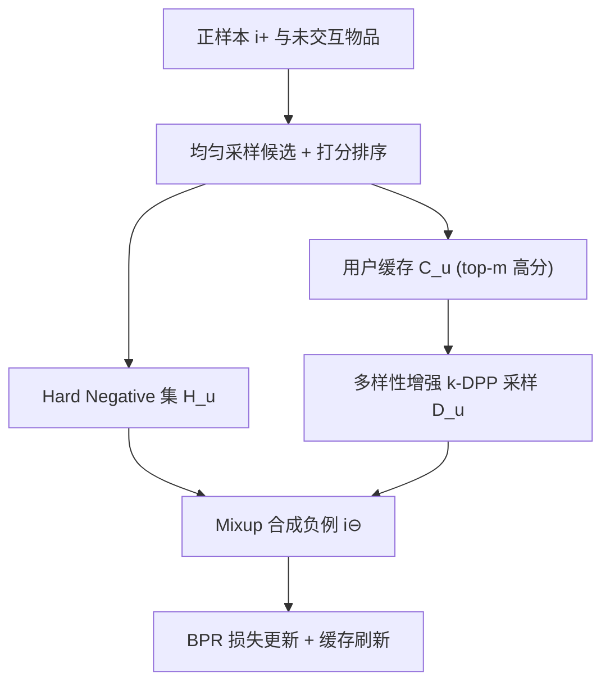

# Diversity-Augmented Negative Sampling for Implicit Collaborative Filtering (面向隐式协同过滤的多样性增强负采样)

- **会议/期刊**: WWW 2026
- **作者与机构**: Yueqing Xuan, Mark Sanderson, Jeffrey Chan (RMIT University)；Kacper Sokol (Università della Svizzera italiana)
- **推荐链路定位**: 召回（BPR 成对训练阶段的负采样器）
- **研究方向**: 协同过滤与双塔召回 / 自监督对比学习与交互去噪
- **论文原文**: [https://arxiv.org/abs/2508.14468v2](https://arxiv.org/abs/2508.14468v2)
- **开源代码**: [https://github.com/xuanxuanxuan-git/DivNS](https://github.com/xuanxuanxuan-git/DivNS)

## TL;DR (1分钟核心速览)

隐式协同过滤的两阶段负采样（先均匀采样候选、再按分数挑 hard negative）因物品嵌入天然成簇，会反复从稠密区域抽取高度相似的负样本，导致训练数据同质化、梯度冗余、模型表达力受限。本文提出 DivNS：把每个正样本对应的 top-$m$高分候选存入用户级缓存，用带 hard-negative 惩罚核的$k$-DPP 从缓存中选出与 hard negative 互补的多样负样本，再经 mixup 合成最终训练负例。在 4 个数据集、MF 与 LightGCN 两种骨干、无偏 Full-Ranking 协议下，NDCG@20 相对最优基线最高提升 8.76%（MF/Pinterest），且训练开销与 DNS/MixGCF 同量级。

## Background & Motivation (背景与核心矛盾)

- **主流范式**: BPR 类成对学习依赖负采样器从无标注物品中挑"真负例"，主流做法是两阶段——先均匀采样 $n$ 个候选，再按预测分数（DNS）或解耦相关性（DENS）取 top-1 作为 hard negative。
- **前人局限**: ① 候选集对每个正样本独立均匀采样，而物品嵌入因品类/流行度呈明显簇结构，候选高度集中于少数稠密簇，跨正样本反复复用同一批物品；② 稀疏区域中潜在高信息量负例被系统性忽略，正样本长期只与"彼此相似"的负例配对，决策边界刻画粗糙。
- **核心洞察 (Key Insight)**: 作者用平均成对余弦不相似度定义候选集多样性，证明均匀采样下 $\mathbb{E}[\mathrm{div}(\hat{I}^-_u)] < \max \mathrm{div}(\hat{I}^-_u)$（Proposition 3.1）；t-SNE 与玩具实验（图 1）显示$k$-DPP 采样能把负例均匀铺开到各簇，而均匀采样只覆盖少数稠密簇。
- **本文切入点**: 不在全物品空间上做多样性优化（$O(|I^-_u|^3)$ 不可行），而是把多样性约束"局部化"到一个小缓存上，兼顾信息量与计算可行性。

## Method (核心方法设计)

### 1. 整体框架 (Overall Architecture)

DivNS 以 epoch 为单位交替执行"内层多样性采样"与"外层 BPR 优化"。Epoch 0 仅做初始化：对每个正样本均匀采样候选集，取最高分者为 hard negative 存入 $H_u$，其余 top-$m$高分者存入用户缓存$C_u$。从 Epoch 1 起，先刷新$H_u^{(t)}$，再从上一轮缓存$C_u^{(t-1)}$中剔除当前 hard negatives，用多样性增强$k$-DPP 抽取$|H_u^{(t)}|$个多样负例$D_u^{(t)}$；随后将每个 hard negative 与随机一个多样负例做 mixup 合成$i^\ominus$，用$(u, i^+, i^\ominus)$ 三元组计算 BPR 损失更新参数，并刷新缓存进入下一轮。

### 2. 关键设计拆解 (Key Designs)

1. **用户级信息缓存 (Cache Construction)**：痛点是被 DNS 丢弃的次高分候选其实同样高信息量（多个真负例常共存于同一候选集）。做法是把每个正样本候选集中除 top-1 外的 top-$m$项存入$C_u$，缓存规模$|C_u| = m \cdot |I^+_u|$，$m \ll n$。只取 top-$m$而非全部$n$项，既抑制低质噪声，又把后续$k$-DPP 的复杂度压到可控范围。

2. **多样性增强 $k$-DPP 采样 (Diversity-Augmented Sampling)**：标准$k$-DPP 以$\mathbb{P}(D) \propto \det(K_D)$、$\kappa(\boldsymbol{v}_i,\boldsymbol{v}_j)=\boldsymbol{v}_i^\top \boldsymbol{v}_j$ 偏好内部互不相似的子集，但可能与 hard negative 撞车。作者给核函数加惩罚因子：

$$\tilde{\kappa}(\boldsymbol{v}_i,\boldsymbol{v}_j)=q_i q_j \kappa(\boldsymbol{v}_i,\boldsymbol{v}_j),\quad q_a = 1-\frac{1}{|H_u^{(t+1)}|}\sum_{b\in H_u^{(t+1)}}\boldsymbol{v}_a^\top \boldsymbol{v}_b$$

即与 hard negative 越相似的物品边际概率被压得越低，从而让 $D_u$同时满足"内部多样"与"与$H_u$互补"。采样用 Cholesky 更新的贪心 MAP 近似，复杂度$O(|C_u|^2(|I^+_u|+d))$，主要受小缓存比$m$ 控制。

3. **合成负例生成与训练目标**：将 hard negative 与随机多样负例线性插值 $\boldsymbol{v}_{i^\ominus}=\lambda \boldsymbol{v}_{i_H}+(1-\lambda)\boldsymbol{v}_{i_D}$，$\lambda\in[0,1]$控制"信息量 vs 多样性"权衡；合成点落在二者连线上，使模型在 hard 边界附近仍能感知更广的物品空间。总损失即标准 BPR：$\mathcal{L}=-\sum_{u}\sum_{i^+}\ln\sigma(\hat{y}(u,i^+)-\hat{y}(u,i^\ominus))$。负采样策略为"缓存内$k$-DPP + mixup"，无需额外打分模型、无需物品元数据、无需重复评估。

## Experimental Setup & Evaluation Protocol (实验设置与评估协议)

- **数据集与预处理**: 4 个基准，评分二值化为隐式反馈；覆盖稀疏（Beauty）到稠密大规模（Yelp 2022）场景。

| 数据集 | 规模特点 | 稀疏度/密度 | 特征/场景说明 |
| :--- | :---: | :---: | :--- |
| Amazon Beauty | 小规模、极稀疏 | 极稀疏 | 美妆品类，长尾显著 |
| MovieLens 1M | 中等规模、较稠密 | 较稠密 | 电影评分二值化 |
| Pinterest | 中等规模、稀疏 | 稀疏 | 图像社交 pin 交互 |
| Yelp 2022 | 最大规模 | 稀疏 | 本地生活评论，最新版本 |

- **数据划分与防穿越 (Splitting Strategy)**: 固定比例划分 `70% / 10% / 20%`（train/val/test），与既有负采样研究保持一致（非序列模型，故不用 Leave-One-Out）。
- **排名评测协议 (Ranking Protocol)**: 无偏 `Full-Ranking`——对用户训练集外全部物品排序，评估阶段不做负采样（遵循标准最佳实践）；指标 NDCG@{10,20} 与 Recall@{10,20}。
- **对比基线与超参设置**: 9 个采样器——静态类 RNS、PNS；hard 类 DNS、AdaSIR、DNS(M,N)、MixGCF、DENS、AHNS、SCONE（后两者中 MixGCF/SCONE 仅适配图骨干）。骨干为 MF 与 LightGCN，嵌入维度 $d=64$，Adam 优化，网格搜索$lr$、$l_2$、$n$、$m$、$\lambda$；每个实验 5 个随机种子取均值，显著性$p<0.05$。

## Key Experimental Results (实验关键数据)

### 1. 主实验对比 (Main Results)

下表摘取 Top-20 指标（NDCG@20 / Recall@20），完整 Top-10 结果见原文表 1：

| 采样器 | Beauty (MF) | ML-1M (MF) | Pinterest (MF) | Yelp (MF) | Beauty (LGCN) | ML-1M (LGCN) | Pinterest (LGCN) | Yelp (LGCN) |
| :--- | :---: | :---: | :---: | :---: | :---: | :---: | :---: | :---: |
| RNS | 0.0304/0.0577 | 0.3009/0.2236 | 0.0766/0.1160 | 0.0527/0.0613 | 0.0398/0.0802 | 0.3225/0.2304 | 0.0951/0.1405 | 0.0666/0.0753 |
| DNS | 0.0354/0.0703 | 0.3328/0.2289 | 0.0814/0.1263 | 0.0582/0.0697 | 0.0427/0.0838 | 0.3437/0.2412 | 0.0986/0.1449 | 0.0755/0.0862 |
| DENS | 0.0352/0.0699 | 0.3325/0.2286 | 0.0736/0.1120 | 0.0592/0.0703 | 0.0397/0.0800 | 0.3223/0.2319 | 0.0800/0.1183 | 0.0740/0.0850 |
| AHNS | 0.0332/0.0631 | 0.2959/0.2154 | 0.0706/0.1052 | 0.0568/0.0675 | 0.0392/0.0791 | 0.3045/0.2287 | 0.0912/0.1185 | 0.0734/0.0812 |
| MixGCF | — | — | — | — | 0.0426/0.0841 | 0.3442/0.2414 | 0.1010/0.1482 | 0.0755/0.0854 |
| SCONE | — | — | — | — | 0.0428/0.0838 | 0.3436/0.2411 | 0.1003/0.1485 | 0.0752/0.0861 |
| **DivNS** | **0.0385/0.0758** | **0.3397/0.2393** | **0.0883/0.1356** | **0.0613/0.0727** | **0.0440/0.0859** | **0.3485/0.2486** | **0.1054/0.1536** | **0.0788/0.0886** |
| **Improv.** | **+8.76%/+7.82%** | **+2.07%/+4.54%** | **+8.48%/+7.36%** | **+3.38%/+3.41%** | **+2.80%/+2.14%** | **+1.25%/+2.98%** | **+4.36%/+3.43%** | **+4.37%/+2.78%** |

### 2. 消融实验 (Ablation Study)

| 配置 | Beauty NDCG@20 | ML-1M NDCG@20 | Pinterest NDCG@20 | Yelp NDCG@20 |
| :--- | :---: | :---: | :---: | :---: |
| MF + DivNS (完整) | **0.0385** | **0.3397** | **0.0883** | **0.0613** |
| MF + 退化为 DNS (去全部模块) | 0.0354 | 0.3328 | 0.0814 | 0.0582 |
| LightGCN + DivNS (完整) | **0.0440** | **0.3485** | **0.1054** | **0.0788** |
| LightGCN + 退化为 DNS | 0.0427 | 0.3437 | 0.0986 | 0.0755 |

模块二替换实验：多样性增强 $k$-DPP > 原生$k$-DPP > 均匀采样；$\lambda$扫描显示$\lambda\in[0.5,0.7]$最优，$\lambda\to1$（纯 hard）与$\lambda<0.5$（过度多样）均下降；缓存比$m$在$m=4$（$n=10$）时最佳，$m=6$ 因纳入低质候选而退化。

### 3. 关键实验发现 (Key Findings)

1. **多样性是独立增益来源**：完全去掉 DivNS 退化为 DNS 后，MF 在 Pinterest 上 NDCG@20 从 0.0883 掉到 0.0814（约 8%），说明收益并非来自"多打分"而是来自负例分布本身。
2. **MF 骨干受益更大**：MF 上相对提升（最高 +8.76%）显著高于 LightGCN（最高 +4.37%），因为 MixGCF/SCONE 这类图专用混合采样器无法用于 MF，而 DivNS 直接优化多样性、与骨干解耦，在无图结构可用时优势被放大。
3. **多样性与信息量存在明确最优点**：$\lambda$与$m$ 的扫描曲线均呈倒 U 形，且 DivNS 采样负例的平均多样性（式 1 度量）在所有数据集上稳定高于 DNS/MixGCF/SCONE（图 3），验证了"多样性可量化、可优化、且需与 hardness 平衡"的核心论点。

## Highlights & Limitations (亮点、对比与审稿批判)

- **与代表作对比 (vs. Prior Work)**: 相比 DNS 只保留 top-1 hard negative、丢弃其余高信息量候选，DivNS 用缓存把它们"回收"；相比 MixGCF 依赖图邻居隐式引入多样性，DivNS 在嵌入空间显式优化多样性目标且不依赖图结构；相比 DPP 后处理重排（提升输出多样性），本文首次把 DPP 用于训练期负采样。
- **可迁移亮点**: ① "缓存 + 子集采样"范式可迁移到对比学习的难负例挖掘（如 SGL/SimGCL 的负对构造）；② 带惩罚核的 $k$-DPP 可推广为"与锚点集合保持距离"的通用子集选择算子，用于去偏采样或课程学习。
- **审稿级局限批判**: ① 缓存需每 epoch 全量刷新并重算核矩阵，$O(|C_u|^2)$在超大规模物品池与长用户序列下仍有压力，论文仅报告了 Beauty 上的秒级开销；② 仅在非序列 MF/LightGCN 上验证，未覆盖序列推荐、双塔 ANN 召回等现代工业链路，且$m$、$\lambda$ 需逐数据集网格搜索，超参敏感度较高。

## Rating (四维评分)

- **方法创新性 (Novelty)**: ⭐⭐⭐⭐ （首次将多样性准则引入训练期负采样，Proposition 3.1 给出均匀采样多样性上界的形式化分析，$k$-DPP 惩罚核设计简洁有效）
- **评估协议与实验扎实度 (Protocol & Experiments)**: ⭐⭐⭐⭐ （4 数据集 × 2 骨干 × 9 基线、Full-Ranking 无偏评测、5 种子均值 + $p<0.05$ 显著性，消融覆盖三大模块与两个关键超参）
- **写作与数学规范度 (Clarity & Rigor)**: ⭐⭐⭐⭐ （多样性定义、复杂度推导与算法伪代码完整清晰，$k$-DPP 细节置于附录，主线公式紧凑）
- **工业落地与复现价值 (Industrial & Practical Value)**: ⭐⭐⭐⭐ （代码已开源、无需元数据、训练耗时与 DNS/MixGCF 同量级，但缓存刷新与核矩阵开销在超大规模场景仍需工程优化）
