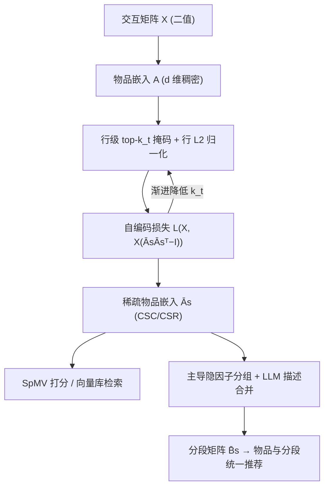
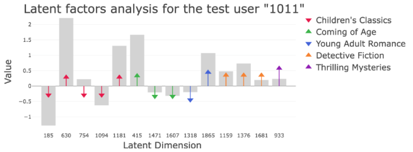

# Efficient Learning of Sparse Representations from Interactions (从交互中高效学习稀疏表征)

- **会议/期刊**: WWW 2026 (4 pages, short paper)
- **作者与机构**: Vojtěch Vančura (Recombee / Charles University)、Martin Spišák (TopK)、Rodrigo Alves (CTU Prague)、Ladislav Peška (Charles University)
- **推荐链路定位**: 召回（候选检索）
- **研究方向**: 协同过滤与双塔召回 / 工业架构与效率
- **论文原文**: [https://arxiv.org/abs/2602.09935v1](https://arxiv.org/abs/2602.09935v1)
- **开源代码**: [https://github.com/zombak79/compressed_elsa](https://github.com/zombak79/compressed_elsa)

## TL;DR (1分钟核心速览)

召回阶段嵌入表是内存与延迟瓶颈，而稠密嵌入的表达力与维度强绑定。本文不改架构，只在 **ELSA 线性自编码器的训练过程中**对物品嵌入矩阵施加**行级 top-$k$ 渐进剪枝**，直接学出高维稀疏嵌入（而非事后压缩）。在 Goodbooks-10k / MovieLens-20M / Netflix Prize 三数据集、按 float32 字节数对齐的等存储预算下，Compressed ELSA 在 1024B 预算即达 0.491 nDCG@100，**反超稠密 ELSA (0.489)**；压缩至 64B（约 100×）仍保留 0.469，仅损约 2.5%。稀疏激活还天然构成倒排索引，可派生与隐空间对齐的语义分段。

## Background & Motivation (背景与核心矛盾)

- **主流范式**: 工业召回普遍用稠密物品嵌入 + ANN 检索；ELSA 以线性自编码器 $\min_{\boldsymbol{A}}\mathcal{L}(\boldsymbol{X},\boldsymbol{X}(\boldsymbol{A}\boldsymbol{A}^{\top}-\boldsymbol{I}))$ 在浅层结构下把全部表达力压进嵌入矩阵，因而依赖较大维度（原文 13000B / 3200B / 9800B）。
- **前人局限**: ① 降维（Low-Dim ELSA）在高压缩比下精度断崖式下跌；② 事后稀疏化（CompresSAE / ELSA+SAE）把已学好的稠密嵌入投影到稀疏空间，信息在投影前已丢失，压缩后精度系统性劣化。
- **核心洞察 (Key Insight)**: 大隐空间中的稀疏码在同等存储预算下可表达的模式数远多于稠密向量（有效动态范围更大），且激活模式天然支持倒排索引检索——但前提是**稀疏性必须在训练中被优化出来**，而非训练后强加。
- **本文切入点**: 把 top-$k$ 稀疏算子嵌入 ELSA 的前向与损失计算，配合渐进剪枝调度，让模型在"先稠密探索、后稀疏特化"的过程中自行分配活跃维度。

## Method (核心方法设计)

### 1. 整体框架 (Overall Architecture)

输入用户-物品二值交互矩阵 $\boldsymbol{X}\in\{0,1\}^{m\times n}$；物品嵌入$\boldsymbol{A}\in\mathbb{R}^{n\times d}$在每个训练步经行级 top-$k_t$掩码与行$\ell_2$重归一化得到$\bar{\boldsymbol{A}}_s$，再以$\bar{\boldsymbol{A}}_s\bar{\boldsymbol{A}}_s^{\top}-\boldsymbol{I}$逼近单位阵完成自编码训练；推理时用户向量$\boldsymbol{x}$与稀疏物品矩阵做 SpMV 打分。训练收敛后，按主导隐因子及其符号对物品分组，用 LLM 生成描述并用句向量相似度合并，得到分段矩阵$\bar{\boldsymbol{B}}_s$，与物品共享同一隐空间实现统一打分。

### 2. 关键设计拆解 (Key Designs)

1. **训练内稀疏化算子 (In-training Sparsification)**：痛点是不想"先稠密再压缩"。定义 $\mathcal{S}_k(\boldsymbol{A})=\mathrm{mask}(\boldsymbol{A},k)\odot\boldsymbol{A}$，仅保留每行绝对值最大的$k$个元素，再行归一化得$\bar{\boldsymbol{A}}_s$，目标改为$\min_{\boldsymbol{A}}\mathcal{L}(\boldsymbol{X},\boldsymbol{X}(\bar{\boldsymbol{A}}_s\bar{\boldsymbol{A}}_s^{\top}-\boldsymbol{I}))$。直觉：稀疏约束直接参与梯度回传，模型会主动把语义负载集中到少数高幅值维度上，避免事后投影的信息损失。

2. **渐进剪枝调度 (Gradual Pruning Schedule)**：若一开始就固定小 $k$，部分隐维度会永久失活（类比 sparse autoencoder 的 dead-latents）。故设序列$\{k_t\}_{t=0}^{T}$，$k_0=d$、$k_T=k$，按步施加$\boldsymbol{A}_s^{(t)}=\mathcal{S}_{k_t}(\boldsymbol{A}^{(t)})$。早期全维度参与学习，后期逐步特化；实验表明**逐 epoch 递减优于等收敛后再剪**（与 Lottery Ticket 建议相反），而每步剪枝后**从原始初始化重启**略优于续训。

3. **稀疏分段与统一打分 (Segment Construction)**：对物品 $i$取主导因子$\ell^*(i)=\arg\max_j|\bar{\boldsymbol{A}}_s[i,j]|$与符号$s^*(i)$分组，用 LLM 生成描述、句向量余弦超阈值$\tau$迭代合并得分段集$\mathcal{C}$；构造仅含$\pm1$的稀疏分段矩阵$\bar{\boldsymbol{B}}_s$，分段得分$\hat{\boldsymbol{r}}_{\text{seg}}^{\top}=\boldsymbol{x}^{\top}\bar{\boldsymbol{A}}_s\bar{\boldsymbol{B}}_s^{\top}$，与物品推荐共用同一用户表征。

**训练目标与推理效率**：总损失即 ELSA 原损失（含其原有正则项），无额外负采样（全库闭式/线性结构，非对比学习范式）。推理前向复杂度 $O(nk)$，同时加载$\bar{\boldsymbol{A}}_s$与$\bar{\boldsymbol{A}}_s^{\top}$ 两份 CSC 副本以支持嵌入与反嵌入的 SpMV；若仅作向量库检索则只需一份 CSR 副本。

## Experimental Setup & Evaluation Protocol (实验设置与评估协议)

- **数据集与预处理**: 三数据集均做反馈二值化，采用 **strong generalization**（训练/验证/测试用户互不重叠）：

| 数据集 | #Users | #Items | 交互规模 | 说明 |
| :--- | :---: | :---: | :---: | :--- |
| Goodbooks-10k | ~10k | ~10k | ~6M | 图书评分二值化 |
| MovieLens-20M | ~138k | ~27k | ~20M | 电影评分二值化 |
| Netflix Prize | ~480k | ~17k | ~100M | 电影评分二值化 |

- **数据划分与防穿越**: 按用户不相交划分（strong generalization），测试用户完全冷启于训练集，属严格泛化协议。
- **排名评测协议**: 全库排序（对测试用户全部未交互物品打分），指标 nDCG@100；标准误约 ≤0.001。
- **对比基线与超参**: 稠密 EASE / ELSA；Low-Dim ELSA；稀疏压缩 Pruned EASE、ELSA+SAE (CompresSAE)。存储预算按 float32 计：稠密每因子 4B，稀疏每非零 4B 值 + 4B 索引；初始维度 $d=4096$，剪枝策略为指数衰减 + 重启。

## Key Experimental Results (实验关键数据)

### 1. 主实验对比 (Main Results)

nDCG@100，按等存储预算（B）对齐；括号内为稠密模型原始嵌入大小：

| 方法 | Goodbooks 1024B | 512B | 256B | 128B | 64B | ML-20M 1024B | 64B | Netflix 1024B | 64B |
| :--- | :---: | :---: | :---: | :---: | :---: | :---: | :---: | :---: | :---: |
| EASE (稠密, 40000/82880/71076B) | 0.482 | – | – | – | – | 0.425 | – | 0.394 | – |
| ELSA (稠密, 13000/3200/9800B) | 0.489 | – | – | – | – | 0.429 | – | 0.395 | – |
| Pruned EASE | 0.478 | 0.475 | 0.473 | 0.469 | 0.458 | 0.419 | 0.368 | 0.389 | 0.343 |
| Low-Dim. ELSA | 0.433 | 0.397 | 0.357 | 0.316 | 0.270 | 0.420 | 0.339 | 0.376 | 0.307 |
| ELSA + SAE | 0.436 | 0.428 | 0.420 | 0.413 | 0.408 | 0.391 | 0.353 | 0.341 | 0.314 |
| **Compressed ELSA** | **0.491** | **0.488** | **0.483** | **0.477** | **0.469** | **0.427** | **0.379** | **0.393** | **0.357** |

相对最强稀疏基线 Pruned EASE：Goodbooks 1024B 提升 **+2.7%**，64B 提升 **+2.4%**；相对 ELSA+SAE 在 64B 上提升 **+14.9%**（0.469 vs 0.408）。

### 2. 消融实验 (Ablation Study)

Goodbooks-10k，nDCG@100（图 1）：

| 配置 | 关键结论（数值） |
| :--- | :--- |
| 剪枝调度：Constant / Linear / Exponential / Step-wise | 逐 epoch 递减（Linear/Exponential）优于 Constant 与等收敛后 Step-wise |
| 剪枝后处理：续训 vs. 重启 | 从原始初始化重启略优（与 LTH 一致） |
| 初始维度 $d\in\{2048,4096,6144,8192\}$|$d$越大最终质量越高，部分配置超过稠密 ELSA (0.489)；$d>4096$ 收益递减 |

### 3. 关键实验发现 (Key Findings)

1. **稀疏性必须在训练中习得**：ELSA+SAE 在 Goodbooks 64B 仅 0.408，而 Compressed ELSA 达 0.469——事后投影损失约 13% 精度，证明"训练内稀疏化"是性能差距的主因而非稀疏本身。
2. **压缩比与精度近似解耦**：从 1024B 压到 64B（16×）精度仅从 0.491 降至 0.469；相对稠密 ELSA 的 13000B，64B 相当于约 200× 压缩仍保留 95.9% 精度，验证大隐空间稀疏码的有效动态范围优势。
3. **稀疏激活即倒排索引且语义自洽**：Goodbooks 上由主导因子分组自发涌现 Children's Classics、Detective Fiction 等连贯分段（训练全程未用元数据），且用户激活维度与其被推荐分段维度持续对齐（图 2），说明分段推荐可直接内嵌于召回模型。

<figure class="paper-figure" markdown="span">
  <figcaption>图 2：用户激活与分段特定潜在维度之间的一致性。灰色柱表示用户的稀疏潜在因子值，彩色箭头标记与该用户被推荐语义分段相关联的维度。箭头与用户激活值始终对齐，表明分段级偏好匹配。（图取自我们的在线演示。）</figcaption>
</figure>

## Highlights & Limitations (亮点、对比与审稿批判)

- **与代表作对比 (vs. Prior Work)**: 与 CompresSAE/ELSA+SAE 的本质区别是稀疏化发生在损失函数内部而非训练后投影；与 Pruned EASE 的区别是剪枝对象为训练中的嵌入而非已收敛权重矩阵，且带渐进调度避免死维度；与 Low-Dim ELSA 的区别是用"高维 + 少非零"替代"低维 + 全非零"，在等字节预算下表达力更强。
- **可迁移亮点**: ① 渐进 top-$k$ 调度 + 重启可直接套用到任何含大嵌入表的双塔/自编码召回模型；② 用主导隐因子 + LLM 描述合并自动生成物品分段，为首页 2D 布局等分段级推荐提供免标注方案。
- **审稿级局限批判**: ① 分段描述依赖外部 LLM（gpt-4.1-nano），引入额外依赖，且可解释性评估仅为 Goodbooks-10k 上的定性观察，缺乏分段一致性/覆盖率的定量指标；② 全部实验限于线性浅层 ELSA，作者自承向 Transformer 等非线性架构迁移时对梯度扰动更敏感，泛化性未验证；③ 未报告端到端线上延迟与训练开销（渐进剪枝需多轮掩码与重启，训练成本上升）。

## Rating (四维评分)

- **方法创新性 (Novelty)**: ⭐⭐⭐⭐ （"训练内稀疏化 + 渐进剪枝"组合简洁但切中工业痛点，稀疏码表达力有理论支撑，非全新范式）
- **评估协议与实验扎实度 (Protocol & Experiments)**: ⭐⭐⭐⭐ （三数据集 + strong generalization + 等字节预算对齐公平，但缺显著性检验与分段定量评估）
- **写作与数学规范度 (Clarity & Rigor)**: ⭐⭐⭐⭐ （4 页短文公式紧凑、算子定义清晰，剪枝调度与推理复杂度交代到位，部分实现细节外引原文）
- **工业落地与复现价值 (Industrial & Practical Value)**: ⭐⭐⭐⭐⭐ （基于生产级 ELSA 改造、代码与在线 demo 全开源、SpMV 推理有实际加速，落地路径极短）

