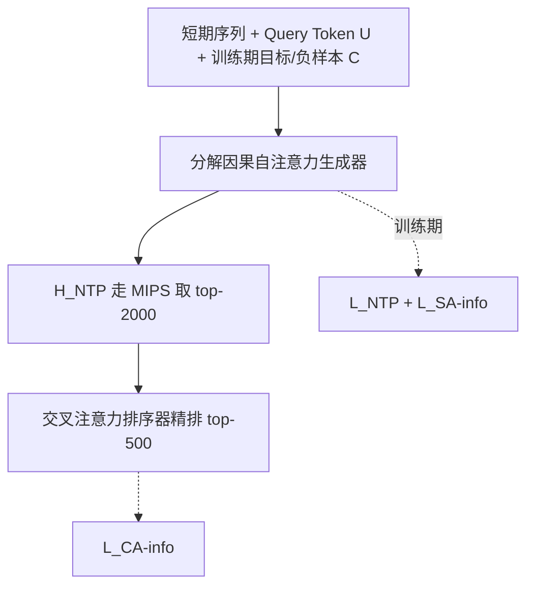
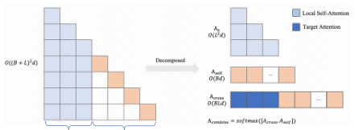

# GRank: Towards Target-Aware and Streamlined Industrial Retrieval with a Generate-Rank Framework (面向目标感知与精简工业召回的生成-排序框架)

- **会议/期刊**: WWW 2026 (Proceedings of the ACM Web Conference 2026)
- **作者与机构**: Yijia Sun, Shanshan Huang, Zhiyuan Guan, Qiang Luo, Ruiming Tang, Kun Gai, Guorui Zhou（快手科技；Kun Gai 无隶属）
- **推荐链路定位**: 召回（两阶段：生成式候选生成 + 轻量重排）
- **研究方向**: 协同过滤与双塔召回 / 多任务学习与列表级重排
- **论文原文**: [https://arxiv.org/abs/2510.15299v3](https://arxiv.org/abs/2510.15299v3)
- **开源代码**: 暂未开源

## TL;DR (1分钟核心速览)

工业召回陷入死锁：Target-Agnostic 双塔/MIPS 高效但把多义兴趣压成单一向量（early fusion bottleneck），Target-Aware 的树/图/量化索引精度高却受 item-centric 静态拓扑与重建开销拖累。GRank 提出免结构化索引的 Generate-then-Rank 范式：训练期用辅助模块把目标物品与 in-batch 负样本注入因果 Transformer，将 Target-Aware 判别力"蒸馏"进推理期仍走 MIPS 的用户向量；再用单头交叉注意力对 2000 候选精排。在 UserBehavior/MovieLens-20M/快手十亿级语料上，全库排序 Recall@500 相对最优基线提升 27.2%–32.8%，P99≤100ms 下 QPS 达 767（TDM 的 2.8 倍）。

## Background & Motivation (背景与核心矛盾)

- **主流范式**: 工业召回绝大多数采用 Target-Agnostic 架构（DSSM 双塔、SASRec/Kuaiformer 序列 Transformer），用户编码与候选无关，靠内积 $s(\mathbf{u},\mathbf{v})=\mathbf{u}^\top\mathbf{v}$走 GPU-MIPS，复杂度$O(\log N)$。
- **前人局限一**: Target-Agnostic 模型在见到候选前就把"游戏本 + 办公椅"式多义历史压成均值向量，无法做 candidate-specific refinement，长尾兴趣召回必须靠放大候选集硬撑。
- **前人局限二**: TDM/JTM 树索引、NANN 图索引、StreamingVQ 量化索引虽引入目标感知剪枝，但索引由 item-item 预计算拓扑驱动，用户实时信号无法动态改道（semantic drift）；且 $O(N\log N)$ 重建、结构不均衡导致 P99 抖动，量化还隐含欧氏空间假设与注意力编码器冲突。
- **核心洞察 (Key Insight)**: 现有方案把"全局剪枝（保 Recall）"与"局部区分（保 Precision）"两个目标强行塞进同一条搜索路径。二者本可解耦——把 Target-Aware 的复杂度从**推理期索引**搬到**训练期学习**。
- **本文切入点**: 生成器在训练时"看见"目标与负样本、推理时"看不见"，从而以零额外延迟获得目标感知表征；精排只在数百候选上做显式交互。

## Method (核心方法设计)

### 1. 整体框架 (Overall Architecture)

输入为短期行为序列 $\mathbf{x}_{L_l-L_s+1:L_l}$、个性化 query token$\mathbf{U}$（用户属性 + 点击/长播/曝光三路 sum-pooling 序列）以及训练期才拼接的目标嵌入$\mathbf{C}^*$与 in-batch 负样本$\mathbf{C}_j$。生成器（4 层因果 Transformer + 分解因果自注意力）输出用户表征$\mathbf{H}_{\text{NTP}}$供 MIPS 检索 top-$k_1$；排序器用单头交叉注意力在长达 1000 的历史上对每个候选打分得$s_{\text{ca}}$。三路 InfoNCE 损失端到端联合优化，推理时辅助模块整体摘除，严格保持训练-服务一致。

<figure class="paper-figure" markdown="span">
  <figcaption>图1：GRank 框架架构。该框架包含两个紧密耦合的模块，并通过三个互补损失进行优化：（1）目标感知增强生成器，集成用于短期偏好建模的生成器（由 LNTP 优化）和用于目标注入的辅助模块（由 LSA-info 优化）；（2）排序器（由 LCA-info 优化），采用高效交叉注意力实现快速推理。辅助模块仅在训练期间注入目标嵌入 C∗ 和批内负样本 Cj。生成器利用我们新颖的分解因果自注意力（详见右下图）以高效地</figcaption>
</figure>

### 2. 关键设计拆解 (Key Designs)

1. **训练期目标注入的生成器（Target-Aware 蒸馏进双塔）**：痛点是双塔推理时无法感知候选。做法是把目标与负样本经辅助 MLP 映射后拼到序列尾部 $\mathbf{H}^{(0)}=[\mathbf{x}_{L_l-L_s+1:L_l};\mathbf{U};\mathbf{C}]$，因果掩码保证历史 token 可 attend 目标、而$\mathbf{C}^*$在推理时被整体 mask 掉。辅助分支用$\mathcal{L}_{\text{SA-info}}=-\log\frac{\exp(s_{\text{sa}})}{\sum_{j\in\mathcal{B}}\exp(s_{\text{sa}_j})}$显式学习目标判别，该梯度回传至共享稀疏嵌入，使$\mathbf{H}_{\text{NTP}}$ 在**架构完全不变**的前提下吸收候选感知能力——"离线优化、透明部署"。

2. **分解因果自注意力（Decomposed Causal SA）**：痛点是把 $L_s$长序列与$B$个候选拼接做全自注意力，复杂度$O((L_s+B)^2 d)$成为训练瓶颈。作者将其数学等价拆为三块：用户序列自注意力$\mathbf{A}_{ss}=\text{softmax}(\mathbf{Q}_s\mathbf{K}_s^\top/\sqrt{d}\odot\mathbf{M}_s)$、候选对用户序列的交叉分$\mathbf{A}_{cs}=\mathbf{Q}_c\mathbf{K}_X^\top/\sqrt{d}\in\mathbb{R}^{B\times L_s}$、以及候选自相关$\mathbf{A}_{cc}=\sum_{i=1}^{d}\mathbf{Q}_{c,:,i}\odot\mathbf{K}_{c,:,i}/\sqrt{d}\in\mathbb{R}^{B\times 1}$，再拼接 softmax：$\mathbf{A}_{\text{combined}}=\text{softmax}([\mathbf{A}_{cs},\mathbf{A}_{cc}])$。复杂度降至$O(L_s^2 d+BL_s d+Bd)$，在$B=300,L_s=64,d=128$ 下 FLOPs 减少 82%，且与原始注意力严格等价。

3. **训练目标、负采样与推理效率**：总损失 $\mathcal{L}_{\text{total}}=\lambda_0\mathcal{L}_{\text{NTP}}+\lambda_1\mathcal{L}_{\text{SA-info}}+\lambda_2\mathcal{L}_{\text{CA-info}}$，三路均为 in-batch 负采样 InfoNCE（免独立负采样器）。$\mathcal{L}_{\text{NTP}}$用$\ell_2$归一化后的$\mathbf{H}_{\text{NTP}}$与$\hat{\mathbf{x}}_j=\text{MLP}_{\text{ntp}}(\mathbf{e}_j)$对比。推理阶段一 MIPS 取$k_1=2000$（$O(\log|I|)$），阶段二交叉注意力纯前馈、GPU 批处理高度并行，输出$k_2=500$。

## Experimental Setup & Evaluation Protocol (实验设置与评估协议)

- **数据集与预处理**:

| 数据集 | #Users | #Items | #Interactions | 稀疏度/密度 | 特征/场景说明 |
| :--- | :---: | :---: | :---: | :---: | :--- |
| UserBehavior | 964K | 4.2M | 1.7M | 4.2e-7 | 电商行为，平均序列长 101 |
| MovieLens-20M | 138K | 27K | 9.3M | 2.5e-3 | 电影评分，平均序列长 144 |
| Kuaishou Industrial | 108M | 42M | 4B | 8.8e-7 | 短视频，平均序列长 980 |

- **数据划分与防穿越 (Splitting Strategy)**: 全部按时间切分；快手工业集用 6 天训练 + 次日测试，两个公开集采用标准 90%/10% 时序划分。
- **排名评测协议 (Ranking Protocol)**: 无偏 `Full-Ranking`（全库未交互物品排序），报告 Recall@K 与 NDCG@K；工业集 K=500，公开集 K=50。效率指标为 P99 延迟 ≤100ms 约束下的最大 QPS。
- **对比基线与超参设置**: 覆盖四大范式——DSSM（双塔）、Kuaiformer（生成式序列）、TDM（树索引，仅工业集因部署复杂度）、NANN（图索引）、StreamingVQ（量化索引）。统一 $d=128$、相同训练数据与硬件；生成器 4 层因果注意力、排序器 1 层交叉注意力、短序列 64 / 长序列 1000、$k_1=2000$。

## Key Experimental Results (实验关键数据)

### 1. 主实验对比 (Main Results)

| Method | UserBehavior R@50 | UserBehavior N@50 | MovieLens R@50 | MovieLens N@50 | Industry R@500 | Industry N@500 |
| :--- | :---: | :---: | :---: | :---: | :---: | :---: |
| DSSM | 0.2711 | 0.1911 | 0.1940 | 0.0792 | 0.1068 | 0.0360 |
| Kuaiformer | 0.3270 | 0.2347 | 0.2538 | 0.0906 | 0.1151 | 0.0386 |
| TDM | - | - | - | - | 0.1766 | 0.0535 |
| NANN | 0.3264 | 0.1765 | 0.2633 | 0.1017 | 0.1326 | 0.0466 |
| StreamingVQ | 0.3220 | 0.2262 | 0.2554 | 0.0907 | 0.1296 | 0.0603 |
| **GRank** | **0.4348** | **0.2780** | **0.3350** | **0.1250** | **0.2346** | **0.0775** |
| Improv.% | +33.0% | +18.4% | +27.2% | +22.9% | +32.8% | +28.5% |

### 2. 消融实验 (Ablation Study)

| Config | Generator R@2000 | R@500 | N@500 | QPS |
| :--- | :---: | :---: | :---: | :---: |
| Pure Generator | 0.1512 | 0.1190 | 0.0405 | 1333 |
| Gen+Aux | 0.3427 | 0.1768 | 0.0541 | 340 |
| Gen+RankOnly | 0.1820 | 0.1363 | 0.0502 | 767 |
| **Full GRank** | **0.3685** | **0.2346** | **0.0775** | 767 |

### 3. 关键实验发现 (Key Findings)

1. **辅助监督是召回天花板的主要贡献者**：仅加 Aux 就把生成器 R@2000 从 0.1512 拉到 0.3427（+127%），而 Gen+RankOnly 仅 0.1820。说明目标注入真正改造了双塔用户表征本身，而非依赖下游重排补救；且该增益在推理期零参数、零延迟。
2. **重排不可省但必须轻**：去掉重排后 R@500 从 0.2346 跌至 0.1768（-50.7% 相对损失），但 Gen+Aux 的 QPS 仅 340（4 层自注意力 $O(4n^2)$ 拖累）；Full GRank 用交叉注意力线性复杂度在同等 767 QPS 下把 NDCG@500 从 0.0541 提到 0.0775，实现 CA-SA 协同。
3. **超参 ROI 拐点明确**：$k_1$从 2000 增至 5000 召回仅 +0.1pp 而 QPS 跌 18%；$d_{\text{top}}=128$ 饱和、256 因内存压力反降，64 则以 3% 召回换 56% QPS。线上 A/B 中主端 Total App Usage Time +0.160%、Lite 端 +0.165%，Recall 通路 Show Ratio +21.92%、UV 覆盖 +16.50%。

## Highlights & Limitations (亮点、对比与审稿批判)

- **与代表作对比 (vs. Prior Work)**: 对比 Kuaiformer（生成式但仍 target-agnostic，仅靠序列建模），GRank 在架构不变下注入目标信号，R@50 高出 33.0%；对比 TDM（树索引 target-aware 但 item-centric 静态路径），GRank 免索引即取得 +32.8% R@500 且 QPS 2.8 倍；对比 StreamingVQ（量化索引受欧氏假设束缚），GRank 无码本失衡与重建开销。
- **可迁移亮点**: (1) "训练期拼目标 + 推理期 mask"的蒸馏范式可零成本移植到任意双塔/序列召回骨干；(2) 分解因果自注意力把候选拼接注意力的二次复杂度降为线性且严格等价，适用于任何"长序列 + 多负样本"联合编码场景。
- **审稿级局限批判**: (1) 排序器仅单头交叉注意力、长序列经 MLP 压缩，细粒度交互容量有限，且三路损失权重 $\lambda_i$ 的敏感性未给出系统分析；(2) 公开集仅两个、K=50 且缺 TDM 对比，工业集结论的可复现性受私有语料与部署栈限制，代码未开源削弱外部验证。

## Rating (四维评分)

- **方法创新性 (Novelty)**: ⭐⭐⭐⭐ （"训练期目标注入 + 推理期 MIPS"的解耦思路清晰且工程优雅，分解注意力有严格等价性支撑，但单点技术多为已有组件的巧妙重组）
- **评估协议与实验扎实度 (Protocol & Experiments)**: ⭐⭐⭐⭐ （全库排序 + 三数据集 + 消融 + 线上 A/B 完整，唯公开集基线覆盖略窄、缺显著性检验）
- **写作与数学规范度 (Clarity & Rigor)**: ⭐⭐⭐⭐ （三路损失与分解注意力公式交代清楚，复杂度分析到位，部分符号在正文与图中略有出入）
- **工业落地与复现价值 (Industrial & Practical Value)**: ⭐⭐⭐⭐⭐ （4 亿用户、500 亿日请求、99.95% 可用性已全量上线，免索引零延迟增益对工业召回极具迁移价值，可惜未开源）
