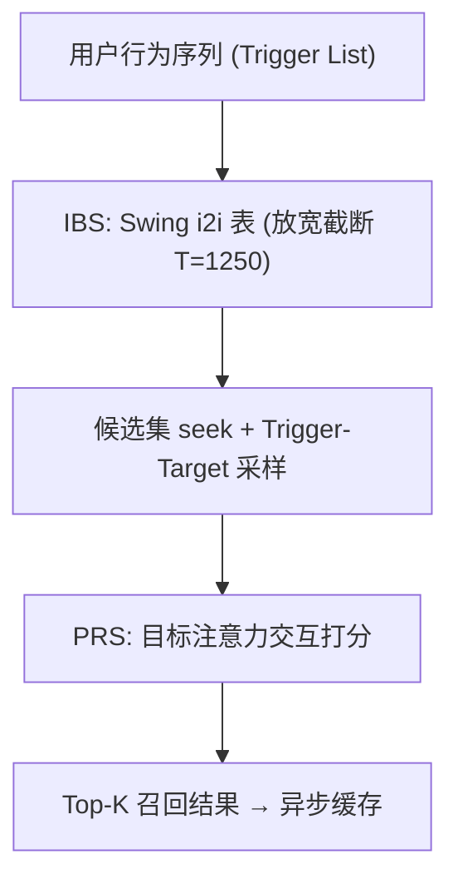
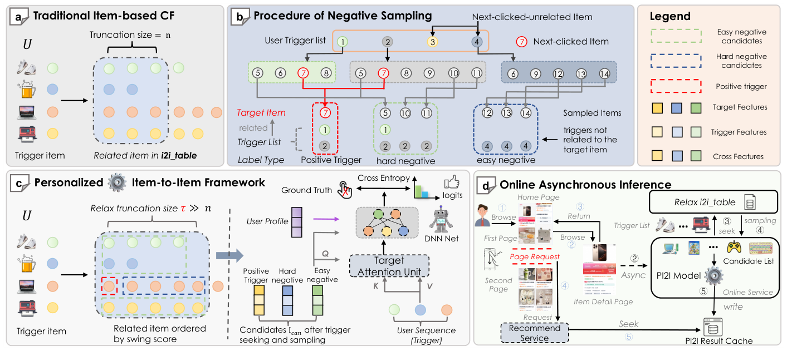

# PI2I: A Personalized Item-Based Collaborative Filtering Retrieval Framework (个性化物品到物品协同过滤召回框架)

- **会议/期刊**: WWW 2026
- **作者与机构**: Shaoqing Wang, Yingcai Ma, Kairui Fu 等（阿里巴巴 / 浙江大学）
- **推荐链路定位**: 召回（Retrieval）
- **研究方向**: 协同过滤与双塔召回 / 序列推荐
- **论文原文**: [https://arxiv.org/abs/2601.16815v1](https://arxiv.org/abs/2601.16815v1)
- **开源代码**: 暂未开源（数据集已公开于 HuggingFace: PI2I/PI2I）

## TL;DR (1分钟核心速览)

工业 I2I 召回存在两大痛点：统一截断尺寸（如 Top-50）会过早砍掉用户可能感兴趣的物品，且纯内积/共现打分无法建模复杂用户-物品交互。PI2I 提出两阶段框架：IBS 阶段用 Swing 构建 i2i 表并**放宽截断阈值 $T$** 以最大化 Hit Rate；PRS 阶段在候选集上引入**目标注意力交互打分模型**，并设计 **Trigger-Target 负采样**使离线训练与在线推理候选空间严格对齐。在淘宝 1.3 亿交互数据集上 HR@4000 达 18.86%（较次优 SASRec 12.00% 提升 57%），线上 A/B 成交率 +1.05%。

## Background & Motivation (背景与核心矛盾)

- **主流范式**: 工业召回以 item-based CF（Swing 共现）与双塔模型（DSSM/YouTubeDNN/MIND）为主，前者靠统计共现、后者靠 ANN 内积检索。
- **前人局限**: ① I2I 采用**统一截断尺寸**且截断过程不含用户个性化信息，热门物品需要更大候选池却被一刀切砍掉；② 双塔的 user/item 分离建模导致**用户-物品交叉过晚（overdue crossing）**，内积表达力受限。
- **核心洞察 (Key Insight)**: 召回阶段真正该优化的是**大 K 下的 Hit Rate**（下游精排会在数千候选中再筛），因此"先放宽候选池保召回、再用轻量交互模型个性化打分"比"小截断+内积"更优；且训练负样本必须来自与在线推理一致的 Trigger-Target 候选空间。
- **本文切入点**: 把 I2I 从"静态查表"升级为"查表 + 端到端可优化的个性化打分"，并用 Trigger-Target 采样消除离线/在线候选集错配。

## Method (核心方法设计)

### 1. 整体框架 (Overall Architecture)

PI2I 分两阶段闭环：**IBS（Indexer Building Stage）** 离线用 Swing 共现分构建 i2i 表，对每个 trigger 物品保留放宽后的 $T$ 个 target；**PRS（Personalized Retrieval Stage）** 在线将用户行为序列全部作为 trigger，从 i2i 表 seek 出十万级候选，经 Trigger-Target 采样训练的目标注意力模型打分，取 Top-K 作为最终召回。线上采用**异步推理**：用户点击详情页即触发推理，200ms 内写入结果缓存，主服务 5ms 内读取（命中率 >95%），不阻塞主链路。

<figure class="paper-figure" markdown="span">
  <figcaption>图2：(a) 传统I2I方法示意图。(b) 触发-目标采样策略示意图。(c) PI2I的整体框架。(d) PI2I在线异步推理流程。</figcaption>
</figure>

### 2. 关键设计拆解 (Key Designs)

1. **放宽截断的 IBS 索引构建**：传统 I2I 统一截断 $T{=}50$导致热门 trigger 的候选池过窄。本文用带活跃用户惩罚的 Swing 分排序后保留大得多的$T$：
$$s(i,j)=\sum_{u\in U_i\cap U_j}\sum_{v\in U_i\cap U_j} w_u w_v\cdot\frac{1}{\alpha+|I_u\cup I_v|},\quad w_u=\frac{1}{\sqrt{|I_u|}}$$
其中 $w_u$ 抑制高频活跃用户对相似度的支配。直觉：候选池先"宁滥勿缺"保 HR，把精度筛选交给 PRS 的交互模型，实现召回率与算力的解耦。

2. **Trigger-Target 负采样（离线在线对齐）**：传统 in-batch/随机负采样与 PI2I 的受限候选空间不匹配。本文按 i2i 关系构造负样本：与正样本在 i2i 表中有连边的历史 trigger 所触发的 target 作 **hard negative**，无连边 trigger 的 target 作 **easy negative**。这样训练采样分布与在线 seek 出的候选集同构，消除 exposure bias；约 15% 找不到关联的样本被丢弃。

3. **目标注意力交互打分与损失**：将 trigger 特征、target 特征与交叉特征（价差、共点次数、i2i 表内排名）拼接后经 MLP 生成 Query，对用户行为序列做 Multi-Head Target Attention：
$$Q=\mathrm{MLP}(E_{trigger}\oplus E_{target}\oplus E_{cross}),\quad \mathrm{head}_i=\mathrm{Softmax}\!\left(\frac{QK_{seq}^T}{\sqrt{d_K}}\right)V_{seq}$$
最终 logits 由 MHA 输出与 profile/trigger/target/cross 嵌入再经 MLP 得到。训练用 softmax 交叉熵 $\mathcal{L}_p=-\sum_{b\in B}\log\frac{\exp(logits_p)}{\exp(logits_p)+\sum_{k\in\mathcal{V}}\exp(logits_k)}$，负样本即上述 hard+easy 混合集（每正样本约 20 hard + 80 easy），**免 ANN 索引**，推理为十万级候选的稠密打分。

## Experimental Setup & Evaluation Protocol (实验设置与评估协议)

- **数据集与预处理**:

| 数据集 | #Users | #Items | #Interactions | 稀疏度 | 特征/场景说明 |
| :--- | :---: | :---: | :---: | :---: | :--- |
| KuaiRec | 7,176 | 10,728 | 12,530,806 | 83.7% | 快手稠密短视频交互 |
| Taobao-Large | 705,699 | 20,402,247 | 130,828,023 | 99.9% | 淘宝 20 天真实采样，工业级稀疏 |
| Taobao-Small | 36,535 | 2,897,861 | 6,434,021 | 99.9% | 同源小规模验证集 |

- **数据划分与防穿越**: 按用户行为时间顺序做 next-item 预测（序列末位为测试目标），属时间序切分，无未来交互泄漏。
- **排名评测协议**: 采用 **Full-Ranking 式全候选打分**（PRS 对 seek 出的完整候选集打分），指标为 HR@K；大规模数据集取 $K{=}4000$、小数据集$K{=}500$，重点考察大 K 覆盖率。
- **对比基线与超参**: 基线含 I2I（Swing）、双塔（DSSM/YouTubeDNN）、序列（SASRec）、图（LightGCN）、生成式（DiffRec）、自监督（RecDCL）、CORE；统一 embedding 维度 $d{=}64$、batch 512、Adam lr=0.01，GNN 层深 2；GNN/SSL 方法在大数据集 OOM 故仅在 KuaiRec/Taobao-Small 比较。

## Key Experimental Results (实验关键数据)

### 1. 主实验对比 (Main Results)

Taobao-Large（HR@K，加粗最优）：

| Method | HR@100 | HR@500 | HR@1000 | HR@2000 | HR@4000 |
| :--- | :---: | :---: | :---: | :---: | :---: |
| DSSM | 1.10% | 2.31% | 3.13% | 4.18% | 5.57% |
| YoutubeDNN | 1.17% | 2.51% | 3.40% | 4.58% | 6.06% |
| SASRec | 2.65% | 5.61% | 7.39% | 9.51% | 12.00% |
| Swing | 0.83% | 1.72% | 2.31% | 3.09% | 4.12% |
| CORE | 1.18% | 2.50% | 3.40% | 4.60% | 6.15% |
| **PI2I** | 1.55% | **5.03%** | **8.11%** | **12.63%** | **18.86%** |
| Improv.@4000 | — | — | +9.7% | +32.8% | **+57.2%** |

KuaiRec（HR@K）：PI2I 在 HR@20/100/500 分别达 2.33%/9.96%/34.26%，全面超越 SASRec（0.94%/5.22%/32.41%）与 LightGCN（1.35%/7.56%/20.45%）。

### 2. 消融实验 (Ablation Study)

Taobao-Small（图 3 趋势，HR@4K 相对变化）：

| 变体 | HR@4K 趋势 | 结论 |
| :--- | :---: | :--- |
| PI2I 完整 | 最高（11.92%） | — |
| w/o Target Attention（换 Self-Attn） | 下降 | 目标交互不可替代 |
| w/o Multi-Value Trigger（随机单 trigger） | 下降 | 多值 trigger 提供信息增益 |
| w/o Trigger feature（完全去 trigger） | 显著下降 | trigger 是核心信号 |
| 仅 Hard Negative | 次优 | 缺 easy 负样本偏离打分空间 |
| Hard-Dominant Hybrid / 随机稀疏采样 | 均下降 | hard+easy 配比与数量都关键 |

### 3. 关键实验发现 (Key Findings)

1. **大 K 才是 PI2I 的主战场**：Taobao-Large 上 HR@4000 相对次优 SASRec 提升 57.2%，但 HR@100 仅 1.55% 低于 SASRec 的 2.65%——印证其定位是"为下游精排供数千候选"，小 K 精度由精排兜底。
2. **截断尺寸 $T{=}1250$是性价比拐点**：超过 1250 后每增 250 单位 HR 增益 <0.5%；$T$ 从 1500 降到 1250 仅损失 3.4% HR 却省 12.5% 检索算力，保留 97% 峰值 HR。
3. **线上收益显著且非靠扩召回**：A/B 中 PI2I 召回规模（4094）反而小于 DM++（4399），但 HR 12.26% vs 8.96%、CTR +51.27%、TPM +116.09%，说明增益来自个性化打分而非候选膨胀。

## Highlights & Limitations (亮点、对比与审稿批判)

- **与代表作对比 (vs. Prior Work)**: 相比 Swing 的静态共现查表，PI2I 增加了端到端可优化的交互打分层；相比 DSSM/YouTubeDNN 双塔的"晚交叉+ANN 内积"，PI2I 在候选集内做 trigger-target 显式交叉且免 ANN；相比 SASRec 的纯序列自注意力，PI2I 用 i2i 表约束候选空间并配 Trigger-Target 负采样对齐离线在线。
- **可迁移亮点**: ① "放宽召回截断 + 轻量交互精筛"的两段式解耦可直接迁移到任何 I2I/双塔召回链路；② Trigger-Target 负采样思路（负样本从推理候选空间内采）可推广到受限候选集的召回任务。
- **审稿级局限批判**: ① PRS 需对十万级候选稠密打分，虽异步缓存但算力开销远高于 ANN 检索，候选规模再扩即触瓶颈；② 约 15% 样本因 i2i 表无关联被丢弃，冷启动物品与长尾 trigger 覆盖不足；③ 主实验仅 HR 单一指标，缺 NDCG/MRR 与显著性检验，且 GNN/SSL 基线在大数据集 OOM 导致对比不完整。

## Rating (四维评分)

- **方法创新性 (Novelty)**: ⭐⭐⭐⭐ （两阶段解耦与 Trigger-Target 采样是扎实的工业增量创新，但单模块均为已知技术的巧妙组合，理论新颖度中等）
- **评估协议与实验扎实度 (Protocol & Experiments)**: ⭐⭐⭐⭐ （三数据集+15 天线上 A/B 完整，但仅 HR 单指标、缺显著性检验且部分基线 OOM 缺席）
- **写作与数学规范度 (Clarity & Rigor)**: ⭐⭐⭐⭐ （Swing 加权与注意力公式清晰，但部分符号（如 $\mathcal{V}$、$\sigma$）定义略松散，缺复杂度分析）
- **工业落地与复现价值 (Industrial & Practical Value)**: ⭐⭐⭐⭐⭐ （淘宝全量部署、成交率 +1.05%，并开源 1.3 亿交互数据集，工程与复现价值极高）

