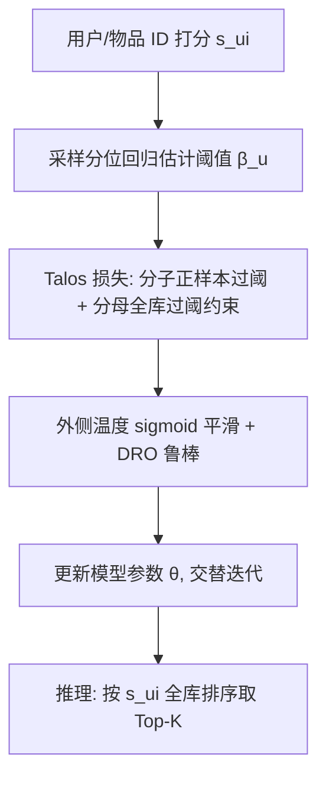

# Talos: Optimizing Top-$K$ Accuracy in Recommender Systems (面向 Top-$K$ 准确率的推荐损失函数)

- **会议/期刊**: WWW 2026
- **作者与机构**: Shengjia Zhang, Weiqin Yang, Jiawei Chen, Can Wang 等（浙江大学；北京工商大学；杭州城市学院；Bangsheng Technology 等）
- **推荐链路定位**: 召回（损失函数层，可插拔于 MF / LightGCN / XSimGCL 等骨干）
- **研究方向**: 协同过滤与双塔召回 / 去偏公平与可信推荐
- **论文原文**: [https://arxiv.org/abs/2601.19276v1](https://arxiv.org/abs/2601.19276v1)
- **开源代码**: [https://github.com/cynthia-shengjia/WWW-2026-Talos](https://github.com/cynthia-shengjia/WWW-2026-Talos)

## TL;DR (1分钟核心速览)

推荐系统真正关心的是 Top-$K$ 命中质量，但 Precision@$K$/Recall@$K$ 依赖排序位置、不可微且难优化；主流 BPR/SL 优化的是全排序指标（AUC/NDCG），与 Top-$K$ 准确率存在 20%+ 的不一致率。Talos 用**分位阈值**把"排序截断"改写为"分数 vs 阈值"的简单比较，配合**采样分位回归**估计每用户阈值、**分母约束项**抑制分数膨胀、**外侧温度 sigmoid** 代理函数获得 DRO 鲁棒性。在 4 数据集 × 3 骨干的 Full-Ranking 协议下，Precision@20/Recall@20 全面超越 SL/PSL/LLPAUC，平均相对提升 1.2%–4.9%。

## Background & Motivation (背景与核心矛盾)

- **主流范式**: 学习式推荐先由模型 $M_\theta$ 打分 $s_{ui}$，再按分数排序取 Top-$K$；损失函数决定优化方向，当前主流是 BPR（近似 AUC）与 Softmax Loss（近似 NDCG），以及 Partial-AUC 系的 LLPAUC。
- **前人局限**: ① 全排序损失与 Top-$K$ 准确率**目标错位**——作者在真实数据上统计任意两排序列表的不一致率，AUC 达 33%–35%、NDCG 达 26%–30%、NDCG@$K$ 仍达 17%–22%，即优化 NDCG 可能反而降低 Precision@$K$；② Partial-AUC 虽把不一致率降到约 21.86%，但其代理损失含三重指示函数、需**对抗训练**，训练不稳定（LLPAUC 在 Gowalla+LGCN 上甚至劣于 BPR），且引入 $\eta_\alpha,\eta_\beta$ 等额外超参，调参代价高。
- **核心洞察 (Key Insight)**: Top-$K$ 截断 $I(\pi_{ui}\le K)$ 的本质只是"该物品分数是否超过第 $K$ 名分数"——若引入每用户分位阈值 $\beta_u^k$，排序依赖即可消解为逐点比较 $I(s_{ui}\ge\beta_u^k)$，从而绕开显式排序。
- **本文切入点**: 以分位技术重构目标，再逐一解决由此衍生的**阈值估计**、**分数膨胀导致的收敛失稳**与**代理函数不连续/分布漂移**三大次生问题。

## Method (核心方法设计)

### 1. 整体框架 (Overall Architecture)

Talos 是一个可插拔损失：输入为用户-物品打分 $s_{ui}$，交替执行两步——(a) 用采样分位回归更新每用户阈值 $\hat\beta_u$；(b) 用 Talos 损失对模型参数做梯度下降。阈值把 Top-$K$ 选择转为分数比较，分母项约束"超过阈值的物品数≈$K$"以抑制膨胀，外侧温度 sigmoid 平滑 Heaviside 并带来 DRO 等价性。推理时仍按 $s_{ui}$ 全库排序取 Top-$K$，额外开销仅一次阈值前向，复杂度与 SL 同阶 $\mathcal{O}(\bar P|\mathcal{U}||G_u|)$。

### 2. 关键设计拆解 (Key Designs)

1. **分位重构 + 采样分位回归（Quantile Reformulation）**：痛点是不一致率与排序不可微。将 $-\log\text{Precision@}K$ 改写为 $-\log\frac{\sum_{i\in\mathcal{P}_u}\delta(s_{ui}-\beta_u^k)}{K}$，阈值定义为第 $K$ 名分数 $\beta_u^k=s_{ui},\ \pi_{ui}=K$。为免遍历全物品空间，提出带重要性权重的负采样分位回归：
$$\mathcal{Q}_K(u)=\frac{1}{|\mathcal{I}|}\Big[\sum_{i\in\mathcal{P}_u}\rho_K(s_{ui}-\hat\beta_u)+w_u\sum_{j\in G_u}\rho_K(s_{uj}-\hat\beta_u)\Big],\ w_u=\tfrac{|\mathcal{I}|-|\mathcal{P}_u|}{|G_u|}$$
其中 $\rho_K(x)=(1-K/|\mathcal{I}|)(x)_+ +(K/|\mathcal{I}|)(-x)_+$。重要性权重保证无偏性 $\mathbb{E}_{G_u}[\mathcal{Q}_K]=\mathcal{L}_{QR}$，复杂度降至 $\mathcal{O}(|\mathcal{P}_u|+|G_u|)$，估计误差 <0.02（对比 SL@$K$ 的 Monte-Carlo 误差 0.18）。

2. **分母约束项（Anti-Inflation Constraint）**：直接优化上式会出现"正负样本分数与阈值同步上涨"的**分数膨胀**。作者把目标等价改写为带约束 $\log\sum_{j\in\mathcal{I}}\delta(s_{uj}-\beta_u^k)=\log K$ 的拉格朗日形式，取 $\lambda=1$ 得
$$-\log\frac{\sum_{i\in\mathcal{P}_u}\delta(s_{ui}-\beta_u^k)}{\sum_{j\in\mathcal{I}}\delta(s_{uj}-\beta_u^k)}$$
分母天然惩罚"超过阈值的物品数"，强制恰好 $K$ 个物品过阈。消融显示去掉分母后 Gowalla P@20 从 0.0642 崩至 0.0278，是全模型最关键的组件。

3. **外侧温度代理函数与训练目标**：用 $\sigma_\tau(\cdot)=\text{sigmoid}(\cdot)^{1/\tau}$（温度在 sigmoid **外侧**）替代常规 $\text{sigmoid}(\cdot/\tau)$，并做 Jensen 上界变换便于 mini-batch：
$$\mathcal{L}_{\text{Talos}}=-\frac{1}{|\mathcal{P}_u|}\sum_{i\in\mathcal{P}_u}\log\frac{\sigma_\tau(s_{ui}-\beta_u^k)}{\sum_{j\in G_u}\sigma_\tau(s_{uj}-\beta_u^k)}$$
外侧温度使 Talos 成为 $-\log\text{Precision@}K$ 的**紧上界**（Thm 3.1），且等价于 KL 球约束下的 **DRO**（Thm 3.2），从而对分布漂移鲁棒；Thm 3.3 给出步长 $0<\alpha<2/K_{\text{Lip}}$ 下的收敛界。负采样沿用 SL 式 in-batch/均匀负采样，仅新增单一超参 $\tau$。

## Experimental Setup & Evaluation Protocol (实验设置与评估协议)

- **数据集与预处理**: 四个公开 CF 数据集，均按惯例过滤（Amazon 三域通常 5-core，Gowalla 过滤低频交互）：

| 数据集 | #Users | #Items | #Interactions | 稀疏度/密度 | 特征/场景说明 |
| :--- | :---: | :---: | :---: | :---: | :--- |
| Gowalla | ~29.9k | ~40.98k | ~1.03M | 99.92% 稀疏 | LBS 签到，含地理/时间 |
| Beauty | ~22.4k | ~12.1k | ~0.20M | 99.93% 稀疏 | Amazon 美妆评论 |
| Games | ~31.0k | ~17.3k | ~0.29M | 99.95% 稀疏 | Amazon 电子游戏 |
| Electronics | ~192k | ~63.0k | ~1.69M | 99.99% 稀疏 | Amazon 电子产品 |

- **数据划分与防穿越 (Splitting Strategy)**: 采用 `Leave-One-Out`（每用户最后一条交互作测试、倒数第二条作验证），并额外构造**时间偏置切分**模拟分布漂移场景（Table 3.4）。
- **排名评测协议 (Ranking Protocol)**: 无偏 `Full-Ranking`（对全部未交互物品排序），主指标 Precision@20 / Recall@20，辅以 Recall@{20,50,80}、NDCG@$K$、MRR@$K$；显著性 $p<0.05$。
- **对比基线与超参设置**: 骨干为 MF、LightGCN、XSimGCL；基线含 BPR、SL、BSL、AdvInfoNCE、PSL、LLPAUC、SmoothI@$K$、RS@$K$、AATP 共 9 个；网格搜索调参，Talos 仅调 $\tau$。

## Key Experimental Results (实验关键数据)

### 1. 主实验对比 (Main Results)

以 MF 与 XSimGCL 骨干为例（完整三骨干见原文 Table 3.1）：

| Backbone | Loss | Gowalla P@20 | Gowalla R@20 | Beauty P@20 | Beauty R@20 | Games P@20 | Electronics R@20 |
| :--- | :--- | :---: | :---: | :---: | :---: | :---: | :---: |
| MF | BPR | 0.0438 | 0.1511 | 0.0146 | 0.1267 | 0.0142 | 0.0566 |
| MF | SL | 0.0625 | 0.2017 | 0.0172 | 0.1403 | 0.0208 | 0.0626 |
| MF | PSL | 0.0631 | 0.2031 | 0.0174 | 0.1432 | 0.0210 | 0.0637 |
| MF | LLPAUC | 0.0562 | 0.1847 | 0.0157 | 0.1336 | 0.0187 | 0.0583 |
| MF | **Talos** | **0.0642** | **0.2079** | **0.0179** | **0.1499** | **0.0213** | **0.0655** |
| MF | Improv.% | +1.71%* | +2.35%* | +2.69%* | +4.69%* | +1.19%* | +2.75%* |
| XSimGCL | SL | 0.0623 | 0.2010 | 0.0171 | 0.1418 | 0.0208 | 0.0627 |
| XSimGCL | PSL | 0.0630 | 0.2023 | 0.0172 | 0.1407 | 0.0207 | 0.0636 |
| XSimGCL | **Talos** | **0.0638** | **0.2057** | **0.0180** | **0.1506** | **0.0212** | **0.0654** |
| XSimGCL | Improv.% | +1.27%* | +1.68%* | +4.87%* | +3.81%* | +1.32%* | +2.81%* |

时间漂移场景（Table 3.4，MF 骨干）：Talos 在 Gowalla 上 P@20 0.0574（+1.24%）、Beauty 上 0.0094（+5.51%），平均提升由 IID 的 1.26% 放大到 3.37%。

### 2. 消融实验 (Ablation Study)

| 变体 | Gowalla P@20 | Gowalla R@20 | Beauty P@20 | Beauty R@20 | Games P@20 | Electronics R@20 |
| :--- | :---: | :---: | :---: | :---: | :---: | :---: |
| w/o-quantile | 0.0626 | 0.2037 | 0.0175 | 0.1487 | 0.0208 | 0.0640 |
| w/o-outside | 0.0577 | 0.1859 | 0.0166 | 0.1375 | 0.0194 | 0.0592 |
| w/o-denominator | 0.0278 | 0.0869 | 0.0101 | 0.0841 | 0.0127 | 0.0160 |
| **Talos** | **0.0642** | **0.2079** | **0.0179** | **0.1499** | **0.0213** | **0.0655** |

### 3. 关键实验发现 (Key Findings)

1. **分母约束项是命门**：去掉后 Gowalla P@20 从 0.0642 跌至 0.0278（-57%），甚至低于 BPR，定量印证"分数膨胀"若不约束会彻底破坏优化；而 w/o-quantile 仅小幅下降（0.0626），说明阈值机制是"锦上添花"、约束项才是"雪中送炭"。
2. **外侧温度带来鲁棒性红利**：w/o-outside 在 Gowalla 掉至 0.0577（-10%），且时间漂移场景下 Talos 平均提升从 1.26% 放大到 3.37%，与 Thm 3.2 的 DRO 等价性一致——鲁棒性不是调参巧合而是理论性质。
3. **$K$ 一致性规律**：训练 $K$ 与评测 $K'$ 匹配时最优（Talos@20 在 Recall@20 上 0.2078，Talos@80 在 Recall@80 上 0.3911）；且随 $K$ 增大提升幅度递减（Gowalla Recall@80 仅 +0.22%），因为大 $K$ 下 Top-$K$ 指标趋近全排序指标，Talos 的相对优势自然收窄。

## Highlights, Limitations & Rating (亮点、对比与审稿评价)

- **与代表作对比 (vs. Prior Work)**: 相比 **SL/PSL**（优化 NDCG，与 Top-$K$ 不一致率 20%+），Talos 直接对准 Precision@$K$ 且给出紧上界保证；相比 **LLPAUC**（需对抗训练、多超参、跨骨干不稳定），Talos 仅一个 $\tau$、训练稳定且复杂度同 SL；相比同期 **SL@$K$**（优化 NDCG@$K$、无鲁棒性保证、Monte-Carlo 阈值误差 0.18），Talos 阈值误差 0.01、少负样本下仍稳定（+1.96%）。
- **可迁移亮点**: ① "分位阈值替代排序截断"可迁移到任何需要 Top-$K$ 截断的列表级目标（如重排阶段的 Top-$K$ 多样性约束）；② 外侧温度 sigmoid 的 DRO 等价技巧可复用到对比学习 InfoNCE 的负样本分布鲁棒化。
- **审稿级局限批判**: ① 阈值需每用户在线维护并随训练演化，工业级流式训练下的阈值同步与冷启动用户（交互极少、分位估计方差大）处理未充分讨论；② 实验仅在 MF/LightGCN/XSimGCL 三个 CF 骨干与四个公开数据集上验证，缺少大规模工业 A/B 与序列/生成式骨干的检验，且 $\tau$ 仍需网格搜索（作者亦将自适应 $\tau$ 列为未来工作）。
- **四维评分**: 创新性 ⭐⭐⭐⭐ | 实验扎实度 ⭐⭐⭐⭐ | 方法清晰度 ⭐⭐⭐⭐⭐ | 落地价值 ⭐⭐⭐⭐

