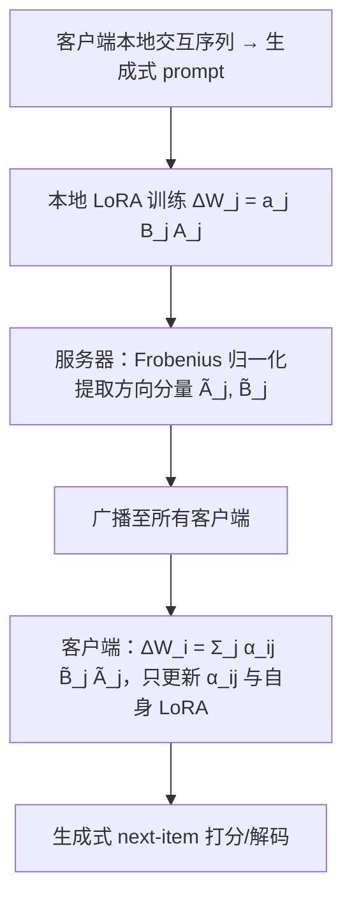
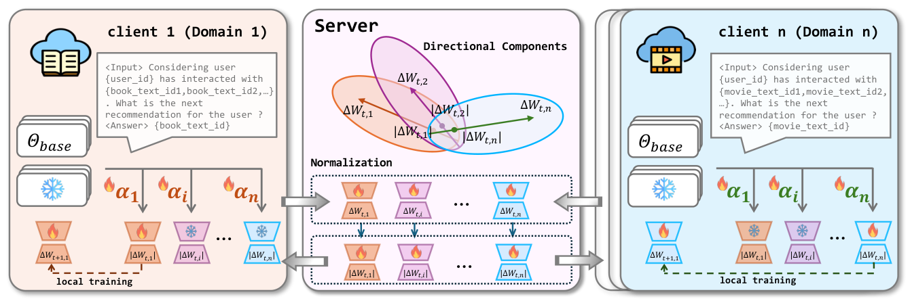

# FeDecider: An LLM-Based Framework for Federated Cross-Domain Recommendation (面向联邦跨域推荐的 LLM 决策框架)

- **会议/期刊**: The Web Conference (WWW) 2026
- **作者与机构**: Xinrui He, Ting-Wei Li, Tianxin Wei, Xuying Ning, Xinyu He, Wenxuan Bao, Hanghang Tong, Jingrui He（University of Illinois Urbana-Champaign）
- **推荐链路定位**: 精排（生成式 next-item 预测）
- **研究方向**: 跨域与多场景推荐 / 大语言模型推荐
- **论文原文**: [https://arxiv.org/abs/2602.16034v1](https://arxiv.org/abs/2602.16034v1)
- **开源代码**: [https://github.com/Xinrui17/FeDecider](https://github.com/Xinrui17/FeDecider)

## TL;DR (1分钟核心速览)

联邦跨域推荐中直接套用 FedAvg 聚合各域 LoRA 适配器会因**更新尺度差异**与**LLM 隐式表征难以度量跨域相似度**而全面掉点（Goodreads 上 FedAvg 平均 Hit@5 仅 0.0383，低于纯本地训练的 0.0551）。FeDecider 让服务器只广播 LoRA 更新的**方向分量**（Frobenius 归一化），客户端再用**可学习个性化权重** $\alpha_{ij}$ 做数据感知融合。在 Goodreads 三域与 Amazon 两对域上，Leave-One-Out + Full-Ranking 协议下平均 Hit@5 达 0.0572，较最强基线提升约 2.3%–3.8%，且优于 ID-based 联邦跨域方法一个量级。

## Background & Motivation (背景与核心矛盾)

- **主流范式**: 联邦跨域推荐（FedCT、FedGCDR、FedHCDR 等）在客户端间交换 ID 表征或图结构，以隐私保护方式迁移跨域知识；LLM4Rec 则用生成式 next-item 预测获得强语义泛化。
- **前人局限**: ① 传统方法依赖刚性 ID 映射与协同过滤架构，无法利用丰富文本、难泛化到新用户/新物品；② 直接把 LLM+LoRA 塞进联邦框架时，各域本地优化的 LoRA 更新**模长差异巨大**，FedAvg 式平均被大模长域主导，产生偏置聚合与过拟合（图 1 右、图 2 显示所有域均掉点）。
- **核心洞察 (Key Insight)**: LLM 通过自回归文本生成隐式编码知识，缺乏传统推荐中显式可比的 user/item 嵌入，因此**基于余弦相似度的聚合权重本身不可靠**；而 LoRA 更新的"方向"承载域特有模式、"模长"只是尺度噪声，二者应当解耦。
- **本文切入点**: 服务器只归一化并广播方向分量 $\tilde{B}_j\tilde{A}_j$，把聚合决策下放到客户端，用可学习权重自适应选择外部知识。

## Method (核心方法设计)

### 1. 整体框架 (Overall Architecture)

每个客户端（域）持有冻结的共享 LLM 主干 $\Theta$与本地 LoRA$\Delta W_i$，用生成式 next-item 负对数似然本地训练；每 5 个本地 epoch 上传一次 LoRA。服务器对每个客户端更新做 Frobenius 归一化提取方向分量并广播给所有客户端；客户端收到全部方向分量后，以个性化权重$\alpha_{ij}$线性组合构造$\Delta W_i$，本地训练时只更新自身 LoRA 与全部$\alpha_{ij}$，外部方向分量保持冻结。最终模型即为加权组合，无需额外微调。

<figure class="paper-figure" markdown="span">
  <figcaption>图3：FeDecider概览。服务器（中间）：在每个联邦轮次中，服务器收集（灰色箭头）来自所有客户端的LoRA更新，提取其方向分量，然后将其广播给所有客户端（灰色箭头）。客户端（左侧和右侧）：每个客户端（例如书籍的域1和电影的域n）保持基础模型冻结，并使用一组个性化权重𝛼整合接收到的方向分量，且在本地训练期间仅更新自身的LoRA和𝛼。</figcaption>
</figure>

### 2. 关键设计拆解 (Key Designs)

1. **方向分量通信（Directional Component Transfer）**：痛点在于模长与方向耦合导致偏置聚合。受 DoRA 启发将更新写作 $\Delta W_j = a_j B_j A_j$，服务器端联合重缩放$\tilde{A}_j \leftarrow s\cdot A_j,\ \tilde{B}_j \leftarrow s\cdot B_j,\ s = \|B_jA_j\|_F^{-1/2}$，保证$\|\tilde{B}_j\tilde{A}_j\|_F = 1$。直觉：剥离尺度后各域更新处于同一"球面"，聚合不再被大模长域绑架，同时归一化天然构成对原始更新的混淆，附带隐私收益。

2. **数据感知个性化融合（Data-aware Integration）**：痛点在于 LLM 隐式表征下余弦相似度无法度量跨域可迁移性。客户端学习 $\Delta W_i = \sum_{j=1}^{N}\alpha_{ij}\tilde{B}_j\tilde{A}_j$，本地目标为$\min_{\alpha_{ij},\tilde{A}_i,\tilde{B}_i}\mathbb{E}_{(x,y)\sim\mathcal{D}_i}[\mathcal{L}((x;W_0+\Delta W_i),y)]$。附录 Proposition A.6 证明$\partial F_i/\partial\alpha_{ij} = \langle\nabla F_i, D_j\rangle_F$，梯度下降会自动压低"有害方向"、抬升"有益方向"，从而在理论上抑制负迁移。

3. **训练目标、负采样与推理效率**：总损失即各客户端生成式交叉熵（next-item NLL），无显式负采样（softmax over 词表/item token）；每轮通信成本 $O(Krd)$，下载侧为$O(Krd)$略高于 LoRA 类基线，但跨域场景$K$ 很小（3–5），实际开销可接受；本地单轮训练 746s，12 轮收敛，均优于 Ditto（1665s）与 FDLoRA（1185s）。

## Experimental Setup & Evaluation Protocol (实验设置与评估协议)

- **数据集与预处理**: 每域随机采样固定用户数，按用户最后一条交互测试、倒数第二条验证：

| 数据集 | #Users | #Items | #Avg Inter. | 特征/场景说明 |
| :--- | :---: | :---: | :---: | :--- |
| Goodreads-Crime | 5,000 | 31,031 | 21.42 | 图书三域联邦 |
| Goodreads-Comics | 5,000 | 15,636 | 24.31 | 图书三域联邦 |
| Goodreads-Children | 5,000 | 21,422 | 26.88 | 图书三域联邦 |
| Amazon-Beauty | 4,000 | 10,077 | 8.92 | 美妆-服饰对 |
| Amazon-Clothing | 4,000 | 14,087 | 9.35 | 美妆-服饰对 |
| Amazon-Electronics | 5,000 | 8,661 | 6.87 | 电子-手机对 |
| Amazon-Phones | 5,000 | 23,037 | 9.89 | 电子-手机对 |

- **数据划分与防穿越**: `Leave-One-Out`（最后一条测试、倒数第二条验证），预训练仅用 2,000（Amazon）/3,000（Goodreads）条不属于任何客户端的交互，避免信息泄漏。
- **排名评测协议**: `Full-Ranking`（对域内全物品池排序），指标 Hit@5/10、NDCG@5/10。
- **对比基线与超参设置**: 7 个个性化联邦基线（FedAvg、PFedAvg、FedProx、Ditto、FFA-LoRA、Rolora、FellRec、FDLoRA）+ 3 个 ID-based 联邦跨域基线（FedHCDR、FedDCSR、FedGCDR）；主干为蒸馏减半的 IDGenRec，LoRA 插入全部注意力层，rank $r=8$（另测$r=16$），batch 64，lr 1e-3，$\alpha$ 初始化为 2，Goodreads 20 轮 / Amazon 25 轮通信。

## Key Experimental Results (实验关键数据)

### 1. 主实验对比 (Main Results)

Goodreads 三域（H@5 / N@5，节选）：

| Method | Crime H@5 | Crime N@5 | Comics H@5 | Comics N@5 | Children H@5 | Children N@5 | Avg H@5 |
| :--- | :---: | :---: | :---: | :---: | :---: | :---: | :---: |
| Local train | 0.0339 | 0.0232 | 0.0820 | 0.0625 | 0.0494 | 0.0376 | 0.0551 |
| FedAvg | 0.0198 | 0.0154 | 0.0598 | 0.0458 | 0.0354 | 0.0283 | 0.0383 |
| PFedAvg | 0.0328 | 0.0223 | 0.0804 | 0.0620 | 0.0486 | 0.0367 | 0.0539 |
| FedProx | 0.0340 | 0.0233 | 0.0838 | 0.0661 | 0.0500 | 0.0381 | 0.0559 |
| Ditto | 0.0358 | 0.0241 | 0.0836 | 0.0651 | 0.0482 | 0.0368 | 0.0559 |
| FFA-LoRA | 0.0304 | 0.0200 | 0.0676 | 0.0517 | 0.0374 | 0.0297 | 0.0451 |
| FDLoRA | 0.0322 | 0.0215 | 0.0818 | 0.0620 | 0.0500 | 0.0373 | 0.0547 |
| **FeDecider** | **0.0352** | **0.0252** | **0.0862** | **0.0701** | **0.0502** | **0.0401** | **0.0572** |
| Improv. vs best | — | +4.6% | +2.9% | +6.0% | +0.4% | +5.3% | **+2.3%** |

Amazon Beauty & Clothing（H@5 / N@5）：

| Method | Beauty H@5 | Beauty N@5 | Clothing H@5 | Clothing N@5 | Avg H@5 |
| :--- | :---: | :---: | :---: | :---: | :---: |
| Local train | 0.0172 | 0.0124 | 0.0080 | 0.0057 | 0.0126 |
| PFedAvg | 0.0173 | 0.0132 | 0.0078 | 0.0062 | 0.0126 |
| Ditto | 0.0158 | 0.0122 | 0.0088 | 0.0067 | 0.0123 |
| FellRec | 0.0173 | 0.0128 | 0.0085 | 0.0068 | 0.0129 |
| FDLoRA | 0.0163 | 0.0123 | 0.0090 | 0.0069 | 0.0127 |
| **FeDecider** | **0.0190** | **0.0145** | **0.0097** | 0.0061 | **0.0144** |
| Improv. vs best | +9.8% | +9.8% | +7.8% | — | **+11.6%** |

与 ID-based 联邦跨域方法对比（Goodreads 平均 H@5）：FedHCDR 0.0244、FedDCSR 0.0153、FedGCDR 0.0279，FeDecider 0.0572，约为最强 ID-based 方法的 **2.05 倍**。

### 2. 消融实验 (Ablation Study)

| 变体 | Crime H@5 | Comics H@5 | Children H@5 | Avg H@5 |
| :--- | :---: | :---: | :---: | :---: |
| PFedAvg (baseline) | 0.0328 | 0.0804 | 0.0486 | 0.0539 |
| w/o Decomp（不分解方向/模长） | 0.0338 | 0.0836 | 0.0510 | 0.0561 |
| w/o Per（均匀聚合，无 $\alpha$） | 0.0342 | 0.0824 | 0.0476 | 0.0547 |
| w/o Sep（先聚合 $A$、$B$ 再相乘） | 0.0342 | 0.0830 | 0.0480 | 0.0551 |
| **FeDecider** | **0.0352** | **0.0862** | **0.0502** | **0.0572** |

### 3. 关键实验发现 (Key Findings)

1. **个性化权重是最大贡献项**：去掉 $\alpha_{ij}$ 改为均匀聚合后平均 H@5 从 0.0572 掉到 0.0547（-4.4%），且在 Children 域掉幅最大（0.0502→0.0476），说明异构域间"一刀切"融合会直接引入负迁移。
2. **方向分解与结构对齐缺一不可**：w/o Decomp 掉至 0.0561、w/o Sep 掉至 0.0551，验证了尺度噪声确实存在，且把 $A_j$、$B_j$ 分开聚合会破坏同一客户端的低秩结构对齐、引入语义不一致。
3. **学到的权重与用户级语义相似度对齐**：图 4 显示 $\alpha_{ij}$ 热力图更贴近 user-level 距离而非 item-level 距离（域 3 对域 1 权重高于域 2，与用户相似度一致），且权重在约第 11 轮收敛；在 15 个用户活跃度分桶中 13 个优于 PFedAvg，长尾（后 2%）物品组也全面领先，说明跨域知识对冷门物品泛化尤为有效。

## Highlights & Limitations (亮点、对比与审稿批判)

- **与代表作对比 (vs. Prior Work)**: 相比 FFA-LoRA/Rolora 只解决 LoRA 聚合稳定性、FDLoRA 用双适配器做粗粒度全局/局部融合，FeDecider 把"共享什么"（仅方向）与"如何融合"（客户端可学习权重）彻底解耦，粒度更细；相比 FedHCDR/FedGCDR 等 ID-based 方法，借助 LLM 文本语义在稀疏域上取得约 2 倍 Hit@5。
- **可迁移亮点**: ① "归一化方向 + 客户端可学习加权"可直接迁移到任意参数高效的多源联邦/多场景融合；② 服务器端归一化兼作轻量隐私混淆，可与 LDP 叠加。
- **审稿级局限批判**: ① 下载成本 $O(Krd)$随客户端数线性增长，论文以"跨域场景$K$小"为由淡化，但未给出$K$增大时的掉点/开销曲线；② 个性化权重目前是客户端级标量，未做层粒度（作者自认未来工作），且$\alpha$ 初始值 2、学习率 1e-3 的敏感性未做系统扫描；③ 评估仅 3–5 个域、Full-Ranking 下绝对指标偏低（H@5 < 0.1），缺少线上或大规模用户级 A/B 验证。

## Rating (四维评分)

- **方法创新性 (Novelty)**: ⭐⭐⭐⭐ （方向/模长解耦 + 客户端可学习融合的组合新颖，附录给出梯度下降自动抑制有害方向的命题支撑）
- **评估协议与实验扎实度 (Protocol & Experiments)**: ⭐⭐⭐⭐ （5 组域对、10 个基线、消融/秩/分桶/收敛分析齐全，但缺 $K$ 规模与超参敏感性）
- **写作与数学规范度 (Clarity & Rigor)**: ⭐⭐⭐⭐ （公式简洁、DoRA 分解与命题推导清晰，通信成本表明确）
- **工业落地与复现价值 (Industrial & Practical Value)**: ⭐⭐⭐⭐ （代码已开源，本地训练 746s/轮、12 轮收敛，蒸馏减半主干适配端侧资源，工程可落地性强）
