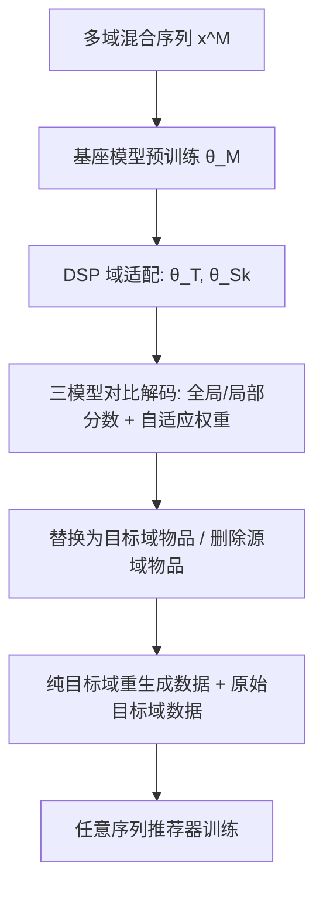
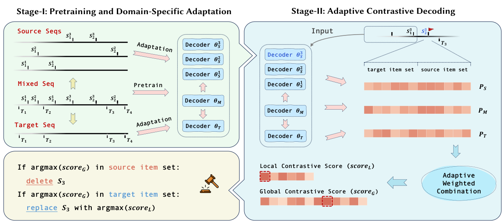

# Generative Data Transformation: From Mixed to Unified Data (从混合数据到统一数据的生成式数据变换)

- **会议/期刊**: WWW 2026 (The Web Conference)
- **作者与机构**: Jiaqing Zhang, Mingjia Yin, Hao Wang, Yuxin Tian, Yuyang Ye, Yawen Li, Wei Guo, Yong Liu, Enhong Chen (USTC / BUPT / 华为诺亚方舟实验室)
- **推荐链路定位**: 数据预处理层（服务于召回/精排的序列模型训练）
- **研究方向**: 跨域与多场景推荐 / 序列推荐
- **论文原文**: [https://arxiv.org/abs/2602.22743v2](https://arxiv.org/abs/2602.22743v2)
- **开源代码**: [https://github.com/USTC-StarTeam/Taesar](https://github.com/USTC-StarTeam/Taesar)

## TL;DR (1分钟核心速览)

跨域序列推荐长期被"模型中心"范式主导：设计复杂融合模块联合训练多域数据，但域间分布异质导致梯度冲突与负迁移（图 1 显示四域梯度余弦相似度多为负值）。本文提出 **Taesar**，一个"数据中心"框架：先用混合序列预训练基座模型 $\theta_M$，再以 Domain-Specific Prediction 派生各域专家$\theta_{S_k},\theta_T$，最后用三模型全局/局部对比解码，把源域物品**替换为目标域物品或直接丢弃**，将跨域混合数据在训练前转化为纯目标域数据。在 Amazon 四域、Leave-One-Out + Full-Ranking 协议下，GCE-GNN+Taesar 在 Books 上 HR@10 从 0.0598 升至 0.0774（+29.4%），且对 GRU/GNN/Attention/对比学习四类骨干均即插即用。

## Background & Motivation (背景与核心矛盾)

- **主流范式**: CDSR 以模型中心为主，早期 Pi-Net/PSJNet 用共享滤波器，后续 DA-GCN/C2DSR/DREAM 用图传播与注意力融合，近期 ABXI/SyNCRec 用 LoRA 与梯度正则抑制负迁移。
- **前人局限**: ① 统一多域建模优化复杂度高，共享表征空间内多域平衡困难，域内精度常不如单域模型；② 融合模块与模型强耦合、多任务超参敏感，泛化与可扩展性差。
- **核心洞察 (Key Insight)**: 图 1 的梯度余弦相似度热力图表明，朴素混合多域数据会引发梯度冲突；而图 2 显示，若在**数据层面**先把源域物品映射到语义最近的目标域物品、其余丢弃，多域建模问题就退化为精确的单域问题。
- **本文切入点**: 不做架构融合，而是用"目标域专家 vs 源域专家 vs 基座模型"的对比解码，在训练前把混合序列重生成为纯目标域序列。

## Method (核心方法设计)

### 1. 整体框架 (Overall Architecture)

Taesar 分两阶段闭环。**阶段一**：在按时间交错的多域混合序列 $\mathbf{x}^M_u$上预训练基座解码器$\theta_M$以捕获跨域共享模式；随后对每个域（含目标域$T$与各源域$S_k$）做 Domain-Specific Prediction 适配——输入仍是完整混合序列，但只对当前域物品计算下一跳预测损失，得到域专家$\theta_T,\theta_{S_k}$。**阶段二**：对混合序列中每个源域物品，并行取源域专家、目标域专家与基座模型的预测分布，计算全局/局部对比分数与熵-散度自适应权重，决定"替换为目标域物品"还是"删除"。重生成后的纯目标域数据与原始目标域数据合并，直接喂给任意现成序列推荐器训练，无需任何架构改动。

<figure class="paper-figure" markdown="span">
  <figcaption>图 3：Taesar 概览。(1) 在第一阶段三模型预训练中，我们构建解码器模型的三个视图：基础模型（𝜃M）、各源域专家（𝜃S）与目标域专家（𝜃T）。(2) 我们选择基础模型、目标域专家以及待转换物品对应的源域专家，利用三模型间的全局与局部对比解码来再生成混合跨域序列。(3) 基于两类对比分数，我们决定是将源域物品替换为目标域物品，还是丢弃源域物品。</figcaption>
</figure>

### 2. 关键设计拆解 (Key Designs)

1. **Domain-Specific Prediction (DSP) 适配**：痛点是从混合序列直接适配会让专家被异域噪声带偏。DSP 保留混合历史作上下文，但损失只统计"目标域物品预测下一个目标域物品"的有效对 $\mathcal{P}_T(\mathbf{x})=\{(i,t)\mid x_i,x_t\in\mathcal{V}_T,\,t>i,\,\nexists j\in(i,t)\ \text{s.t.}\ x_j\in\mathcal{V}_T\}$，即$\mathcal{L}^{\text{DSP}}_T=\mathbb{E}_{\mathbf{x}\sim\mathcal{X}^M}[\sum_{(i,t)\in\mathcal{P}_T(\mathbf{x})}\ell(\Phi_\theta(\mathbf{x}_{1:i}),x_t)]$。这样专家既继承跨域模式，又只对域内语义负责，为后续对比提供干净的"专家信号"。

2. **两级对比分数（Global / Local Contrastive Score）**：痛点是单看目标域专家无法判断某源域物品是否"值得迁移"。全局分数在全物品空间上对比 $\text{Global-score}_{i+1}=\alpha_g\cdot P_T-\beta_g\cdot P_{S_k}$，若最大值落在目标域物品集则判定可迁移；局部分数再把分布限制到$\mathcal{V}_T$上$\text{Local-score}_{i+1}=\alpha_l\cdot P_T|_{\mathcal{V}_T}-\beta_l\cdot P_{S_k}|_{\mathcal{V}_T}$，精确选出替换目标。直觉是：全局负责"要不要换"，局部负责"换成谁"，两级分工避免源域高置信噪声污染映射。

3. **熵-JSD 自适应权重与训练/推理开销**：固定 $\alpha,\beta$无法适应序列中置信度剧烈变化的位置。作者用信息论量纲定义$\alpha_g=1-\frac{H(P_T(v|\mathbf{x}_{1:i}))}{1-\max_{v\in\mathcal{V}}H(P_T(v|\mathbf{x}_{1:i}))}$（熵越低越自信、权重越大），$\beta_g=\tfrac{1}{2}[\text{KL}(P_M\|\tfrac{P_M+P_{S_k}}{2})+\text{KL}(P_{S_k}\|\tfrac{P_M+P_{S_k}}{2})]$（JSD 越小说明基座与源专家越对齐、迁移性越强）。重生成是一次性离线过程，下游模型训练与推理零额外开销；代价是需维护$M+2$ 个解码器并做逐位置三模型前向。

## Experimental Setup & Evaluation Protocol (实验设置与评估协议)

- **数据集与预处理**: Amazon 四域，按 [2,31] 预处理，每用户/物品至少 3 次交互，长序列截断至最近 128 条，按时间排序。

| 数据集 | #Users | #Items | #Interactions | 稀疏度 | 场景说明 |
| :--- | :---: | :---: | :---: | :---: | :--- |
| Books | 70,672 | 526,955 | — (均长 13.12) | 99.98% | 图书评论 |
| Electronics | 44,278 | 501,759 | — (均长 12.49) | 99.97% | 电子产品 |
| Sports | 38,030 | 355,807 | — (均长 8.86) | 99.98% | 运动户外 |
| Tools | 40,165 | 331,230 | — (均长 8.25) | 99.97% | 工具家装 |

- **数据划分与防穿越**: `Leave-One-Out`——每序列最后一条测试、倒数第二条验证、其余训练；按序列末物品所属域构造各域验证/测试集。
- **排名评测协议**: 无偏 `Full-Ranking`（全物品集为候选），明确规避 Krichene 指出的采样指标排序不稳定问题；指标 HR@{10,20}、NG@{10,20}、MRR@{10,20}。
- **对比基线与超参**: 单域骨干 SASRec / GRU4Rec / GCE-GNN / CL4SRec；跨域基线 SASRec$_4$（朴素混合）、ABXI、SyNCRec、CGRec。单域模型统一 2 头 2 层、hidden/inner=128、dropout=0.2；跨域基线在 heads/layers/hidden/LoRA rank/专家数上网格搜索；Adam，学习率$\{10^{-3},3\times10^{-4},10^{-4}\}$，最多 300 epoch，NG@10 30 轮不升即早停。

## Key Experimental Results (实验关键数据)

### 1. 主实验对比 (Main Results)

Books / Electronics 两域核心结果（完整表见原文 Table 2）：

| 方法 | Books HR@10 | Books NG@10 | Books MRR@10 | Elec. HR@10 | Elec. NG@10 | Elec. MRR@10 |
| :--- | :---: | :---: | :---: | :---: | :---: | :---: |
| SASRec | 0.0563 | 0.0371 | 0.0311 | 0.0350 | 0.0257 | 0.0228 |
| GCE-GNN | 0.0598 | 0.0447 | 0.0400 | 0.0353 | 0.0286 | 0.0266 |
| CL4SRec | 0.0585 | 0.0442 | 0.0398 | 0.0347 | 0.0278 | 0.0257 |
| SASRec$_4$ (朴素混合) | 0.0504 | 0.0342 | 0.0291 | 0.0311 | 0.0240 | 0.0218 |
| ABXI | 0.0489 | 0.0341 | 0.0369 | 0.0352 | 0.0290 | 0.0246 |
| SyNCRec | 0.0455 | 0.0337 | 0.0259 | 0.0314 | 0.0252 | 0.0193 |
| CGRec | 0.0413 | 0.0316 | 0.0218 | 0.0338 | 0.0203 | 0.0190 |
| **GCE-GNN+Taesar** | **0.0774** | **0.0566** | **0.0502** | **0.0404** | **0.0319** | **0.0293** |
| **CL4SRec+Taesar** | 0.0772 | 0.0567 | 0.0504 | 0.0408 | 0.0317 | 0.0289 |
| Improv. (vs 最佳基线) | +29.4% | +26.6% | +25.5% | +14.4% | +11.5% | +10.2% |

Sports 上 CL4SRec+Taesar 达 HR@10 0.0602（原 0.0413，+45.8%），Tools 上 SASRec+Taesar 达 0.0465（原 0.0333，+39.6%）。

### 2. 消融实验 (Ablation Study)

Electronics 域：

| 变体 | HR@10 | HR@20 | NG@10 | MRR@10 |
| :--- | :---: | :---: | :---: | :---: |
| w/o DSA | 0.0352 | 0.0434 | 0.0237 | 0.0202 |
| DSA w/o DSP | 0.0350 | 0.0450 | 0.0241 | 0.0208 |
| DSP w/o SDE | 0.0398 | 0.0472 | 0.0282 | 0.0239 |
| DSP w/o GCS | 0.0439 | 0.0523 | 0.0289 | 0.0242 |
| DSP w/o LCS | 0.0431 | 0.0512 | 0.0278 | 0.0231 |
| **Taesar Full** | **0.0441** | **0.0527** | **0.0291** | **0.0243** |

### 3. 关键实验发现 (Key Findings)

1. **负迁移真实存在且模型中心方法救不回来**：SASRec$_4$ 在 Books 上 HR@10 仅 0.0504，低于单域 SASRec 的 0.0563；ABXI/SyNCRec/CGRec 在多数指标上甚至不如单域基线，说明弱域间语义下架构增强无法弥合分布鸿沟，而 Taesar 把 Books HR@10 拉到 0.0774。
2. **数据侧收益可跨架构迁移且"越强越受益"**：同一份重生成数据喂给 GRU4Rec/GCE-GNN/CL4SRec 均一致提升，且 GCE-GNN、CL4SRec 这类表达力更强的骨干增益更大（Books HR@10 +29.4%/+32.0%），印证数据质量与模型容量互补。
3. **消融显示每个部件都不可省，源域专家最关键**：去掉源域专家（w/o SDE）HR@10 掉到 0.0398（-9.8%），去掉全局/局部对比分别掉到 0.0439/0.0431；去掉 DSA 或 DSP 更是跌至 0.035 量级，说明"先适配再对比"的两阶段设计是性能地基。图 5 进一步显示重生成后 Books 物品频率曲线更平、长尾覆盖提升、序列更长更稠密，从数据分布层面解释了增益来源。

## Highlights & Limitations (亮点、对比与审稿批判)

- **与代表作对比 (vs. Prior Work)**: 与 ABXI（LoRA 域不变兴趣 + 任务对齐）、SyNCRec（单/多域对比 + 互信息正则）、CGRec（层级对比重加权域损失）本质不同——三者都在**模型内部**做迁移与去噪，Taesar 在**训练前**把跨域数据物理转化为单域数据，下游模型零改动；相比 DR4SR 的单域数据重生成，本文首次把对比解码用于跨域序列重生成。
- **可迁移亮点**: ① "基座-专家-业余"三模型对比解码 + 熵/JSD 自适应权重，可迁移到多场景/多任务数据清洗与伪标签重写；② DSP"混合上下文、单域监督"的适配目标，是低成本构造域专家的通用配方。
- **审稿级局限批判**: ① 重生成需离线维护 $M+2$ 个解码器并逐位置三模型前向，源域多时预处理成本与存储映射字典开销未量化；② 映射质量强依赖域间语义相关性，论文仅在 Amazon 四域验证，对弱相关域（如图 1 中梯度近零的域对）是否会大量丢弃、丢弃率对下游的影响缺乏敏感性分析；③ 信息保留的理论边界作者自认未解决。

## Rating (四维评分)

- **方法创新性 (Novelty)**: ⭐⭐⭐⭐ （首次将数据中心范式与三模型对比解码引入 CDSR，视角切换清晰，但对比解码本身源自 LLM 领域，属组合式创新）
- **评估协议与实验扎实度 (Protocol & Experiments)**: ⭐⭐⭐⭐ （Leave-One-Out + Full-Ranking 严谨，四域 × 四骨干 × 多基线覆盖充分，消融完整；缺显著性检验与丢弃率敏感性分析）
- **写作与数学规范度 (Clarity & Rigor)**: ⭐⭐⭐⭐ （两阶段流程与公式定义清楚，熵/JSD 权重有信息论动机；重生成信息保留缺理论刻画）
- **工业落地与复现价值 (Industrial & Practical Value)**: ⭐⭐⭐⭐ （代码开源，重生成离线一次、下游零改动，工程友好；多专家离线成本与映射字典维护是主要落地门槛）
