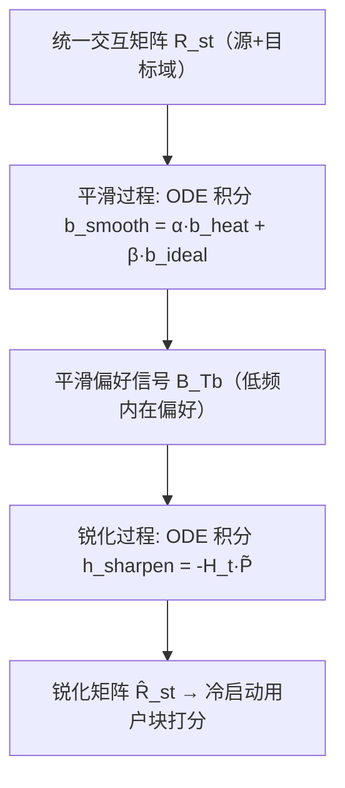
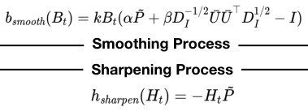

# S2CDR: Smoothing-Sharpening Process Model for Cross-Domain Recommendation (面向跨域推荐的平滑-锐化过程模型)

- **会议/期刊**: WWW 2026
- **作者与机构**: Xiaodong Li, Juwei Yue, Xinghua Zhang, Jiawei Sheng, Wenyuan Zhang, Taoyu Su, Zefeng Zhang, Tingwen Liu（中科院信工所 / UCAS / 阿里巴巴）
- **推荐链路定位**: 召回（跨域冷启动用户偏好迁移与打分）
- **研究方向**: 跨域与多场景推荐 / 冷启动与长尾推荐
- **论文原文**: [https://arxiv.org/abs/2603.02725v1](https://arxiv.org/abs/2603.02725v1)
- **开源代码**: 暂未开源

## TL;DR (1分钟核心速览)

针对跨域冷启动推荐中扩散模型（DMCDR）的两大痛点——只建模 user-item 交互而忽略跨域 item-item 相关性、前向加高斯噪声破坏用户个性化偏好——本文提出 S2CDR：以「平滑（corruption）→锐化（recovery）」的 ODE 过程替代扩散去噪，平滑阶段用热方程 + 理想低通滤波器在 item-item 相似图上无噪声地提取内在偏好，锐化阶段用负号算子迭代放大个性化差异。方法**完全免训练、闭式求解**，在 Douban/Amazon 三场景六跨域对上相对六个 SOTA 平均提升 HR 7.07%、NDCG 7.42%。

## Background & Motivation (背景与核心矛盾)

- **主流范式**: 跨域冷启动推荐分三派——映射式（EMCDR/SSCDR/UDMCF 学跨域映射函数）、元学习式（TMCDR/PTUPCDR 为每用户学个性化映射）、以及最新的扩散式（DMCDR 用高斯噪声前向腐蚀用户表征再反向生成目标域表征）。
- **前人局限**: ① DMCDR 仅处理 user-item 交互矩阵，**完全忽略跨域 item-item 相关性**这一同样关键的偏好迁移桥梁；② 扩散前向过程注入的高斯噪声会**侵蚀用户内在个性化偏好**，导致迁移的是次优偏好。
- **核心洞察 (Key Insight)**: 推荐任务真正需要的只是 user-item / item-item 交互矩阵本身，对其加高斯噪声既无必要也不高效；而图信号处理（GSP）理论指出，用户内在偏好由**低频信号**主导、噪声由**高频信号**主导，因此可用「无噪声的图滤波平滑」替代「加噪腐蚀」。
- **本文切入点**: 将扩散的 corruption-recovery 范式改写为 GSP 视角下的 smoothing-sharpening 过程，并用 ODE 连续求解，从而在保留个性化偏好的同时显式建模跨域 item 相关性。

## Method (核心方法设计)

### 1. 整体框架 (Overall Architecture)

输入为拼接源/目标域的统一交互矩阵 $\tilde{\boldsymbol{R}}_{st}$（重叠用户桥接两域，冷启动用户对应块全零待推断）。**平滑过程**以热方程 + 理想低通滤波器构成的平滑函数$b_{\text{smooth}}$为 ODE 导数，将原始交互信号连续腐蚀为去噪后的平滑偏好信号$\boldsymbol{B}_{T_b}$；**锐化过程**以$h_{\text{sharpen}}=-\boldsymbol{H}_t\tilde{\boldsymbol{P}}$为导数，从$\boldsymbol{B}_{T_b}$出发反向迭代放大节点间差异，输出锐化矩阵$\hat{\boldsymbol{R}}_{st}$，其中冷启动用户块即为预测交互。全过程无神经网络、无 embedding、无反向传播，ODE 求解即推理。

<figure class="paper-figure" markdown="span">
  <figcaption>图1：S2CDR 的整体框架。平滑过程旨在以无噪声的方式将原始用户-物品/物品-物品交互信号逐步破坏为平滑偏好信号，而锐化过程则迭代地细化和锐化偏好信号，以恢复冷启动用户的未知交互。</figcaption>
</figure>

### 2. 关键设计拆解 (Key Designs)

1. **热方程平滑算子 $b_{\text{heat}}$（捕获跨域 item 相关性）**：痛点在于 DMCDR 无 item-item 桥接。本文在跨域 item-item 相似图$\tilde{\boldsymbol{P}}=\tilde{\boldsymbol{R}}_{st}^\top\tilde{\boldsymbol{R}}_{st}$ 上引入热方程（牛顿冷却定律的图版本）：
$$b_{\text{heat}}(\boldsymbol{B}_t)=k\,\boldsymbol{B}_t(\tilde{\boldsymbol{P}}-\boldsymbol{I})$$
其直觉是：$\tilde{\boldsymbol{P}}$ 由**两域拼接矩阵**导出，故天然编码源域与目标域 item 的跨域相似性，热扩散使偏好沿该图传播，实现「源域看过冒险书 → 目标域冒险电影得分升高」的迁移。

2. **理想低通滤波算子 $b_{\text{ideal}}$（滤除高频噪声）**：热方程只抓低阶信息，且交互矩阵含大量高频噪声。本文借 GSP 的理想低通滤波器强化表达：
$$b_{\text{ideal}}(\boldsymbol{B}_t)=\boldsymbol{B}_t\!\left(\boldsymbol{D}_I^{-1/2}\bar{\boldsymbol{U}}\bar{\boldsymbol{U}}^\top\boldsymbol{D}_I^{1/2}-\boldsymbol{I}\right)$$
其中 $\bar{\boldsymbol{U}}$为$\boldsymbol{R}_{st}$的 top-$K$奇异向量。该算子将信号投影到主奇异子空间，等价于保留低频、截断高频，从而剥离「幻想/浪漫」类噪声偏好、保留「冒险」类内在偏好。二者加权合成$b_{\text{smooth}}=k\boldsymbol{B}_t(\alpha\tilde{\boldsymbol{P}}+\beta\boldsymbol{D}_I^{-1/2}\bar{\boldsymbol{U}}\bar{\boldsymbol{U}}^\top\boldsymbol{D}_I^{1/2}-\boldsymbol{I})$。

3. **锐化算子与免训练求解**：平滑会过度抹平节点差异（这正是纯 CF 类方法 PGSP/GF-CF 的上限所在）。锐化过程取 $h_{\text{sharpen}}(\boldsymbol{H}_t)=-\boldsymbol{H}_t\tilde{\boldsymbol{P}}$，负号使信号沿图**反向扩散**，重新拉开邻居间差距以恢复个性化。两阶段均为$\boldsymbol{X}_T=\boldsymbol{X}_0+\int_0^T f(\boldsymbol{X}_t)dt$的 Riemann 积分，用 Euler / RK4 / DOPRI 等 ODE 求解器离散积分即可，**无损失函数、无负采样、无参数**；推理开销仅为矩阵-矩阵乘法与$T/s$ 步积分。

## Experimental Setup & Evaluation Protocol (实验设置与评估协议)

- **数据集与预处理**: Douban（Movie、Book）与 Amazon（Movie&TV、CDs&Vinyl、Books）构造三个 CDR 场景；评分 $\ge 4$二值化为 1，过滤交互数$<5$ 的用户（`5-core`）。

| 数据集/场景 | 域对 | 过滤方式 | 特征说明 |
| :--- | :---: | :---: | :--- |
| Douban: Movie&Book | Book→Movie, Movie→Book | 5-core | 评分二值化，无辅助信息 |
| Amazon: Movie&Music | Music→Movie, Movie→Music | 5-core | 评分二值化，无辅助信息 |
| Amazon: Book&Music | Music→Book, Book→Music | 5-core | 评分二值化，无辅助信息 |

- **数据划分与防穿越**: 随机抽取约 20% 重叠用户作为冷启动用户（如 10% 从 Movie 侧、10% 从 Book 侧），其余重叠用户用于桥接两域；冷启动用户在被预测域中的交互块置零，属**冷启动划分**。
- **排名评测协议**: `Sampled Ranking`——`Leave-One-Out`，每用户 1 正例 + 999 随机负例，报告 HR@10 与 NDCG@10。
- **对比基线与超参**: 14 个基线覆盖单域（NeuMF）、映射式（EMCDR/DCDCSR/SSCDR/TMCDR/LACDR/DOML/UDMCF）、元学习式（PTUPCDR）、解耦式（CDRIB）、GSP-CF（GF-CF/PGSP）、扩散式（DMCDR）。$\alpha,\beta\in\{0.1,\dots,1.0\}$，$T_b,T_h\in[1,3]$，步数$\in\{1,\dots,5\}$，$k=1$。

## Key Experimental Results (实验关键数据)

### 1. 主实验对比 (Main Results)

| 方法 | Book→Movie HR | Book→Movie NDCG | Movie→Music HR | Movie→Music NDCG | Book→Music HR | Book→Music NDCG |
| :--- | :---: | :---: | :---: | :---: | :---: | :---: |
| NeuMF | 0.2390 | 0.1441 | 0.1581 | 0.0883 | 0.1518 | 0.0781 |
| EMCDR | 0.2477 | 0.1525 | 0.1662 | 0.0978 | 0.1621 | 0.0898 |
| PTUPCDR | 0.2736 | 0.1634 | 0.1810 | 0.1094 | 0.1749 | 0.1067 |
| CDRIB | 0.2761 | 0.1662 | 0.1832 | 0.1123 | 0.1758 | 0.1069 |
| UDMCF | 0.2914 | 0.1792 | 0.1952 | 0.1236 | 0.1863 | 0.1174 |
| PGSP | 0.4301 | 0.2470 | 0.2163 | 0.1516 | 0.1736 | 0.0881 |
| DMCDR | 0.4925 | 0.3046 | 0.2968 | 0.1920 | 0.2643 | 0.1510 |
| **S2CDR** | **0.5430** | **0.3302** | **0.3139** | **0.2049** | **0.2782** | **0.1646** |
| Improv.% | +10.25% | +8.40% | +5.76% | +6.72% | +5.26% | +9.01% |

六跨域对平均相对提升：HR **7.07%**、NDCG **7.42%**。

### 2. 消融实验 (Ablation Study)

| 变体 | Book→Movie HR | Movie→Music HR | Book→Music HR | 说明 |
| :--- | :---: | :---: | :---: | :--- |
| w/o $b_{\text{heat}}$ | 0.3387 | 0.2855 | 0.2370 | 去热方程，跨域 item 相关性丢失 |
| w/o $b_{\text{ideal}}$ | 0.4995 | 0.2230 | 0.1616 | 去低通滤波，高频噪声未滤除 |
| w/o $b_{\text{smooth}}$ | 0.1935 | 0.1115 | 0.1370 | 去整个平滑，退化最严重 |
| w/o $h_{\text{sharpen}}$ | 0.4892 | 0.2973 | 0.2684 | 去锐化，个性化差异未恢复 |
| **S2CDR** | **0.5430** | **0.3139** | **0.2782** | — |

### 3. 关键实验发现 (Key Findings)

1. **平滑是命脉、锐化是增益**：移除整个平滑函数 $b_{\text{smooth}}$ 使 Book→Movie HR 从 0.5430 暴跌至 0.1935（−64%），而移除锐化仅降至 0.4892；说明 GSP 平滑承担了跨域迁移的主体，锐化则是在平滑基础上「找回」被抹平的个性化差异（+5.4~11% 相对增益）。
2. **跨域 item 图优于单域 item 图**：用单域 $\tilde{\boldsymbol{P}}_{\text{source}}$或$\tilde{\boldsymbol{P}}_{\text{target}}$替换跨域$\tilde{\boldsymbol{P}}$ 均显著掉点（如 Music→Movie HR 0.1645/0.3535 vs. 0.3703），且对目标域冷启动用户，源域 item 图往往比目标域 item 图更有效——直接验证了「跨域 item 相关性是偏好迁移桥梁」这一核心动机。
3. **超参强度与数据稀疏度反向相关**：交互稀疏的 Movie→Book 需较大 $\alpha$才能捕获有限的相关性，而交互丰富的 Movie→Music/Book→Music 只需较小$\alpha$；噪声滤波强度$\beta$同理——稀疏场景噪声少、小$\beta$即可，稠密场景噪声多、需大$\beta$。此外 S2CDR 参数量为 0（DMCDR 为 21.17M~72.30M），预处理与推理时间全面低于 DMCDR。

## Highlights & Limitations (亮点、对比与审稿批判)

- **与代表作对比 (vs. Prior Work)**: 相比 DMCDR，本文用**无噪声图滤波**替代高斯加噪、用**跨域 item-item 图**补上被忽略的迁移桥梁，且免去 70M 级参数训练；相比 PGSP/GF-CF 等纯 GSP-CF，本文多出「锐化」这一反向扩散步骤，把平滑后的过平滑信号重新拉开，故在 Book→Movie 上 HR 从 0.4301 跃至 0.5430；相比 EMCDR/PTUPCDR 等映射式方法，本文不做表征映射而是直接操作交互矩阵，规避了映射函数在冷启动用户上的泛化误差。
- **可迁移亮点**: ①「平滑→锐化」的 ODE 双阶段结构可迁移到任何需要「先去噪再恢复个性化」的召回场景（如序列去噪、图推荐过平滑缓解）；② 用 top-$K$ 奇异向量构造理想低通滤波器的做法计算廉价，可作为 GCN 类模型的即插即用去噪前置模块。
- **审稿级局限批判**: ① 评估采用 1:999 采样排序而非 Full-Ranking，且仅报告 HR/NDCG@10，未覆盖全库排序下的真实召回上限；② 方法本质是线性图滤波 + ODE 积分，对**非线性高阶交互**建模能力有限，且 $\alpha,\beta,T_b,T_h$、步数与$K$ 等超参需按场景网格搜索，跨场景自适应能力存疑；③ 仅在两个数据集三个场景验证，未涉及多域（>2）或含辅助信息（文本/图像）的冷启动设定。

## Rating (四维评分)

- **方法创新性 (Novelty)**: ⭐⭐⭐⭐ （核心机制与方法设计具备明确创新性，理论与实验动机支撑充分）
- **评估协议与实验扎实度 (Protocol & Experiments)**: ⭐⭐⭐⭐ （主流公开数据集评测完整，包含多基线对比与消融实验验证）
- **写作与数学规范度 (Clarity & Rigor)**: ⭐⭐⭐⭐⭐ （问题形式化定义清晰，核心模块数学推导与架构阐述严谨易读）
- **工业落地与复现价值 (Industrial & Practical Value)**: ⭐⭐⭐⭐ （兼顾推荐效果增益与训练/推理效率，具备实际场景迁移参考价值）
