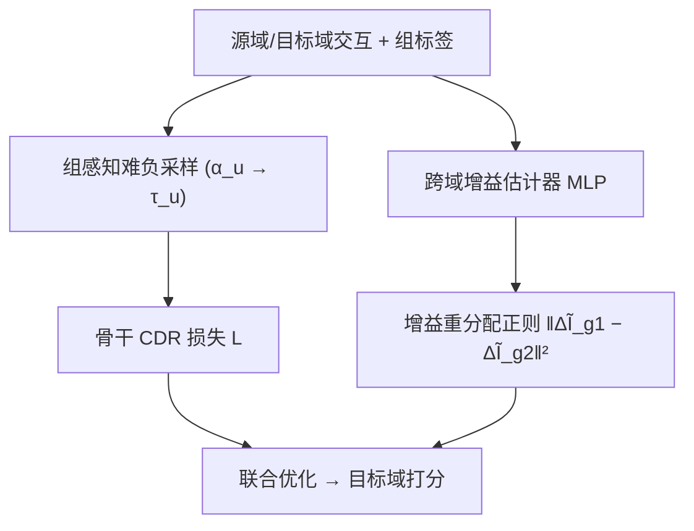
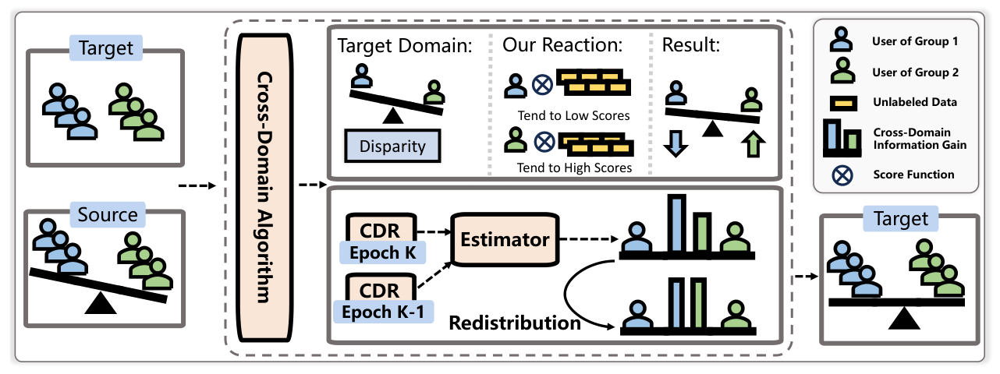

# The Double-Edged Sword of Knowledge Transfer: Diagnosing and Curing Fairness Pathologies in Cross-Domain Recommendation (知识迁移的双刃剑：诊断与治愈跨域推荐中的公平性病理)

- **会议/期刊**: WWW 2026
- **作者与机构**: Yuhan Zhao, Weixin Chen, Li Chen (香港浸会大学), Weike Pan (深圳大学)
- **推荐链路定位**: 精排（跨域知识迁移阶段）
- **研究方向**: 跨域与多场景推荐 / 去偏公平与可信推荐
- **论文原文**: [https://arxiv.org/abs/2601.21805v1](https://arxiv.org/abs/2601.21805v1)
- **开源代码**: [https://github.com/weixinchen98/CDFA](https://github.com/weixinchen98/CDFA)

## TL;DR (1分钟核心速览)

跨域推荐 (CDR) 在提升目标域精度的同时会**放大群体级不公平**，但既有工作只做“事后修补”而未回答“不公平从何而来”。本文用 Wasserstein-1 与 Rademacher 复杂度严格证明不公平源于两条路径：**源域群体差异经表示迁移被继承**，以及**跨域信息增益在群体间分配不均**。据此提出模型无关的 CDFA：用组感知难负采样均衡训练信号信息量，用信息论增益估计器重分配跨域收益。在 Tenrec QB/QK 上接入 5 种 CDR 骨干，UGF 最高相对下降 **98.97%**，精度平均反升 **+10.53%**。

## Background & Motivation (背景与核心矛盾)

- **主流范式**: CDR 通过共享表示 $\phi$与目标预测器$f_t$ 将源域信号注入目标域；公平性侧则以 FairCDR（样本影响力重加权）、VUG（为无重叠用户生成虚拟源域用户）等事后干预为主。
- **前人局限**: 其一，现有方法把 CDR 不公平当作单域不公平的简单放大，未区分“继承的偏差”与“新产生的偏差”，因而无法对症下药；其二，直接过滤源域不公平信息 $\hat{\mathcal{D}}_s=\text{filter}(\mathcal{D}_s)$ 会进一步压缩本就稀缺的源域监督，且只保证源域公平、对目标域无约束。
- **核心洞察 (Key Insight)**: 作者用 Kantorovich–Rubinstein 对偶推出目标域 UGF 上界 $\Gamma^{\text{UGF}}_t \le L_oL_f\big(W_1(\nu^0_s,\nu^1_s)+\delta^0_t+\delta^1_t+\delta^0_s+\delta^1_s+2\Delta_{ts}\big)$，其中源域组间 Wasserstein 距离$W_1(\nu^0_s,\nu^1_s)$ 直接抬高目标域公平性天花板；同时 Rademacher 复杂度分析表明组间样本量与函数类复杂度决定“增益差”的可观测偏差。图 1 的三组对照（target-only / CDR / 最小化源域差异的 CDR）实证了：CDR 确实恶化公平，修好源域差异能缓解但**不能消除**，说明第二条路径独立存在。
- **本文切入点**: 不动源域数据、不改 CDR 骨干结构，只在训练信号层面“补信息”与“分收益”。

## Method (核心方法设计)

### 1. 整体框架 (Overall Architecture)

CDFA 作为插件挂在任意 CDR 骨干（CMF/CLFM/BiTGCF/CoNet/DTCDR）之上，每个 epoch 执行两条并行支路：支路一读取上一轮各组平滑损失 $\bar{\mathcal{L}}^{(K)}_g$，算出用户级劣势度$\alpha_u$，据此调节负采样温度，为劣势组采更难负样本、优势组采更易负样本，从而在不删源域信息的前提下均衡组间训练信号信息量；支路二用 MLP 估计器拟合“跨域联合预测”与“单域预测”的对数比，得到每组的跨域信息增益$\hat{\Delta I}^K_{st}$，并以组间增益方差作为正则项回传，实现收益再分配。两路损失与骨干 BPR 损失联合优化，推理阶段不引入任何额外开销。

<figure class="paper-figure" markdown="span">
  <figcaption>图2：我们提出的跨域公平增强（CDFA）框架示意图。</figcaption>
</figure>

### 2. 关键设计拆解 (Key Designs)

1. **组感知自适应难负采样（均衡训练信号信息量）**：痛点是不公平部分源于劣势组训练信号“信息量不足”，而过滤源域会雪上加霜。作者用动量平滑损失作为可微的性能代理 $\bar{\mathcal{L}}^{(K)}_g=\beta\bar{\mathcal{L}}^{(K-1)}_g+(1-\beta)\mathcal{L}^{(K)}_g$，定义相对劣势$\alpha_u=(\bar{\mathcal{L}}^{(K)}_{g_u}-\bar{\mathcal{L}}^{(K)}_{\text{avg}})/\bar{\mathcal{L}}^{(K)}_{\text{avg}}$，并令采样温度$\tau_u=\exp(-\epsilon\alpha_u)$代入 softmax 采样概率$p(i|u)^{(K)}=\frac{\exp(\text{score}(\mathbf{u}_t,\mathbf{i}_t)/\tau_u)}{\sum_{j\in M}\exp(\text{score}(\mathbf{u}_t,\mathbf{j}_t)/\tau_u)}$。$\alpha_u$越大温度越低、分布越尖，难负样本被选中概率越高——直觉上等于给劣势组“加练”，且增强幅度与公平差距成正比，天然自适应。候选集$M$ 从全库随机抽样，既控开销又降低把用户真实偏好物品误当负样本的假阴性风险。

2. **信息论跨域增益估计与重分配（均衡收益分配）**：定义跨域增益 $\Delta I_{st}=I(Y;\mathbf{X}_s,\mathbf{X}_t)-[I(Y;\mathbf{X}_s)+I(Y;\mathbf{X}_t)]$，展开为期望对数比$\mathbb{E}\big[\log\frac{p(y|\mathbf{x}_s,\mathbf{x}_t)}{p(y|\mathbf{x}_s)p(y|\mathbf{x}_t)}\big]+c$。单域项用$\sigma(\text{score}(\mathbf{u}_s,\mathbf{i}_t))$、$\sigma(\text{score}(\mathbf{u}_t,\mathbf{i}_t))$直接估计，联合项$p(y|\mathbf{x}_s,\mathbf{x}_t)=\sigma(\text{Estimator}(\mathbf{u}_t,\mathbf{u}_s)\cdot\mathbf{i}_t)$由 MLP 建模。关键巧思在于联合项**无直接监督**：作者观察到第$K-1$轮更新后的目标域表示$\mathbf{u}^K_t$已内蕴跨域增益，于是用$\min_{\Theta_{\text{Estimator}}}\|\text{Estimator}(\mathbf{u}^{K-1}_t,\mathbf{u}^{K-1}_s)-\mathbf{u}^K_t\|^2$自监督拟合，把“一轮跨域更新带来的表示位移”当作增益的物理载体。最终以$\|\Delta\tilde{I}^{g_1}_{st}-\Delta\tilde{I}^{g_2}_{st}\|^2$ 压缩组间增益差。

3. **训练目标与推理效率**：总损失为 $\min_{\Theta\backslash\Theta_{\text{Estimator}}}\mathcal{L}+\gamma\|\Delta\tilde{I}^{g_1}_{st}-\Delta\tilde{I}^{g_2}_{st}\|^2$，估计器参数由上式单独交替更新；负采样为组自适应重要性采样（非均匀、非 in-batch），无需额外难负样本挖掘器。两模块仅增加常数级开销，整体复杂度与常规 CDR 框架同阶，推理期零额外成本。

## Experimental Setup & Evaluation Protocol (实验设置与评估协议)

- **数据集与预处理**: 两个腾讯真实跨域数据集，均为 Video↔Article 双域，敏感属性取 gender 与 age 两组划分。

| 数据集 | 域对 | 敏感属性 | 场景说明 |
| :--- | :---: | :---: | :--- |
| Tenrec QB | Video / Article | gender, age | QQ Browser 平台交互 |
| Tenrec QK | Video / Article | gender, age | QQ Kan 平台交互 |

- **数据划分与防穿越 (Splitting Strategy)**: 基于 RecBole-CDR 框架的标准跨域划分，目标域为主评测域，源域仅作辅助信号；详细统计与实现见原文附录 C。
- **排名评测协议 (Ranking Protocol)**: 采用 `Full-Ranking` 全库未交互物品排序，报告 Recall@{10,20} 与 NDCG@{10,20}；公平性用 UGF@K（组间指标期望差的上确界，越小越公平）。
- **对比基线与超参设置**: 精度骨干为 CMF、CLFM、BiTGCF、CoNet、DTCDR 五类；公平性对手为 FairCDR 与 VUG。所有提升经双侧 $t$-test 检验，$p<0.05$ 显著。

## Key Experimental Results (实验关键数据)

### 1. 主实验对比 (Main Results)

下表摘取 QB-gender 与 QK-gender 两个代表性设定（完整四设定见原文表 1），UGF 取四个指标均值口径的改善幅度：

| 骨干 | 设定 | Recall@10 (w/o → w/) | NDCG@20 (w/o → w/) | Acc. Impr. | Fair. Impr. |
| :--- | :--- | :---: | :---: | :---: | :---: |
| CMF | QB-gender | 0.2461 → **0.2715** | 0.1571 → **0.1771** | +11.66% | **+97.76%** |
| CLFM | QB-gender | 0.2049 → **0.2825** | 0.1281 → **0.1817** | **+40.09%** | +95.71% |
| BiTGCF | QB-gender | 0.2677 → **0.2754** | 0.1748 → **0.1779** | +2.20% | +68.75% |
| CoNet | QB-gender | 0.2266 → **0.2381** | 0.1468 → **0.1551** | +5.48% | **+98.97%** |
| DTCDR | QB-gender | 0.2138 → **0.2324** | 0.1347 → **0.1498** | +10.53% | +62.00% |
| CMF | QK-gender | 0.0210 → **0.0260** | 0.0151 → **0.0180** | +20.82% | +73.67% |
| CLFM | QK-gender | 0.0132 → **0.0277** | 0.0093 → **0.0191** | **+106.69%** | +40.02% |
| CoNet | QK-gender | 0.0129 → 0.0128 | 0.0092 → 0.0088 | −3.04% | +8.21% |

与 FairCDR、VUG 的对比（图 3）显示 CDFA 在精度与公平两个维度同时占优，且未出现精度回退。

### 2. 消融实验 (Ablation Study)

CMF + QB-gender 设定：

| 变体 | Recall@10 | NDCG@10 | UGF@10 | UGF@20 |
| :--- | :---: | :---: | :---: | :---: |
| w/o $\alpha_u$（去掉劣势度调节） | 0.2727 | 0.1414 | 0.0044 | 0.0020 |
| w/o FS（退化为随机负采样） | 0.2571 | 0.1322 | 0.0393 | 0.0458 |
| w/o $\mathcal{L}_{redist}$ | 0.2526 | 0.1308 | 0.0471 | 0.0541 |
| w/o $\mathcal{L}_{est}$ | **0.2729** | **0.1414** | 0.0035 | 0.0024 |
| CDFA 完整 | 0.2715 | 0.1411 | **0.0008** | **0.0006** |

### 3. 关键实验发现 (Key Findings)

- **公平性提升幅度与骨干的“原始偏差”强相关**：CoNet 在 QB-gender 上原始 UGF@10 高达 0.0513，CDFA 将其压到 0.0005（+98.97%）；而 BiTGCF 原本偏差就小（0.0364），改善幅度仅 +68.75%。说明 CDFA 是“按需补偿”，偏差越大收益越显著。
- **两条病理路径缺一不可**：去掉 $\mathcal{L}_{redist}$后 UGF@20 从 0.0006 反弹至 0.0541（恶化近 90 倍），去掉组感知采样后反弹至 0.0458，二者均远大于去掉$\alpha_u$或$\mathcal{L}_{est}$ 的影响，定量印证“差异迁移”与“增益不均”是两个独立且都必须处理的主因。
- **公平与精度并非零和**：多数设定精度同步上升（CLFM 在 QK-gender 上 Recall@10 提升 +106.69%），最差情形仅 −3.04%（CoNet/QK-gender）；超参分析显示 $\gamma$是唯一呈现明显权衡的超参，$|M|$主要扰动精度而公平性稳定，$\epsilon$ 在合理区间内鲁棒。

## Highlights & Limitations (亮点、对比与审稿批判)

- **与代表作对比 (vs. Prior Work)**: FairCDR 通过样本影响力重加权做数据层纠偏，VUG 通过虚拟源域用户补足无重叠用户，二者均属“事后对症”；本文首次给出 UGF 的 Wasserstein 上界与增益收敛界，把不公平拆成可分别干预的两项，且干预手段（负采样 + 增益正则）不触碰骨干结构，因而能同时挂载 5 种异构 CDR 模型。
- **可迁移亮点**: 其一，“用上一轮表示位移作为无监督增益监督信号”的自监督构造，可迁移到任何需要估计“某模块带来多少增量信息”的场景；其二，用动量平滑损失作为可微公平代理、再映射为采样温度的做法，可直接复用到单域去偏与冷启动扶持。
- **审稿级局限批判**: 其一，增益估计器依赖重叠用户，非重叠用户占主导时 $\hat{\Delta I}$ 的可靠性存疑，论文未给出重叠率的敏感性分析；其二，实验仅在腾讯两个同构（Video/Article）域对上验证，缺乏跨类型域（如电商→短视频）与多组（>2 组）公平性的扩展实验，UGF 的多组求和扩展仅有定义层面的说明。

## Rating (四维评分)

- **方法创新性 (Novelty)**: ⭐⭐⭐⭐ （首次用 Wasserstein 上界 + Rademacher 界把 CDR 不公平拆成迁移项与增益项，理论诊断扎实，但干预算子本身较常规）
- **评估协议与实验扎实度 (Protocol & Experiments)**: ⭐⭐⭐⭐ （5 骨干 × 2 数据集 × 2 敏感属性 + 公平性 SOTA 对比 + 完整消融与超参分析，$p<0.05$ 检验到位；缺多组与跨类型域验证）
- **写作与数学规范度 (Clarity & Rigor)**: ⭐⭐⭐⭐ （定理—实证—方法三段闭环清晰，公式推导完整；部分符号在正文与附录间复用略密）
- **工业落地与复现价值 (Industrial & Practical Value)**: ⭐⭐⭐⭐⭐ （模型无关插件、推理零开销、代码已开源，可直接挂载现有 CDR 生产链路）

