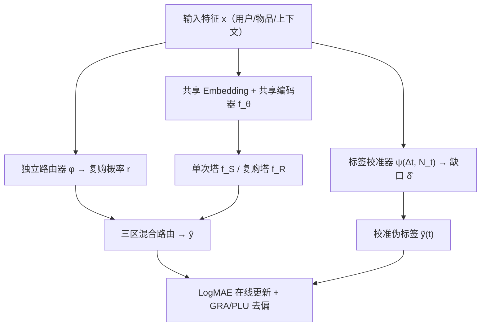

# Delayed Feedback Modeling for Post-Click Gross Merchandise Volume Prediction: Benchmark, Insights and Approaches (后点击商品交易总额预测的延迟反馈建模：基准、洞察与方法)

- **会议/期刊**: WWW 2026
- **作者与机构**: Xinyu Li, Sishuo Chen, Guipeng Xv, Li Zhang, Mingxuan Luo, Zhangming Chan, Xiang-Rong Sheng, Han Zhu, Jian Xu, Chen Lin（厦门大学信息学院 & 阿里巴巴淘天集团）
- **推荐链路定位**: 精排（广告排序 ECPM 中的 pGMV 预估）
- **研究方向**: CTR/CVR 预估与特征交叉 / 去偏公平与工业架构
- **论文原文**: [https://arxiv.org/abs/2601.20307v1](https://arxiv.org/abs/2601.20307v1)
- **开源代码**: [https://github.com/alimama-tech/OnlineGMV](https://github.com/alimama-tech/OnlineGMV)

## TL;DR (1分钟核心速览)

广告排序目标正从概率型 CVR 转向数值型后点击 GMV，但 GMV 是连续目标且单次点击可触发多次复购累加形成标签，延迟反馈问题远比 CVR 复杂，此前仅有 TransSun 考虑单次购买场景。本文构建首个覆盖完整交易序列的 TRACE 基准，揭示「在线流式训练必要性」与「单次/复购样本分布显著差异」两大洞察，提出复购感知双分支 READER（路由选择专家塔 + 标签校准 + 部分标签遗忘）。在 TRACE 全库流式评估下，ACC 相对最优基线提升 2.19%、AUC 提升 0.86%、ALPR 降低 6.88%。

## Background & Motivation (背景与核心矛盾)

- **主流范式**: 价值竞价（Max Conversion Value / Target ROAS）下 ECPM 需预估 pGMV，现有延迟反馈研究几乎全部聚焦 CVR 二分类，GMV 数值回归被忽视。
- **前人局限**: (1) 单次点击的 GMV 标签在归因窗口 $w_a$内被更新至多$N$次（图1），早期观测严重低估最终值——仅 40% 的 GMV 来自点击后即时购买；(2) 复购样本占比高达 53.55%，其 GMV 分布与单次购买样本存在显著右偏差异（KS 检验$p=0.00$），单一塔难以同时拟合两种异构分布。
- **核心洞察 (Key Insight)**: 在线流式训练显著优于离线日更（AUC 0.8165 vs. 0.8055），说明模型新鲜度至关重要；而轻量 MLP 路由器预测复购的 AUC 已超 80%，证明「先判复购、再分塔回归」在工程上可行。
- **本文切入点**: 用双分支解耦异构分布 + 用校准器补偿不完整标签 + 用遗忘策略消除末期标签膨胀，三者协同实现在线无偏 GMV 回归。

## Method (核心方法设计)

### 1. 整体框架 (Overall Architecture)

READER 采用「共享底层 + 双专家塔 + 独立路由器 + 标签校准器」结构。输入特征 $x$经共享 Embedding 与共享编码器$f_\theta$得到$h$，分别送入单次购买塔$f_S$与复购塔$f_R$得到$\hat{y}_s,\hat{y}_r$；独立路由器$\phi$输出复购概率$r$决定路由；校准器$\psi$依据已流逝时间$\Delta t$与已观测购买次数$N_t$预测标签缺口$\hat{\delta}$，将部分标签$y(t)$校正为伪标签$\tilde{y}(t)$。训练分两阶段：离线预训练（完整标签$y^*$）→ 在线流式学习（部分标签 + 去偏目标）。

### 2. 关键设计拆解 (Key Designs)

1. **复购感知双分支 + 三区混合路由**：痛点在于单塔需同时拟合单次与复购两种异构分布，梯度相互干扰。共享底层保留共性行为线索，双塔解耦各自分布；路由采用三区策略而非硬阈值，避免早期路由错误被放大：
$$\hat{y}=\begin{cases}\hat{y}_s, & r\le\tau_1\\ (1-r)\hat{y}_s+r\hat{y}_r, & \tau_1<r<\tau_2\\ \hat{y}_r, & r\ge\tau_2\end{cases}$$
其中 $\tau_1=0.1,\tau_2=0.9$。混合区软插值使训练可微，且对不确定样本保留两塔信息，物理直觉是「低置信不硬判」。

2. **标签校准器 (Label Calibrator)**：在线阶段观测到的 $y(t)$系统性低估$y^*$，直接回归会引入偏差监督。校准器学习对数域的标签缺口：
$$\hat{\delta}=\text{softplus}\big(f_\psi(\text{Emb}_\psi(x),\Delta t,N_t)\big),\quad \delta=\log(1+y^*)-\log(1+y(t))$$
校正后 $\tilde{y}(t)=\exp(\log(1+y(t))+\hat{\delta})-1$。用 softplus 保证缺口非负，符合「观测值只可能偏小」的先验；输入$\Delta t$与$N_t$ 让校准量随归因窗口推进自适应收缩。

3. **训练目标、负采样与推理效率**：总损失为
$$\mathcal{L}_{overall}=\mathcal{L}_{online}+\lambda_1(\mathcal{L}_{GRA}-\lambda_2\mathcal{L}_{PLU}),\ \lambda_1=0.1,\lambda_2=0.5$$
其中 $\mathcal{L}_{online}$用校准伪标签做 LogMAE 回归；$\mathcal{L}_{GRA}$在窗口关闭后用真值$y^*$对齐；$\mathcal{L}_{PLU}$反向最大化与末期校准伪标签$\tilde{y}(t_{p_N})$ 的误差，抵消校准器在最后一次购买处的「标签膨胀」。回归任务无需负采样；推理时仅需一次前向（路由 + 双塔 + 校准器），路由器与校准器均为轻量 MLP，在线开销可控。

## Experimental Setup & Evaluation Protocol (实验设置与评估协议)

- **数据集与预处理**: TRACE 采样自淘宝展示广告日志，覆盖 82 天，归因窗口 7 天，按广告场景（15 个代表性场景）与用户（分层采样，高活跃用户高采样率）两维抽样，标识符不可逆哈希脱敏。

| 数据集 | #Clicks | #Repurchase Samples | #Users | #Items | 特征/场景说明 |
| :--- | :---: | :---: | :---: | :---: | :--- |
| TRACE | 7.16M | 3.84M (53.55%) | 3.60M | 1.96M | 22 类类别特征 + 点击/购买时间戳 + 交易价格序列 + 累积 GMV 轨迹 |

- **数据划分与防穿越 (Splitting Strategy)**: 时间切分——预训练用第 0–50 天点击，在线学习用第 57–82 天流式数据，中间留 gap 防标签穿越。
- **排名评测协议 (Ranking Protocol)**: 在线流式评估，每个样本在其购买事件到达时按当时可观测信息打分，指标为 AUC、ACC（相对误差 20% 内占比）、ALPR（平均对数相对误差）。
- **对比基线与超参设置**: 基线含 Pre-Single、Offline-Single、Online-Single 及其双分支变体 Pre-Dual、Offline-Dual、Online-Dual，另设 Oracle-Single/Oracle-Dual 作性能上界参考；学习率搜索 $\{10^{-2},10^{-3},10^{-4}\}$，训练 1 epoch。

## Key Experimental Results (实验关键数据)

### 1. 主实验对比 (Main Results)

| 模型 | AUC↑ | ACC↑ | ALPR↓ |
| :--- | :---: | :---: | :---: |
| Oracle-Single（上界参考） | 0.8168 | 0.2580 | 0.7823 |
| Oracle-Dual（上界参考） | 0.8486 | 0.4134 | 0.6273 |
| Pre-Single | 0.8035 | 0.2488 | 0.8220 |
| Offline-Single | 0.8055 | 0.2556 | 0.8125 |
| Online-Single | 0.8165 | 0.2495 | 0.8079 |
| Pre-Dual | 0.8045 | 0.2466 | 0.8213 |
| Offline-Dual | 0.8114 | 0.2507 | 0.7974 |
| Online-Dual | 0.8161 | 0.2562 | 0.8506 |
| **READER** | **0.8235** | **0.2612** | **0.7523** |
| **Improv.%** | **+0.86%** | **+2.19%** | **-6.88%** |

### 2. 消融实验 (Ablation Study)

| Calib | GRA | PLU | AUC↑ | ACC↑ | ALPR↓ |
| :---: | :---: | :---: | :---: | :---: | :---: |
| ✗ | ✗ | ✗ | 0.8161 | 0.2562 | 0.8506 |
| ✓ | ✗ | ✗ | 0.8180 | 0.2568 | 0.7738 |
| ✓ | ✓ | ✗ | **0.8235** | 0.2604 | 0.7534 |
| ✓ | ✓ | ✓ | **0.8235** | **0.2612** | **0.7523** |

架构消融（Oracle 设定）：Single-Branch 0.8168 / Independent Dual 0.8348 / Frozen-Bottom Dual 0.8404 / **Shared-Bottom Dual 0.8520**（AUC），共享可训练底层最优。路由消融：Hard Routing AUC 0.8066 vs. Hybrid Routing 0.8161。

### 3. 关键实验发现 (Key Findings)

1. **在线训练是 GMV 预测的刚需**：Online-Single 较 Offline-Single AUC 提升 0.0110（0.8165 vs. 0.8055），印证 GMV 标签分布逐小时剧烈波动（午夜/早间/晚间三峰），日更模型无法跟上分布漂移。
2. **双分支必须配去偏才在在线场景生效**：Online-Dual 虽 ACC 升至 0.2562，但 AUC 与 ALPR 反而劣化（ALPR 0.8506 为全表最差），说明无校准的部分标签监督会放大双塔方差；加入 Calib 后 ALPR 骤降至 0.7738，再加 GRA 使 AUC 提升 +0.0055，三件套齐备后达到最优。
3. **校准器与遗忘策略互补而非冗余**：Calib 单独贡献主要来自 ALPR（-0.0768），GRA 贡献主要来自 AUC（+0.0055），PLU 在 AUC 不降的前提下把 ACC 再推高 0.0008 并压低保 ALPR，验证「补偿低估」与「消除末期膨胀」作用于不同偏差来源。

## Highlights & Limitations (亮点、对比与审稿批判)

- **与代表作对比 (vs. Prior Work)**: 相较 TransSun 仅建模单次购买订单级 GMV，本文首次显式处理复购累加标签；相较 CVR 延迟反馈经典方法（如 ES-DFM、DEFER 的样本复制/重要性加权），本文把「延迟」从二分类概率偏移推广到连续数值的累积低估问题，并给出校准 + 遗忘的回归专用解法。
- **可迁移亮点**: (1) 三区软路由可迁移到任何「异构样本共享底层」的多场景/多任务建模；(2) 「校准伪标签 + 窗口关闭后反向遗忘」的组合可复用到任何带归因窗口的数值型延迟目标（如 LTV、长期 GMV）。
- **审稿级局限批判**: (1) 校准器在线阶段被冻结，作者自承在线更新仅边际收益，但分布漂移剧烈时冻结校准器可能失效；(2) 评估仅限淘宝单平台 TRACE，且采样策略使数据不代表真实业务指标，跨平台泛化性与线上 A/B 收益未验证；(3) 路由阈值 $\tau_1,\tau_2$ 固定为 0.1/0.9，缺少敏感性分析。

## Rating (四维评分)

- **方法创新性 (Novelty)**: ⭐⭐⭐⭐ （首次形式化后点击 GMV 延迟反馈问题，双分支 + 校准 + 遗忘的组合针对性强，但各组件单独看均属已有范式迁移）
- **评估协议与实验扎实度 (Protocol & Experiments)**: ⭐⭐⭐⭐ （首个公开基准 + 在线流式评估贴近工业，消融完整含架构与路由两维，但缺跨平台与线上验证）
- **写作与数学规范度 (Clarity & Rigor)**: ⭐⭐⭐⭐ （问题定义与符号表清晰，公式推导简洁；式 (17) 中 $\mathcal{L}_{GRA}$ 重复书写为笔误，路由阈值缺敏感性讨论）
- **工业落地与复现价值 (Industrial & Practical Value)**: ⭐⭐⭐⭐⭐ （数据与代码全开源，来自淘天真实广告系统，双塔 + 轻量路由的在线部署成本低，直接可落地）
