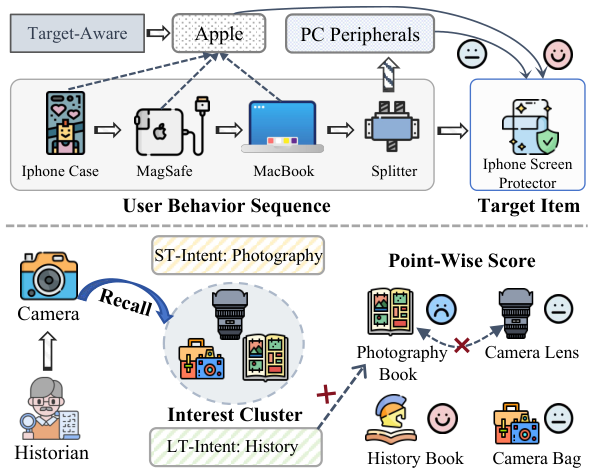
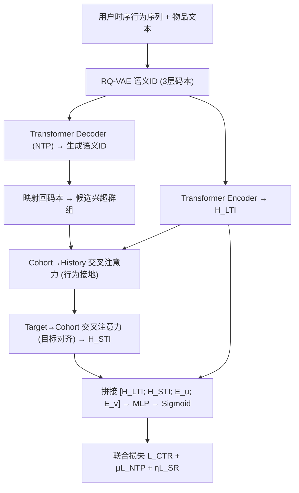
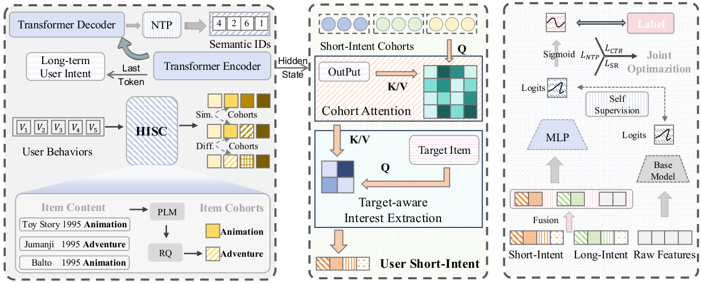

# GenCI: Generative Modeling of User Interest Shift via Cohort-based Intent Learning for CTR Prediction (基于群组意图学习的生成式用户兴趣漂移建模用于CTR预估)

- **会议/期刊**: WWW 2026 (Research Track)
- **作者与机构**: Kesha Ou, Zhen Tian, Wayne Xin Zhao, Ji-Rong Wen (中国人民大学高瓴人工智能学院); Hongyu Lu (腾讯微信)
- **推荐链路定位**: 精排 (CTR预估)，通过生成式模块向精排注入召回阶段上下文
- **研究方向**: CTR预估与特征交叉 / 生成式推荐与离散语义ID
- **论文原文**: [https://arxiv.org/abs/2601.18251v1](https://arxiv.org/abs/2601.18251v1)
- **开源代码**: [https://github.com/RUCAIBox/GenCI](https://github.com/RUCAIBox/GenCI)

## TL;DR (1分钟核心速览)

针对判别式CTR模型"只做候选-历史相关性匹配、易过拟合历史主导特征"与"逐点打分丢弃召回集合上下文"两大痛点，GenCI 用 RQ-VAE 语义ID + Transformer 的 NTP 任务**主动生成**候选兴趣群组（candidate-agnostic 的短期意图假设），再经分层候选感知交叉注意力（cohort→行为、target→cohort 两级）精炼后注入精排，并以 NTP + 自监督正则联合端到端训练。在 MovieLens / Amazon-Fashion / Amazon-Instrument 三数据集上 AUC 达 0.8964 / 0.7519 / 0.7182，相对最强基线 SFG/MIRRN 提升 0.25%~2.34%，推理延迟与 DIN 同级（0.28~0.48s）。

## Background & Motivation (背景与核心矛盾)

- **主流范式**: 以 DIN/DIEN/MIRRN 为代表的行为序列建模，用 target-aware 注意力对历史行为加权，本质是"候选相关性判别"；特征交叉侧则由 DCNv2/xDeepFM/AFN+/RFM 沿"embedding-then-interaction"路线堆叠高阶交叉。
- **前人局限**: ① 判别式范式只评估"候选 vs 历史"的相关性，不构造独立的当前意图表征，用户从 iPhone 配件转向 MacBook 配件时仍因历史 Apple 物品密集而给 iPhone 贴膜高分（shortcut learning）；② 逐点打分使精排对召回集合整体隐含的意图假设"失明"，召回已检索出摄影类物品，精排却被长期历史书偏好压制，形成召回-排序错位。
- **核心洞察 (Key Insight)**: 用户点击序列的时序因果性蕴含意图漂移；若在**全物品空间**上做 NTP 生成，语义ID天然把相似物品聚成"群组"，可得到全局一致、候选无关的意图假设，恰好补上逐点精排缺失的上下文。
- **本文切入点**: 把 `recall-then-rank` 重构为 `generate-and-interpret`——生成模块产出兴趣群组作为动态先验，精排负责解读与个性化。

<figure class="paper-figure" markdown="span">
  <figcaption>图1：CTR预测中两个关键挑战的示意图。上：基于相关性的模型侧重于长期偏好匹配，无法适应短期意图变化（例如，从iPhone配件到MacBook配件）。下：召回与排序之间的不一致，召回阶段检索意图相关物品（例如，摄影相关），但排序阶段偏好与长期兴趣一致的物品（例如，历史书籍）。</figcaption>
</figure>

## Method (核心方法设计)

### 1. 整体框架 (Overall Architecture)

输入用户时序行为序列，先用 RQ-VAE 将物品标题/描述文本嵌入量化为 3 层、码本 256 的语义ID；Transformer 编码器取最后有效位置隐状态得长期意图 $\mathbf{H}_{LTI}$，解码器以 NTP 目标自回归生成下一物品语义ID（约束 beam search 保证落在语料内），映射回码本即得候选兴趣群组；分层候选感知模块先用群组表征作 query 去 attend 历史隐状态（行为接地），再用目标物品 embedding 作 query 去 attend 多层级群组（目标对齐），得短期意图$\mathbf{H}_{STI}$；二者与常规特征拼接入 MLP 出 CTR，全模型以$\mathcal{L}_{CTR}+\mu\mathcal{L}_{NTP}+\eta\mathcal{L}_{SR}$ 端到端联合优化。

<figure class="paper-figure" markdown="span">
  <figcaption>图2：所提出的GenCI框架概览。左侧部分展示了构建用户兴趣群组的生成模块，其中“HISC”通过分层量化生成这些群组。中间部分详述了分层候选感知意图建模，用于细化这些群组。右侧部分展示了多意图融合，并与自监督联合优化用于CTR预测。</figcaption>
</figure>

### 2. 关键设计拆解 (Key Designs)

1. **语义兴趣群组生成 (HISC + NTP)**：痛点是不构造独立意图表征。用 RQ-VAE 逐层残差量化 $z_n=\arg\min_k\|\boldsymbol{r}^{(n)}-\boldsymbol{c}^n_k\|_2^2,\ \boldsymbol{r}^{(n+1)}=\boldsymbol{r}^{(n)}-\boldsymbol{c}^n_{z_n}$，同一层同码字的物品即构成一个语义群组，共$N\times K$个多粒度群组；解码器以$P(Y|X)=\prod_{n=1}^{N}P(c^{t+1}_n|X,c^{t+1}_{<n})$ 生成下一物品的语义ID。直觉：预测目标是结构化码而非原子ID，迫使模型学"抽象意图"而非表层共现，且全库预测带来全局语义一致性，抑制对局部高频特征的过拟合。

2. **分层候选感知意图精炼 (HCAIM)**：痛点是生成群组可能仅因粗粒度语义相似而混入行为无关物品。先群组内 mean-pool 得 $\mathbf{E}_C\in\mathbb{R}^{(N-1)\times d}$，再两级交叉注意力：$\mathbf{E}_R=\text{Softmax}\big(\tfrac{(\mathbf{E}_CW_Q)(\mathbf{H}_{enc}W_K)^\top}{\sqrt{d}}\big)(\mathbf{H}_{enc}W_V)$用群组查询历史、筛掉无行为证据的物品；$\mathbf{H}_{STI}=\text{Softmax}\big(\tfrac{(\boldsymbol{e}_vW_Q)(\mathbf{E}_RW_K)^\top}{\sqrt{d}}\big)(\mathbf{E}_RW_V)$ 用目标物品查询多层级群组，自适应选择合适语义粒度（大类 vs 细分 niche）。直觉：静态 mean-pool 会得到 target-agnostic 向量，两级 query 分别解决"行为接地"与"目标对齐"。

3. **联合优化与自监督正则**：总损失 $\mathcal{L}=\mathcal{L}_{CTR}+\mu\mathcal{L}_{NTP}+\eta\mathcal{L}_{SR}$，其中$\mathcal{L}_{SR}=-\frac{1}{N}\sum_i L\big(\text{OP}(\mathcal{M}_{base}(\boldsymbol{x}_i)),\text{OP}(\mathcal{M}_{ours}(\boldsymbol{x}_i,\boldsymbol{\phi}_i))\big)$ 用轻量 DeepFM 的 logits 蒸馏正则化全模型输出，缓解训练早期生成意图噪声导致的收敛不稳。NTP 为全库 softmax（免负采样），推理时仅需一次 beam search 生成 + 两次小规模注意力，开销与 DIN 同级。

## Experimental Setup & Evaluation Protocol (实验设置与评估协议)

- **数据集与预处理**:

| 数据集 | #Users | #Items | #Interactions | Avg.n | 稀疏度 | 特征/场景说明 |
| :--- | :---: | :---: | :---: | :---: | :---: | :--- |
| MovieLens | 6,041 | 3,669 | 739,012 | 122.35 | 96.66% | 评分>3为正、<3为负；序列截断50 |
| Amazon-Fashion | 3,719 | 13,198 | 24,097 | 6.48 | 99.95% | 5-core 过滤；序列截断20 |
| Amazon-Instrument | 57,440 | 24,588 | 511,836 | 8.91 | 99.96% | 5-core 过滤；序列截断20 |

- **数据划分与防穿越 (Splitting Strategy)**: MovieLens 按时序 **8:1:1 比例划分**；两个 Amazon 子集采用 **Leave-One-Out**（最后一件测试、倒数第二件验证）。
- **排名评测协议 (Ranking Protocol)**: 采用 CTR 标准 **AUC + LogLoss**（逐样本二分类打分，非全库排序），辅以 RelaImpr 相对提升指标；未使用负采样排序协议。
- **对比基线与超参设置**: 15 个基线覆盖 LR/FwFM（低阶）、NFM/PNN/FiGNN（高阶）、DeepFM/DCNv2/AutoInt+/xDeepFM（显式+隐式集成）、AFN+/RFM（自适应阶）、DIN/DIEN/MIRRN（行为建模）、SFG（生成式特征）；RecBole 实现，embedding 维度 16，batch 1024，RQ-VAE 3 码本×256 + 1 碰撞码本，T5 为序列骨干，交叉注意力 2 头，dropout∈{0.1,0.2,0.3}，MLP [256,256,256]，Adam lr=5e-3，0.001 级显著性。

## Key Experimental Results (实验关键数据)

### 1. 主实验对比 (Main Results)

| Model | MovieLens AUC | LogLoss | RelaImpr | Fashion AUC | LogLoss | RelaImpr | Instrument AUC | LogLoss | RelaImpr | Latency |
| :--- | :---: | :---: | :---: | :---: | :---: | :---: | :---: | :---: | :---: | :---: |
| LR | 0.8577 | 0.3904 | – | 0.7284 | 0.5097 | – | 0.6985 | 0.4200 | – | 0.16s |
| DeepFM | 0.8908 | 0.3527 | 9.25% | 0.7430 | 0.6949 | 6.39% | 0.7151 | 0.3866 | 8.36% | 0.22s |
| DCNv2 | 0.8927 | 0.3564 | 9.78% | 0.7423 | 0.6147 | 6.08% | 0.7148 | 0.3869 | 8.21% | 0.21s |
| xDeepFM | 0.8919 | 0.3512 | 9.56% | 0.7443 | 0.6465 | 6.96% | 0.7158 | 0.3868 | 8.71% | 0.31s |
| DIN | 0.8931 | 0.3445 | 9.89% | 0.7445 | 0.7838 | 7.05% | 0.7166 | 0.3894 | 9.11% | 0.29s |
| DIEN | 0.8936 | 0.3459 | 10.03% | 0.7451 | 0.8129 | 7.31% | 0.7168 | 0.3879 | 9.21% | 1.06s |
| MIRRN | 0.8938 | 0.3472 | 10.05% | 0.7466 | 0.5647 | 7.95% | 0.7169 | 0.3863 | 9.26% | 0.36s |
| SFG | 0.8939 | 0.3463 | 10.08% | 0.7450 | 0.5672 | 7.28% | 0.7159 | 0.3920 | 8.79% | 0.29s |
| **GenCI** | **0.8964** | 0.3507 | **10.82%** | **0.7519** | **0.4959** | **10.29%** | **0.7182** | **0.3849** | **9.92%** | 0.28~0.48s |

（AUC 相对最强基线：MovieLens +0.25%、Fashion +0.53%、Instrument +0.13%；RelaImpr 相对 SFG/MIRRN 提升 0.66~2.34 个百分点。LogLoss 在 MovieLens 上略逊于 DIN/DIEN，作者归因于概率校准与排序能力的权衡。）

### 2. 消融实验 (Ablation Study)

| 变体 | MovieLens AUC | Fashion AUC | Instrument AUC | Fashion LogLoss |
| :--- | :---: | :---: | :---: | :---: |
| (0) GenCI 完整 | **0.8964** | **0.7519** | **0.7182** | **0.4959** |
| (1) w/o ST-Intent | 0.8935 | 0.7394 | 0.7165 | 0.5211 |
| (2) w/o LT-Intent | 0.8941 | 0.7414 | 0.7176 | 0.6083 |
| (3) w/o SR | 0.8923 | 0.7410 | 0.7160 | 0.5517 |
| (4) w/o NTP | 0.8920 | 0.7400 | 0.7146 | 0.5192 |

### 3. 关键实验发现 (Key Findings)

1. **短期意图是最大增益源，且稀疏场景更敏感**：去掉 ST-Intent 后 Fashion AUC 从 0.7519 跌至 0.7394（-1.25pt）、LogLoss 恶化 0.0252，跌幅远超 MovieLens 的 -0.29pt——说明在平均序列仅 6.48 的极稀疏 Amazon 场景，生成式群组提供的即时意图信号比长历史匹配更关键。
2. **NTP 是召回-排序一致性的命门**：w/o NTP 在 Instrument 上 AUC 掉至 0.7146（-0.36pt，全变体最低），且 Fashion 掉 1.19pt，验证"去掉全库生成监督后，群组退化为局部模式匹配，无法对齐召回假设"；而 w/o SR 在 MovieLens 上跌幅最大（-0.41pt），说明自监督正则主要作用是稳定早期训练而非提供额外信息。
3. **两级注意力优于任何单级聚合**：图 3 显示 Intent-Mean（群组内均值池化）与 Target-Intent（仅目标注意力）均低于完整 HCAIM，印证"先行为接地、再目标对齐"的粗到细精炼缺一不可；图 4 的 t-SNE 进一步显示 ST-Intent 紧簇于目标物品周围、LT-Intent 广泛分布，证明二者成功解耦。

## Highlights & Limitations (亮点、对比与审稿批判)

- **与代表作对比 (vs. Prior Work)**: 与 DIN/DIEN 的本质区别在于后者只做"历史对目标的注意力加权"、不产生独立意图表征，GenCI 用生成式 NTP 主动构造候选无关的意图假设；与 SFG 相比，SFG 是生成特征 embedding 缓解坍缩，GenCI 生成的是**语义ID群组**并跨阶段注入精排上下文；与 TIGER 类生成式召回相比，GenCI 把生成结果作为精排的动态先验而非直接输出推荐列表，首次打通 generate-and-interpret 闭环。
- **可迁移亮点**: ① 用 RQ-VAE 语义ID的"同层同码字即群组"性质零成本构造多粒度兴趣簇，可迁移到任何需要意图聚类的精排模型；② 用轻量 base 模型 logits 做自监督正则稳定多任务联合训练，是低成本抗早期噪声的通用技巧。
- **审稿级局限批判**: ① 评估仅用 AUC/LogLoss 的逐点协议，未做全库排序或线上 A/B，且 MovieLens LogLoss 反被 DIN/DIEN 超越，概率校准存疑；② 依赖物品文本经 Sentence-T5 + RQ-VAE 离线量化，文本缺失或多模态场景下语义ID质量与冷启动物品覆盖未讨论；③ $\mu,\eta$ 两个损失权重需网格搜索（图 6/7），且 NTP 引入 T5 骨干使训练成本显著高于纯特征交叉基线。

## Rating (四维评分)

- **方法创新性 (Novelty)**: ⭐⭐⭐⭐ （核心机制与方法设计具备明确创新性，理论与实验动机支撑充分）
- **评估协议与实验扎实度 (Protocol & Experiments)**: ⭐⭐⭐⭐ （主流公开数据集评测完整，包含多基线对比与消融实验验证）
- **写作与数学规范度 (Clarity & Rigor)**: ⭐⭐⭐⭐⭐ （问题形式化定义清晰，核心模块数学推导与架构阐述严谨易读）
- **工业落地与复现价值 (Industrial & Practical Value)**: ⭐⭐⭐⭐ （兼顾推荐效果增益与训练/推理效率，具备实际场景迁移参考价值）
