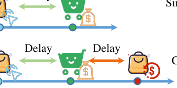
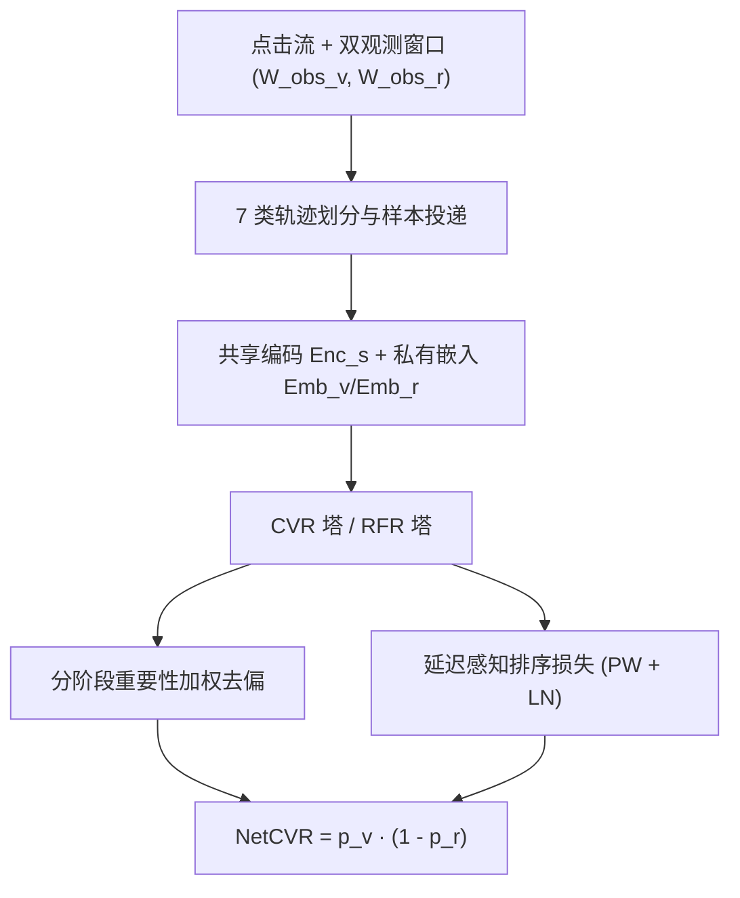

# Modeling Cascaded Delay Feedback for Online Net Conversion Rate Prediction: Benchmark, Insights and Solutions (在线净转化率预测中的级联延迟反馈建模：基准、洞察与方案)

- **会议/期刊**: WWW 2026 (Dubai)
- **作者与机构**: Mingxuan Luo, Guipeng Xv, Xinyu Li, Chen Lin (厦门大学)；Sishuo Chen, Li Zhang, Zhangming Chan, Xiang-Rong Sheng, Han Zhu, Jian Xu, Bo Zheng (阿里巴巴淘天集团)
- **推荐链路定位**: 精排（CVR/NetCVR 预估）
- **研究方向**: CTR/CVR 预估与特征交叉 / 去偏、公平与工业架构
- **论文原文**: [https://arxiv.org/abs/2601.19965v2](https://arxiv.org/abs/2601.19965v2)
- **开源代码**: [https://github.com/alimama-tech/NetCVR](https://github.com/alimama-tech/NetCVR)

## TL;DR (1分钟核心速览)

传统 CVR 忽略退款，无法反映真实满意度；净转化率 NetCVR（点击后购买且未退款）面临 **Click→Conversion→Refund 两段级联延迟**，且两段延迟对标签的作用方向相反，使单阶段 CVR 去偏方法直接失效。本文发布首个淘宝流式基准 CASCADE，并据三条数据洞察提出 TESLA：CVR-RFR 级联共享-私有结构、分阶段重要性加权去偏、延迟感知排序损失。在流式 Full-Ranking 协议下，NetCVR 的 RI-AUC 绝对提升 **12.41%**、RI-PRAUC 提升 **14.94%**。

## Background & Motivation (背景与核心矛盾)

- **主流范式**: 工业界以 CVR 做流量分配，延迟反馈处理分三派——参数化生存模型 (DFM)、重要性加权纠偏 (FNW/Defer)、窗口混合法 (Defuse/DDFM/DSFN/MISS)；ECAD 首次引入退款但为离线静态标签。
- **前人局限**: ① 上述方法只覆盖 Click→Conversion 单段延迟，未建模 Conversion→Refund 第二段，且退款可发生在购买后数周，离线日更模型无法跟上小时级波动；② 直接建模 NetCVR 无法区分"未转化"与"转化后退款"，两类负样本被混为一谈，导致预测系统性偏高（PCOC>1）。
- **核心洞察 (Key Insight)**: 三条数据发现——(1) NetCVR 呈强小时级节律（凌晨 00:00–04:00 骤降），必须在线持续训练；(2) 级联建模 CVR×RFR 优于直接建模 NetCVR（AUC 0.7525 vs 0.7514，PCOC 1.04 vs 1.24）；(3) 延迟时长本身是行为信号：高 CVR 用户转化更快更稳定（±16.4h vs ±19.6h），高退款率用户退款更快（±7.7h vs ±17.8h）。
- **本文切入点**: 把 NetCVR 分解为 $f^{\text{NetCVR}}_\theta = f^{\text{CVR}}_\theta \cdot (1 - f^{\text{RFR}}_\theta)$，用流式双窗口数据流 + 分阶段去偏 + 延迟加权排序损失统一求解。

<figure class="paper-figure" markdown="span">
  <figcaption>图1：净转化与转化的示意图。净转化呈现多阶段级联延迟特性，涉及点击→转化和转化→退款延迟。</figcaption>
</figure>

## Method (核心方法设计)

### 1. 整体框架 (Overall Architecture)

TESLA 以流式方式消费点击日志：每个点击样本先进入**转化观测窗口** $W^{obs}_v$，若窗口内转化则触发**退款观测窗口**$W^{obs}_r$，据此把交互划分为 7 类轨迹（iConv./dConv./nConv. 及 iConv.-iRefund、iConv.-dRefund、dConv.-iRefund、dConv.-dRefund），区分"瞬时转化"与"留存转化"。特征经共享编码器$Enc_s$与任务私有嵌入$Emb_v, Emb_r$ 后送入 CVR/RFR 双塔，两塔输出相乘得 NetCVR。训练时两塔各自做分阶段重要性加权去偏，并叠加延迟感知排序损失；推理仅需一次前向，延迟开销可忽略。

### 2. 关键设计拆解 (Key Designs)

1. **CVR-RFR 级联共享-私有结构**：直接建模 NetCVR 会把退款样本误当负样本、过拟合转化意图。TESLA 借鉴 PLE 思想，让两塔共享底层编码、保留任务私有嵌入，既迁移"高 CVR 常伴高 NetCVR"的共性，又隔离退款特有模式。消融显示 Hybrid 优于全共享 (Shared) 与全独立 (Separate)，且 Shared 优于 Separate——退款数据稀疏，参数共享对 RFR 塔尤为关键。

2. **分阶段重要性加权去偏**：两段延迟各自产生删失正样本（窗口内未观测到的真转化/真退款被误标为负）。对 CVR 塔，正样本权重为
$$w^+_v(\mathbf{x}) = 1 + p_v(\mathbf{x}) \cdot p(h_v > W^{obs}_v \mid y=1, \mathbf{x}),$$
负样本权重按同一删失概率做贝叶斯修正；RFR 塔以 $p(h_r > W^{obs}_r \mid z=1, y=1, \mathbf{x})$对称替换。直觉是：把"可能迟到"的样本按迟到概率放大，使$\hat{p}_v, \hat{p}_r$分别逼近真值，从而$\hat{p}_n = \hat{p}_v(1-\hat{p}_r)$ 渐近无偏。这是把单阶段去偏技术首次推广到双段级联。

3. **延迟感知排序损失 (DAR)**：点损失对标签翻转不鲁棒，故引入 pairwise 项，但样本质量参差。正样本按批内延迟中位数 $m$ 重加权：
$$w_i = w_{\min} + \alpha \cdot \sigma\!\left(\frac{m - h^{(i)}_v}{s}\right), \quad s = \max(\mathrm{std}(\mathbf{h}_v), 1),$$
快转化样本权重更高；负样本按 $\pi_j \propto (1-\hat{p}_v(\mathbf{x}_j))^{1/\tau}$ 采样，优先取低预测 CVR 的"高置信负例"。最终损失
$$\mathcal{L} = \mathcal{L}_v + \mathcal{L}_r + \mathcal{L}^{\text{DAR}}_v + \mathcal{L}^{\text{DAR}}_r,$$
其中 $\mathcal{L}^{\text{DAR}}$为加权 BPR 形式的$\log\sigma(o_i - o_{j_k})$ 均值。训练采用流式在线更新（非 batch 重训），负采样为模型引导的 in-stream 采样，无需全库负例。

## Experimental Setup & Evaluation Protocol (实验设置与评估协议)

- **数据集与预处理**: CASCADE 取自淘宝展示广告，逐条记录 click→conversion→refund 全链路时间戳，是首个含退款信号的公开 NetCVR 数据集（Criteo/Tencent 均无购后行为）。数据按流式切分为预训练段与流式段，采用四窗口机制（转化/退款观测窗口 + 归因窗口）与配套样本投递规则模拟线上环境。

| 数据集 | 场景 | 标签结构 | 关键特性 |
| :--- | :---: | :---: | :--- |
| CASCADE (Taobao) | 展示广告 | click / conversion / refund 三级时间戳 | 流式分块、双段延迟、含退款 |

- **数据划分与防穿越**: 流式时间切分（pre-train + streaming chunks），严格按事件时间戳投递样本，退款标签仅在退款观测窗口结束后回填，避免未来信息泄漏。
- **排名评测协议**: 流式在线评估，指标含 AUC、PRAUC、NLL、RI-AUC、RI-PRAUC（RI 为相对提升指标，衡量在线模型相对静态基线的增益），属全量流式样本排序评估。
- **对比基线与超参设置**: 参照组 Pre-trained（静态）、Oracle（全观测上界）、BDL（离线日更）；8 个强基线含 FNC、FNW (RecSys'19)、ES-DFM (AAAI'21)、DEFER (KDD'21)、DEFUSE (WWW'22)、DSFN (SIGIR'23)、DDFM (CIKM'23)、MISS (AAAI'24)。观测窗口在 $\{0.003, 0.01, 0.05, 0.125, 0.25\}$ 天网格搜索。

## Key Experimental Results (实验关键数据)

### 1. 主实验对比 (Main Results)

| Model | AUC↑ (CVR/NetCVR) | NLL↓ (CVR/NetCVR) | PRAUC↑ (CVR/NetCVR) | RI-AUC↑ (CVR/NetCVR) | RI-PRAUC↑ (CVR/NetCVR) |
| :--- | :---: | :---: | :---: | :---: | :---: |
| Pre-trained | 0.7223 / 0.7353 | 0.2252 / 0.1810 | 0.1768 / 0.1521 | – | – |
| Oracle (上界) | 0.7556 / 0.7643 | 0.2155 / 0.1750 | 0.2007 / 0.1722 | – | – |
| BDL (离线日更) | 0.7381 / 0.7476 | 0.2237 / 0.1805 | 0.1832 / 0.1574 | 47.45% / 42.41% | 26.78% / 26.37% |
| FNW (RecSys'19) | 0.7443 / 0.7539 | 0.2220 / 0.1800 | 0.1887 / 0.1619 | 66.07% / 64.14% | 49.79% / 48.76% |
| DEFER (KDD'21) | 0.7450 / 0.7552 | 0.2190 / 0.1777 | 0.1920 / 0.1649 | 68.17% / 68.62% | 63.60% / 63.68% |
| DEFUSE (WWW'22) | 0.7459 / 0.7550 | 0.2347 / 0.1971 | 0.1925 / 0.1645 | 70.87% / 67.93% | 65.69% / 61.69% |
| ES-DFM (AAAI'21) | 0.7456 / 0.7546 | 0.2190 / 0.1783 | 0.1924 / 0.1644 | 69.97% / 66.55% | 65.27% / 61.19% |
| DSFN (SIGIR'23) | 0.7437 / 0.7527 | 0.2199 / 0.1793 | 0.1905 / 0.1617 | 64.26% / 60.00% | 57.32% / 47.76% |
| MISS (AAAI'24) | 0.7441 / 0.7527 | 0.2199 / 0.1783 | 0.1902 / 0.1625 | 65.47% / 60.00% | 56.07% / 51.74% |
| **TESLA (Hybrid)** | **0.7469 / 0.7579** | **0.2188 / 0.1771** | **0.1933 / 0.1676** | **73.87% / 77.93%** | **69.04% / 77.11%** |
| **TESLA (full)** | **0.7479 / 0.7588** | **0.2182 / 0.1767** | **0.1939 / 0.1679** | **76.88% / 81.03%** | **71.55% / 78.61%** |
| **Improv. (vs 最强基线)** | – | – | – | **+6.01% / +12.41%** | – / **+14.94%** |

### 2. 消融实验 (Ablation Study)

| 变体 | 设置 | AUC↑ | NLL↓ | PRAUC↑ |
| :--- | :--- | :---: | :---: | :---: |
| Separate | 全独立双塔 | 0.7546 | 0.1783 | 0.1644 |
| Shared | 全共享双塔 | 0.7553 | 0.1779 | 0.1644 |
| Hybrid | 共享+私有 | 0.7555 | 0.1776 | 0.1651 |
| w/o ROW | 去退款观测窗口 | 0.7546 | 0.1783 | 0.1644 |
| ROW only | 仅窗口 | 0.7553 | 0.1779 | 0.1644 |
| ROW + DS | 窗口+去偏 | 0.7555 | 0.1776 | 0.1651 |

| DAR 变体 (Hybrid 上) | RI-AUC↑ (CVR/NetCVR) | RI-PRAUC↑ (CVR/NetCVR) |
| :--- | :---: | :---: |
| NR (无排序损失) | 73.87% / 77.93% | 69.04% / 77.11% |
| RN (随机负例) | 75.68% / 79.77% | 69.60% / 77.28% |
| HN (高不确定负例) | 75.08% / 76.44% | 69.60% / 76.29% |
| LN (低不确定负例) | 76.08% / 80.23% | 70.85% / 78.23% |
| **DAR (PW-LN)** | **76.78% / 80.92%** | **71.41% / 78.77%** |

### 3. 关键实验发现 (Key Findings)

1. **级联延迟的收益集中在 NetCVR 而非 CVR**：TESLA 在 NetCVR 上 RI-AUC 提升 12.41%，远高于 CVR 的 6.01%，说明双段去偏与退款建模的增益主要来自第二段延迟，单段 CVR 方法无法触及这部分收益。
2. **在线持续训练是必要非充分条件**：所有在线模型均优于离线 BDL（如 DEFER 的 NetCVR RI-AUC 68.62% vs BDL 42.41%），但只有叠加 DAR 后 TESLA 才从 Hybrid 的 77.93% 进一步升至 81.03%，证明"在线 + 延迟感知排序"缺一不可。
3. **负例采样方向决定成败**：低不确定负例 (LN, 80.23%) 显著优于高不确定负例 (HN, 76.44%) 甚至随机负例 (RN, 79.77%)，说明把低预测 CVR 样本当负例能有效抑制延迟导致的假阴性噪声；退款观测窗口宜短（≤0.01 天最优），过长反而劣于不设窗口，与退款延迟中位数仅 0.1h 的分布一致。

## Highlights & Limitations (亮点、对比与审稿批判)

- **与代表作对比 (vs. Prior Work)**: 相比 FNW/DEFER/DEFUSE 等单段延迟纠偏方法，TESLA 首次把去偏推广到 Click→Conversion→Refund 双段级联；相比 ECAD 的离线静态标签，TESLA 是首个在线持续 NetCVR 框架；相比 DSFN/MISS 的多流窗口，TESLA 额外引入延迟时长作为排序信号而非仅作纠偏变量。
- **可迁移亮点**: ① "延迟时长即行为信号"的正样本重加权思路可迁移到任何长延迟转化任务（如会员续费、金融授信）；② 分阶段重要性加权的级联推广范式，可复用于多级漏斗（曝光→点击→加购→支付）的逐级去偏。
- **审稿级局限批判**: ① 实验仅在单一淘宝数据集上验证，缺乏跨平台/跨品类泛化证据，且 CASCADE 的流式分块规则对结果影响未做敏感性分析；② 延迟分布模型 $p(h > W^{obs} \mid \cdot)$依赖历史日志预训练，分布漂移时去偏权重可能失准，论文未讨论该失效场景；③ 双窗口超参（$W^{obs}_v$、$W^{obs}_r$）需网格搜索，线上自动调参成本未量化。

## Rating (四维评分)

- **方法创新性 (Novelty)**: ⭐⭐⭐⭐ （首次系统建模双段级联延迟，分阶段去偏与延迟感知排序损失组合新颖，但各组件均为已有技术的巧妙拼接）
- **评估协议与实验扎实度 (Protocol & Experiments)**: ⭐⭐⭐⭐ （首个公开 NetCVR 流式基准 + 8 个强基线 + 完整消融与窗口敏感性分析，但仅单数据集）
- **写作与数学规范度 (Clarity & Rigor)**: ⭐⭐⭐⭐ （三条洞察驱动设计的叙事清晰，去偏权重推导置于附录，主文公式紧凑）
- **工业落地与复现价值 (Industrial & Practical Value)**: ⭐⭐⭐⭐⭐ （淘天真实场景验证、代码与数据集全开源、推理仅一次前向，工程可复现性极高）

