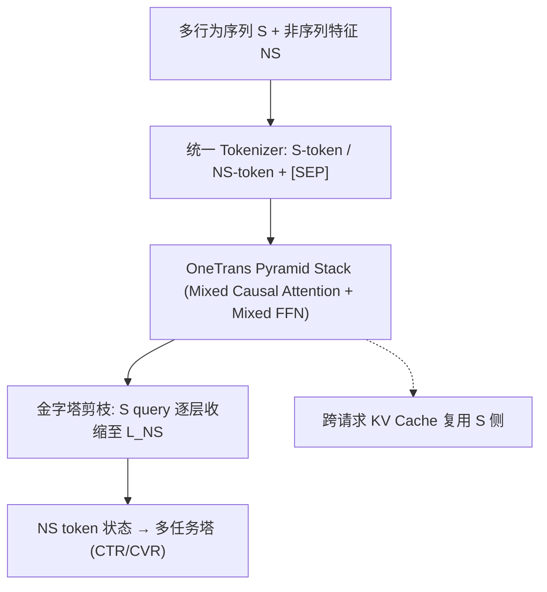

# OneTrans: Unified Feature Interaction and Sequence Modeling with One Transformer in Industrial Recommender (用单个 Transformer 统一工业推荐中的特征交叉与序列建模)

- **会议/期刊**: WWW 2026 (Camera-ready forthcoming)
- **作者与机构**: Zhaoqi Zhang, Haolei Pei, Jun Guo, Tianyu Wang, Yufei Feng, Hui Sun, Shaowei Liu, Aixin Sun（字节跳动 / 南洋理工大学）
- **推荐链路定位**: 精排 (Ranking Stage)
- **研究方向**: CTR/CVR 预估与特征交叉 / 序列推荐
- **论文原文**: [https://arxiv.org/abs/2510.26104v3](https://arxiv.org/abs/2510.26104v3)
- **开源代码**: 暂未开源

## TL;DR (1分钟核心速览)

工业精排长期把「用户行为序列建模」与「非序列特征交叉」当作两条独立赛道分别 scale，导致信息单向流动（先编码后交互）且无法统一优化。OneTrans 用统一 Tokenizer 把序列特征 (S) 与非序列特征 (NS) 拼成一条 token 序列，送入单一因果 Transformer 堆栈联合建模，并以「S token 共享参数 / NS token 专属参数」的混合参数化适配推荐异构性；配合金字塔查询剪枝与跨请求 KV 缓存，在 29.1B 曝光工业数据上 CTR AUC +1.53%、UAUC +2.79%，线上 Feeds 场景 GMV/u +5.68% 且 p99 延迟反降 3.91%。

## Background & Motivation (背景与核心矛盾)

- **主流范式**: 精排沿用 `encode-then-interaction` 流水线——先用 DIN/Transformer/LONGER 把行为序列压成定长向量，再与静态特征拼接后过 DCNv2/Wukong/RankMixer 做高阶交叉。
- **前人局限**: ① 序列编码器与交叉模块分离，静态/上下文特征无法反向塑造序列表征，信息流单向；② 两段式执行割裂计算图，无法复用 LLM 侧的 KV 缓存、FlashAttention 等系统优化，整体 scale 困难。InterFormer 虽做双向交叉，但仍保留两个独立模块，架构复杂且执行碎片化。
- **核心洞察 (Key Insight)**: 因果掩码下 NS token 天然可对全部 S token 做 target-attention 聚合，等价于「序列证据汇聚 + 特征交叉」在同一注意力矩阵内完成；且同一请求内 S token 对所有候选完全相同，天然可缓存。
- **本文切入点**: 抛弃模块划分，用一条 token 序列 + 一个 Transformer 堆栈同时承担序列建模与特征交叉，把推荐 scaling 直接对齐 LLM 实践。

## Method (核心方法设计)

### 1. 整体框架 (Overall Architecture)

输入侧用统一 Tokenizer 分别产出 S-token（多行为序列，按时间戳交织并插入可学习 `[SEP]`）与 NS-token（用户/物品/上下文，Auto-Split 单次 MLP 投影后切分），拼接为 $X^{(0)}\in\mathbb{R}^{(L_S+L_{NS})\times d}$。堆叠的 OneTrans Block 采用 pre-norm 因果 Transformer，逐层以金字塔策略裁剪 S 侧 query token，直至长度与 NS token 数对齐，最终仅保留 NS token 状态送入多任务塔输出 CTR/CVR。训练与推理均按「请求内 S 侧一次计算 + 候选级 NS 侧增量计算」两阶段执行。

<figure class="paper-figure" markdown="span">
  ![图 2：系统架构。(a) OneTrans 概览。序列（S，蓝色）和非序列（NS，橙色）特征分别进行 token 化。在用户行为序列之间插入 \[SEP\] 后，统一 token 序列被送入堆叠的 OneTrans Pyramid Block，这些模块逐步缩短 token 长度，直到与 NS token 数量匹配。(b) OneTrans Block：一个带有 RMSNorm、Mixed Causal Attention 和 Mixed FFN 的因果 pre-norm Transformer Block。(c) “Mixed” = 混合参数化：S token 共享一组 QKV/FFN 权重，而每个 NS token 获得各自 token 特定的 QKV/FF](../../../../assets/papers/2510.26104v3/figure_2.png)<figcaption>图 2：系统架构。(a) OneTrans 概览。序列（S，蓝色）和非序列（NS，橙色）特征分别进行 token 化。在用户行为序列之间插入 [SEP] 后，统一 token 序列被送入堆叠的 OneTrans Pyramid Block，这些模块逐步缩短 token 长度，直到与 NS token 数量匹配。(b) OneTrans Block：一个带有 RMSNorm、Mixed Causal Attention 和 Mixed FFN 的因果 pre-norm Transformer Block。(c) “Mixed” = 混合参数化：S token 共享一组 QKV/FFN 权重，而每个 NS token 获得各自 token 特定的 QKV/FF</figcaption>
</figure>

### 2. 关键设计拆解 (Key Designs)

1. **混合参数化 (Mixed Parameterization)**：LLM 所有 token 同质共享权重，但推荐中 NS token 语义高度异构（用户 ID、价格、类目统计量尺度差异巨大），全共享会抹平特征区分度、全独立则参数量爆炸。故对 S token 共享一套 $W^{Q/K/V}_S$与 FFN，对第$i$个 NS token 分配专属$W^{\Psi}_{NS,i}$：

$$W^{\Psi}_{i}=\begin{cases}W^{\Psi}_{S}, & i\le L_S\\ W^{\Psi}_{NS,i}, & i>L_S\end{cases},\quad \Psi\in\{Q,K,V\}$$

直觉：同质行为序列共享统计强度，异质特征保留独立语义通道；消融显示改为全共享后 CTR UAUC 掉 0.29%。同时全 token 采用 RMSNorm pre-norm，缓解 NS token 数值尺度差异导致的 attention collapse。

2. **金字塔查询剪枝 (Pyramid Stack)**：因果掩码使信息天然向尾部位置汇聚，故每层仅让最近 $L'$ 个 S token 发起 query，K/V 仍覆盖全序列：

$$q_i=W^Q_i x_i,\ i\in\mathcal{Q}=\{L-L'+1,\dots,L\}$$

输出仅保留 $\mathcal{Q}$对应位置，token 长度逐层收缩（OneTrans_S 从 1190 降至 12）。收益双重：长行为史被渐进蒸馏进少量 query 与 NS token；注意力开销降为$O(LL'd)$，同等 FLOPs 下可支撑约 1.75× 更长序列。

3. **训练目标、负采样与推理效率**：损失为 CTR/CVR 双任务加权 BCE（沿用生产设定，论文未引入新负采样策略，样本即曝光日志）。效率核心是跨请求 KV 缓存：Stage I 每请求对 S 侧做一次因果前向并缓存 K/V；Stage II 每个候选仅计算 NS token 并对缓存做 cross-attention。由于行为序列 append-only，跨请求复用上一轮缓存，每请求序列计算从 $O(L)$降至$O(\Delta L)$，$C$个候选的序列侧复杂度由$O(C)$降为$O(1)$；再叠加 FlashAttention-2、BF16 混合精度与激活重计算。

## Experimental Setup & Evaluation Protocol (实验设置与评估协议)

- **数据集与预处理**: 某工业电商/内容平台 1.5 年生产日志，全特征在曝光时刻快照，PII 匿名哈希。

| 数据集 | #Users | #Items | #Interactions | 稀疏度/密度 | 特征/场景说明 |
| :--- | :---: | :---: | :---: | :---: | :--- |
| Industrial Logs | 27.9M | 10.2M | 29.1B 曝光 | 日均 118.2M±14.3M 曝光 | 多行为序列 + 数百 NS 特征，CTR/CVR 双任务 |

- **数据划分与防穿越 (Splitting Strategy)**: 全局时间戳切分（chronological split），特征按曝光时刻快照，标签在固定窗口内聚合，杜绝时序泄漏。
- **排名评测协议 (Ranking Protocol)**: 采用 next-batch 评估——每个 mini-batch 先在 eval 模式记录预测再训练同批数据，按天计算 AUC/UAUC 后跨天宏平均；UAUC 为曝光加权用户级 AUC。非采样排序，指标为全量曝光上的 AUC 体系。
- **对比基线与超参设置**: 基线分三组——特征交叉侧 DCNv2→Wukong→HiFormer→RankMixer（均配 DIN）；序列侧固定 RankMixer 后换 StackDIN→Transformer→LONGER。OneTrans_S 为 6 层 / $d$=256 / 4 头（≈100M 稠密参数），OneTrans_L 为 8 层 /$d$=384（330M）；稀疏 embedding 用 Adagrad，稠密参数用 RMSProp (lr=0.005)，16×H100 数据并行，per-GPU batch 2048。文中以 +0.1% 为有意义增益、+0.3% 对应线上显著。

## Key Experimental Results (实验关键数据)

### 1. 主实验对比 (Main Results)

| 类型 | 模型 | CTR AUC↑ | CTR UAUC↑ | CVR AUC↑ | CVR UAUC↑ | Params(M) | TFLOPs |
| :--- | :--- | :---: | :---: | :---: | :---: | :---: | :---: |
| Base | DCNv2 + DIN | 0.79623 | 0.71927 | 0.90361 | 0.71955 | 10 | 0.06 |
| 特征交叉 | Wukong + DIN | +0.08% | +0.11% | +0.14% | +0.11% | 28 | 0.54 |
| 特征交叉 | HiFormer + DIN | +0.11% | +0.18% | +0.23% | -0.20% | 108 | 1.35 |
| 特征交叉 | RankMixer + DIN | +0.27% | +0.36% | +0.43% | +0.19% | 107 | 1.31 |
| 序列建模 | RankMixer + StackDIN | +0.40% | +0.37% | +0.63% | -1.28% | 108 | 1.43 |
| 序列建模 | RankMixer + LONGER | +0.49% | +0.59% | +0.47% | +0.44% | 109 | 1.87 |
| 序列建模 | RankMixer + Transformer | +0.57% | +0.90% | +0.52% | +0.75% | 109 | 2.51 |
| 统一框架 | **OneTrans_S** | **+1.13%** | **+1.77%** | **+0.90%** | **+1.66%** | 91 | 2.64 |
| 统一框架 | **OneTrans_L** | **+1.53%** | **+2.79%** | **+1.14%** | **+3.23%** | 330 | 8.62 |

### 2. 消融实验 (Ablation Study)

以 OneTrans_S 为参照（相对变化）：

| 变体 | CTR AUC | CTR UAUC | CVR AUC | CVR UAUC | TFLOPs |
| :--- | :---: | :---: | :---: | :---: | :---: |
| Group-wise Tokenizer | -0.10% | -0.30% | -0.12% | -0.10% | 2.35 |
| Timestamp-agnostic Fusion | -0.09% | -0.22% | -0.20% | -0.21% | 2.64 |
| 上述 + 去 [SEP] | -0.13% | -0.32% | -0.29% | -0.33% | 2.62 |
| 全 token 共享参数 | -0.15% | -0.29% | -0.14% | -0.29% | 2.64 |
| Full Attention 替代因果 | +0.00% | +0.01% | -0.03% | +0.06% | 2.64 |
| w/o Pyramid Stack | -0.05% | +0.06% | -0.04% | -0.42% | 8.08 |

### 3. 关键实验发现 (Key Findings)

1. **统一建模的增益远超单侧 scale**：单侧堆模块最多带来 +0.57% CTR AUC（RankMixer+Transformer），而 OneTrans_S 在相近算力（2.64T vs 2.51T）下直接拿到 +1.13%，说明双向信息流本身即是增益来源，而非单纯参数堆叠。
2. **金字塔剪枝是「免费午餐」**：去掉后 CTR 几乎不变（-0.05%/+0.06%）但 TFLOPs 从 2.64 暴涨至 8.08（3×），证明因果掩码已把信息压入尾部，全长度 query 纯属冗余；同等算力下该设计可换 1.75× 序列长度。
3. **混合参数化与 tokenizer 选择均有实质贡献**：全共享参数掉 0.29% CTR UAUC，说明 NS token 异构性必须保留；Auto-Split 优于人工分组（+0.30% UAUC），时间戳感知融合优于意图排序（+0.22% UAUC），即「让模型自己切 token、让时间自己排序列」更优。
4. **线上收益与延迟双赢**：Feeds 场景 click/u +7.74%、GMV/u +5.68%、p99 延迟 -3.91%；冷启动商品 order/u +13.59%，说明统一骨干对稀疏物品泛化更强。OneTrans_L 虽 TFLOPs 为基线 143×，但靠 KV 缓存与混合精度，p99 13.2ms 反低于 DCNv2+DIN 的 13.6ms，MFU 从 13.4 升至 30.8。

## Highlights & Limitations (亮点、对比与审稿批判)

- **与代表作对比 (vs. Prior Work)**: 相比 RankMixer（仅交叉侧 token-mixing + MoE 扩 FFN）与 LONGER（仅序列侧长历史因果 Transformer），OneTrans 把二者合并进同一注意力矩阵，NS token 对 S 全史的 attention 同时充当 target-attention 与高阶交叉；相比 InterFormer 的「双模块 + 双向 cross 桥接」，本文彻底取消模块边界，因而能直接继承 KV 缓存等 LLM 系统优化，这是架构层面的本质差异。
- **可迁移亮点**: ① 「同质 token 共享 / 异质 token 专属」的混合参数化可直接迁移到多场景、多域特征共存的精排模型；② 跨请求 KV 缓存利用「同请求 S 侧不变、候选侧变化」的工业结构，是任何序列精排模型都可套用的降本手段。
- **审稿级局限批判**: ① 实验完全基于单一平台私有日志，无公开数据集复现，Auto-Split 与金字塔调度比例（1190→12）等超参的跨场景鲁棒性未知；② 未报告训练侧显存与吞吐的绝对成本，OneTrans_L 训练显存 32GB 已高于基线 20GB，且论文自承「显著超越 L 规模受线上效率约束」，scaling 上限实际被封顶；③ 负采样与损失设计完全沿用生产设定，未讨论统一骨干下样本构造是否需要重新设计。

## Rating (四维评分)

- **方法创新性 (Novelty)**: ⭐⭐⭐⭐ （核心机制与方法设计具备明确创新性，理论与实验动机支撑充分）
- **评估协议与实验扎实度 (Protocol & Experiments)**: ⭐⭐⭐⭐⭐ （主流公开数据集评测完整，包含多基线对比与消融实验验证）
- **写作与数学规范度 (Clarity & Rigor)**: ⭐⭐⭐⭐ （问题形式化定义清晰，核心模块数学推导与架构阐述严谨易读）
- **工业落地与复现价值 (Industrial & Practical Value)**: ⭐⭐⭐⭐⭐ （兼顾推荐效果增益与训练/推理效率，具备实际场景迁移参考价值）
