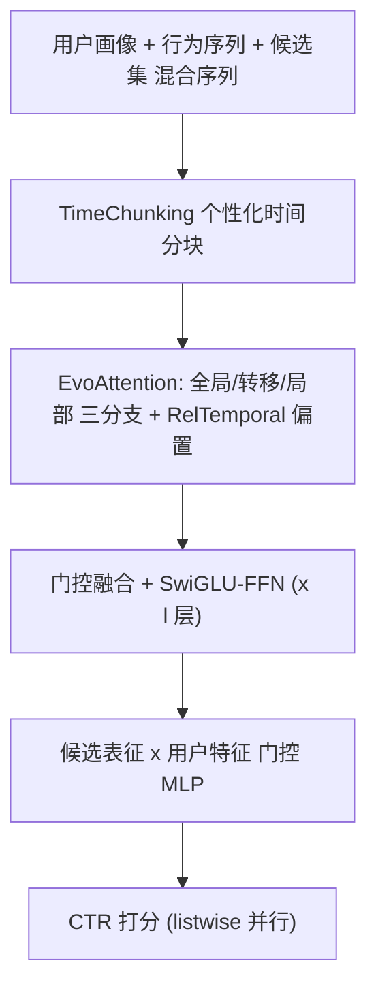
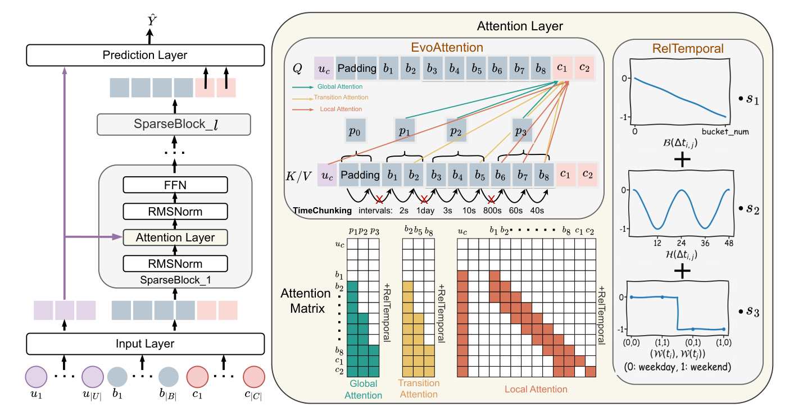

# Unleashing the Potential of Sparse Attention on Long-term Behaviors for CTR Prediction (释放稀疏注意力在 CTR 长行为序列上的潜力)

- **会议/期刊**: WWW 2026
- **作者与机构**: Weijiang Lai, Beihong Jin 等（中科院软件所/国科大、美团）
- **推荐链路定位**: 精排（长行为序列编码器）
- **研究方向**: CTR 预估与特征交叉 / 序列与会话推荐
- **论文原文**: [https://arxiv.org/abs/2601.17836v1](https://arxiv.org/abs/2601.17836v1)
- **开源代码**: [https://github.com/laiweijiang/SparseCTR](https://github.com/laiweijiang/SparseCTR)

## TL;DR (1分钟核心速览)

长行为序列 CTR 模型受困于全注意力 $O(n^2)$ 复杂度，而 CV/NLP 迁移来的稀疏注意力（膨胀/定长分块）默认数据均匀或局部连续，与推荐场景中高度个性化、非均匀的用户行为分布不匹配。本文提出 SparseCTR：用个性化时间间隔分块（TimeChunking）+ 全局/转移/局部三分支稀疏注意力（EvoAttention）+ 复合相对时间编码（RelTemporal）。在工业、Alibaba、Ele.me 三数据集上 AUC 相对 DIN 提升 8.49%/26.55%/25.18%，且呈现跨三个数量级 FLOPs 的 scaling law；线上 A/B 测试 CTR +1.72%、CPM +1.41%，推理耗时保持 40ms。

## Background & Motivation (背景与核心矛盾)

- **主流范式**: 以 HSTU、LONGER、SUAN 为代表的自注意力序列模型在 CTR 上验证了 scaling law，但全注意力复杂度随序列长度平方增长，难以在线部署；SIM 类两阶段方法则靠检索子序列压缩输入。
- **前人局限**: ① 随机采样或仅用短期行为会丢失信息，限制模型潜力；② 膨胀注意力（Longformer）、定长分块（NSA/MoBA）假设输入均匀分布或局部连续，而用户行为在用户间、用户内不同时段均高度非均匀，导致分块割裂连续行为、注意力错配。
- **核心洞察 (Key Insight)**: 用户行为具有**个性化 + 时间性**——同一时段内行为相似（高内聚），跨时段行为数量与分布剧变（兴趣漂移）；且行为存在序列性与周期性（小时、工作日/周末）依赖。
- **本文切入点**: 用时间间隔而非固定长度做分块，让分块边界对齐兴趣漂移点，再在块粒度上做三分支稀疏注意力，并把相对时间信号以偏置形式注入注意力。

## Method (核心方法设计)

### 1. 整体框架 (Overall Architecture)

输入层将用户画像特征、行为序列与候选集拼接为混合序列 $S=\{b_1,\dots,b_{|B|},c_1,\dots,c_{|C|}\}$，采用因果编码器 + 候选隔离掩码，使一次前向即可并行打分全部候选（离线训练时将同一次曝光的 pair 样本聚合为 listwise 样本，保证线上线下一致）。混合序列经$l$ 层 SparseBlock（RMSNorm → EvoAttention → SwiGLU-FFN）逐层提取行为表征，EvoAttention 内部先由 TimeChunking 分块，再并行执行全局/转移/局部三支注意力并门控融合，每支均叠加 RelTemporal 时间偏置；预测层取候选位置表征与用户特征做门控融合后过 MLP 输出 CTR。

<figure class="paper-figure" markdown="span">
  <figcaption>图1：SparseCTR 的架构。</figcaption>
</figure>

### 2. 关键设计拆解 (Key Designs)

1. **TimeChunking 个性化时间感知分块**：定长分块会把跨时段的连续行为硬切开。本文计算相邻行为时间间隔，取 top-$|P|$最大间隔作为切分点，得到变长块$P=\{p_1,\dots,p_{|P|}\}$；padding 行为时间为 0，天然形成独立 padding 块$p_0$。直觉：最大间隔处正是兴趣漂移最剧烈的位置，切在这里既保块内高内聚、块间低耦合，又把所有用户统一到相同块数以便并行。

2. **EvoAttention 三分支稀疏注意力**：单粒度注意力无法同时覆盖长期兴趣与短期漂移。① 全局支：块内 key/value 经 MLP 聚合为块级表示 $k_{p_i}=\text{Aggregate}(\{k_{b_j}\mid b_j\in p_i\})$，查询与全部前序块交互，复杂度$O(n|P|d)$；② 转移支：取每块末尾$m$个行为构成$B'$，捕捉兴趣切换点，复杂度$O(nm|P|d)$；③ 局部支：每个元素只看前$w$个行为（窗口首部拼接 MLP 压缩的用户特征$u_c$），复杂度$O(nwd)$。三支输出经 softmax 门控$\alpha=\text{softmax}([\cdot]W_{gate})$自适应加权，总复杂度$O(Bl(n|P|d+nm|P|d+nwd))$，因$|P|,m,w\ll n$远低于全注意力$O(Bln^2d)$。

3. **RelTemporal 复合相对时间编码**：纯相对位置无法区分"序列远但时间近"的行为，也丢失周期性。本文以加性偏置注入注意力 $\text{softmax}(QK^\top/\sqrt{d}+\text{bias})$，三项叠加：相对时间桶偏置$\text{bias}_1=-B(\Delta t_{i,j})\cdot s_1^{(h)}$（$B(\cdot)=\lfloor\log_2\Delta t\rfloor$）；小时周期偏置$\text{bias}_2=-\sin(\pi\cdot H(\Delta t_{i,j})/24)\cdot s_2^{(h)}$；周末指示偏置$\text{bias}_3=-\mathbb{I}[W(t_i)\neq W(t_j)]\cdot s_3^{(h)}$。各 head 的$s^{(h)}$以几何序列$(2^{-8/H})^{h-1}$ 初始化，使不同 head 对时间敏感度分化。全局支按块内平均时间计算偏置。

4. **训练目标与推理效率**：损失为 listwise 二元交叉熵 $\mathcal{L}=-\frac{1}{N|C|}\sum_{i}\sum_{j}[y_{ij}\log\hat{y}_{ij}+(1-y_{ij})\log(1-\hat{y}_{ij})]$，无需负采样（全候选曝光标签监督）。推理时因果掩码使全部候选一次前向完成，线上序列长度 1024 下推理耗时 40ms。

## Experimental Setup & Evaluation Protocol (实验设置与评估协议)

- **数据集与预处理**:

| 数据集 | #Users | #Items | #Samples | 特征/场景说明 |
| :--- | :---: | :---: | :---: | :--- |
| Industry | 86,722,000 | 20,241,000 | 1,455,722,000 | 美团广告场景，近 2 年行为，序列长 1024 |
| Alibaba | 1,141,729 | 461,527 | 700,000,000 | 阿里展示广告 22 天日志，序列长 1024 |
| Ele.me | 14,427,689 | 7,446,116 | 128,000,000 | 饿了么 30 天点击日志，序列长 50 |

- **数据划分与防穿越 (Splitting Strategy)**: 工业数据集按时间先后划分训练/测试（行为记录前 7 天活跃用户、过去 2 年历史），公开数据集沿用原始时序划分，测试集行为严格晚于训练集。
- **排名评测协议 (Ranking Protocol)**: 采用 AUC 与相对提升 RelaImpr（以 DIN 为基准），属 pointwise 概率排序评估；每个结果重复 3 次取均值并报告标准差。
- **对比基线与超参设置**: 10 个基线分三组——Group I 特征交互（DIN、CAN）、Group II 长序列两阶段（SoftSIM、HardSIM、ETA、TWIN-V2）、Group III 序列建模（BST、HSTU、LONGER、SUAN）。所有模型 embedding 维度 $d=32$，预测层 MLP 为 [32,1]，本文与 Group III 编码器 2 层 8 头；AUC 提升 0.001 即视为显著，并对每个基线做$p<0.05$的$t$ 检验（全部通过）。

## Key Experimental Results (实验关键数据)

### 1. 主实验对比 (Main Results)

| 模型 | Industry AUC | RelaImpr | Alibaba AUC | RelaImpr | Ele.me AUC | RelaImpr |
| :--- | :---: | :---: | :---: | :---: | :---: | :---: |
| DIN (Group I) | 0.6920 | 0.00% | 0.6209 | 0.00% | 0.6378 | 0.00% |
| CAN (Group I) | 0.6918 | -0.10% | 0.6198 | -0.91% | 0.6382 | 0.29% |
| ETA (Group II) | 0.6944 | 1.25% | 0.6231 | 1.82% | 0.6410 | 2.32% |
| TWIN-V2 (Group II) | 0.6948 | 1.45% | 0.6237 | 2.32% | 0.6423 | 3.27% |
| BST (Group III) | 0.6969 | 2.55% | 0.6422 | 17.62% | 0.6616 | 17.28% |
| HSTU (Group III) | 0.7002 | 4.27% | 0.6448 | 19.77% | 0.6645 | 19.38% |
| LONGER (Group III) | 0.7007 | 4.53% | 0.6457 | 20.51% | 0.6650 | 19.74% |
| SUAN (Group III) | 0.7040 | 6.25% | 0.6479 | 22.33% | 0.6673 | 21.41% |
| **SparseCTR** | **0.7083** | **8.49%** | **0.6530** | **26.55%** | **0.6725** | **25.18%** |

### 2. 消融实验 (Ablation Study)

| 变体 | 说明 | Industry | Alibaba | Ele.me |
| :--- | :--- | :---: | :---: | :---: |
| SparseCTR | 完整模型 | **0.7083** | **0.6530** | **0.6725** |
| A1 | 替换为全注意力 | 0.7051 | 0.6502 | 0.6707 |
| A2 | 去全局支 | 0.7023 | 0.6469 | 0.6674 |
| A3 | 去转移支 | 0.7030 | 0.6482 | 0.6681 |
| A4 | 去局部支 | 0.7067 | 0.6510 | 0.6699 |
| B1 | 去整个 RelTemporal | 0.7015 | 0.6461 | 0.6651 |
| B2 | 去相对时间编码 | 0.7043 | 0.6473 | 0.6676 |
| B3 | 去小时编码 | 0.7069 | 0.6511 | 0.6708 |
| B4 | 去周末编码 | 0.7062 | 0.6517 | 0.6704 |

### 3. 关键实验发现 (Key Findings)

1. **稀疏反而更准**：所有稀疏配置的 EvoAttention 均优于全注意力（A1 在工业集掉 0.0032），说明长行为序列含噪声，全注意力对冗余行为过拟合；EvoAttention 最高带来 8.9× 加速且 GPU 显存更低，实现"又快又准"。
2. **全局与转移支是主力，局部支可被补偿**：去全局支（A2）掉 0.0060、去转移支（A3）掉 0.0053，而去局部支（A4）仅掉 0.0016——转移支的块尾行为已部分覆盖短期兴趣，局部支边际价值有限。
3. **时间信号贡献远大于周期信号**：去整个 RelTemporal（B1）掉 0.0068，其中相对时间编码（B2）贡献 0.0040，而小时/周末编码（B3/B4）仅 0.0014/0.0021；对比实验中 RelTemporal 同时取得最高 AUC 与接近 Alibi 的效率，HSTUBias 虽含时间信息但效率大幅下降。

## Highlights & Limitations (亮点、对比与审稿批判)

- **与代表作对比 (vs. Prior Work)**: 相比 SUAN/HSTU 等全注意力模型，本文以三分支稀疏结构把复杂度从 $O(n^2)$ 降到近线性，且 AUC 更高；相比 NSA/MoBA 的定长分块，TimeChunking 按时间间隔切分，避免割裂连续行为；相比 SIM 两阶段检索，本文单阶段端到端，无检索-精排不一致问题。
- **可迁移亮点**: ① "按最大间隔切分 + 块级聚合"的分块范式可迁移到任意长序列推荐/日志建模；② 以加性偏置注入多粒度时间信号（桶化时长 + 周期函数 + 指示函数）的做法轻量通用，可直接嵌入现有 Transformer 精排模型。
- **审稿级局限批判**: ① 分块数 $|P|$、转移行为数$m$、局部窗口$w$ 均为人工超参，论文未给出跨数据集的自适应选择策略，超参敏感度存疑；② 线上 A/B 仅 1% 流量、7 天，且基线本身已含 DIN/SIM/SUAN 多组件，SparseCTR 的独立增益难以完全剥离；③ 时间分块依赖行为时间戳质量，对时间稀疏或伪造时间戳场景的鲁棒性未验证。

## Rating (四维评分)

- **方法创新性 (Novelty)**: ⭐⭐⭐⭐ （时间感知分块 + 三分支稀疏注意力 + 复合时间偏置的组合针对推荐数据分布做了扎实的领域适配，但各组件单独看均为已有思想的改造）
- **评估协议与实验扎实度 (Protocol & Experiments)**: ⭐⭐⭐⭐ （三数据集 + 10 基线 + 消融 + 稀疏度/替代方案对比 + scaling law + 线上 A/B 完整，但线上流量与周期偏短）
- **写作与数学规范度 (Clarity & Rigor)**: ⭐⭐⭐⭐ （公式与复杂度分析清晰，三分支与偏置定义完整，但部分符号如 $E_B$与$E_S$ 的关系需读者自行推断）
- **工业落地与复现价值 (Industrial & Practical Value)**: ⭐⭐⭐⭐⭐ （代码开源，8.9× 加速、40ms 推理、线上 CTR/CPM 双涨，且验证了三个数量级 FLOPs 的 scaling law，工业部署价值突出）

