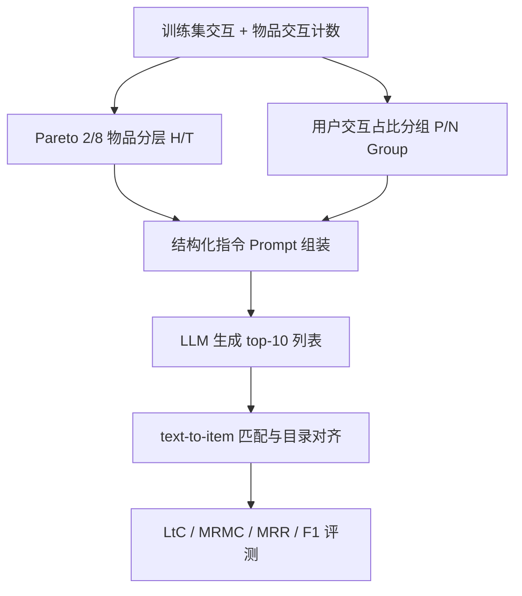
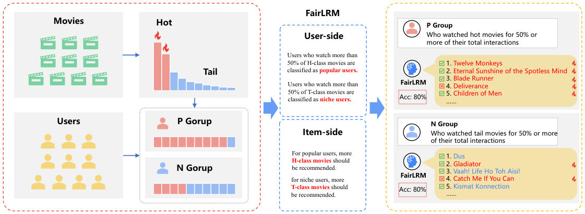

# Bridging Semantic Understanding and Popularity Bias with LLMs (以 LLM 弥合语义理解与流行度偏差)

- **会议/期刊**: WWW 2026
- **作者与机构**: Renqiang Luo, Dong Zhang, Yupeng Gao, Wen Shi, Mingliang Hou, Jiaying Liu, Zhe Wang, Shuo Yu（吉林大学、大连理工大学、暨南大学 & 好未来）
- **推荐链路定位**: 重排（LLM 列表生成式重排）
- **研究方向**: 去偏公平与工业架构 / 大语言模型推荐
- **论文原文**: [论文原文链接](https://arxiv.org/abs/2601.09478v3)
- **开源代码**: [开源代码仓库链接](https://github.com/LuoRenqiang/FairLRM)

## TL;DR (1分钟核心速览)

现有 RecLLM 去偏方法把流行度偏差当作"多样性增强"或"长尾覆盖"的表层问题，提示词里写 "diversity"/"debiasing" 只会让模型在热门物品内部换花样，N Group 用户准确率仅 0–20%。本文提出 FairLRM，把偏差显式拆成**物品侧（全局流行度分布）**与**用户侧（个体偏好分组）**两层语义，用结构化指令把 2/8 物品分层与 P/N 用户分组规则写进 prompt。在 MovieLens-20M 与 Goodbooks-10k 上，Qwen-max 下 MRMC 由 0.586 降至 0.302、MRR@10 由 0.078 升至 0.452，实现公平与精度同向提升。

## Background & Motivation (背景与核心矛盾)

- **主流范式**: RecLLM 去偏主要靠 prompt 里加 "diversity"、"popularity debiasing" 等词，或对物品流行度做简单重排/数据划分。
- **前人局限**: ① 只建模物品侧分布，忽略"偏差源于异质用户偏好"这一因果来源；② LLM 对 "diversity" 只做词面理解，倾向在热门集合内换品类，导致精度与覆盖双输（图 1 中 N Group 用户 Acc 仅 0–20%）。
- **核心洞察 (Key Insight)**: 偏差的语义本质是"用户—物品交互失衡"，而非物品频次本身；因此必须让 LLM 同时"看到"全局物品分层与个体用户偏好分组，才能形成因果级理解。
- **本文切入点**: 用 Pareto 2/8 规则量化物品分层、用训练集交互比例量化用户分组，把两者作为结构化语义信号注入指令提示。

## Method (核心方法设计)

### 1. 整体框架 (Overall Architecture)

FairLRM 不改模型参数，是一条纯提示层的"语义注入"流水线：先对训练集物品按交互数排序，前 20% 记为 H 类（热门）、后 80% 记为 T 类（小众）；再按用户在训练集上对 H 类物品的交互占比把用户划为 P Group（≥50% 或 ≥80%）与 N Group；随后把这两套分层规则与"P 用户多推 H、N 用户多推 T"的指令拼进 prompt，交由 LLM 生成 top-10 列表；最后经 text-to-item 匹配管线做归一化、目录对齐与目录外物品剔除，再计算 LtC/MRMC/MRR/F1。关键在于所有分组只在训练集上完成，杜绝测试集泄漏。

<figure class="paper-figure" markdown="span">
  <figcaption>图 2：展示了 FairLRM 对流行度偏差的语义理解如何提升推荐性能，尤其是对小众偏好用户。红色物品为热门物品，蓝色表示小众物品（或长尾物品）。</figcaption>
</figure>

### 2. 关键设计拆解 (Key Designs)

1. **物品侧语义量化（Pareto 2/8 分层）**：痛点是把"长尾"当模糊概念，LLM 无法定位边界 $\to$ 按交互数降序取前 20% 为 $I_p$、其余 80% 为 $I_n$，并把该分层写进 prompt $\to$ 直觉是给模型一个可判定的"热门/小众"语义锚点，使其不再把"换品类"误当"去偏"。

2. **用户侧语义分组（P/N Group 规则注入）**：痛点是把所有用户同质对待，N Group 被系统性欠服务 $\to$ 以训练集交互占比阈值 $\tau \in \{50\%, 80\%\}$ 划分用户，并在 prompt 中声明"P 用户多推 H 类、N 用户多推 T 类" $\to$ 直觉是把偏差的因果来源（异质偏好）显式编码，使去偏与个性化同向而非对冲。两种阈值记为 FairLRM(55) 与 FairLRM(82)，用于适配不同 LLM 的指令敏感度。

3. **训练目标、负采样与推理效率**：本文为**零训练/零微调**框架，无损失函数与负采样，全部收益来自提示设计；推理开销即一次 LLM 调用 + 一次目录匹配，成本与 Vanilla 基线持平，这是相对微调类去偏方法的核心工程优势。

## Experimental Setup & Evaluation Protocol (实验设置与评估协议)

- **数据集与预处理**: 过滤交互数 < 30 的用户以缓解冷启动。

| 数据集 | #Users | #Items | #Interactions | 稀疏度/密度 | 特征/场景说明 |
| :--- | :---: | :---: | :---: | :---: | :--- |
| MovieLens-20M | 138,493 | 270,000 | 20,000,000 | 5.4e-4 | 电影评分 + 自由文本标签 |
| Goodbooks-10k | 53,271 | 10,000 | 5,972,476 | 1.1e-2 | 图书评分 + 元数据/书架标签 |

- **数据划分与防穿越 (Splitting Strategy)**: 按时间戳升序做 **70%/30% 时间切分**，最近 30% 作测试；用户 P/N 分组**仅在训练集上计算**，避免测试集泄漏。
- **排名评测协议 (Ranking Protocol)**: LLM 直接生成 top-10 列表后做目录匹配，属**生成式列表评测**（非全库打分），指标统一 @10；公平性用物品侧 LtC（越高越好）与用户侧 MRMC（越低越好），精度用 MRR@10 与 F1@10。
- **对比基线与超参设置**: Vanilla（无指令）、Pop.Debiasing、Diversity 三类提示基线，均设 (55)/(82) 两档阈值；LLM 为 Qwen-max（官方 API）与 Llama-7B（单卡 L40 48GB 本地部署）。

## Key Experimental Results (实验关键数据)

### 1. 主实验对比 (Main Results)

MovieLens-20M（Qwen-max / Llama）：

| 方法 | LtC↑ | MRMC↓ | MRR@10↑ | F1@10↑ |
| :--- | :---: | :---: | :---: | :---: |
| Vanilla (Qwen) | 0.013 | 0.586 | 0.078 | 0.576 |
| Pop.Deb (55) (Qwen) | 0.046 | 0.372 | 0.403 | 0.760 |
| Diversity (55) (Qwen) | 0.058 | 0.384 | 0.138 | 0.751 |
| **FairLRM (55) (Qwen)** | **0.062** | **0.302** | **0.452** | **0.810** |
| Vanilla (Llama) | 0.036 | 0.370 | 0.053 | 0.686 |
| Pop.Deb (82) (Llama) | 0.024 | 0.363 | 0.178 | 0.779 |
| Diversity (55) (Llama) | 0.027 | 0.361 | 0.144 | 0.773 |
| **FairLRM (82) (Llama)** | 0.029 | 0.367 | **0.213** | 0.780 |

Goodbooks-10k（Qwen-max / Llama）：

| 方法 | LtC↑ | MRMC↓ | MRR@10↑ | F1@10↑ |
| :--- | :---: | :---: | :---: | :---: |
| Vanilla (Qwen) | 0.696 | 0.274 | 0.026 | 0.064 |
| Pop.Deb (55) (Qwen) | 0.810 | 0.188 | 0.023 | 0.697 |
| Diversity (55) (Qwen) | 0.813 | 0.198 | 0.009 | 0.690 |
| **FairLRM (82) (Qwen)** | 0.798 | **0.175** | 0.029 | **0.745** |
| Vanilla (Llama) | 0.319 | 0.198 | 0.341 | 0.809 |
| Diversity (55) (Llama) | 0.628 | 0.205 | 0.144 | 0.812 |
| **FairLRM (82) (Llama)** | **0.795** | **0.166** | **0.480** | **0.822** |

### 2. 消融实验 (Ablation Study)

MovieLens-20M 上"多样性词 vs 物品排名信息"的语义对照：

| 配置 | LtC↑ | MRMC↓ | MRR@10↑ | F1@10↑ |
| :--- | :---: | :---: | :---: | :---: |
| Diversity (Qwen) | 0.024 | 0.399 | 0.068 | 0.748 |
| Item-rank (Qwen) | 0.045 | 0.436 | 0.117 | 0.754 |
| **FairLRM (Qwen)** | **0.062** | **0.302** | **0.452** | **0.810** |
| Diversity (Llama) | 0.027 | 0.361 | 0.068 | 0.773 |
| Item-rank (Llama) | 0.031 | 0.340 | 0.117 | 0.784 |
| **FairLRM (Llama)** | **0.048** | **0.331** | **0.170** | **0.794** |

### 3. 关键实验发现 (Key Findings)

1. **"diversity" 是负向信号**：Qwen-max 上加入 diversity 词后 MRR 从 0.117 掉到 0.068、LtC 从 0.045 掉到 0.024，说明 LLM 把多样性理解为"在热门集合内换品类"，反而同时损害覆盖与精度。
2. **双侧语义是公平-精度同向提升的关键**：FairLRM(55) 在 Qwen-max 上 MRMC 相对 Vanilla 下降 48.5%（0.586→0.302），同时 MRR 提升 5.8 倍（0.078→0.452），打破了传统去偏"公平换精度"的权衡。
3. **阈值需按 LLM 适配**：Llama 上 FairLRM(82) 的 MRR（0.213）优于 (55)（0.170）但 LtC 略低（0.029 vs 0.048），说明指令敏感度不同的模型需调分组粒度；Goodbooks 上 Diversity 基线 MRR 崩至 0.009，印证缺乏用户侧语义时"为多样而多样"会产出无关推荐。

## Highlights, Limitations & Rating (亮点、对比与审稿评价)

- **与代表作对比 (vs. Prior Work)**: 相比 PAAC 等传统去偏方法，本文不修改学习目标或做重排惩罚，而是从语义层重构问题定义；相比 Pop.Debiasing 等零样本提示基线，本文把模糊词替换为可判定的数据分层规则，因而在 N Group 用户上不再失效；相比 RecLLM 微调类公平工作（多聚焦群体公平），本文首次系统处理流行度偏差的物品-用户双侧交互语义。
- **可迁移亮点**: ① "把统计分层规则翻译成 prompt 中的可判定语义锚点"这一范式可直接迁移到曝光偏差、位置偏差等其它偏差形态；② 训练集内完成分组、测试集严格隔离的协议设计，值得所有 LLM 评测工作借鉴。
- **审稿级局限批判**: ① 评测仅覆盖两个电影/图书域、top-10 单一截断，且生成式列表评测无法与全库排序基线直接可比；② 依赖 LLM 对长 prompt 的指令遵循能力，阈值 (55)/(82) 需按模型手工调优，跨模型泛化与推理成本（每次请求携带完整分层规则）在工业级 QPS 下存疑。
- **四维评分**: 创新性 ⭐⭐⭐⭐ | 实验扎实度 ⭐⭐⭐ | 方法清晰度 ⭐⭐⭐⭐⭐ | 落地价值 ⭐⭐⭐⭐

