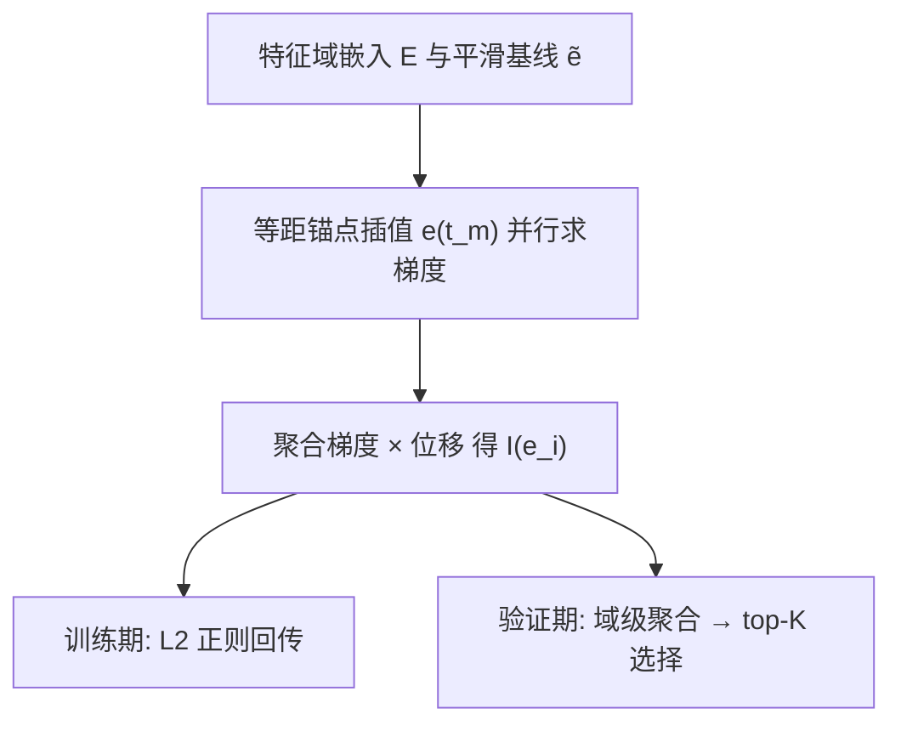

# FairFS: Addressing Deep Feature Selection Biases for Recommender System (面向推荐系统深度特征选择偏差的公平修正框架)

- **会议/期刊**: WWW 2026
- **作者与机构**: Xianquan Wang, Kai Zhang (USTC)；Zhaocheng Du, Jieming Zhu, Qinglin Jia, Zhenhua Dong (华为诺亚方舟实验室)
- **推荐链路定位**: 离线特征选择（服务于精排/全链路推理加速）
- **研究方向**: 去偏公平与工业架构 / CTR 预估与特征交叉
- **论文原文**: [https://arxiv.org/abs/2602.20001v1](https://arxiv.org/abs/2602.20001v1)
- **开源代码**: [https://github.com/xqwustc/FairFS](https://github.com/xqwustc/FairFS)

## TL;DR (1分钟核心速览)

工业推荐系统需从上千特征域中筛出高价值子集以兼顾精度与延迟，但现有门控法与敏感度法存在三类系统性偏差：门控值被后续非线性层扭曲（层偏差）、零/均值基线偏离决策边界（基线偏差）、一阶 Taylor 展开在远距离上失效（近似偏差）。FairFS 以「平滑基线 + 等距锚点聚合梯度 + 全层敏感度正则」三招同时修正，在 Criteo/Avazu/iFly-AD 三数据集、四种骨干上取得 SOTA，AUC 相对提升最高 0.35%，线上 A/B 在 CTR 场景 ECPM +1.35%、延迟 −20%。

## Background & Motivation (背景与核心矛盾)

- **主流范式**: 嵌入式特征选择分两支——门控法（AutoField/AdaFS/MvFS 用可训练 gate 绝对值衡量重要性）与敏感度法（PFI/SFS/SHARK/SNIP 用「特征置为基线后损失变化」衡量重要性）。
- **前人局限**: 门控法的重要性只在门控层成立，后续 MLP 的非线性变换会重排放大尺度（图 3 实测 Droprank 门控幅度与下一层变化不匹配）；敏感度法的基线选择无原则，Criteo 上均值基线输出 logit 仅 0.293，远离 0.5 决策边界，导致负样本被误判为「无信息」，重要性偏向正样本。
- **核心洞察 (Key Insight)**: 一阶 Taylor 近似误差为 $O(|\boldsymbol{e}_i-\tilde{\boldsymbol{e}}_i|)$，与特征到基线的距离成正比——因此「基线要近」与「路径要细分」是两个可独立优化的降偏杠杆。
- **本文切入点**: 把特征重要性从「事后打分」升级为「训练期正则 + 验证期聚合估计」的统一框架，用积分中值定理把单点梯度替换为路径平均梯度。

## Method (核心方法设计)

### 1. 整体框架 (Overall Architecture)

FairFS 以「特征域嵌入 $\boldsymbol{E}=[\boldsymbol{e}_1,\dots,\boldsymbol{e}_F]$」为输入，三阶段闭环：阶段一在原始嵌入与平滑基线之间做线性插值生成锚点并并行求梯度；阶段二按积分中值定理聚合锚点梯度得到样本级重要性$I(\boldsymbol{e}_i)$，再在验证集上求和为域级重要性；阶段三双轨使用——训练期以$M=0$（退化为 Gradient×Input）作为稀疏正则项参与反向传播，验证期以$n_{ac}$个锚点做高精度打分并指导 top-$K$ 特征域筛选与重训。整个流程与骨干模型解耦，可直接挂载于 Wide&Deep/DCN/DeepFM/FM。

### 2. 关键设计拆解 (Key Designs)

1. **聚合近似（Aggregated Approximation）**：针对一阶 Taylor 在远距离失效，沿插值路径 $\boldsymbol{e}(t)=(1-t)\boldsymbol{e}_i+t\tilde{\boldsymbol{e}}_i$取$M+1$ 个等距锚点，用算术均值逼近路径平均梯度：
$$I(\boldsymbol{e}_i)=(\boldsymbol{e}_i-\tilde{\boldsymbol{e}}_i)\odot\frac{1}{M+1}\sum_{m=0}^{M}\nabla_{\boldsymbol{e}(t_m)}L$$
直觉：由积分中值定理，路径平均梯度恰等于某中间点 $c$的梯度，等距采样比蒙特卡洛方差更低，$M\to\infty$时近似偏差趋零（附录 C 给出$O(M^{-1/2})$ 收敛界）。

2. **平滑基线（Smoothing Baseline）**：提出基线须满足「无信息性」（落在决策边界流形 $f_\theta(\tilde{\boldsymbol{E}})=D_b$）与「邻近性」（离原样本尽量近）两原则，写成约束优化$\min\|\boldsymbol{E}-\tilde{\boldsymbol{E}}\|^2\ \text{s.t.}\ f_\theta(\tilde{\boldsymbol{E}})=D_b$。在两层 ReLU 假设下解得$\tilde{\boldsymbol{E}}=\boldsymbol{E}-\frac{\alpha}{2}(\boldsymbol{\Theta}_1\boldsymbol{\Theta}_2)^T$，工程上以样本内跨域均值替代迭代求解：
$$\tilde{\boldsymbol{E}}=[\mathbb{E}_k[\boldsymbol{h}_k],\dots,\mathbb{E}_k[\boldsymbol{h}_k]]$$
即用「本样本各域表征的均值」复制 $F$ 份，既抹去域语义又保留样本强度，且逐样本不同——这是相对全局零/均值基线的本质改进。

3. **训练目标与推理开销**：总损失 $\mathcal{L}=L_{CE}+\lambda\sum_{i=1}^{F}\|I(\boldsymbol{e}_i)\|_2$，域级（而非维度级）稀疏，天然规避 I-Razor 的维度碎片化。训练期$M=0$仅需一次标准反传，几乎零额外开销；验证期$n_{ac}\in\{1,5,10,20\}$ 次前向，属离线周期性任务，可容忍。推理期无任何额外控制器，延迟仅由选中域数决定。

## Experimental Setup & Evaluation Protocol (实验设置与评估协议)

- **数据集与预处理**:

| 数据集 | #Fields | #Training | #Validation | #Test | 场景说明 |
| :--- | :---: | :---: | :---: | :---: | :--- |
| Criteo | 39 | 36.67M | 4.58M | 4.58M | 经典展示广告 CTR |
| Avazu | 24 | 32.34M | 4.04M | 4.04M | 移动端点击日志 |
| iFly-AD | 245 | 1.78M | 0.22M | 0.22M | 高维工业广告，域数最多 |

- **数据划分与防穿越**: 按 `8:1:1` 比例划分训练/验证/测试，早停依据验证集，特征重要性估计严格在验证集上完成以避免对训练分布过拟合。
- **排名评测协议**: 采用 `Full-Ranking` 式全样本 AUC 与 Logloss（CTR 场景标准），辅以 `Ratio`（选中域数/总域数）衡量稀疏度；AUC 提升 0.001 即视为显著，并做 $p\le 0.05$ 显著性检验。
- **对比基线与超参**: 基线含 No Selection、PFI、AutoField、AdaFS、MvFS；骨干为 Wide&Deep($d{=}40$)、DCN($d{=}32$)、DeepFM($d{=}40$)、FM($d{=}10$)，统一基于 FuxiCTR 默认配置，batch=10000，Adam + Xavier，最多 100 epoch；$\lambda\in\{10^2,\dots,10^{-2},0\}$，$n_{ac}\in\{1,5,10,20\}$。

## Key Experimental Results (实验关键数据)

### 1. 主实验对比 (Main Results)

以 Wide&Deep 与 DCN 骨干为例（AUC↑ / Ratio↓）：

| 数据集-骨干 | No Sel. | PFI | AutoField | AdaFS | MvFS | **FairFS** | Improv. |
| :--- | :---: | :---: | :---: | :---: | :---: | :---: | :---: |
| Criteo-W&D | 0.8090 | 0.8093 | 0.8093 | 0.8116 | **0.8120** | 0.8094 | −0.26% |
| Avazu-W&D | 0.7922 | 0.7923 | 0.7719 | 0.7877 | 0.7910 | **0.7929\*** | +0.09% |
| iFly-W&D | 0.8840 | 0.8854 | 0.8859 | 0.8857 | 0.8846 | **0.8862** | +0.03% |
| Criteo-DCN | 0.8095 | 0.8098 | 0.8096 | 0.8095 | 0.8097 | **0.8097** | 持平 |
| Avazu-DCN | 0.7920 | 0.7918 | 0.7920 | 0.7867 | 0.7915 | **0.7928\*** | +0.10% |
| iFly-DCN | 0.8849 | 0.8852 | 0.8860 | 0.8859 | 0.8855 | 0.8852 | −0.09% |
| Criteo-DeepFM | 0.8076 | 0.8072 | 0.8075 | 0.8071 | 0.8076 | **0.8086\*** | +0.12% |
| Avazu-DeepFM | 0.7929 | 0.7931 | 0.7929 | 0.7917 | 0.7921 | **0.7932\*** | +0.04% |
| Criteo-FM | 0.8010 | 0.8011 | 0.8006 | 0.8000 | 0.8007 | **0.8018\*** | +0.10% |

（`*` 表示 $p\le 0.05$ 显著；原文报告三数据集相对提升上限分别为 0.20%/0.22%/0.35%。）

### 2. 消融实验 (Ablation Study)

| 配置 | 关键现象 | 结论 |
| :--- | :--- | :--- |
| $n_{ac}=0$（退化为单点 Taylor） | AUC 最低 | 聚合近似是主要增益来源 |
| $n_{ac}$: 0→5→10→20→40 | AUC 近单调上升 | 锚点越密，近似偏差越小 |
| 基线 = Zero / Mean / Swap / Uniform | 小特征集下明显劣于 Smooth | 平滑基线在 $K$ 小时鲁棒性最强 |
| $\lambda$扫描 |$\lambda\in(0,0.01]$ 最优，过大丢重要域 | 稀疏与精度需权衡 |

### 3. 关键实验发现 (Key Findings)

1. **稀疏度与精度的解耦能力**：Avazu 上 FairFS 仅保留 66.67% 域即达 0.7929，而 MvFS 保留 58.33% 却掉到 0.7910——说明 MvFS 删掉的是信息域而非噪声域，FairFS 的域级聚合梯度能区分二者。
2. **基线偏差的定量证据**：Criteo 上均值基线 logit=0.293 严重偏向负侧，平滑基线更贴近 0.5 决策边界且理论距离更短；在 $K<20$ 的小特征集区间，平滑基线 AUC 优势最明显，因为此时无共线特征可「兜底」。
3. **线上收益与骨干无关的稳定性**：CTR 场景剔除 23% 噪声域后 ECPM +1.35%、延迟 −20%；CVR 场景剔除 40% 域后 ECPM 持平、延迟 −5.4%，证明 FairFS 的收益主要来自「删对特征」而非「删多特征」。

## Highlights & Limitations (亮点、对比与审稿批判)

- **与代表作对比 (vs. Prior Work)**: 相比 AutoField/MvFS 的「门控值即重要性」，FairFS 用深层梯度穿透所有非线性层，从根上消除层偏差；相比 SHARK 的「均值基线 + 单点 Taylor」，FairFS 同时修正了基线位置与近似阶数两个误差源，且给出基线选择的两条可验证数学原则（此前工作仅有直觉）。
- **可迁移亮点**: ①「样本内跨域均值」作为逐样本平滑基线，可迁移到任何需要 baseline 的归因/可解释性任务（如 SHAP 的 background set 构造）；②训练期 $M=0$、验证期$n_{ac}>0$ 的「阶段差异化精度」策略，是离线重计算任务的通用省算技巧。
- **审稿级局限批判**: ①平滑基线的闭式解依赖「两层 ReLU + 平衡数据」两个强假设，深层骨干下仅为启发式替代，缺乏误差界；②主实验中 FairFS 在 Criteo-W&D 与 iFly-DCN 上并未超过 MvFS/AutoField，SOTA 结论依赖多骨干平均，且 iFly-AD 仅 178 万样本，工业代表性有限；③验证期 $n_{ac}$ 次前向在 245 域场景下的绝对耗时未与门控法做端到端对比。

## Rating (四维评分)

- **方法创新性 (Novelty)**: ⭐⭐⭐⭐ （三类偏差的识别清晰且有实证支撑，积分中值定理聚合近似与平滑基线闭式解具备理论骨架，但各组件单独看均属已有思想的组合改良）
- **评估协议与实验扎实度 (Protocol & Experiments)**: ⭐⭐⭐⭐ （三数据集 × 四骨干 × 五基线 + 显著性检验 + 一周线上 A/B，覆盖充分；扣分在于部分骨干上未取胜且缺少方差报告）
- **写作与数学规范度 (Clarity & Rigor)**: ⭐⭐⭐⭐ （偏差分类—原则—公式—验证的叙事链条完整，附录给出收敛率证明；但平滑基线的假设简化与真实骨干间的 gap 未做误差分析）
- **工业落地与复现价值 (Industrial & Practical Value)**: ⭐⭐⭐⭐⭐ （推理零额外开销、代码开源、已在华为广告平台作为基线方法上线，A/B 延迟 −20% 是硬指标）

