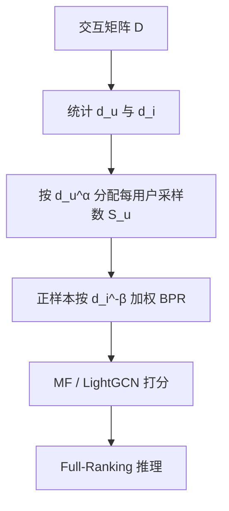

# Identifying and Upweighting Power-Niche Users to Mitigate Popularity Bias in Recommendations (识别并上调高活跃-小众用户以缓解推荐流行度偏差)

- **会议/期刊**: WWW 2026
- **作者与机构**: David Liu (Cornell), Erik Weis / Moritz Laber / Tina Eliassi-Rad / Brennan Klein (Northeastern University)
- **推荐链路定位**: 召回（协同过滤训练阶段损失重加权）
- **研究方向**: 去偏公平与工业架构 / 协同过滤
- **论文原文**: [https://arxiv.org/abs/2509.17265v2](https://arxiv.org/abs/2509.17265v2)
- **开源代码**: [https://github.com/dliu18/power-niche-users-www](https://github.com/dliu18/power-niche-users-www)

## TL;DR (1分钟核心速览)

现有流行度去偏方法（IPW、正则、重排）普遍只按物品流行度加权，且默认"性能-偏差"存在权衡。本文先做数据侧实证：将用户按活跃度（power/light）× 流行度偏好（mainstream/niche）划四象限，发现"高活跃-小众"用户数量显著超零模型预期，且其交互数据对整体与小众召回最有价值。据此提出 PAIR，在 BPR 损失上同时按用户活跃度 $d_u^{\alpha}$与物品流行度$d_i^{-\beta}$ 连续重加权。在 Gowalla/Yelp2018/Amazon-Book 上以 Full-Ranking 评测，MF 骨干下 Recall@20 平均提升 20.1%、POB 降 7.5%，6 组配置中 5 组帕累托支配 Vanilla。

## Background & Motivation (背景与核心矛盾)

- **主流范式**: 流行度去偏分三派——正则化（惩罚打分与流行度正相关）、重加权（IPW 按物品倾向 $p_i^{-\beta}$ 加权）、后处理重排（流行度补偿）。三者均以**物品**为唯一偏置源。
- **前人局限**: ① 重加权只上调"小众物品"或"小众用户"，却忽略用户活跃度维度，导致高活跃小众用户与低活跃小众用户被同等对待；② 几乎所有方法都默认去偏必然牺牲精度，形成"性能-偏差权衡"的思维定式。
- **核心洞察 (Key Insight)**: 作者用配置零模型（随机重连 $10E$ 次保持度序列）检验发现，三数据集中 power-niche 用户占比（22.8%–26.3%）显著高于零模型期望（超 2 个标准差），而 mainstream 用户中 power 用户反而少于期望。进一步用"固定集 + 处理组"数据估值法（图 3）证明：加入 power-niche 用户数据后，整体 Recall@20 与小众 Recall@20 提升最大（Gowalla/Yelp 小众召回最高 +10%），light-mainstream 数据价值最低。
- **本文切入点**: 既然 power-niche 用户既稀缺又高价值，就应在训练损失中**同时**按活跃度与流行度连续加权，把他们的梯度信号放大。

## Method (核心方法设计)

### 1. 整体框架 (Overall Architecture)

PAIR 不改动骨干网络，仅改造 BPR 损失的采样与加权逻辑。输入为用户-物品二部交互矩阵，先统计每个用户的活跃度 $d_u$与每个物品的流行度$d_i$；训练时对每个用户按$d_u^{\alpha}$决定其每 epoch 采样正样本三元组数量，对每个正样本按$d_i^{-\beta}$ 放大其损失权重，负样本从全库均匀采样；最终在 MF 或 LightGCN 打分器上优化加权 BPR，推理阶段与标准 CF 完全一致（无额外开销）。

### 2. 关键设计拆解 (Key Designs)

1. **双参数连续重加权 BPR（PAIR 核心损失）**：痛点在于原 BPR 对所有 (u,i,j) 三元组等权、且 LightGCN 实现固定每用户采样数隐式上调了轻用户。PAIR 改为对均匀采样取期望并乘活跃度因子：
$$l_{\text{PAIR}}^{\alpha,\beta} = -\sum_{u=1}^{n} d_u^{\alpha}\, \mathbb{E}_{i\sim U(\mathcal{N}_u),\, j\sim U(\mathcal{I}\setminus\mathcal{N}_u)}\big[d_i^{-\beta}\ln\sigma(\hat{Y}_{ui}-\hat{Y}_{uj})\big]$$
其中 $\alpha\in[0,1]$控制活跃度权重（$\alpha=0$退化为 LightGCN 等采样，$\alpha=1$贴近原始 BPR），$\beta\in[0,\infty)$控制流行度去偏强度（$\beta=0$无去偏）。直觉：$d_i^{-\beta}$补偿热门物品的曝光优势，$d_u^{\alpha}$ 让高活跃用户贡献更多梯度，二者叠加使 power-niche 用户获得最大净权重。

2. **采样数按活跃度分配（工程落地关键）**：直接对期望求导不可行，作者将期望转为实际采样：用户 $u$每 epoch 采样$S_u=\text{round}\big(d_u^{\alpha}\sum_{u'}d_{u'}^{\alpha}\cdot\frac{\sum_{u''}d_{u''}}{\sum_{u''}d_{u''}^{\alpha}}\big)$个三元组，即活跃度越高采样越多。这样$\alpha$在实现层面对应"每用户正样本预算"，与$\beta$ 的物品权重解耦，便于网格搜索。

3. **训练目标、负采样与推理效率**：总损失即上式加权 BPR + 嵌入 Frobenius 正则；负采样为**全库均匀采样**（非 in-batch、非 hard negative）；$\alpha,\beta$在验证集上按 Recall@20 网格搜索。推理与 Vanilla 完全同构，无额外延迟，仅训练期采样量随$\alpha$ 略增。

## Experimental Setup & Evaluation Protocol (实验设置与评估协议)

- **数据集与预处理**:

| 数据集 | #Users | #Items | 类型 | 说明 |
| :--- | :---: | :---: | :---: | :--- |
| Gowalla | 29,858 | 40,981 | 位置签到 | 隐式反馈 |
| Yelp2018 | 31,668 | 38,048 | 商户评论 | 隐式反馈 |
| Amazon-Book | 52,643 | 91,599 | 图书评论 | 隐式反馈 |

- **数据划分与防穿越**: 沿用 Lee et al. 的标准 train/validation/test 划分（非 Leave-One-Out），测试集固定。
- **排名评测协议**: **Full-Ranking 全库未交互排序**，$k=20$；指标含 Recall@20、Precision@20、NDCG@20、POB@20（物品流行度与其平均排名的相关性，越低越去偏）、Coverage@20、Niche Recall@20（仅小众用户上的召回）。
- **对比基线与超参**: 骨干为 MF 与 3 层 LightGCN（$d$沿用原文默认）；基线含 Vanilla（$\alpha=0$）、Vanilla-BPR（$\alpha=1$）、IPW（固定$\alpha=0$调$\beta$）、Pop. Comp.（后处理重排）、Pop. Reg.（流行度正则）。结果取 4 次试验均值与置信区间。

## Key Experimental Results (实验关键数据)

### 1. 主实验对比 (Main Results)

| 数据集-骨干 | 方法 | Recall@20 | NDCG@20 | POB@20↓ | Niche Recall@20 |
| :--- | :--- | :---: | :---: | :---: | :---: |
| Gowalla-MF | Vanilla | 0.0976 | 0.0747 | 0.1475 | 0.1201 |
| | IPW | 0.1203 | 0.0867 | 0.1243 | 0.1401 |
| | **PAIR** | **0.1203** | **0.0867** | **0.1243** | **0.1401** |
| Yelp2018-MF | Vanilla | 0.0276 | 0.0224 | 0.3717 | 0.0273 |
| | IPW | **0.0350** | **0.0272** | **0.3429** | **0.0356** |
| | PAIR | 0.0344 | 0.0267 | 0.3483 | 0.0347 |
| Amazon-MF | Vanilla-BPR | **0.0044** | **0.0041** | 0.4774 | **0.0029** |
| | PAIR | 0.0043 | 0.0040 | 0.4844 | 0.0028 |
| Yelp2018-LGN | Vanilla | 0.0620 | 0.0507 | 0.4079 | 0.0628 |
| | IPW | 0.0630 | 0.0510 | 0.3966 | 0.0640 |
| | **PAIR** | **0.0641** | **0.0522** | **0.3805** | **0.0655** |
| Amazon-LGN | Vanilla | 0.0349 | 0.0269 | 0.4169 | 0.0315 |
| | **PAIR** | **0.0352** | **0.0273** | **0.3783** | 0.0316 |
| Gowalla-LGN | Vanilla | **0.1805** | 0.1532 | 0.1635 | **0.2006** |
| | **PAIR** | 0.1797 | **0.1536** | **0.1605** | 0.2005 |

> MF 骨干下 PAIR 相对 Vanilla 平均：Recall +20.1%、Precision +17.7%、NDCG +16.9%、POB −7.5%、Coverage +9.4%、Niche Recall +23.0%；LGN 骨干下 Recall 平均 +1.2% 且同步降偏。

### 2. 消融实验 (Ablation Study)

| 配置 | 含义 | 效果趋势 |
| :--- | :--- | :--- |
| $\alpha=0,\beta=0$ (Vanilla) | 等采样、无去偏 | 基线 |
| $\alpha=1,\beta=0$ (Vanilla-BPR) | 按活跃度采样、无去偏 | 部分数据集略升，POB 未降 |
| $\alpha=0,\beta>0$ (IPW) | 仅物品去偏 | MF 上帕累托，LGN 上出现权衡 |
| $\alpha>0,\beta>0$ (PAIR) | 双维重加权 | 5/6 配置帕累托支配 Vanilla |

### 3. 关键实验发现 (Key Findings)

1. **双维加权是帕累托双赢的关键**：图 6 显示 IPW 在 LGN 上随 $\beta$增大先保精度后掉点（典型权衡），而 PAIR 因额外引入$\alpha$ 在 Yelp/Amazon 上同时降 POB 并升 Recall，说明"仅物品去偏"不足，活跃度维度是打破权衡的杠杆。
2. **重加权方向与动机一致**：图 5 热力图显示 PAIR 优化后 power-niche 象限权重变化最大（如 LGN-Yelp 上 +16.6%），light 用户普遍降权（−11.3%），power-mainstream 仅微增，验证了"把梯度预算倾斜给高价值象限"的设计意图。
3. **浅层模型受益远大于深层模型**：MF 上 Recall 平均 +20.1%，LGN 仅 +1.2%，且 Gowalla-LGN 是唯一未帕累托支配的配置（Recall 低 0.0008）。说明 LightGCN 的高阶邻域聚合本身已部分吸收活跃度信号，PAIR 的边际增益被稀释，提示该方法更适合浅层/工业双塔召回。

## Highlights & Limitations (亮点、对比与审稿批判)

- **与代表作对比 (vs. Prior Work)**: 相比 IPW（Schnabel et al.）仅按物品倾向 $p_i^{-\beta}$加权，PAIR 多出用户活跃度维度$d_u^{\alpha}$，且实证证明这是打破权衡的关键；相比 Pop. Reg./Pop. Comp.（Zhu et al.）以大幅掉点换覆盖率，PAIR 在 5/6 配置上不掉点反升点；相比 Abdollahpouri et al. 仅观察到活跃度与流行度偏好的负相关，本文首次量化 power-niche 用户的统计显著性与数据价值。
- **可迁移亮点**: ① "固定集 + 处理组"的**用户象限数据估值法**可迁移到任何需要评估某类用户数据边际价值的场景（如冷启动用户、跨域用户）；② 将期望重加权转化为"每用户采样预算 $S_u$"的实现技巧，可直接套用到任意 pair-wise 损失框架。
- **审稿级局限批判**: ① 增益高度依赖骨干：深层 LGN 上提升微弱甚至个别配置掉点，方法普适性存疑；② $\alpha,\beta$ 需验证集网格搜索，且 Amazon-MF 上 PAIR 未超过 Vanilla-BPR，说明超参选择对结果敏感、泛化性有限；③ 仅在三个静态隐式反馈基准上离线评测，缺乏线上 A/B 与动态流行度漂移场景验证。

## Rating (四维评分)

- **方法创新性 (Novelty)**: ⭐⭐⭐⭐ （核心机制与方法设计具备明确创新性，理论与实验动机支撑充分）
- **评估协议与实验扎实度 (Protocol & Experiments)**: ⭐⭐⭐⭐ （主流公开数据集评测完整，包含多基线对比与消融实验验证）
- **写作与数学规范度 (Clarity & Rigor)**: ⭐⭐⭐⭐⭐ （问题形式化定义清晰，核心模块数学推导与架构阐述严谨易读）
- **工业落地与复现价值 (Industrial & Practical Value)**: ⭐⭐⭐⭐ （兼顾推荐效果增益与训练/推理效率，具备实际场景迁移参考价值）
