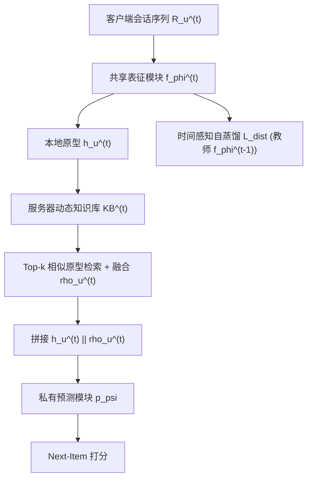
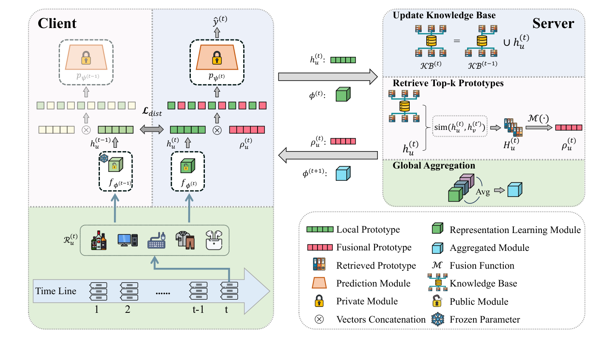

# Learning Evolving Preferences: A Federated Continual Framework for User-Centric Recommendation (学习演化偏好：面向用户中心推荐的联邦持续框架)

- **会议/期刊**: WWW 2026
- **作者与机构**: Chunxu Zhang, Zhiheng Xue, Guodong Long, Weipeng Zhang, Bo Yang（吉林大学符号计算与知识工程教育部重点实验室；香港理工大学 PolyU AAI；悉尼科技大学 AAII）
- **推荐链路定位**: 召回（会话级 Next-Item 排序）
- **研究方向**: 去偏公平、可信隐私与工业架构 / 序列与会话推荐
- **论文原文**: [https://arxiv.org/abs/2603.17315v1](https://arxiv.org/abs/2603.17315v1)
- **开源代码**: [https://github.com/Poizoner/code4FCUCR_www2026](https://github.com/Poizoner/code4FCUCR_www2026)

## TL;DR (1分钟核心速览)

现有联邦推荐把用户数据当作静态快照，既无法应对用户偏好随时间漂移导致的**时间遗忘**，也因客户端数据高度异构而弱化了**协同个性化**。FCUCR 提出两个即插即用模块：客户端侧用「时间感知自蒸馏」以历史表征模块约束当前表征模块（无需回放缓冲），服务器侧维护动态原型知识库并为每个客户端检索 top-$k$ 相似原型做融合增强。在 XING / RetailRocket / LastFM / Tmall 四个基准、会话级全库排序协议下，挂载 SASRec 骨干后 HR@10 相对提升 12.6%–44.0%，且对 GRU4Rec、TiSASRec 骨干同样稳定增益。

## Background & Motivation (背景与核心矛盾)

- **主流范式**: 联邦推荐（PFedRec、FedRAP、GPFedRec）以用户为客户端、只上传参数/嵌入，在隐私约束下做个性化；会话推荐（DMI-GNN、HearInt、MiaSRec）在中心化场景建模多兴趣与意图解耦。
- **前人局限**: ① 联邦方法假设用户行为静态、依赖固定数据快照，忽略偏好的连续演化，模型随会话累积而**时间遗忘**；② 直接聚合参数被少数大数据客户端主导，异构分布下**跨用户协同关系**无法被有效刻画，个性化与协同相互掣肘。
- **核心洞察 (Key Insight)**: 用户对物品语义的认知（由表征模块 $f_\phi$ 承载）在时间上高度稳定，而决策逻辑（由预测模块 $p_\psi$ 承载）高度个性化；同时不同用户存在可复用的**时序意图模式**（如"探索→决策"的转移节律）。
- **本文切入点**: 表征模块共享 + 预测模块私有，用自蒸馏锁住时间连续性、用原型检索补足跨用户协同，二者解耦且互不干扰。

## Method (核心方法设计)

### 1. 整体框架 (Overall Architecture)

每个用户为一个客户端，本地模型拆为共享表征模块 $f_\phi$（Transformer 编码会话）与私有预测模块 $p_\psi$（MLP）。第 $t$ 轮：客户端先用当前 $\phi^{(t)}$ 计算本会话原型 $h_u^{(t)}=f_\phi(\mathcal{R}_u^{(t)})$ 上传服务器；服务器并入动态知识库 $\mathrm{KB}^{(t)}$，为每个客户端检索 top-$k$ 相似原型并融合为 $\rho_u^{(t)}$ 下发；客户端将 $h_u^{(t)}\|\rho_u^{(t)}$ 拼接送入 $p_\psi$ 预测，同时以 $f_\phi^{(t-1)}$ 为教师做自蒸馏；训练后仅上传 $\phi_u^{(t)}$ 做 FedAvg。推理时仅需一次前向 + 一次原型拼接，无额外解码开销。

<figure class="paper-figure" markdown="span">
  <figcaption>图1：我们提出的FCUCR的整体框架。我们关注持续推荐，其中客户端随时间接收新的交互会话。为缓解时间遗忘，我们采用时间感知自蒸馏策略，使用前一时间步的表示模块指导当前会话的学习。此外，我们引入用户间原型迁移机制，服务器维护动态原型知识库，并为每个客户端检索前k个相似原型以实现协同个性化。该图展示了在</figcaption>
</figure>

### 2. 关键设计拆解 (Key Designs)

1. **时间感知自蒸馏 (TASD)**：痛点是无回放缓冲时新会话会覆盖旧偏好。做法是让当前表征模块在**新数据**上对齐上一轮冻结的自身输出，而非对齐旧数据：
$$\mathcal{L}_{dist}=\mathrm{MSE}\big(f_\phi^{(t)}(\mathcal{R}^{(t)}),\; f_\phi^{(t-1)}(\mathcal{R}^{(t)})\big)$$
直觉：约束的是"对同一输入的语义解释"而非"对旧样本的记忆"，因此零存储成本即可实现隐式时序正则，且不引入旧物品分布偏差。

2. **跨用户原型迁移 (IUPR)**：痛点是参数聚合被大数据客户端主导、无法表达细粒度用户关系。服务器维护 $\mathrm{KB}^{(t)}=\mathrm{KB}^{(t-1)}\cup\{h_u^{(t)}\}_{u=1}^{N}$，按余弦相似度为客户端 $u$ 检索 top-$k$ 邻居原型 $H_u^{(t)}$，经融合函数 $\mathcal{M}(\cdot)$（均值或降维）得 $\rho_u^{(t)}$，预测改为 $\hat{y}^{(t)}=p_\psi(h_u^{(t)}\|\rho_u^{(t)})$。直觉：原型是会话级意图的压缩摘要，比原始参数更鲁棒、更隐私友好（不上传可识别信息），且"检索而非聚合"避免了异构性下的均值坍缩。

3. **训练目标与效率**：总目标 $\min_{\phi,\{\psi_u\}}\sum_u \alpha_u\big(\mathcal{L}_{rec}+\lambda\mathcal{L}_{dist}\big)$，$\mathcal{L}_{rec}$ 为会话内下一物品的交叉熵（隐式反馈正负样本），无额外负采样设计；$\lambda=10$ 最优。效率侧支持滑窗裁剪知识库与降低原型传输频率（间隔 3 轮）以换取近似无损的性能。

## Experimental Setup & Evaluation Protocol (实验设置与评估协议)

- **数据集与预处理**: 按 HRNN 协议以**时间戳不活跃阈值**切分会话（XING 为 30 分钟），剔除 `DELETE` 交互；测试/验证集中未在训练集出现的物品被过滤。

| 数据集 | #Users | #Items | #Sessions | 平均会话长度 | 场景说明 |
| :--- | :---: | :---: | :---: | :---: | :--- |
| XING | 877 | 29,366 | 6,165 | 15.10 | 招聘/职位浏览 |
| RetailRocket | 391 | 14,051 | 4,183 | 7.93 | 电商浏览日志（6 个月） |
| LastFM | 940 | 145,469 | 468,297 | 18.50 | 音乐收听 |
| Tmall | 1,746 | 123,405 | 12,594 | 37.78 | 电商购物 |

- **数据划分与防穿越 (Splitting Strategy)**: 每个用户**最后一个会话为测试集、倒数第二个会话为验证集**，其余会话按时间顺序构成训练流（会话级 Leave-Last-Session-Out，天然满足时序防穿越）。
- **排名评测协议 (Ranking Protocol)**: 会话级 **Full-Ranking 全库排序**（对全物品集打分，非采样排序），指标 HR@10 / NDCG@10；显著性用双侧 t 检验 $p<0.05$。
- **对比基线与超参设置**: 三类基线——联邦推荐（PFedRec、FedRAP、GPFedRec）、会话推荐（Fed-DMI-GNN、Fed-HearInt、Fed-MiaSRec）、序列推荐（Fed-GRU4Rec、Fed-SASRec、Fed-TiSASRec），后两类均改造为联邦版本（前缀 `Fed-`）。骨干为 GRU4Rec / SASRec / TiSASRec，消融统一用 SASRec；$k\in\{1,5,20,100,200,1000\}$，$\lambda\in\{0.1,1,5,10,20,50\}$。

## Key Experimental Results (实验关键数据)

### 1. 主实验对比 (Main Results)

| 类型 | 模型 | XING HR@10 | XING NDCG@10 | RetailRocket HR@10 | RetailRocket NDCG@10 | LastFM HR@10 | LastFM NDCG@10 | Tmall HR@10 | Tmall NDCG@10 |
| :--- | :--- | :---: | :---: | :---: | :---: | :---: | :---: | :---: | :---: |
| 联邦 | PFedRec | 0.1852 | 0.0898 | 0.2603 | 0.1706 | 0.1596 | 0.0835 | 0.2669 | 0.1451 |
| 联邦 | FedRAP | 0.2013 | 0.1318 | 0.3183 | 0.2198 | 0.2191 | 0.1198 | 0.2411 | 0.1309 |
| 联邦 | GPFedRec | 0.1804 | 0.0839 | 0.2303 | 0.1322 | 0.1532 | 0.0777 | 0.2216 | 0.1208 |
| 会话 | Fed-DMI-GNN | 0.2561 | 0.1584 | 0.2876 | 0.1983 | 0.3216 | 0.2060 | 0.2068 | 0.1145 |
| 会话 | Fed-MiaSRec | 0.1692 | 0.0910 | 0.2473 | 0.1439 | 0.2894 | 0.1756 | 0.2451 | 0.1385 |
| 序列 | Fed-GRU4Rec | 0.1765 | 0.0939 | 0.2392 | 0.1432 | 0.3291 | 0.1918 | 0.2274 | 0.1248 |
| 序列 | **w/ FCUCR** | **0.2311** | **0.1563** | **0.3454** | **0.2687** | **0.3362** | **0.1946** | **0.2394** | **0.1420** |
| 序列 | Fed-SASRec | 0.1800 | 0.0954 | 0.2574 | 0.1527 | 0.3271 | 0.1907 | 0.2898 | 0.1571 |
| 序列 | **w/ FCUCR** | **0.2882** | **0.1863** | **0.3602** | **0.2879** | **0.3426** | **0.1944** | **0.3074** | **0.1947** |
| 序列 | Fed-TiSASRec | 0.2375 | 0.1549 | 0.2608 | 0.1602 | 0.3359 | 0.1964 | 0.2718 | 0.1507 |
| 序列 | **w/ FCUCR** | **0.2983** | **0.1891** | **0.3750** | **0.2996** | **0.3553** | **0.2187** | **0.2967** | **0.1593** |

相对骨干提升（HR@10）：SASRec 上 XING **+60.1%**、RetailRocket **+39.9%**、LastFM +4.7%、Tmall +6.1%；TiSASRec 上 XING +25.6%、RetailRocket **+43.8%**、LastFM +5.8%、Tmall +9.2%；GRU4Rec 上 XING +30.9%、RetailRocket **+44.4%**、LastFM +2.2%、Tmall +5.3%。所有增益均通过 $p<0.05$ 显著性检验。

### 2. 消融实验 (Ablation Study)

| 模型 (SASRec 骨干) | XING HR@10 | XING NDCG@10 | RetailRocket HR@10 | RetailRocket NDCG@10 | LastFM HR@10 | LastFM NDCG@10 | Tmall HR@10 | Tmall NDCG@10 |
| :--- | :---: | :---: | :---: | :---: | :---: | :---: | :---: | :---: |
| FCUCR 完整 | **0.2882** | **0.1863** | **0.3602** | **0.2879** | **0.3426** | 0.1944 | **0.3074** | **0.1947** |
| w/o TASD | 0.2731 | 0.1795 | 0.3360 | 0.2590 | 0.3309 | **0.1967** | 0.2926 | 0.1860 |
| w/o IUPR | 0.2556 | 0.1754 | 0.3324 | 0.2692 | 0.3287 | 0.1912 | 0.2520 | 0.1412 |

### 3. 关键实验发现 (Key Findings)

1. **IUPR 是更"硬"的增益来源，TASD 是更"稳"的增益来源**：去掉 IUPR 后 Tmall HR@10 从 0.3074 跌至 0.2520（−18.0%）、NDCG@10 从 0.1947 跌至 0.1412（−27.5%），跌幅远超去掉 TASD（−4.8% / −4.5%）；说明在数据稀疏的 Tmall 上，跨用户原型补足的信息量比时序正则更关键，而 TASD 的贡献在会话数最多的 XING 上最明显（HR@10 −5.2%）。
2. **TASD 的收益并非单调，存在"稳定性—可塑性"权衡**：LastFM 上去掉 TASD 后 NDCG@10 反而微升（0.1944→0.1967），说明该数据集偏好漂移快、过强的历史对齐会抑制适应；这与超参分析中 $\lambda=10$ 最优、$\lambda$ 过大性能回落的结论一致，印证了正则强度需按漂移速率调节。
3. **原型数量 $k$ 呈倒 U 型，且抗遗忘性可被直接观测**：$k$ 从 1 增至中等值性能上升、过大则因噪声原型下降；图 2(a) 追踪各客户端**首个会话**在训练轮次上的 HR，基线（SASRec/GRU4Rec/TiSASRec/MiaSRec）随会话累积持续下滑，而 FCUCR 保持高位；图 2(b)(c) 显示原型增强后正负样本预测概率分布明显分离，而 Fed-SASRec 的负样本概率大量堆积在 0.5 附近，判别力不足。

## Highlights, Limitations & Rating (亮点、对比与审稿评价)

- **与代表作对比 (vs. Prior Work)**: 与 PFedRec/FedRAP/GPFedRec 的本质差异在于它们只做**空间维度的客户端个性化**、假设数据静态，FCUCR 显式引入**时间维度的持续学习**；与 F3CRC 相比，本文进一步处理了会话流式到达与跨客户端"空间遗忘"，且以原型检索替代参数聚合，规避异构性下的聚合坍缩；与 Fed-DMI-GNN/HearInt 等图结构会话模型相比，本文不依赖跨会话图构建，通信开销更低且天然隐私友好。
- **可迁移亮点**: ① "在新数据上对齐旧模型输出"的**无回放自蒸馏**可直接迁移到任何存储受限的端侧增量推荐；② **原型检索替代参数聚合**的思路可迁移到多场景/跨域推荐中的知识迁移，用会话级摘要做软邻居检索比全局 FedAvg 更能保留长尾客户端信号。
- **审稿级局限批判**: ① 用户规模极小（391–1,746 客户端），与工业级百万级客户端的通信与知识库检索开销（top-$k$ 全库相似度计算为 $O(N\cdot|\mathrm{KB}|)$）未被评估，缺乏真实大规模或线上 A/B 证据；② 原型知识库跨轮累积存在**隐私侧信道风险**（会话级表征可能被反演），文中仅用 LDP 加噪做了附录级验证，未给出形式化隐私预算与效用权衡曲线；③ 所有基线均为作者自行改造的 `Fed-` 版本，缺少与原论文中心化结果的对照，公平性存疑。
- **四维评分**: 创新性 ⭐⭐⭐⭐ | 实验扎实度 ⭐⭐⭐ | 方法清晰度 ⭐⭐⭐⭐⭐ | 落地价值 ⭐⭐⭐⭐

