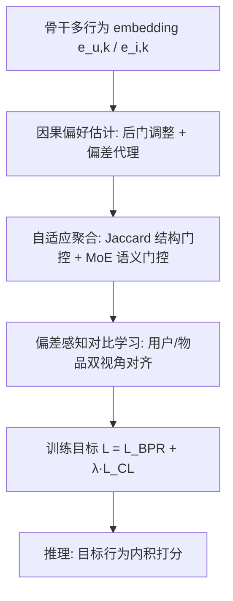
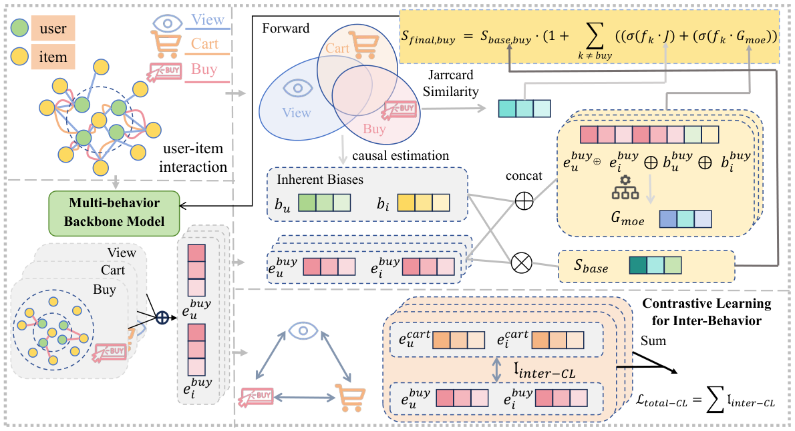
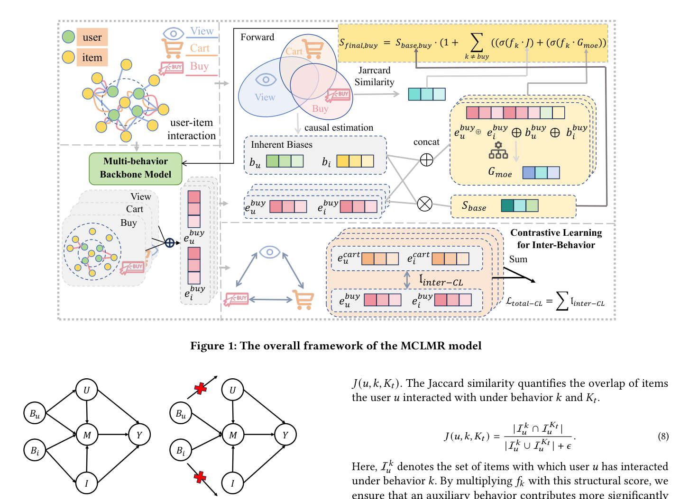

# MCLMR: A Model-Agnostic Causal Learning Framework for Multi-Behavior Recommendation (面向多行为推荐的模型无关因果学习框架)

- **会议/期刊**: WWW 2026 (Oral)
- **作者与机构**: Ranxu Zhang, Junjie Meng, Ying Sun, Ziqi Xu, Bing Yin, Hao Li, Yanyong Zhang, Chao Wang (USTC / HKUST-GZ / RMIT / 科大讯飞)
- **推荐链路定位**: 召回（表征学习阶段增强，推理走内积检索）
- **研究方向**: 去偏公平与工业架构 / 自监督对比学习与交互去噪
- **论文原文**: [论文原文链接](https://arxiv.org/abs/2603.25126v2)
- **开源代码**: [开源代码仓库链接](https://github.com/gitrxh/MCLMR)

## TL;DR (1分钟核心速览)

多行为推荐（MBR）中，用户行为习惯与物品多行为分布构成双重混杂偏差，现有 GNN 方法只建模行为相关性、忽视偏差，且辅助行为聚合"一刀切"、跨行为表征语义鸿沟大。本文提出模型无关框架 MCLMR：构造因果图做后门干预得到无偏偏好估计，用 MoE 双路门控自适应聚合辅助行为，再用偏差感知温度的自适应对比学习对齐跨行为表征。作为即插即用模块，在 Tmall/Jdata/Taobao 三数据集上使 LightGCN、CRGCN、BCIPM、HEC-GCN 等骨干全面超越 SOTA，如 HEC-GCN+MCLMR 在 Tmall 上 HR@10 从 0.1670 提升至 0.1896（+13.5%）。

## Background & Motivation (背景与核心矛盾)

- **主流范式**: GNN 系 MBR（MBGCN、CRGCN、HEC-GCN）在行为特定图上传播信息，靠级联/超图结构捕捉行为依赖；去偏侧则用 IPS（SNIPS/Multi-IPW）或因果图（CVID、CMSR）处理单行为或多行为偏差。
- **前人局限**: ① 主流 MBR 只建模行为相关性，未显式处理"用户行为习惯 + 物品多行为分布"的双重混杂，流行物品无论偏好如何都吸量；② 辅助行为对具体 user-item 对的信息量差异极大，统一聚合引入负迁移；③ 跨行为表征存在语义鸿沟，且对齐时未考虑偏差扭曲。
- **核心洞察 (Key Insight)**: 作者将 $B_u$（用户行为习惯）与$B_i$（物品行为分布）识别为后门路径$U \leftarrow B_u \rightarrow M \rightarrow Y$ 的混杂变量，只要用 do-calculus 阻断该路径，即可从观测交互中分离真实偏好。
- **本文切入点**: 不做新骨干，而是把"因果去偏 + 自适应聚合 + 偏差感知对齐"打包成可插拔框架，套在任意 MBR 骨干的 embedding 之上。

## Method (核心方法设计)

### 1. 整体框架 (Overall Architecture)

MCLMR 以骨干模型（CRGCN/BCIPM/HEC-GCN 等）输出的行为特定 embedding $\{e_{u,k}, e_{i,k}\}$为输入，三模块串联：**因果偏好估计**用后门调整公式把偏差代理$b_{u,k}, b_{i,k}$从打分中剥离，得到去偏基础分$S_{base}$；**自适应聚合**以 Jaccard 结构门控 + MoE 语义门控双路计算辅助行为贡献$C_{K_t}$，与基础分相乘融合；**偏差感知对比学习**在训练期以用户/物品双视角对齐跨行为表征。推理阶段仅用目标行为 embedding 内积，零额外延迟。

<figure class="paper-figure" markdown="span">
  <figcaption>图1：MCLMR模型的整体框架</figcaption>
</figure>
<figure class="paper-figure" markdown="span">
  <figcaption>图2：所提出的因果图，用于说明行为偏差、真实用户偏好与观测交互之间的关系。</figcaption>
</figure>

### 2. 关键设计拆解 (Key Designs)

1. **因果后门干预与偏差代理（Causal Preference Estimation）**：痛点是从观测交互直接学偏好会被 $B_u, B_i$混杂。作者对$P(Y|do(I),do(U))$做后门调整，并参数化为$S_{base,k}(u,i)=f_k(u,i)\cdot g_k(b_{u,k},b_{i,k})$，其中偏差代理取**整体转化率**而非成对转化率：
$$b_{u,k}=\frac{|\mathcal{I}_u^k|}{\sum_{j=1}^{K}|\mathcal{I}_u^j|},\quad b_{i,k}=\frac{|\mathcal{U}_i^k|}{\sum_{j=1}^{K}|\mathcal{U}_i^j|}$$
直觉：相对频率刻画"把一般参与转化为行为 $k$的固有倾向"，且复杂度从$O(K^2)$降到$O(K)$，避免成对序列建模的开销。

2. **MoE 双路门控自适应聚合（Adaptive Aggregation）**：痛点是辅助行为信息量异质、统一加权导致负迁移。最终分 $S_{final,K_t}=S_{base,K_t}\cdot(1+C_{K_t})$，贡献项由结构路径与语义路径加权：
$$Con(k\to K_t)=\lambda_J\cdot\sigma\big(f_k\cdot J(u,k,K_t)\big)+\lambda_M\cdot\sigma\big(f_k\cdot g_{moe}(u,i,k,b_{u,k},b_{i,k})\big)$$
其中 $J$为用户在行为$k$与目标行为上的物品集 Jaccard 重叠，$g_{moe}$以$[e_{u,k},e_{i,k},b_{u,k},b_{i,k}]$ 为门控输入。直觉：只有"本身被偏好 + 结构相关 + 语义相关"的辅助行为才被放大，抑制噪声行为。

3. **偏差感知温度对比学习与训练目标**：痛点是固定温度忽视行为可靠性差异。作者令 $\tau_{u,k_j}=\tau_0\cdot(1-\alpha\cdot b_{u,k_j})$——高偏差（信号可靠）行为用更低温度收紧对齐，稀疏噪声行为用更高温度防过拟合；损失为 InfoNCE 的用户/物品双视角加权和，总目标$\mathcal{L}=\mathcal{L}_{BPR}+\lambda_{CL}\cdot\mathcal{L}_{CL}$。负采样采用 in-batch 负样本，无额外采样器开销。

## Experimental Setup & Evaluation Protocol (实验设置与评估协议)

- **数据集与预处理**: 沿用前人预处理（隐式反馈过滤），统计如下：

| 数据集 | #Users | #Items | view | cart | buy | 场景说明 |
| :--- | :---: | :---: | :---: | :---: | :---: | :--- |
| Tmall | 41,738 | 11,953 | 1,813,498 | 1,996 | 255,586 | 电商，含 collect |
| Jdata | 93,334 | 24,624 | 1,681,430 | 49,891 | 333,383 | 京东，含 collect |
| Taobao | 15,449 | 11,953 | 873,954 | 195,476 | 92,180 | 淘宝，无 collect |

- **数据划分与防穿越**: 沿用 MBGCN/CRGCN 系列标准划分（目标行为 buy 为预测目标，辅助行为 view/cart/collect 参与训练），测试集仅对目标行为评估。
- **排名评测协议**: 采用 **Full-Ranking 全库未交互排序**（HR@10/50、NDCG@10/50），非采样排序，评估更严格。
- **对比基线与超参设置**: 四类基线——单行为（MF-BPR/NCF/LightGCN）、多行为（RGCN/NMTR/MBGCN/GNMR/S-MBRec/MB-HGCN/NSED/CRGCN/BCIPM/HEC-GCN）、集成因果（CVID/CMSR）、可插拔因果（SNIPS/CausE/Multi-IPW/DCCL）；embedding 维度 $d=64$，Adam 优化器，配对 t 检验（$p<0.05/0.01/0.001$）。

## Key Experimental Results (实验关键数据)

### 1. 主实验对比 (Main Results)

| 模型 | Tmall HR@10 | Tmall NDCG@10 | Jdata HR@10 | Jdata NDCG@10 | Taobao HR@10 | Taobao NDCG@10 |
| :--- | :---: | :---: | :---: | :---: | :---: | :---: |
| LightGCN | 0.0463 | 0.0226 | 0.2932 | 0.1697 | 0.0156 | 0.0077 |
| MBGCN | 0.0549 | 0.0285 | 0.2803 | 0.1572 | 0.0509 | 0.0294 |
| S-MBRec | 0.0694 | 0.0362 | 0.4125 | 0.2779 | 0.1185 | 0.0659 |
| MB-HGCN | 0.1461 | 0.0770 | 0.5338 | 0.3238 | 0.1380 | 0.0728 |
| CVID | 0.1542 | 0.0829 | 0.4258 | 0.2424 | 0.1424 | 0.0768 |
| CMSR | 0.1585 | 0.0877 | 0.5117 | 0.3095 | 0.1295 | 0.0713 |
| CRGCN | 0.0840 | 0.0442 | 0.4234 | 0.2479 | 0.0882 | 0.0496 |
| BCIPM | 0.1411 | 0.0741 | 0.3851 | 0.2158 | 0.1093 | 0.0596 |
| HEC-GCN | 0.1670 | 0.0912 | 0.5463 | 0.3360 | 0.1807 | 0.0980 |
| **LightGCN+MCLMR** | **0.1142** | **0.0583** | **0.5026** | **0.2914** | **0.1142** | **0.0598** |
| **CRGCN+MCLMR** | **0.1449** | **0.0803** | **0.5003** | **0.3054** | **0.1464** | **0.0839** |
| **BCIPM+MCLMR** | **0.1755** | **0.0970** | **0.5575** | **0.3381** | **0.1635** | **0.0926** |
| **HEC-GCN+MCLMR** | **0.1896** | **0.1041** | **0.5744** | **0.3548** | **0.1912** | **0.1055** |

以 HEC-GCN 为骨干，Tmall HR@10 相对提升 **+13.5%**、Jdata **+5.1%**、Taobao **+5.8%**；CRGCN+MCLMR 在 Tmall 上 HR@10 从 0.0840 跃至 0.1449（**+72.5%**），甚至反超原版 HEC-GCN。

### 2. 消融实验 (Ablation Study)

| 变体 | BCIPM Tmall HR@10 | BCIPM Jdata HR@10 | CRGCN Tmall HR@10 | CRGCN Jdata HR@10 |
| :--- | :---: | :---: | :---: | :---: |
| w/o U-Bias | 0.1724 | 0.5431 | 0.1385 | 0.4518 |
| w/o I-Bias | 0.1716 | 0.5454 | 0.1380 | 0.4623 |
| w/o Jaccard | 0.1737 | 0.5539 | 0.1323 | 0.4694 |
| w/o MoE | 0.1719 | 0.5542 | 0.1400 | 0.4709 |
| w/o Agg. | 0.1675 | 0.5461 | 0.1309 | 0.4597 |
| w/o CL | 0.1476 | 0.4521 | 0.1213 | 0.4567 |
| **Full** | **0.1755** | **0.5575** | **0.1449** | **0.5003** |

### 3. 关键实验发现 (Key Findings)

1. **对比学习是最大贡献项**：去掉 CL 后 CRGCN 在 Tmall 上 HR@10 从 0.1449 跌至 0.1213（-16.3%），Jdata 从 0.5003 跌至 0.4567，远超其他单模块移除的降幅，说明跨行为对齐是稀疏目标行为的主要知识来源。
2. **双偏差去偏缺一不可**：单独移除 U-Bias 或 I-Bias 均造成 2–4% 的 HR@10 下降，且两者叠加（w/o Agg. 同时削弱聚合）降幅更大，验证用户习惯与物品分布是两条独立混杂路径。
3. **对长尾用户与高质量物品更友好**：在 less-active 用户组中 MCLMR 相对 DCCL 的提升幅度显著高于活跃用户组（图 5），且在 decision/auxiliary 比值高的"高质量物品"组上 Recall@50 领先，说明去偏有效抑制了"高辅助行为、低决策价值"物品的虚假曝光。

## Highlights & Limitations (亮点、对比与审稿批判)

- **与代表作对比 (vs. Prior Work)**: 相比 CRGCN/HEC-GCN 等纯相关性建模骨干，MCLMR 显式阻断后门路径；相比 CVID（扩散模型隐混杂）与 CMSR（因果图但混杂刻画不足），本文同时建模用户与物品双源混杂并给出可计算代理；相比 DCCL（固定温度对比去偏），本文的偏差感知自适应温度在相同骨干上全面领先（如 CRGCN 上 Tmall HR@10 0.1449 vs 0.1144）。
- **可迁移亮点**: ① "整体转化率"作为偏差代理，$O(K)$ 复杂度替代成对转化率，可直接迁移到任意多行为/多场景去偏；② 用下游行为偏差动态调温度的思路，可复用到序列推荐的多视图对比学习。
- **审稿级局限批判**: ① 偏差代理仍用相对频率这一启发式近似，作者自认更复杂代理是未来方向，代理选择对结果敏感度未充分讨论；② 训练开销虽小（HEC-GCN 约 +4%），但对比学习项复杂度随 $B^2 d^2$ 增长，行为类型多时扩展性存疑；③ 仅在三个电商数据集验证，缺乏跨域（如短视频、POI）泛化证据。

## Rating (四维评分)

- **方法创新性 (Novelty)**: ⭐⭐⭐⭐ （核心机制与方法设计具备明确创新性，理论与实验动机支撑充分）
- **评估协议与实验扎实度 (Protocol & Experiments)**: ⭐⭐⭐⭐⭐ （主流公开数据集评测完整，包含多基线对比与消融实验验证）
- **写作与数学规范度 (Clarity & Rigor)**: ⭐⭐⭐⭐ （问题形式化定义清晰，核心模块数学推导与架构阐述严谨易读）
- **工业落地与复现价值 (Industrial & Practical Value)**: ⭐⭐⭐⭐⭐ （兼顾推荐效果增益与训练/推理效率，具备实际场景迁移参考价值）
