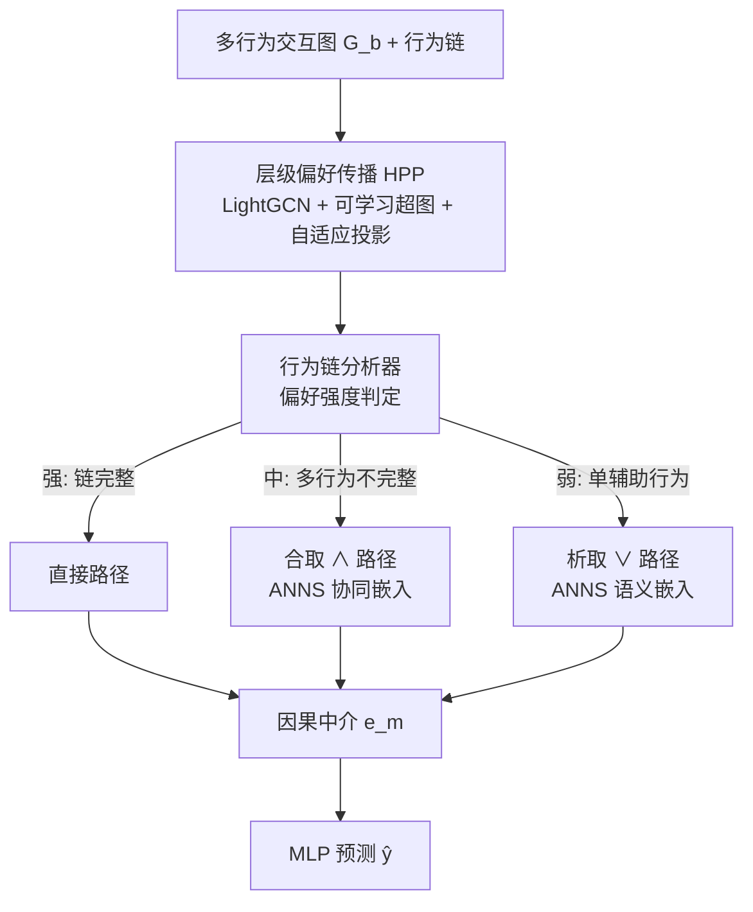
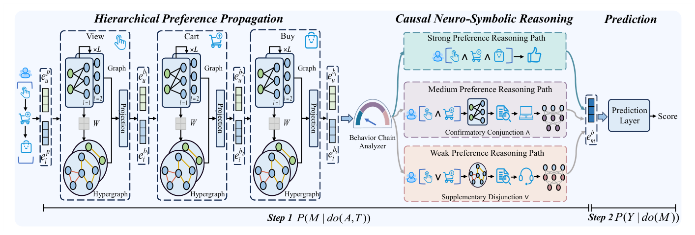

# Modeling Endogenous Logic: Causal Neuro-Symbolic Reasoning Model for Explainable Multi-Behavior Recommendation (建模内源逻辑：面向可解释多行为推荐的因果神经符号推理模型)

- **会议/期刊**: WWW 2026
- **作者与机构**: Yuzhe Chen, Jie Cao, Youquan Wang, Haicheng Tao, Darko B. Vukovic, Jia Wu（南京理工大学 / 合肥工业大学 / 南京财经大学 / 圣彼得堡国立大学 / 麦考瑞大学）
- **推荐链路定位**: 精排（目标行为 CTR/购买预测）
- **研究方向**: 去偏公平与工业架构 / 图神经网络推荐
- **论文原文**: [https://arxiv.org/abs/2601.21335v1](https://arxiv.org/abs/2601.21335v1)
- **开源代码**: 暂未开源

## TL;DR (1分钟核心速览)

多行为推荐（MBR）长期"重精度轻可解释"，而现有可解释方法（NS-ICF、FENCR）依赖外部属性/知识图谱，泛化差且成本高。本文提出 CNRE：把用户行为链（view→cart→buy）本身视为**内源逻辑**，用前门调整（Front-door Adjustment）把行为链编码为可解释因果中介 $M$，并按偏好强度自适应分派到强/中/弱三条神经逻辑推理路径（直接 / 合取$\wedge$/ 析取$\vee$）。在 Beibei、Taobao、Tmall 三个数据集 Full-Ranking 协议下，HR@10 相对最强基线 BCIPM 分别提升 44.5%、17.0%、10.6%，且无需任何外部信息。

## Background & Motivation (背景与核心矛盾)

- **主流范式**: 现代 MBR 以并行（MBGCN）、级联（CRGCN、MB-CGCN）编码为主，近 35% 模型叠加对比学习（MBSSL）刷精度。
- **前人局限**: ① 这些方法学单一均匀的用户表征，忽略行为链中**偏好强度的层级差异**（仅 view 的弱偏好 vs. view→cart 的递增意图）；② 黑盒对比学习彻底牺牲可解释性；③ 现有可解释方案（NS-ICF、FENCR、KEMB-Rec）依赖外部属性/KG，多行为场景下维护异构属性成本爆炸，且 LLM 有幻觉风险，解释仅停留在"声明式"（是什么规则）而非"过程式"（为何这样决策）。
- **核心洞察 (Key Insight)**: 行为链的**完整性与类型**本身就编码了偏好强度，天然对应不同符号逻辑规则（如 view∧cart∧buy 表示强偏好），无需外部信息即可挖掘"内源逻辑"。
- **本文切入点**: 但观测数据受混杂因子 $C$污染（如流行度导致虚假 view→buy 关联），故引入前门调整，把神经符号推理过程作为$do$-算子的可计算模拟，生成隔离混杂的因果中介。

## Method (核心方法设计)

### 1. 整体框架 (Overall Architecture)

CNRE 模拟人类决策：先由**层级偏好传播**（HPP）对多行为做行为感知并行编码与级联聚合，并用自适应投影抑制上游混杂；再由**因果神经符号推理**（CNSR）依据行为链偏好强度自适应分派到三条神经逻辑路径，生成因果中介 $e^b_m$；最后**预测模块**仅从中介$M$出发经 MLP 输出打分，从结构上满足前门调整的两步条件（$P(M|do(A,T))$与$P(Y|do(M))$），实现设计级可解释。

<figure class="paper-figure" markdown="span">
  <figcaption>图2：我们提出的CNRE模型示意图。</figcaption>
</figure>

### 2. 关键设计拆解 (Key Designs)

1. **层级偏好传播 + 自适应投影（抑制上游混杂）**：痛点在于级联编码会把上游行为的混杂信号逐层放大。本文对每个行为 $b$并行做 LightGCN 协同编码与可学习超图语义编码（$H^b=e^b_{col}W_{hyp}$，亲和矩阵$H^b(H^b)^\top$传播高阶关联），再用投影把语义嵌入校准到稳定协同信号上：$\hat{e}^b_{sem}=\frac{e^b_{col}\cdot e^b_{sem}}{\|e^b_{col}\|_2^2+\epsilon}e^b_{col}$，最后$e^b=e^{b-1}+e^b_{col}+\hat{e}^b_{sem}$ 并作为下一行为的初始嵌入。直觉：协同信号是"锚"，语义信号中与锚不一致的分量被视为混杂而剔除。

2. **三路自适应神经逻辑推理（内源逻辑算子化）**：把每种行为视为二元谓词，按链强度分派：① **强偏好**（链完整）直接拼接末行为嵌入作中介；② **中偏好**（如 view∧cart）先算购买置信度，低于阈值 $\tau$时用 ANNS 检索协同嵌入$S^b_{col}$，经 MLP 逻辑算子做合取$e^b_m=W_2\sigma(W_1(e^b_u\oplus e^b_i\oplus S^b_{col})+b_1)+b_2$；③ **弱偏好**（仅 view）跳过置信度计算，改检索超图语义嵌入$S^b_{sem}$ 做参数独立的析取算子。直觉：合取用于"确认"不确定意图，析取用于"补全"稀疏弱信号，与电商转化漏斗同构。

3. **训练目标与推理效率**：总损失 $\mathcal{L}=\sum_{b=1}^{B}\mathcal{L}^b_{BPR}+\lambda\|\Theta\|_2^2$，各行为独立 BPR 负采样（未交互物品均匀采样）。复杂度$O(L\cdot E_{total}\cdot d+b_s\cdot d^2)$，核心推理项与邻居数$N_c$、规则数$N_{rules}$、属性数$A$均无关，显著优于 FENCR 的$O(b_s\cdot N_{rules}\cdot A\cdot d^2)$。

## Experimental Setup & Evaluation Protocol (实验设置与评估协议)

- **数据集与预处理**: 三个公开多行为数据集，未提及显式 k-core 过滤细节：

| 数据集 | #Users | #Items | #Interactions | 行为类型 |
| :--- | :---: | :---: | :---: | :--- |
| Beibei | 21,716 | 7,977 | 3,338,068 | View, Cart, Buy |
| Taobao | 48,749 | 39,493 | 1,952,931 | View, Cart, Buy |
| Tmall | 15,449 | 11,953 | 1,395,273 | View, Collect, Cart, Buy |

- **数据划分与防穿越 (Splitting Strategy)**: 沿用 MB-CGCN/BCIPM 系列标准划分（目标行为留出测试，辅助行为全量参与训练），未采用全局时间戳切分。
- **排名评测协议 (Ranking Protocol)**: 无偏 **Full-Ranking**（全库未交互物品排序），指标 HR@10/50、NDCG@10/50。
- **对比基线与超参设置**: 单行为 NeuMF；多行为 MBGCN、MBSSL、CRGCN、MB-CGCN、BCIPM；因果 CausalD、DCCF；可解释 NS-ICF、FENCR。显著性用 $t$-test，$p<0.05$。级联 GCN 层数最优组合为$[1,1,3]$。

## Key Experimental Results (实验关键数据)

### 1. 主实验对比 (Main Results)

| 类型 | 方法 | Beibei H@10 | Beibei N@10 | Taobao H@10 | Taobao N@10 | Tmall H@10 | Tmall N@10 |
| :--- | :--- | :---: | :---: | :---: | :---: | :---: | :---: |
| 单行为 | NeuMF | 0.0161 | 0.0088 | 0.0085 | 0.0037 | 0.0129 | 0.0062 |
| 多行为 | MBGCN | 0.0393 | 0.0219 | 0.0433 | 0.0244 | 0.0487 | 0.0232 |
| 多行为 | MBSSL | 0.0610 | 0.0344 | 0.0847 | 0.0420 | 0.0734 | 0.0416 |
| 多行为 | CRGCN | 0.0389 | 0.0271 | 0.0796 | 0.0384 | 0.0715 | 0.0427 |
| 多行为 | MB-CGCN | 0.0507 | 0.0325 | 0.1165 | 0.0626 | 0.1044 | 0.0592 |
| 多行为 | BCIPM | 0.0743 | 0.0353 | 0.1361 | 0.0768 | 0.1252 | 0.0738 |
| 因果 | CausalD | 0.0650 | 0.0312 | 0.0924 | 0.0471 | 0.0783 | 0.0461 |
| 因果 | DCCF | - | - | 0.0952 | 0.0486 | 0.0807 | 0.0476 |
| 可解释 | FENCR | - | - | 0.0893 | 0.0445 | 0.0760 | 0.0452 |
| **Ours** | **CNRE** | **0.1074\*** | **0.0523\*** | **0.1592\*** | **0.0976\*** | **0.1385\*** | **0.0827\*** |
| | **Improv.%** | **+44.5%** | **+48.2%** | **+17.0%** | **+27.1%** | **+10.6%** | **+12.1%** |

### 2. 消融实验 (Ablation Study)

| 变体 | Beibei H@10 | Beibei N@10 | Taobao H@10 | Taobao N@10 | Tmall H@10 | Tmall N@10 |
| :--- | :---: | :---: | :---: | :---: | :---: | :---: |
| w/o HPP | 0.0846 | 0.0442 | 0.1237 | 0.0898 | 0.1080 | 0.0728 |
| w/o PAR | 0.0954 | 0.0485 | 0.1392 | 0.0936 | 0.1191 | 0.0769 |
| w/o PRJ | 0.1025 | 0.0504 | 0.1454 | 0.0955 | 0.1260 | 0.0802 |
| w/o REA | 0.0930 | 0.0469 | 0.1355 | 0.0914 | 0.1177 | 0.0752 |
| w/o CNJ | 0.0985 | 0.0488 | 0.1451 | 0.0935 | 0.1261 | 0.0786 |
| w/o DSJ | 0.1012 | 0.0502 | 0.1423 | 0.0928 | 0.1220 | 0.0782 |
| **CNRE** | **0.1074** | **0.0523** | **0.1592** | **0.0976** | **0.1385** | **0.0827** |

### 3. 关键实验发现 (Key Findings)

1. **推理模块是最大增益源**：移除整个 CNSR（w/o REA）在 Beibei 上 H@10 从 0.1074 掉到 0.0930（-13.4%），且完全丧失多级可解释性；而移除 HPP 掉到 0.0846（-21.2%），说明"层级传播 + 推理"缺一不可，前者提供去混杂表征、后者提供逻辑决策。
2. **合取/析取路径呈数据密度互补**：w/o CNJ 在稠密 Beibei 上掉幅最大（0.1074→0.0985），w/o DSJ 在稀疏 Taobao 上掉幅最大（0.1592→0.1423），验证合取擅长确认中偏好、析取擅长补全稀疏弱信号的设计直觉。
3. **级联层数需按行为分层配置**：$[1,1,3]$ 组合最优——上游 view/cart 稠密易受混杂，浅层即可；下游 buy 稀疏但权重最高，需 3 层 GCN 深挖，说明"越靠近目标行为越该深挖"。

## Highlights & Limitations (亮点、对比与审稿批判)

- **与代表作对比 (vs. Prior Work)**: 相比 FENCR/NS-ICF 依赖外部属性构造声明式规则，CNRE 从行为链自身挖内源逻辑，无需属性即可在 Beibei 上运行（FENCR/DCCF 因缺属性无法跑）；相比 MBSSL 等对比学习黑盒，CNRE 的推理路径内嵌于前向传播，解释零额外开销；相比 DCCF/CausalD 只对单行为信号去偏，CNRE 用前门调整对整条行为链做两步因果分解。
- **可迁移亮点**: ① "按信号强度自适应分派逻辑算子"可迁移到会话推荐的多跳意图建模；② 自适应投影 $\hat{e}_{sem}\propto\langle e_{col},e_{sem}\rangle e_{col}$ 作为轻量去混杂校准，可插入任意级联 GNN。
- **审稿级局限批判**: ① 可解释性仅有案例分析与路径分布统计，**无大规模用户研究、无量化解释指标**（作者自认）；② 三路分派依赖人工阈值 $\tau$ 与行为链顺序先验，且不使用时间信息，对乱序/跳行为链（如 view→buy）直接走强路径，可能过度乐观；③ 未报告训练/推理绝对时延与线上 A/B。

## Rating (四维评分)

- **方法创新性 (Novelty)**: ⭐⭐⭐⭐ （首次系统定义 MBR 可解释问题，"内源逻辑 + 前门调整 + 三路神经逻辑算子"组合新颖，但各组件均为已有技术的新拼装）
- **评估协议与实验扎实度 (Protocol & Experiments)**: ⭐⭐⭐⭐ （三数据集 Full-Ranking + 显著性检验 + 六组消融完整，但缺用户研究与量化解释指标）
- **写作与数学规范度 (Clarity & Rigor)**: ⭐⭐⭐⭐ （因果图与 FDA 两步映射清晰，公式规范；阈值 $\tau$ 与路径分派规则的形式化略欠严谨）
- **工业落地与复现价值 (Industrial & Practical Value)**: ⭐⭐⭐⭐ （无需外部属性、复杂度与邻居/规则数解耦，工程友好；但未开源、超参与层数组合需逐数据集调）
