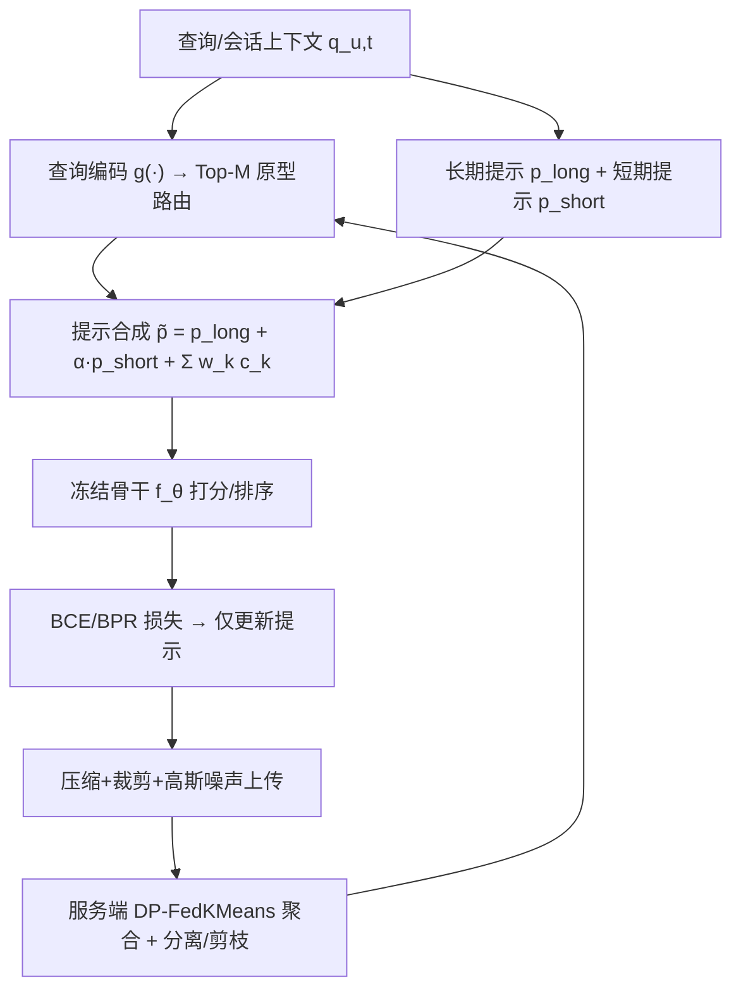
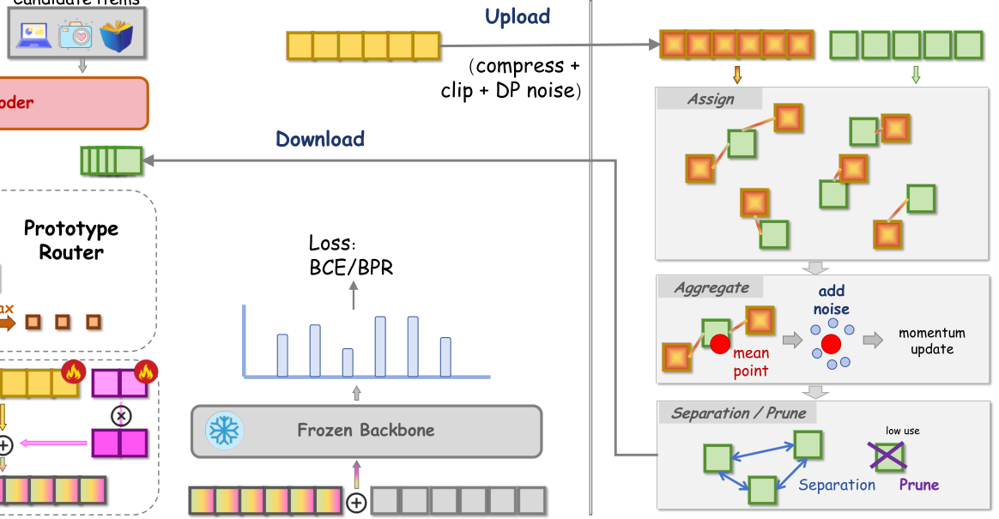

# Prototype-Aligned Federated Soft-Prompts for Continual Web Personalization (原型对齐的联邦软提示持续网页个性化)

- **会议/期刊**: WWW 2026
- **作者与机构**: Canran Xiao (中山大学深圳校区)、Liwei Hou (湖南大学)
- **推荐链路定位**: 端到端（冻结骨干上的提示级在线适配）
- **研究方向**: 去偏公平、可信隐私与工业架构 / 大语言模型推荐 (PEFT 提示)
- **论文原文**: [https://arxiv.org/abs/2603.27678v1](https://arxiv.org/abs/2603.27678v1)
- **开源代码**: 暂未开源

## TL;DR (1分钟核心速览)

持续网页个性化面临稳定性–可塑性两难：全量重训昂贵且泄露隐私，重放/正则方法又无法在用户粒度上控制遗忘。本文提出 ProtoFed-SP：在**冻结骨干**上注入**双时间尺度软提示**——短期提示以 ℓ1 稀疏近端步快速追踪会话意图，长期提示通过 Bregman+InfoNCE 对齐到**服务端原型库**，原型库由**差分隐私联邦聚合**（DP-FedKMeans）持续刷新。在 8 个基准、1 正 99 负采样排序协议下，NDCG@10 平均 +2.9%、HR@10 +2.0%（Books +5.0% vs. INFER），同时降低遗忘 AF 与 Steps-to-95%。

## Background & Motivation (背景与核心矛盾)

- **主流范式**: 持续推荐分四路——重放（ER/ReLoop/INFER）、正则（EWC/SI/SAIL-PIW 用户级模仿权重）、蒸馏（CCD）、PEFT 适配器（Prompt/Adapter/Dual-LoRA），联邦侧则有 FedProx/Ditto/FedRAP。
- **前人局限**: ① 稳定性–可塑性调节停留在**全局损失或算法层**，缺少可共享的语义锚点把用户记忆绑定到群体结构，用户粒度不可控；② 重放类方法需存储交互/ logits，隐私与带宽代价高，联邦个性化多靠额外权重而非轻量提示记忆，且少有显式 DP 账本。
- **核心洞察 (Key Insight)**: 用户偏好天然是**双时间尺度**的——品牌/品类慢变、会话主题快变；单一提示状态要么被近期噪声过拟合（可塑性主导），要么遗忘旧习惯（稳定性主导）。若把慢变记忆"拴"在一个低曲率原型流形上，漂移可被显式收缩。
- **本文切入点**: 用"双提示 + 原型锚定 + DP 联邦刷新"三件套，把稳定性–可塑性做成**用户/会话级可调接口**。

## Method (核心方法设计)

### 1. 整体框架 (Overall Architecture)

客户端持有冻结推荐骨干 $f_\theta$（SASRec 式 Transformer，H&M 另冻结 ViT-B/16 与 DistilBERT），仅训练两组提示 $p^{long}_u, p^{short}_{u,t}\in\mathbb{R}^{L_p\times d}$。推理时查询编码 $h_{u,t}=g(q_{u,t})$ 检索 Top-$M$ 原型，合成路由提示注入嵌入层打分；训练时短期提示走稀疏近端步、长期提示走对齐感知近端步；服务端周期性接收压缩加噪的长期提示嵌入，做 DP 聚类聚合、分离约束与剪枝后广播回客户端。

<figure class="paper-figure" markdown="span">
  <figcaption>图1：ProtoFed-SP：原型对齐的联邦软提示个性化。左侧（客户端）。给定用户查询或交互历史，客户端将上下文编码为池化嵌入，并通过基于相似度的检索将其路由到一小部分Top-𝑀群体原型。双时间尺度提示状态在本地维护：捕捉稳定偏好的长期提示和建模会话级意图的短期提示。路由提示由长期提示、漂移自适应短期提示以及检索到的原型的加权混合相加组成，并被 i</figcaption>
</figure>

### 2. 关键设计拆解 (Key Designs)

1. **双时间尺度提示与漂移自适应缩放**：单提示无法同时兼顾快慢动态。合成提示为 $\tilde{p}_{u,t}=p^{long}_u+\alpha_{u,t}p^{short}_{u,t}+\sum_{k\in\text{Top-}M}w_k c_k$，其中 $\alpha_{u,t}=\sigma(a^\top\Delta_{u,t})$ 由会话嵌入滚动均值漂移量 $\Delta_{u,t}$ 驱动——漂移大则放大短期权重，实现"按需可塑"。短期更新用软阈值近端步 $p^{short}\leftarrow\text{SoftThresh}(p^{short}-\eta_s\nabla\mathcal{L}_{rec},\eta_s\lambda_p)$，ℓ1 稀疏化防止提示膨胀，使快变量只承载少量会话增量。

2. **原型锚定对齐损失（稳定性来源）**：无约束时 $p^{long}_u$ 会坍缩到近期特异信号。令 $z_u=\phi(p^{long}_u)$、$v_k=\phi(c_k)$，对齐项为 $\mathcal{A}(z_u,\mathcal{C})=\min_k D_\Psi(z_u\|v_k)+\gamma\cdot(-\log\frac{\exp(\langle z_u,v_{\pi(u)}\rangle/\tau_a)}{\sum_j\exp(\langle z_u,v_j\rangle/\tau_a)})$：Bregman 项把长期记忆**收缩**到最近锚点，InfoNCE 项**锐化**归属以抵抗干扰原型；可选 2-Wasserstein 版本约束整个上下文分布而非仅中心。直觉上原型构成群体语义的低曲率流形，锚定即给慢变量加"弹性绳"。

3. **DP 联邦原型聚合与训练目标**：客户端上传 $z_u=\text{compress}(\phi(p^{long}_u))+\xi,\ \xi\sim\mathcal{N}(0,\sigma^2 I)$（PCA 至 64 维 + 8-bit 乘积量化，裁剪半径 1.0），服务端按 $v_k\leftarrow(1-\beta)v_k+\beta(\bar{z}_k+\xi_k)$ 动量更新，并施加最小间距约束 $\min_{i\neq j}\|v_i-v_j\|_2\ge\rho$ 与低利用率剪枝防坍缩。总目标 $\mathcal{J}=\mathbb{E}_{(u,t)}[\mathcal{L}_{rec}+\lambda_s\mathcal{A}(\phi(p^{long}_u),\mathcal{C})+\lambda_p\|p^{short}_{u,t}\|_1]$，$\mathcal{L}_{rec}$ 为 BCE 或 BPR；用户自适应 $\lambda_s(u)=\lambda_{max}\exp(-\kappa\Delta_u)$ 让高漂移用户更可塑。每客户端内存 $O(L_p d)$，路由 $O(Kd_\phi)$ 可 ANN 加速。

## Experimental Setup & Evaluation Protocol (实验设置与评估协议)

- **数据集与预处理**（均 `5-core` 过滤，按时间排序切 $T\in\{8,10,12\}$ 个时间片）：

| 数据集 | 规模/特点 | 场景说明 |
| :--- | :---: | :--- |
| Amazon-Books / Electronics | 大规模、长周期 | 强概念漂移、频繁冷物品 |
| ML-20M | 经典序列基准 | 评分≥4 二值化 |
| Yelp | 城市商户 | 季节性、用户漂移分析 |
| Gowalla / LastFM-1K | 签到/听歌序列 | 漂移序列对比 |
| RetailRocket | 点击流 | 会话级意图尖峰 |
| Taobao User Behavior | 大规模 CTR | 联邦多客户端仿真 |
| H&M Fashion | 多模态 | 冻结 ViT/BERT 骨干 |

- **数据划分与防穿越**: 按墙钟时间切片，每片末 10% 测试、前 10% 验证；新片首现物品仅可作该片正样本，杜绝泄漏。
- **排名评测协议**: `Sampled Ranking`，每查询 1 正 + 99 均匀采样负例（全方法共享候选集）；指标 HR/NDCG/MRR@$\{5,10,20\}$，另报遗忘 AF、BWT/FWT、Steps-to-95%、公平性 Disp$_{item}$/Disp$_{user}$、参数量/显存/通信量。
- **对比基线与超参**: 七类基线（全量重训/微调、EWC/SI/MAS/LwF/Personalized Imitation、ER/ReLoop/INFER、CCD、Prompt/Adapter/Dual-LoRA、FedAvg/FedProx/Ditto/FedRAP、RecICL/PCL）；$d=256$、$L_p=8$、$K=128$、$M=4$、$\tau=0.07$、$\tau_a=0.1$、$\gamma=0.5$、$\eta_s=5\times10^{-3}$、$\eta_\ell=10^{-3}$，3 种子取均值±标准差。

## Key Experimental Results (实验关键数据)

### 1. 主实验对比 (Main Results)

| Method | Books N@10 | ML-20M N@10 | Yelp N@10 | Gowalla N@10 | Taobao N@10 | H&M N@10 | H&M HR@10 |
| :--- | :---: | :---: | :---: | :---: | :---: | :---: | :---: |
| FullRetrain | 0.114 | 0.319 | 0.109 | 0.205 | 0.217 | 0.262 | 0.487 |
| ReLoop2 | 0.118 | 0.320 | 0.113 | 0.210 | 0.221 | 0.268 | 0.495 |
| INFER | 0.120 | 0.318 | 0.115 | 0.209 | 0.222 | 0.270 | 0.497 |
| CCD | 0.117 | 0.317 | 0.112 | **0.212** | 0.220 | 0.267 | 0.494 |
| Dual-LoRA | 0.117 | **0.323** | 0.114 | 0.208 | 0.220 | 0.277 | 0.503 |
| FedRAP | 0.114 | 0.314 | 0.110 | 0.206 | 0.226 | 0.266 | 0.492 |
| PCL | 0.117 | 0.316 | 0.112 | 0.205 | 0.219 | 0.269 | 0.494 |
| **ProtoFed-SP** | **0.126** | **0.329** | **0.119** | **0.216** | **0.231** | **0.284** | **0.512** |
| Improv.% | +5.0% | +1.9% | +3.5% | +1.9% | +2.2% | +2.5% | +1.8% |

（Electronics 0.142/0.271、RetailRocket 0.257/0.487 亦全面最优；平均 NDCG@10 +2.9%、HR@10 +2.0%。）

### 2. 消融实验 (Ablation Study)

| 变体 | Books N@10 | ML-20M N@10 | Taobao N@10 | H&M N@10 |
| :--- | :---: | :---: | :---: | :---: |
| Full | **0.126** | **0.329** | **0.231** | **0.284** |
| w/o 原型对齐 $\mathcal{A}$ | 0.120 (-0.006) | 0.324 (-0.005) | 0.225 (-0.006) | 0.277 (-0.007) |
| w/o 短期提示 ($\alpha=0$) | 0.122 (-0.004) | 0.325 (-0.004) | 0.227 (-0.004) | 0.279 (-0.005) |
| w/o 长期提示 | 0.116 (-0.010) | 0.320 (-0.009) | 0.223 (-0.008) | 0.274 (-0.010) |
| 静态原型（不联邦刷新） | 0.121 (-0.005) | 0.326 (-0.003) | 0.226 (-0.005) | 0.278 (-0.006) |
| 几何中位数聚合 | 0.124 (-0.002) | 0.328 (-0.001) | 0.230 (-0.001) | 0.282 (-0.002) |
| 2-Wasserstein 重心 | 0.123 (-0.003) | 0.327 (-0.002) | 0.229 (-0.002) | 0.281 (-0.003) |

### 3. 关键实验发现 (Key Findings)

1. **长期提示是稳定性主承重墙**：移除后 Books N@10 掉 0.010（HR 掉 0.016），为所有消融中最大跌幅；而移除对齐项使 Books 第 8 片 AF 从 0.009 升至 0.024，证明原型锚定直接抑制漂移型遗忘。
2. **短期提示是适应速度引擎**：去掉后 Books 第 8 片 Steps-to-95% 从 170 升至 270（+59%），且在多模态 H&M 上跌幅最大（-0.005），说明会话级快变量对密集交互/多模态漂移最敏感；Full 模型在 Books 上形成 NDCG 上升而 AF<0.01 的最优 Pareto 前沿。
3. **隐私代价温和且聚合器不敏感**：$\sigma=0.4$（$\varepsilon\approx3.4$）时 NDCG 落在 Non-DP 误差带内、AF 仅微升；$\sigma=0.8$（$\varepsilon\approx1.8$）仅降 1–2.5 点且优雅退化；替换为几何中位数/Wasserstein 重心精度变化 ≤0.003，说明增益来自锚定机制而非特定聚合规则。高漂移用户（无论活跃度）与冷启动新用户获得最大且显著的 $\Delta$NDCG。

## Highlights, Limitations & Rating (亮点、对比与审稿评价)

- **与代表作对比 (vs. Prior Work)**: 相比 INFER 的**样本级重放**，本文以压缩提示嵌入替代原始交互，天然规避隐私与存储；相比 Dual-LoRA 的**每用户独立适配器**，本文用共享原型库提供跨用户语义先验，冷启动与高漂移段受益更明显；相比 FedRAP 的**联邦权重个性化**，本文把个性化下沉到 $O(L_p d)$ 提示层并附显式 $(\varepsilon,\delta)$ 账本。
- **可迁移亮点**: ① "慢变量锚定 + 快变量稀疏近端"的双速更新范式可移植到任何 PEFT 持续学习场景；② 用 DP 聚类中心作为可广播的群体先验，是联邦场景下低成本知识共享的通用技巧。
- **审稿级局限批判**: ① 联邦为 Flower/FedML 仿真（1k–5k 客户端、5% 采样），DP 隐私账本为 accountant 估计，缺线上 A/B 与真实攻击评估；② 原型数 $K$、分离边距 $\rho$、$\lambda_s$ 需逐数据集网格搜索，且骨干全程冻结，未验证与可训练骨干或更大 LLM 的兼容性。
- **四维评分**: 创新性 ⭐⭐⭐⭐ | 实验扎实度 ⭐⭐⭐⭐ | 方法清晰度 ⭐⭐⭐⭐ | 落地价值 ⭐⭐⭐⭐

