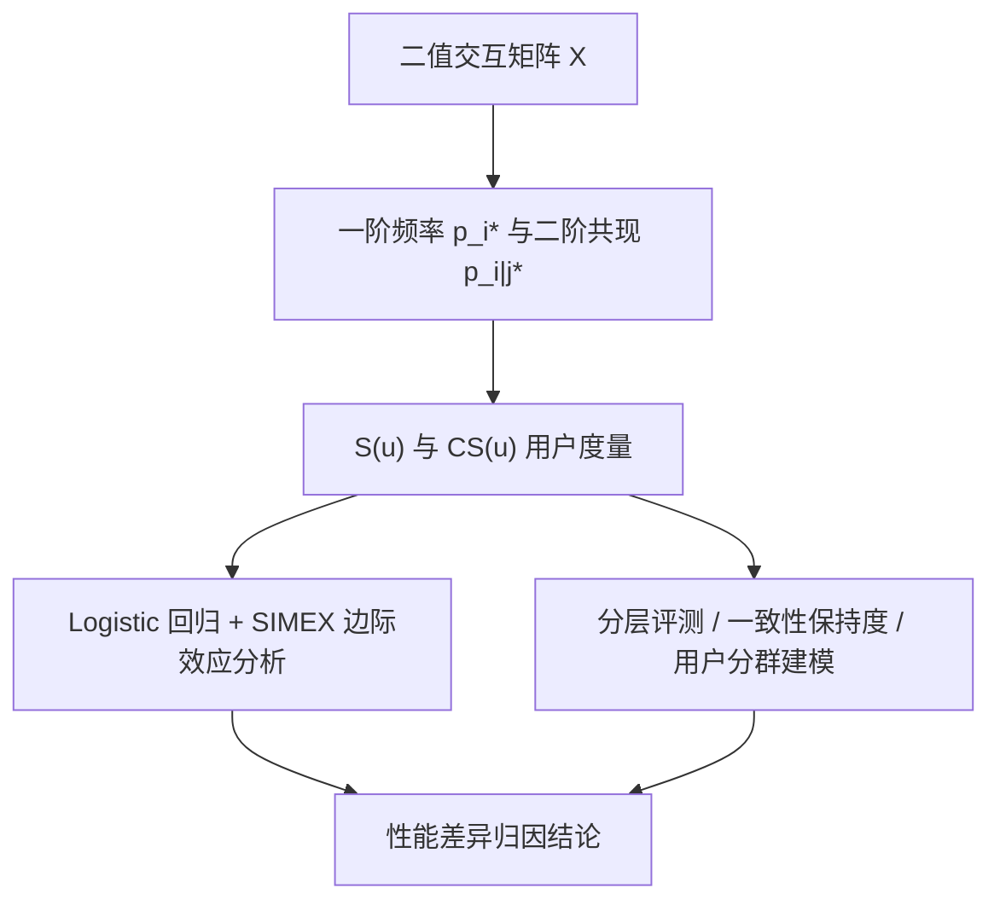
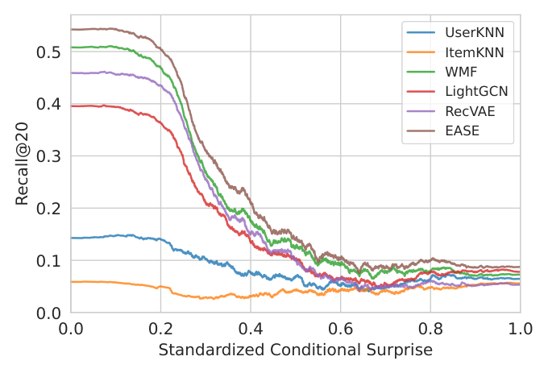

# Quantifying User Coherence: A Unified Framework for Analyzing Recommender Systems Across Domains (量化用户一致性：跨域推荐系统统一分析框架)

- **会议/期刊**: WWW 2026
- **作者与机构**: Michaël Soumm (Télécom Paris), Alexandre Fournier Montgieux, Adrian Popescu, Bertrand Delezoide (CEA List / Amanda.com)
- **推荐链路定位**: 评测与系统设计（不改变召回/排序模型本身，而是提供用户画像度量与分层评测工具）
- **研究方向**: 去偏公平、可信隐私与工业架构 / 冷启动与长尾推荐
- **论文原文**: [https://arxiv.org/abs/2410.02453v2](https://arxiv.org/abs/2410.02453v2)
- **开源代码**: [https://github.com/MSoumm/coherence-measures](https://github.com/MSoumm/coherence-measures)

## TL;DR (1分钟核心速览)

推荐系统性能在不同用户间差异巨大，但成因缺乏解释。本文提出两个信息论度量：Mean Surprise $S(u)$（用户偏离热门物品的程度，关联流行度偏差）与 Mean Conditional Surprise $CS(u)$（用户交互内部的共现一致性，域无关）。在 7 种算法 × 9 个数据集上，通过 Logistic 回归与 SIMEX 去噪证明二者是性能的强预测因子：复杂模型的增益几乎全部集中在"高一致"用户，而所有算法在"低一致"用户上普遍失效。据此提出分层评测、行为对齐分析与用户分群专用建模三种应用，Netflix 上专用模型以更少数据在一致用户段取得 Recall@20 提升（如 EASE 53.0→56.0）。

## Background & Motivation (背景与核心矛盾)

- **主流范式**: 协同过滤评测长期依赖聚合指标（Recall@K / NDCG），近年虽有多样性、新颖性、满意度等列表级指标，但均刻画"推荐输出"而非"输入用户画像"本身。
- **前人局限**: (1) 现有"灰羊用户"识别依赖用户间相似度聚类或密度方法，对画像密度敏感且需数据集特定超参，跨域泛化差；(2) 模型相关的 surprise 方法（如 Unexp-DIN）绑定特定架构的预测分布，无法解释"为何某类用户对所有模型都难"。
- **核心洞察 (Key Insight)**: 若把物品概率定义为全体用户中的出现频率 $p_i^*$ 与二阶共现 $p_{i|j}^*$，则用户画像的"意外度"与"内部一致性"可在**不依赖任何模型**的前提下被量化；且 $CS(u)$ 的分布在电影、电商、旅游等 9 个数据集上高度稳定，具备域无关性。
- **本文切入点**: 用归一化到用户自身物品集上的平均交叉熵（而非全库 $m$ 维求和）构造稳定估计量，并以理论界证明其是理想交叉熵的良态重缩放。

## Method (核心方法设计)

### 1. 整体框架 (Overall Architecture)

框架分三层：**度量层**从二值交互矩阵 $X\in\{0,1\}^{n\times m}$ 估计一阶/二阶物品频率，计算每个用户的 $S(u)$ 与 $CS(u)$；**验证层**以 Logistic 回归（含乘积交互项与 SIMEX 测量误差校正）将 Recall@20 二值结果对度量做回归，用平均边际效应 (AME) 与 McFadden $R^2$ 量化解释力；**应用层**基于度量做分层评测、输入-输出一致性保持度分析与用户分群专用模型训练。

<figure class="paper-figure" markdown="span">
  <figcaption>图 1：不同 RS 在数据集上的平均 Recall@20 性能，相对于我们提出的条件惊喜度（𝐶𝑆(𝑢)）度量，该度量表示用户交互的一致程度，标准化在 0 到 1 之间。所有 RS 的性能在 𝐶𝑆(𝑢) 高值时崩溃，表明大多数模型增益仅来自在“简单”数据点上的学习。</figcaption>
</figure>

### 2. 关键设计拆解 (Key Designs)

1. **Mean Surprise 与 Mean Conditional Surprise（归一化估计量）**：朴素定义 $\tilde S(u)=-\frac{1}{m}\sum_i \log(p_i^*)x_{ui}$ 在全库维度上求和，导致新增任何物品都单调增大度量，违背直觉且随 $|u|$ 漂移。本文改为仅在用户已消费物品上归一化：
$$S(u)=-\frac{1}{|u|}\sum_{i\in u}\log p_i^*,\qquad CS(u)=-\frac{1}{|u|^2}\sum_{i\in u}\sum_{j\in u}\log p_{i|j}^*$$
直觉：加入一个高频常见物品时度量可下降，符合"意外度"语义；且对不同活跃度用户可比。附录证明 $CS(u)=PS(u)-S(u)$，即二阶度量自动扣除一阶流行度效应，二者近似正交。

2. **理论稳定性保证（Proposition 3.1 / 3.2）**：稀疏二值数据下朴素交叉熵估计方差极大。作者证明所提估计量与理想交叉熵 $S^*(u)$ 的比值被 $\mathbb{E}[m/|u|]$ 类因子上下夹住，并在 $|u|\sim\text{Poisson}(\lambda)$ 假设下给出 $\mathbb{E}_{X\ge1}[1/X]\le 2\mathbb{E}_{X\ge1}[X]$ 的紧界（经验常数 1.37）。这解释了为何该度量在冷启动用户上仍可用——附录 SNR 分析显示 Netflix 上 $|u|=5$ 用户的信噪比达 14.36。

3. **训练目标、负采样与推理效率**：本文不训练新推荐模型，度量计算为一次性 $O(\sum_u |u|^2)$ 统计，可在离线管道中预计算并缓存；回归分析使用 SIMEX 对 $\log p_i$、$\log p_{i|j}$ 的估计方差做模拟外推，消除测量误差导致的系数衰减。专用模型实验沿用各基线原训练流程（Optuna 50 轮调参，最大化验证集 Recall@20）。

## Experimental Setup & Evaluation Protocol (实验设置与评估协议)

- **数据集与预处理**: 评分二值化阈值 $r_{ui}>3$，采用 `5-core` 迭代过滤（先滤物品后滤用户，作者指出常见实现顺序会导致残留物品不足 5 次的问题）：

| 数据集 | #Users | #Items | #Interactions | 密度 | 场景说明 |
| :--- | :---: | :---: | :---: | :---: | :--- |
| ML 1M | 6K | 3.1K | 562K | $3\times10^{-2}$ | 电影 |
| ML 10M | 69K | 9.4K | 5.7M | $9\times10^{-3}$ | 电影 |
| Netflix Small | 8.3K | 2.7K | 320K | $1\times10^{-2}$ | 电影 |
| Netflix | 463K | 18K | 59.9M | $7\times10^{-4}$ | 电影（大规模） |
| Vis2Rec | 9.1K | 9.3K | 200K | $2\times10^{-3}$ | 旅游 |
| Tradesy | 6.6K | 12K | 73K | $9\times10^{-4}$ | 二手时尚电商 |
| Amazon Music | 8.6K | 11K | 87K | $9\times10^{-4}$ | 电商 |
| Amazon Office | 20K | 62K | 468K | $4\times10^{-4}$ | 电商 |
| Amazon Toys | 61K | 143K | 1.2M | $1\times10^{-4}$ | 电商 |

- **数据划分与防穿越**: `Leave-One-Out`——每数据集采样 10,000 测试用户（不足则全取），最后一条交互为测试、倒数第二条为验证，其余为训练；保证测试用户出现在训练集中。
- **排名评测协议**: 单正样本设定下 Recall@K 与 Precision@K 等价，故仅用 Recall@20，等价于二值 0/1 命中；对全库未交互物品做 `Full-Ranking`。
- **对比基线与超参设置**: 7 种算法覆盖流行度 (MostPop)、邻域 (UserKNN/ItemKNN)、矩阵分解 (WMF/EASE)、图卷积 (LightGCN)、变分自编码 (RecVAE)；Optuna 50 轮搜索，显著性 $p<0.05$。

## Key Experimental Results (实验关键数据)

### 1. 主实验对比 (Main Results)

整体 Recall@20（图 7 数值化，取代表性数据集）：

| 算法 | ML 1M | ML 10M | Netflix | Vis2Rec | Tradesy | A. Music | A. Toys |
| :--- | :---: | :---: | :---: | :---: | :---: | :---: | :---: |
| MostPop | 低 | 低 | 低 | 低 | 低 | 低 | 低 |
| ItemKNN | 中 | 中 | — | 中 | 中 | 中 | 中 |
| WMF | 较高 | 较高 | 较高 | 较高 | 较高 | 较高 | 较高 |
| LightGCN | 较高 | 较高 | 较高 | 中 | 中 | 中 | 中 |
| RecVAE | 中 | **高** | **高** | 中 | 中 | 中 | 中 |
| **EASE** | **最优** | 较高 | 较高 | **最优** | **最优** | **最优** | **最优** |

（原文以图 7 呈现，EASE 在几乎所有数据集最优；WMF 次优，但在最大规模数据集上 RecVAE 因数据量优势反超；UserKNN 在 Netflix 上因 1.4TB 内存饱和未跑。）

**分层评测核心结果（图 1）**：按标准化 $CS(u)$ 分桶后，所有算法的 Recall@20 随 $CS(u)$ 升高单调下降并收敛至同一低水平；算法间差距仅在低 $CS(u)$（一致用户）区间显著。

**用户分群专用模型（Netflix，一致用户最低十分位，表 7）**：

| 模型 | ItemKNN | LightGCN | WMF | RecVAE | EASE |
| :--- | :---: | :---: | :---: | :---: | :---: |
| Vanilla（全量训练） | 0.0 | 33.8 | 47.4 | 46.0 | 53.0 |
| **Specialized（仅一致子集）** | **3.2** | **39.3** | **49.2** | **47.8** | **56.0** |

### 2. 消融实验 (Ablation Study)

以回归模型变量消融（AME，单位：Recall@20 百分点 / 1 标准差，取 ML 1M 与 Amazon Toys 代表）：

| 变量配置 | ML 1M | A. Toys | 说明 |
| :--- | :---: | :---: | :--- |
| 仅 $\lvert u\rvert$ | -0.02 | +0.05 | 画像密度单独解释力弱 |
| 仅 $S(u)$ | +0.02 | -0.03 | 流行度偏离影响最小 |
| 仅 $CS(u)$ | **-0.22** | **-0.09** | 一致性是主导负向因子 |
| $S(u)\times CS(u)$ 全交互 | $R^2$=0.34 | $R^2$=0.35 | AIC 最优模型 |
| 朴素 $\tilde S,\widetilde{CS}$（未归一化） | 随 $\lvert u\rvert$ 二次漂移 | 同左 | 图 3 显示不可比 |

### 3. 关键实验发现 (Key Findings)

1. **增益集中于一致用户**：图 1 显示 $CS(u)$ 最高的分桶中所有 7 种算法 Recall@20 收敛到近乎相同的低值，说明聚合指标下的"模型进步"实质是对低 $CS(u)$ 用户的改善；对高 $CS(u)$ 用户，算法选择几乎无关紧要。
2. **一致性是比流行度更强的难度信号**：表 5 中 $CS(u)$ 的 AME 在多数数据集达 -13 至 -26 个百分点（如 EASE 在 A. Toys 上 -26），而 $S(u)$ 仅 -3 至 -20，且 $S(u)$ 在电影域几乎不显著——说明模型对"小众口味"已有一定适应，但对"内部不自洽"束手无策。
3. **数据质量可胜数据规模**：Netflix 上仅用最低十分位 $CS(u)$ 的一致用户训练，EASE 在目标段从 53.0 提升至 56.0、LightGCN 从 33.8 提升至 39.3，尽管训练数据大幅减少——表明不一致用户引入的噪声对一致用户建模的损害超过数据量收益。

## Highlights, Limitations & Rating (亮点、对比与审稿评价)

- **与代表作对比 (vs. Prior Work)**: 相比灰羊用户识别（Ghazanfar 聚类、Gras 分布法），本文度量无需聚类与数据集特定超参，且具理论界保证；相比 Unexp-DIN 等模型相关 surprise，本文度量完全 model-agnostic，刻画输入数据内在属性；相比 Elliot / ReChorus 等评测框架聚焦准确率指标，本文补充了"用户画像难度"这一评测维度。
- **可迁移亮点**: (1) 分层评测可直接嵌入 A/B 实验报告，按 $CS(u)$ 分桶暴露聚合指标掩盖的失效模式；(2) "一致性保持度"（输入与推荐集 $CS$ 的 Pearson 相关）可作为多样性/长尾场景的补充指标，表 6 显示多数模型对 $S(u)$ 保持良好（均值 0.2–0.6）但对 $CS(u)$ 保持弱（均值 0.03–0.43）。
- **审稿级局限批判**: (1) 仅覆盖二值隐式反馈与 7 种基础 CF 模型，未验证显式评分、会话数据及 LLM-based 推荐器；(2) 专用模型实验仅为 Netflix 单数据集的概念验证，提升幅度温和（1.8–5.5 点），且未给出在线部署的延迟与分群路由成本分析；(3) $CS(u)$ 计算为 $O(|u|^2)$，对超活跃用户需采样近似。
- **四维评分**: 创新性 ⭐⭐⭐⭐ | 实验扎实度 ⭐⭐⭐⭐ | 方法清晰度 ⭐⭐⭐⭐⭐ | 落地价值 ⭐⭐⭐⭐

