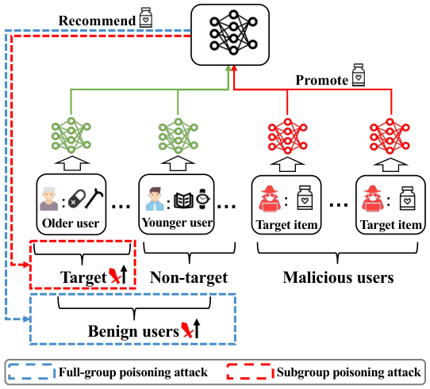
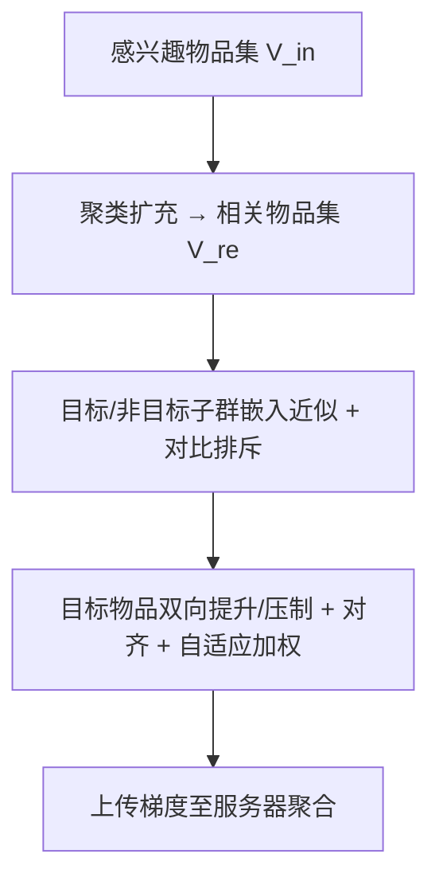

# Spattack: Subgroup Poisoning Attacks on Federated Recommender Systems (联邦推荐系统上的子群投毒攻击)

- **会议/期刊**: WWW 2026
- **作者与机构**: Bo Yan, Dingqi Liu, Huabin Sun, Chuan Shi (北京邮电大学); Yurong Hao, Wei Yang Bryan Lim (南洋理工大学); Pengpeng Qiao, Yang Cao (东京科学大学)
- **推荐链路定位**: 联邦训练阶段（恶意客户端上传梯度投毒，影响召回/排序结果）
- **研究方向**: 去偏公平、可信隐私与工业架构 / 协同过滤
- **论文原文**: [https://arxiv.org/abs/2507.06258v2](https://arxiv.org/abs/2507.06258v2)
- **开源代码**: 暂未开源

## TL;DR (1分钟核心速览)

现有 FedRec 投毒攻击均面向**全体用户**（full-group），既易被检测又无法定向。本文提出首个**子群投毒攻击 Spattack**：以"近似-提升"范式先合成目标/非目标子群的用户嵌入，再用对比排斥、聚类扩充相关物品、目标-相关物品对齐与自适应加权四招破解两群间的权衡困境。在 ML-100K/ML-1M/Steam 上，仅 0.1%–0.2% 恶意客户端即实现目标群 **100% ER@5**，非目标群 ER@5 压至 3.82%–6.31%，且推荐性能几乎无损（ML-1M 上 HR@10 反超无攻击基线）。

## Background & Motivation (背景与核心矛盾)

- **主流范式**: FedRec 本地更新用户嵌入、仅上传物品/模型梯度；投毒攻击分两派——流行度操纵（让目标物品模仿热门物品）与用户近似（合成良性用户嵌入后直接建模其与目标物品交互）。
- **前人局限**: ① 两派均以全体用户为目标，目标物品被无差别推给所有人，**隐蔽性差**（年轻用户等敏感群体会察觉异常推荐）；② 由于协同过滤的相似性本质，用户群在表示空间中因交互重叠而**天然纠缠**，强行全群攻击必然在目标群收益与非目标群副作用间陷入权衡（图 2 实证：恶意比例升高时两群 ER 同涨，无解逼近右上最优角）。
- **核心洞察 (Key Insight)**: 真实攻击者（保健品推销、选举微定向）只关心**特定子群**——只需最大化目标子群 ER、同时最小化非目标子群 ER，即可同时收获"更隐蔽"与"更有效"双重红利。
- **本文切入点**: 既然单群近似不够，就**同时近似两个子群**并在表示空间显式拉开距离，再对目标物品做"对目标群提升、对非目标群压制"的双向操纵。

<figure class="paper-figure" markdown="span">
  <figcaption>图1：传统全组投毒攻击针对所有良性用户的示意图，以及我们提出的针对特定目标用户的子组投毒攻击。</figcaption>
</figure>

## Method (核心方法设计)

### 1. 整体框架 (Overall Architecture)

Spattack 运行在 FCF+NCF 基座上，每轮恶意客户端执行两阶段：(1) **近似阶段**——用攻击者感兴趣物品集 $\mathcal{V}_{in}$（如药品、拐杖）构造目标群训练集，随机采样等长物品集构造非目标群训练集，仅训练两组合成用户嵌入 $\tilde{u}^t_i,\tilde{u}^n_i$，并叠加对比排斥与聚类扩充的相关物品集 $\mathcal{V}_{re}$；(2) **提升阶段**——固定合成嵌入，把目标物品 $\tilde{\mathcal{V}}$ 作为目标群正样本、非目标群负样本训练物品嵌入，同时用目标-相关物品对齐与自适应系数调节优化方向，最后将 $\tilde{\mathcal{V}}$ 与 $\Theta$ 的梯度上传服务器聚合。攻击全程 model-agnostic，仅依赖公开参数与恶意客户端本地梯度。

### 2. 关键设计拆解 (Key Designs)

1. **对比式群间排斥（Inter-group Repulsion）**：仅用 $\mathcal{V}_{in}$ 近似会因"老年人也买药、年轻人也买药"的交互纠缠而缺乏判别力。本文对每对合成嵌入施加 margin 排斥损失，显式把两群在表示空间推开：
$$\mathcal{L}_{dis}=\tfrac{1}{2}\big[\max(0,\ \delta-\|\tilde{u}^t_i-\tilde{u}^n_i\|_2)\big]^2$$
$\delta$ 过小分离不足、过大则扭曲语义结构（实验显示先升后降），本质是用度量学习为后续"分群操纵"腾出表示空间。

2. **聚类式相关物品构造 + 目标-相关物品对齐**：攻击者无法获知真实群成员，且随机采样的非目标物品可能恰好与 $\mathcal{V}_{in}$ 相似，导致两群近似趋同。本文先算 $\mathcal{V}_{in}$ 的平均嵌入，按余弦相似度取 top-$k$ 构成 $\mathcal{V}_{re}$（复杂度从 $O(|\mathcal{V}|^2)$ 降至 $O(|\mathcal{V}|)$），再让目标物品与 $\mathcal{V}_{re}$ 对齐：
$$\mathcal{L}_{sim}=\frac{1}{|\mathcal{V}_{re}||\tilde{\mathcal{V}}|}\sum_{v_i\in\mathcal{V}_{re}}\sum_{v_j\in\tilde{\mathcal{V}}}\big[1-\cos(v_i,v_j)\big]$$
直觉上这是把"流行度操纵"从"模仿热门"迁移为"模仿目标群语义邻居"，既缓解两群优化冲突，又强化目标群曝光。

3. **自适应系数调节与训练目标**：固定权重在联邦训练中无法验证、且不同频次物品更新速度不一。本文按目标物品在各群的归一化平均排名 $R^t_e,R^n_e$ 动态分配权重，并乘 $(1+\gamma_e(e/T)^2)$ 在训练早期降权不可靠排名：
$$\mathcal{L}_{pro}=\big(1+\gamma^t_e(e/T)^2\big)\mathcal{L}_{pro\_t}+\big(1-\gamma^n_e(e/T)^2\big)\mathcal{L}_{pro\_n}+\alpha\mathcal{L}_{sim}$$
总目标为 $\mathcal{L}_{app}=\mathcal{L}_{app\_t}+\mathcal{L}_{app\_n}+\mathcal{L}_{dis}$ 与上式交替优化。**负采样**：目标物品对目标群作正样本、对非目标群作负样本（硬负样本模拟），非目标近似集显式排除 $\mathcal{V}_{re}$ 与 $\tilde{\mathcal{V}}$；**推理开销**：每轮仅增加约 0.1–0.6s（表 3），远低于 FedRecAttack 的 2.9–10.3s。

## Experimental Setup & Evaluation Protocol (实验设置与评估协议)

- **数据集与预处理**:

| 数据集 | #Users | #Items | #Interactions | 平均交互/用户 | 场景说明 |
| :--- | :---: | :---: | :---: | :---: | :--- |
| ML-100K | 943 | 1,682 | 100,000 | 106 | 电影评分 |
| ML-1M | 6,040 | 3,706 | 1,000,209 | 166 | 电影评分（稠密） |
| Steam | 3,753 | 5,134 | 114,713 | 31 | 游戏交互（稀疏） |

- **数据划分与防穿越**: 沿用 FedRecAttack 的联邦划分，各客户端本地数据独立训练，无跨客户端泄漏；恶意比例 $\rho$：ML-1M 取 0.1%，ML-100K/Steam 取 0.2%（避免小数据集无恶意用户）。
- **排名评测协议**: 采用 **Full-Ranking** 式 ER@K（Exposure Ratio，统计目标物品进入 top-K 且用户未交互过的比例），并提出综合指标 $\gamma\text{-GER@}K=\gamma\text{ER@}K(\mathcal{U}_t)+(1-\gamma)(1-\text{ER@}K(\mathcal{U}_n))$，实验取 $\gamma=0.5$；推荐性能用 HR@10/NDCG@10。
- **对比基线与超参**: 攻击基线 7 个（PipAttack、FedRecAttack、A-hum、PSMU、PoisonFRS、PIECK-UEA、PIECK-IPE），防御基线 7 个（Norm、Median、TrimmedMean、Krum、MultiKrum、Bulyan、PIECK）；基座 NCF+FCF，30 轮训练取均值。

## Key Experimental Results (实验关键数据)

### 1. 主实验对比 (Main Results)

攻击性能（%，ER@5 / ER@10，All 列为 0.5-GER@K）：

| 数据集 | 指标 | 群组 | PipAttack | FedRecAttack | A-hum | PSMU | PIECK-UEA | **Spattack** |
| :--- | :--- | :--- | :---: | :---: | :---: | :---: | :---: | :---: |
| ML-100K | ER@5 | Target | 100.00 | 0.00 | 100.00 | 100.00 | 100.00 | **100.00** |
| | | Non-target | 14.01 | 0.00 | 13.90 | 34.76 | 16.04 | **6.31** |
| | | All | 93.00 | 50.00 | 93.05 | 82.62 | 91.98 | **96.85** |
| ML-1M | ER@5 | Target | 100.00 | 0.00 | 100.00 | 100.00 | 100.00 | **100.00** |
| | | Non-target | 100.00 | 0.00 | 100.00 | 31.96 | 58.38 | **3.82** |
| | | All | 50.00 | 50.00 | 50.00 | 84.02 | 70.81 | **98.09** |
| Steam | ER@5 | Target | 0.00 | 0.00 | 100.00 | 1.63 | 27.87 | **100.00** |
| | | Non-target | 0.00 | 0.00 | 9.59 | 0.00 | 0.27 | **6.28** |
| | | All | 50.00 | 50.00 | 95.21 | 50.82 | 63.80 | **96.86** |

推荐性能（HR@10 / NDCG@10，%）与效率（每轮秒数）：

| 数据集 | No-attack | PSMU | FedRecAttack | **Spattack** | 每轮耗时(No-attack→Spattack) |
| :--- | :---: | :---: | :---: | :---: | :---: |
| ML-100K | 8.484 / 3.857 | 7.741 / 3.578 | 8.378 / 3.825 | **8.170 / 3.770** | 1.0 → 1.1s |
| ML-1M | 7.831 / 4.097 | 7.620 / 4.007 | 7.815 / 4.098 | **7.848 / 4.100** | 6.5 → 6.8s |
| Steam | 7.967 / 3.593 | 7.914 / 3.624 | 7.967 / 3.642 | **7.860 / 3.541** | 4.0 → 4.6s |

### 2. 消融实验 (Ablation Study)

ML-1M / Steam 上 ER@5（Target / Non-target）与 HR@10：

| 变体 | ML-1M Target | ML-1M Non-target | ML-1M HR@10 | Steam Target | Steam Non-target | Steam HR@10 |
| :--- | :---: | :---: | :---: | :---: | :---: | :---: |
| origin | **100.00** | 3.82 | 7.85 | **100.00** | 6.28 | 7.86 |
| −e（去全部增强） | 0.00 | 0.00 | 7.85 | 0.00 | 0.00 | 7.78 |
| −appr_e | 28.21 | 0.07 | 7.88 | 100.00 | 9.59 | 6.37 |
| −promp_e | 30.77 | 0.17 | 7.85 | 0.00 | 0.00 | 7.97 |
| −appr_e1（去排斥） | 28.21 | 0.05 | 7.85 | 19.67 | 0.08 | 8.01 |
| −appr_e2（去聚类扩充） | 100.00 | 4.82 | 7.85 | 100.00 | 8.15 | 6.37 |
| −promp_e1（去对齐） | 100.00 | 5.58 | 7.85 | 83.61 | 4.98 | 7.78 |
| −promp_e2（去自适应） | 28.21 | 0.08 | 7.85 | 0.00 | 0.00 | 7.91 |

### 3. 关键实验发现 (Key Findings)

1. **基础范式完全失效，增强模块是命门**：去掉全部增强（−e）后两群 ER@5 直接归零，说明单纯"双群近似+双向提升"因表示纠缠与优化冲突而不可行；而单独去掉自适应加权（−promp_e2）在 ML-1M 上目标群从 100% 崩至 28.21%，证明动态权重是维持优化方向的关键。
2. **子群攻击天然优于全群攻击的隐蔽性**：ML-1M 上 A-hum/PipAttack 虽目标群 100%，但非目标群同样 100%（等于全群攻击），0.5-GER 仅 50%；Spattack 非目标群仅 3.82%，0.5-GER 达 98.09%，且 HR@10 反超无攻击基线（7.848 vs 7.831），推荐性能无损是隐蔽性的直接证据。
3. **对主流防御具韧性，但 Median 是有效反制**：面对 Krum/MultiKrum/Bulyan，ML-1M 目标群 ER@5 仍达 76.92%–100%；而 Median 在稠密数据上把目标群压至 0%（ML-100K/ML-1M），因其过滤掉多数更新——但 Median 同时使 HR@10 降至 6.85/6.89，实用性差；Bulyan 甚至因归一化削弱稀疏良性梯度而**放大**攻击效果。

## Highlights, Limitations & Rating (亮点、对比与审稿评价)

- **与代表作对比 (vs. Prior Work)**: 相比 FedRecAttack/PSMU 的"单群近似"，Spattack 首次同时近似两群并显式解耦，把攻击从"全群无差别"升级为"子群定向"；相比 PipAttack/PIECK 的"模仿热门物品"，本文改为"对齐目标群语义邻居"，避免热门物品被推给所有人的副作用。
- **可迁移亮点**: ① 用"平均嵌入 + 余弦 top-k"把物品集扩充的复杂度从 $O(|\mathcal{V}|^2)$ 降到 $O(|\mathcal{V}|)$，可迁移至冷启动物品语义扩展；② 基于排名反馈的自适应损失加权，可迁移至多目标/多群组推荐的损失平衡。
- **审稿级局限批判**: ① 目标群定义依赖"用户交互过全部 $\mathcal{V}_{in}$"这一强假设，真实场景中攻击者难以精确圈定子群，定义松弛后攻击效果未评估；② 防御评估仅覆盖聚合规则类方法，未考虑基于梯度聚类/异常检测的联邦防御，且 Median 已显示可完全压制攻击，实际部署风险被低估。
- **四维评分**: 创新性 ⭐⭐⭐⭐ | 实验扎实度 ⭐⭐⭐⭐ | 方法清晰度 ⭐⭐⭐⭐ | 落地价值 ⭐⭐⭐⭐

