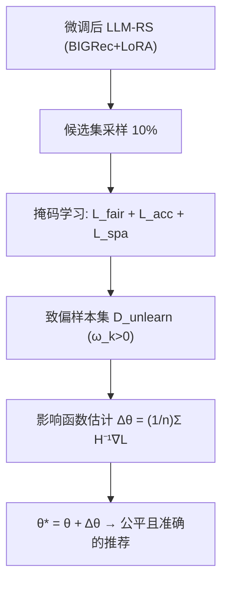

# Towards Fair Large Language Model-based Recommender Systems without Costly Retraining (面向免高昂重训的公平大模型推荐系统)

- **会议/期刊**: WWW 2026
- **作者与机构**: Jin Li, Huilin Gu, Shoujin Wang, Qi Zhang, Shui Yu, Chen Wang, Xiwei Xu, Fang Chen（悉尼科技大学、同济大学、CSIRO Data61）
- **推荐链路定位**: 端到端生成式（LLM 生成式推荐的后处理去偏）
- **研究方向**: 去偏公平与工业架构 / 大语言模型推荐
- **论文原文**: [论文原文链接](https://arxiv.org/abs/2601.17492v2)
- **开源代码**: [开源代码仓库链接](https://github.com/JinLi-i/FUDLR)

## TL;DR (1分钟核心速览)

LLM-RS 会继承训练数据中的流行度偏差与用户属性偏差，而现有去偏方法要么只针对单一偏差类型（缺乏通用性），要么依赖全量重训（8B 模型不可承受）。FUDLR 把去偏重构为**机器遗忘**：先用一个 bias-agnostic 可学习掩码定位"致偏样本"，再用影响函数一步估计参数修正量 $\Delta\theta$ 直接抹除其影响。在 ML1M/Games 上以 BIGRec+LLaMA3.1-8B 为骨干，Full-Ranking 下 HR@5 提升 2.6%、HD@20 降低 37.4%，而去偏耗时从 34.79h 降至 1.29h（**-96.27%**）。

## Background & Motivation (背景与核心矛盾)

- **主流范式**: LLM-RS（如 BIGRec、TALLRec）通过 LoRA 微调 LLM 做生成式推荐，将用户历史与目标物品转为自然语言 prompt 训练。
- **前人局限**: ① 现有去偏方法（Reweighting、Reranking、CFP、Prompt Masking）各自绑定单一偏差类型，面对 LLM 在海量无对齐数据上涌现的**新偏差或多偏差共存**时失效；② 这些方法均需重训/重微调，对 8B 级 LLM 计算上不可行。
- **核心洞察 (Key Insight)**: 偏差并非弥散于全部数据，而是由**一小撮致偏样本**驱动；只要精准定位并"遗忘"这批样本，即可在不动其余参数的前提下纠正模型。
- **本文切入点**: 将去偏形式化为 $\theta^*=\theta+\Delta\theta$的遗忘式参数修正，用可微公平指标驱动掩码选择，用影响函数闭式估计$\Delta\theta$，彻底绕开重训。

<figure class="paper-figure" markdown="span">
  ![图1：ML1M数据集中的观察结果。(a) 流行度偏差：骨干推荐模型（如BIGRec \[3\]）表现出明显的过度曝光热门物品而曝光不足长尾物品的倾向。我们的FUDLR框架显著缓解了这种偏差，并产生了与真实用户偏好更一致的更均衡的推荐分布。(b) 属性偏差：我们提出的FUDLR框架通过减少性别相关的HR差异显著提高了公平性，而骨干模型（如BIGRec \[3\]）在用户群体之间表现出显著的性能差距。](../../../../assets/papers/2601.17492v2/figure_1.png)<figcaption>图1：ML1M数据集中的观察结果。(a) 流行度偏差：骨干推荐模型（如BIGRec [3]）表现出明显的过度曝光热门物品而曝光不足长尾物品的倾向。我们的FUDLR框架显著缓解了这种偏差，并产生了与真实用户偏好更一致的更均衡的推荐分布。(b) 属性偏差：我们提出的FUDLR框架通过减少性别相关的HR差异显著提高了公平性，而骨干模型（如BIGRec [3]）在用户群体之间表现出显著的性能差距。</figcaption>
</figure>

## Method (核心方法设计)

### 1. 整体框架 (Overall Architecture)

FUDLR 分两阶段。**阶段一（偏差识别）**：在训练集上均匀采样 10% 构成候选集 $\mathcal{D}_{cand}$，为每个样本学习移除概率$m_k=\sigma(\omega_k)$，以"公平提升 + 精度保持 + 稀疏性"三目标联合优化掩码 logit，取$\omega_k>0$者为致偏样本集$\mathcal{D}_{unlearn}$。**阶段二（遗忘去偏）**：基于影响函数估计$\mathcal{D}_{unlearn}$对参数的聚合影响，一次性算出$\Delta\theta$并更新为$\theta^*$，无需任何重训。推理时仍按 BIGRec 的 embedding 距离对全库物品排序。

### 2. 关键设计拆解 (Key Designs)

1. **Bias-Agnostic 掩码学习（通用性来源）**：痛点是去偏方法被偏差类型锁死。FUDLR 用影响函数定义每个样本对公平指标的贡献 $I(z_k,\mathcal{B}(\theta))=-\nabla_\theta\mathcal{B}(\theta)^\top H_\theta^{-1}\nabla_\theta\mathcal{L}_{LLM}(z_k;\theta)$，并优化
$$\mathcal{L}_{mask}=\lambda_{fair}\mathcal{L}_{fair}+\lambda_{acc}\mathcal{L}_{acc}+\lambda_{spa}\mathcal{L}_{spa}$$
其中 $\mathcal{L}_{fair}=-\frac{1}{|\mathcal{D}_{cand}|}\sum m_k I(z_k,\mathcal{B})$、$\mathcal{L}_{acc}=\frac{1}{|\mathcal{D}_{cand}|}\sum m_k \mathcal{L}_{LLM}(z_k)$、$\mathcal{L}_{spa}=\frac{1}{|\mathcal{D}_{cand}|}\sum m_k$。**关键直觉**：只需替换可微公平指标$\mathcal{B}(\theta)$——流行度偏差用$\mathcal{B}_{pop}=\sum_i P(i|z;\theta)v_{pop}(i)$，属性偏差用人口统计平价$\mathcal{B}_{attr}=|\bar{P}_{G_0}-\bar{P}_{G_1}|$，多偏差共存用$\mathcal{B}_{combined}=\alpha\mathcal{B}_{pop}+(1-\alpha)\mathcal{B}_{attr}$——算法其余部分零改动，这是"统一去偏"的物理本质。

2. **影响函数一步遗忘（效率来源）**：重训 $\hat\theta=\arg\min\sum_{\mathcal{D}_{remain}}\mathcal{L}$不可行。Proposition 1 证明：移除$\mathcal{D}_{unlearn}$ 后的参数偏移可由聚合影响闭式近似
$$\Delta\theta\approx\frac{1}{n}\sum_{z_k\in\mathcal{D}_{unlearn}}H_\theta^{-1}\nabla_\theta\mathcal{L}_{LLM}(z_k;\theta)$$
其本质是牛顿法一步修正，用二阶曲率 $H^{-1}$ 把"删样本"翻译成"沿损失梯度反向走一步"。附录 E 验证其与真实重训结果差距可忽略。

3. **训练目标、负采样与推理效率**：总目标即上述 $\mathcal{L}_{mask}$；训练沿用 BIGRec 的生成式下一物品预测损失，无额外负采样设计（排序靠 embedding 距离全库比较）。效率上三重加速：① 仅对 **LoRA 最后一层适配器**做影响估计，参数量极小；② 用 **HVP（Hessian-vector product）**避免显式构造/求逆 Hessian；③ 影响分数预计算一次复用。总复杂度$O((n_c+T_{cg})\cdot F)$与$O((n_u+T_{cg})\cdot F)$，因$n_u\ll n$远低于重训的$O(n\cdot E\cdot F)$。

## Experimental Setup & Evaluation Protocol (实验设置与评估协议)

- **数据集与预处理**: 沿用 BIGRec 预处理，按时间戳切 10 段防泄漏，8:1:1 划分，训练采样 65,536、测试 5,000 条（保持原分布）。

| 数据集 | #Users | #Items | #Interactions | 稀疏度/密度 | 特征/场景说明 |
| :--- | :---: | :---: | :---: | :---: | :--- |
| ML1M | ~6.0k | ~3.7k | ~1M | 长尾分布 | 电影，含性别等人口属性，测流行度+属性偏差 |
| Games | — | — | Amazon 子集 | 长尾 | 视频游戏评论，测流行度偏差 |

- **数据划分与防穿越 (Splitting Strategy)**: 全局时间戳切分（10 段）+ 8:1:1 比例划分，测试集为末段。
- **排名评测协议 (Ranking Protocol)**: **Full-Ranking 全库排序**（按生成 embedding 与候选物品距离排序），非采样排序。
- **对比基线与超参设置**: 流行度去偏基线 Reweighting / Reranking / RWRR；属性去偏基线 CFP / Prompt Masking。骨干 BIGRec + LLaMA 3.1 8B，LoRA 微调；$\lambda_{fair},\lambda_{acc},\lambda_{spa}\in\{10^i\}_{i=-3}^{2}$网格搜索，Adam lr=$10^{-3}$；$p<0.05$ 显著性检验。

## Key Experimental Results (实验关键数据)

### 1. 主实验对比 (Main Results)

**流行度去偏（ML1M，K=5）**：

| 方法 | HR↑ | NDCG↑ | ARP↑ | APT↑ | $F_{pop}$↑ | Time(h)↓ |
| :--- | :---: | :---: | :---: | :---: | :---: | :---: |
| BIGRec | 0.0220 | 0.0167 | 5.0237 | 0.3256 | 0.1644 | 34.79 |
| Reweighting | 0.0180 | 0.0131 | 5.4806 | 0.4529 | 0.1502 | 40.95 |
| Reranking | 0.0102 | 0.0080 | 4.8443 | 0.4082 | 0.0907 | 1.12 |
| RWRR | 0.0084 | 0.0060 | 5.2571 | 0.5013 | 0.0775 | 41.60 |
| **FUDLR** | **0.0226\*** | **0.0172\*** | 5.0310 | 0.3278 | **0.1681\*** | **1.29** |
| Improv.% | +2.65 | +2.63 | +0.14 | +0.67 | +2.15 | **-96.27** |

**属性去偏（ML1M，Implicit，K=20）**：

| 方法 | HR↑ | NDCG↑ | HD↓ | DP↓ | $F_{attr}$↑ | Time(h)↓ |
| :--- | :---: | :---: | :---: | :---: | :---: | :---: |
| BIGRec | 0.0336 | 0.0200 | 0.0093 | 0.0974 | 0.2833 | 34.79 |
| CFP | 0.0316 | 0.0184 | 0.0124 | 0.1198 | 0.2679 | 58.88 |
| **FUDLR** | **0.0340\*** | **0.0206\*** | **0.0058\*** | **0.0961\*** | **0.2862\*** | **1.54** |
| Improv.% | +1.19 | +3.29 | **-37.36** | -1.32 | +1.02 | -95.57 |

**多偏差共存（ML1M，K=5）**：FUDLR 相对 BIGRec 的 HR +4.55%、NDCG +5.60%、$F_{pop}$+3.42%、$F_{attr}$ +4.03%，耗时 34.79h→1.55h（-95.53%）。

### 2. 消融实验 (Ablation Study)

| 变体 (Fair/Acc/Sparse) | HR@5 | HR@20 | APT@5 | APT@20 | $F_{pop}$@5 |$F_{pop}$@20 |
| :--- | :---: | :---: | :---: | :---: | :---: | :---: |
| ✓ / - / - | 0.0184 | 0.0312 | **0.3698** | **0.2641** | 0.1473 | 0.1961 |
| - / ✓ / - | 0.0204 | 0.0332 | 0.2818 | 0.2247 | 0.1498 | 0.1910 |
| - / - / ✓ | 0.0220 | 0.0336 | 0.3256 | 0.2476 | 0.1644 | 0.2002 |
| ✓ / ✓ / - | 0.0202 | 0.0336 | 0.2854 | 0.2276 | 0.1492 | 0.1933 |
| ✓ / ✓ / ✓ (全模型) | **0.0226** | **0.0340** | 0.3278 | 0.2486 | **0.1681** | **0.2019** |

### 3. 关键实验发现 (Key Findings)

1. **公平与精度并非零和**：仅 Fair 目标虽把 APT@5 推到 0.3698，却使 HR@5 从 0.0220 跌至 0.0184（-16.4%）；而三目标全模型同时取得最高 HR（0.0226）与最高 $F_{pop}$（0.1681），说明稀疏化+精度约束让"遗忘"只删真正致偏的样本，而非误伤有效交互。
2. **效率是压倒性优势**：FUDLR 去偏耗时 1.29h，比骨干重训快 96.27%、比 RWRR 快约 32 倍；Reranking 虽快 0.17h，但作为后处理使 HR@5 暴跌 53.6%，无法兼顾精度。
3. **通用性经多偏差验证**：同一套掩码机制仅替换 $\mathcal{B}$即在流行度（HD@20 -37.36%）、属性、以及二者共存（$F_{pop}$+3.42%、$F_{attr}$+4.03%）三种场景全部正向，证明 bias-agnostic 设计确实可迁移。

## Highlights & Limitations (亮点、对比与审稿批判)

- **与代表作对比 (vs. Prior Work)**: 相比 Reweighting/RWRR（需重训且精度崩塌）、Reranking（后处理牺牲精度）、CFP（对抗训练需重微调且隐式场景失效），FUDLR 首次把 LLM-RS 去偏统一为**免重训的遗忘问题**，在精度、公平、效率三角上同时占优。
- **可迁移亮点**: ① "可微公平指标 + 掩码选择 + 影响函数修正"的范式可迁移到任何需要定向删除训练数据影响的推荐场景（如投毒样本清除、隐私遗忘）；② 仅对 LoRA 末层做 HVP 影响估计，是 8B 级模型上做数据归因的实用工程技巧。
- **审稿级局限批判**: ① 影响估计依赖 Hessian 近似与 LoRA 低秩假设，对全参数微调或更深层偏差的适用性未验证；② 公平指标需可微且需人工指定 $\mathcal{B}$，对"未知新兴偏差"仍需先定义度量，且$\lambda$ 三参数网格搜索对部署有调参成本；③ 实验仅两个数据集、单一骨干（BIGRec+LLaMA3.1-8B），泛化证据偏薄。

## Rating (四维评分)

- **方法创新性 (Novelty)**: ⭐⭐⭐⭐ （核心机制与方法设计具备明确创新性，理论与实验动机支撑充分）
- **评估协议与实验扎实度 (Protocol & Experiments)**: ⭐⭐⭐⭐ （主流公开数据集评测完整，包含多基线对比与消融实验验证）
- **写作与数学规范度 (Clarity & Rigor)**: ⭐⭐⭐⭐⭐ （问题形式化定义清晰，核心模块数学推导与架构阐述严谨易读）
- **工业落地与复现价值 (Industrial & Practical Value)**: ⭐⭐⭐⭐⭐ （兼顾推荐效果增益与训练/推理效率，具备实际场景迁移参考价值）
