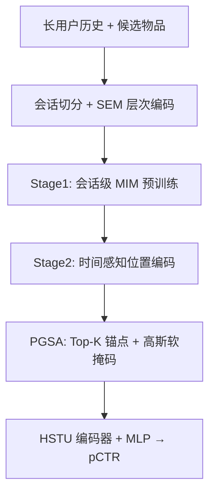
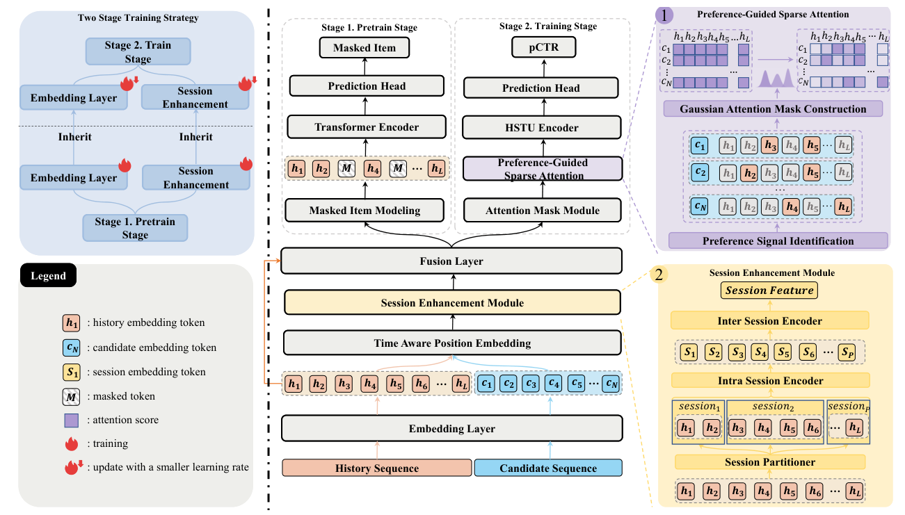

# Beyond the Flat Sequence: Hierarchical and Preference-Aware Generative Recommendations (超越扁平序列：层次化与偏好感知的生成式推荐)

- **会议/期刊**: WWW 2026 (The ACM Web Conference)
- **作者与机构**: Zerui Chen, Heng Chang, Tianying Liu, Chuantian Zhou, Yi Cao, Jiandong Ding, Ming Liu, Bing Qin（哈工大、华为、北邮）
- **推荐链路定位**: 精排 (pCTR 预估)
- **研究方向**: 生成式推荐 / 序列推荐
- **论文原文**: [https://arxiv.org/abs/2603.00980v1](https://arxiv.org/abs/2603.00980v1)
- **开源代码**: 暂未开源

## TL;DR (1分钟核心速览)

HSTU 类生成式推荐把用户历史当作"扁平序列"，既丢失了会话级层次结构，又让稠密注意力在稀疏语义历史中引入大量噪声。本文提出 HPGR：先用会话增强模块 (SEM) + 会话级掩码物品建模 (MIM) 做结构感知预训练，再用偏好引导稀疏注意力 (PGSA) 以候选为 query 检索 Top-K 历史锚点并施加高斯软掩码。在 APPGallery 工业数据上，全量测试集 AUC 达 0.89288（较 MTGR +0.01139），线上 A/B 的 eCPM 提升 +1.99%。

## Background & Motivation (背景与核心矛盾)

- **主流范式**: HSTU 将推荐重构为长用户历史上的序列转导任务，统一异构特征并展现出类 LLM 的缩放律；MTGR 进一步适配 DLRM 的交叉特征。
- **前人局限**: ① 扁平假设忽略用户行为天然聚簇为会话的层次时间结构，无法区分会话内连贯模式与会话间兴趣漂移；② 稠密注意力对数千条历史全量计算，既冗余又引入噪声，稀释真实偏好信号。
- **核心洞察 (Key Insight)**: 对给定候选物品，真正相关的历史只是极小子集；且用户兴趣在会话内局部一致、会话间缓慢演化——这两个结构先验可显式注入模型。
- **本文切入点**: 用"两阶段"把结构先验拆成表征层（层次预训练）与计算层（偏好引导稀疏注意力）分别注入。

## Method (核心方法设计)

### 1. 整体框架 (Overall Architecture)

HPGR 采用两阶段训练。Stage 1 结构感知预训练：按时间不活跃度把历史 $H=\{h_1,\dots,h_N\}$切分为会话序列$S=\{S_1,\dots,S_M\}$，经 SEM 得到会话增强的全局上下文$F_{\text{sess}}$，广播加回物品嵌入，再以会话级 MIM 目标学习物品语义与层次行为动态。Stage 2 偏好感知微调：继承预训练的物品嵌入表与 SEM 权重（以更小学习率更新），引入时间感知位置编码与 PGSA，将候选作为 query 检索 Top-K 历史锚点并构造高斯软掩码，送入 HSTU 编码器后经 MLP 输出 pCTR。

<figure class="paper-figure" markdown="span">
  <figcaption>图2：我们提出的HPGR框架的整体架构。模型采用两阶段训练范式。中心流程展示了共享基础，包括提供层次化上下文的会话增强模块（SEM）。架构随后分支为两个不同阶段：(1) 阶段1（预训练），使用Transformer编码器和掩码物品建模目标学习结构感知的物品表示。(2) 阶段2（微调），采用HSTU编码器进行下游pCTR任务，并由我们新颖的偏好引导稀疏注意力增强。</figcaption>
</figure>

### 2. 关键设计拆解 (Key Designs)

1. **会话增强模块 SEM（层次化上下文注入）**：扁平序列无法区分会话内/会话间动态 $\to$两级 Transformer：会话内共享编码器取 [CLS] 得会话摘要$s_i=\text{Intra-Transformer}(\text{Emb}(S_i))_{[\text{CLS}]}$，会话间编码器再聚合$F_{\text{sess}}=\text{Inter-Transformer}([s_1,\dots,s_M])_{\text{GlobalPool}}$，并以$H_{\text{enhanced\_emb}}=H_{\text{emb}}+F_{\text{sess}}$广播注入$\to$ 让每个物品 token 携带"局部意图 + 全局兴趣演化"双重上下文，这正是图 1 中注意力从散乱物品级转向会话级结构的原因。

2. **偏好引导稀疏注意力 PGSA（内容感知的软稀疏）**：HSTU 的随机长度缩减是内容无关的 $\to$三步走：(i) 用预训练嵌入内积算对齐分$\text{score}_i=\text{emb}(C)\cdot\text{emb}(h_i)$；(ii) 取 Top-K 得锚点集$\{p_1,\dots,p_K\}$；(iii) 构造高斯软掩码
$$M_j=\max_{k\in\{1,\dots,K\}}\exp\left(-\frac{(j-p_k)^2}{2\sigma^2}\right)$$
逐元素乘到注意力分数矩阵上 $\to$ 软掩码保留锚点邻域的平滑梯度（避免硬二值掩码的梯度断裂），同时把计算与容量集中到偏好富集区，信噪比与效率双升。

3. **时间感知位置编码与训练目标**：候选插入历史后按时间戳重排并重编位置 ID，$\text{Index}(C)=1+\sum_{i=1}^{N}\mathbb{I}(t_i<t_c)$，消除"候选恒在末尾"的时序错位。预训练损失$\mathcal{L}_{\text{MIM}}=-\sum_{i\in H_m}\log P(h_i\mid H_{\text{unmasked}})$；微调损失为二分类交叉熵$\mathcal{L}_{\text{pCTR}}=-\frac{1}{B}\sum_{i=1}^{B}\left[y_i\log\hat{y}_i+(1-y_i)\log(1-\hat{y}_i)\right]$。负样本来自真实曝光未点击日志（工业 pCTR 范式，无额外负采样器）；推理时 PGSA 仅需一次 Top-K 检索 + 稀疏注意力，开销低于全稠密注意力。

## Experimental Setup & Evaluation Protocol (实验设置与评估协议)

- **数据集与预处理**: 华为 APPGallery 应用分发平台连续一个月真实日志，全量未采样；主实验在随机抽取 2.5% 用户（含完整历史）的子集上做调参与消融，最终在全量测试集复核。

| 数据集 | #Users | #Items | #Interactions | 稀疏度/密度 | 特征/场景说明 |
| :--- | :---: | :---: | :---: | :---: | :--- |
| APPGallery (全量) | ~45.8 M | ~200 K | 285 M (Train) / 7.38 M (Test) | 极稀疏 | 应用分发、真实曝光点击日志 |
| APPGallery (2.5% 子集) | ~1.15 M | ~200 K | ~7.1 M | 极稀疏 | 主实验/消融用 |

- **数据划分与防穿越 (Splitting Strategy)**: 按时间切分训练/测试（一个月日志，测试集为后续时段），候选插入位置严格依时间戳，避免未来信息泄漏。
- **排名评测协议 (Ranking Protocol)**: 工业 pCTR 场景，以 AUC 为主指标，在全量测试集上做无偏评估（非采样负例排序）；另报告线上 eCPM。
- **对比基线与超参设置**: 判别式基线 DNN / MoE / GRU4Rec / BERT4Rec / SASRec / Wukong，生成式基线 HSTU / MTGR；PGSA 的 Top-K 经网格搜索定为 $K=50$（图 6），$\sigma$ 控制高斯宽度；继承权重使用更小学习率。

## Key Experimental Results (实验关键数据)

### 1. 主实验对比 (Main Results)

| 类别 | 模型 | AUC (↑) |
| :--- | :--- | :---: |
| 判别式 | DNN | 0.7923 |
| 判别式 | GRU4Rec | 0.8146 |
| 判别式 | SASRec | 0.8194 |
| 判别式 | Wukong | 0.8167 |
| 生成式 | HSTU | 0.8220 |
| 生成式 | MTGR | 0.8253 |
| 本文 | HPGR (Full) | **0.8377** |
| 提升 | Impr. vs. MTGR | **+1.50%** (绝对 +0.0124) |

全量测试集复核：HPGR **0.89288** vs. MTGR +0.01139 绝对 AUC，排序结论与子集一致（图 4）。

### 2. 消融实验 (Ablation Study)

| 配置 | AUC (↑) | 增量 |
| :--- | :---: | :---: |
| HSTU (Base) | 0.8220 | — |
| + 结构感知预训练 (MIM only) | 0.8327 | +0.0107 |
| + PGSA (无 SEM) | 0.8348 | +0.0021 |
| + SEM (无 PGSA) | 0.8374 | +0.0047 |
| HPGR (Full) | **0.8377** | +0.0003 |

### 3. 关键实验发现 (Key Findings)

1. **预训练是最大增益源**：仅替换为结构感知 MIM 预训练嵌入即从 0.8220 升至 0.8327（+0.0107），单项已超越最强基线 MTGR（0.8253），说明高质量层次化物品表征空间比端到端任务训练更具泛化性。
2. **SEM 与 PGSA 互补且量级不同**：SEM 单独贡献 +0.0047，显著大于 PGSA 的 +0.0021，但二者叠加仅再增 +0.0003，暗示 PGSA 的收益部分被 SEM 已提供的层次上下文"吸收"——稀疏注意力更偏效率工具而非精度主力。
3. **稀疏度存在最优拐点**：$K=50$时 AUC 峰值，$K$过小导致上下文不足（过度剪枝），$K$ 过大重新引入噪声（图 6）；同时模型随历史长度与模型规模单调增益（图 7），训练/推理时间仅温和上升却换来 +0.0124 绝对 AUC（图 8），线上 7 天 A/B 相对生产 DLRM 取得 **+1.99% eCPM**。

## Highlights & Limitations (亮点、对比与审稿批判)

- **与代表作对比 (vs. Prior Work)**: 相较 HSTU 的随机长度缩减（内容无关稀疏），PGSA 是任务驱动的内容感知稀疏；相较 SASRec/BERT4Rec 的扁平自注意力，SEM 显式建模多会话层次；相较纯 LLM4Rec 路线，本文不依赖外部大模型，纯行为序列自监督即可获得结构化嵌入。
- **可迁移亮点**: ① "预训练嵌入内积做 Top-K 锚点 + 高斯软掩码"可低成本移植到任何长序列精排模型；② 时间感知位置重编码（候选按时间戳插入）是修复"候选恒末尾"位置偏置的通用小技巧。
- **审稿级局限批判**: ① 仅单一工业数据集（APPGallery）+ 单一 pCTR 任务，缺乏公开基准（如 Amazon/TAOBAO）复现，泛化性存疑；② 两阶段训练 + 继承权重小学习率的超参（$\sigma$、$K$、学习率比例）敏感度未充分报告，且 PGSA 需额外一次 Top-K 检索，超长序列下的实际延迟收益缺少量化对比。

## Rating (四维评分)

- **方法创新性 (Novelty)**: ⭐⭐⭐⭐ （把"会话层次 + 偏好稀疏"两个结构先验拆到预训练与注意力两层注入，思路清晰但组件本身多为已有模块的组合创新）
- **评估协议与实验扎实度 (Protocol & Experiments)**: ⭐⭐⭐⭐ （全量未采样测试集复核 + 线上 A/B 是加分项，但缺公开数据集与多任务验证）
- **写作与数学规范度 (Clarity & Rigor)**: ⭐⭐⭐⭐ （公式简洁、图示清楚，PGSA 的 $\sigma$ 与掩码归一化细节略欠推导）
- **工业落地与复现价值 (Industrial & Practical Value)**: ⭐⭐⭐⭐ （真实生产 +1.99% eCPM 说服力强，但代码未开源、依赖私有数据，复现门槛高）

