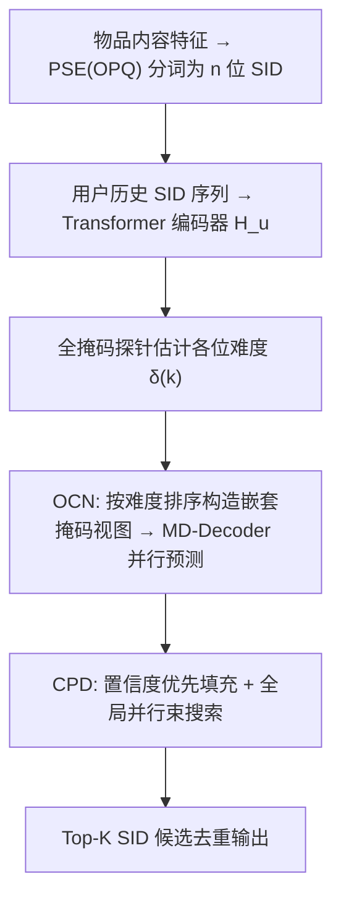
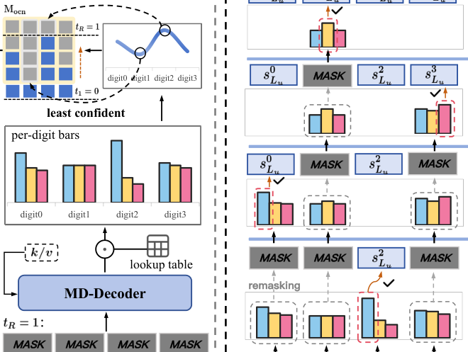

# DiffGRM: Diffusion-based Generative Recommendation Model (基于扩散的生成式推荐模型)

- **会议/期刊**: WWW 2026 (Proceedings of the ACM Web Conference 2026, pp. 5853-5864)
- **作者与机构**: Zhao Liu, Yichen Zhu, Yiqing Yang, Xiao Lv, Guoping Tang, Rui Huang, Qiang Luo, Ruiming Tang, Kun Gai, Guorui Zhou（快手科技，Kun Gai 为独立研究者）
- **推荐链路定位**: 端到端生成式召回（Next-Item SID 生成）
- **研究方向**: 生成式推荐与离散语义 ID / 序列推荐
- **论文原文**: [https://arxiv.org/abs/2510.21805v2](https://arxiv.org/abs/2510.21805v2)
- **开源代码**: [https://github.com/liuzhao09/DiffGRM](https://github.com/liuzhao09/DiffGRM)

## TL;DR (1分钟核心速览)

生成式推荐（GR）把物品编码为 $n$位语义 ID（SID）并用自回归（ARM）逐位生成，但 SID 存在**项内一致性**（$n$ 位共同指向一个物品，却被左到右因果掩码割裂）与**位间异质性**（不同位语义粒度与预测难度差异大，却被等权监督）两大结构性矛盾。DiffGRM 用掩码离散扩散（MDM）替换 ARM 解码器，实现双向上下文与任意顺序并行生成，并在分词（PSE）、训练（OCN）、推理（CPD）三处做任务定制。在 Amazon 三数据集 Leave-Last-Out 全库排序协议下，NDCG@10 相对最强基线提升 6.9%–15.5%。

## Background & Motivation (背景与核心矛盾)

- **主流范式**: TIGER/RPG 等 GR 方法先用 RQ-VAE/RQ-Kmeans 将物品内容量化为 $n$ 位 SID，再用 GPT 式因果 Transformer 逐位自回归预测下一位 token。
- **前人局限一（信息壁垒）**: 因果注意力使第 $k$位只能看到前缀，无法利用后序位做交叉验证，$n$ 位联合确定一个物品的"项内一致性"被压缩为单条因果路径监督。
- **前人局限二（监督失衡）**: 不同位（如 Category 易、Brand 难）预测难度悬殊，但 next-token 目标对每位等权，导致易位过训练、难位欠训练，难位错误还会沿因果链传播。
- **核心洞察 (Key Insight)**: 掩码扩散天然具备双向上下文、并行生成与随机掩码带来的稠密监督，与 SID 结构更契合；但直接套用会遭遇"监督信号组合爆炸"（$n$层码本产生$n2^{n-1}$个目标-上下文信号，全覆盖至少需$2^n-1$种掩码配置）与"推荐需 Top-$K$ 多样候选"两大新问题。
- **本文切入点**: 以 MDM 为骨架，在分词端解耦位间依赖、在训练端按不确定性聚焦难位、在推理端做置信度引导的全局并行束搜索。

## Method (核心方法设计)

### 1. 整体框架 (Overall Architecture)

物品先经 PSE 分词为 $n$位解耦 SID，用户历史 SID 序列经嵌入拼接投影后送入 Transformer 编码器得到$\mathbf{H}_u$；掩码扩散解码器（MD-Decoder）对部分掩码的$n$位输入做非因果自注意力（位间双向互看）与对$\mathbf{H}_u$的交叉注意力，并行预测所有被掩码位。训练时 OCN 用一次全掩码探针估计各位难度，构造由轻到重的嵌套掩码视图，编码器$\mathbf{k}/\mathbf{v}$只算一次并在各视图间复用；推理时 CPD 从全掩码出发，按置信度优先填充并做全局并行束搜索，输出去重后的 Top-$K$ SID。

<figure class="paper-figure" markdown="span">
  <figcaption>图2：DiffGRM的整体框架。(a) 训练：编码器总结用户历史，掩码扩散解码器在由On-policy Coherent Noising（OCN）调度的掩码下并行预测缺失数字，OCN将损坏集中在较难的数字上。(b) 推理：Confidence-guided Parallel Denoising（CPD）从完全掩码的输入执行全局并行束搜索，优先填充置信度较高的数字以恢复完整的SID。</figcaption>
</figure>

### 2. 关键设计拆解 (Key Designs)

1. **并行语义编码 PSE（解耦位间依赖）**: RQ 的残差层级使后位依赖前位，既加剧位间信息不均衡，又与并行任意序生成冲突。PSE 改用 OPQ 式"旋转-切分-独立量化"：学习正交旋转 $\mathbf{R}_o$最小化量化失真，将$\tilde{\mathbf{h}}_i=\mathbf{R}_o\mathbf{h}_i$均分为$n$个子向量，各自在独立码本$\mathcal{C}^{(k)}$上最近邻取码$s_i^k=\arg\min_j\|\mathbf{v}_i^k-\mathbf{c}_j^{(k)}\|_2^2$。各子空间信息量均衡且无顺序耦合，天然匹配扩散的任意序预测。

2. **On-policy 相干加噪 OCN（把监督预算压到难位）**: 随机掩码使监督碎片化且组合爆炸。OCN 先对全掩码输入跑一次解码器，得每位置信度 $p^{(k)}_{\max}=\max_v p_\theta^{(R,k)}(v)$，定义难度$\delta^{(k)}=1-p^{(k)}_{\max}$，按$\delta^{(k)}$降序得排列$\sigma$；第$r$个视图掩掉最难的$m_r$位（$1\le m_1<\cdots<m_R\le n$），即$\mathcal{M}^{(r)}=\{\sigma(1),\dots,\sigma(m_r)\}$，其余位保留干净嵌入。嵌套掩码使可见上下文随视图递增、梯度持续聚焦同一批难位，避免组合爆炸并稳定优化。总损失为各视图掩码位交叉熵均值$\mathcal{L}=\frac{1}{R}\sum_{r=1}^{R}\mathcal{L}^{(r)}$，其中$\mathcal{L}^{(r)}=\frac{1}{|\mathcal{M}^{(r)}|}\sum_{k\in\mathcal{M}^{(r)}}-\sum_{v=0}^{M-1}\tilde{q}_v^{(k)}\log p_\theta^{(r,k)}(v\mid\mathbf{y}^{(r)},\mathbf{H}_u)$，$\tilde{\mathbf{q}}^{(k)}$ 为标签平滑后的 one-hot 目标。

3. **置信度引导并行去噪 CPD（面向 Top-$K$的全局束搜索）**: LLM 侧 MDM 惯用贪心填单输出，无法满足推荐的多候选需求。CPD 在束宽$B_{\text{act}}$下维护活跃部分 SID 集合，每步对所有分支的"待填位-码字"对打分$s_{r-1}(b,k,c)=\text{score}_r(b)+\log p_\theta(y_k=c\mid\mathbf{y}_b^{(r)},\mathbf{H}_u)$，截断保留 Top-$B_{\text{act}}$，优先填充高置信位，最终去重取 Top-$K$。编码器$\mathbf{k}/\mathbf{v}$ 全程缓存，额外打分在位上并行，增加算力但不拉长关键路径。

**训练与推理开销**: 训练时编码器只跑一次、$R$个视图共享，复杂度$O(N^2d_m)+R\cdot O(n^2d_m+nNd_m)$，工业长历史场景下编码器主导，与 ARM 基本同阶；推理解码项多一个$n$因子（$O(B_{\text{act}}n^2Nd_m)$），但$n$很小、$N$ 最大，端到端墙钟延迟接近 ARM。训练采用标签平滑交叉熵，无需负采样。

## Experimental Setup & Evaluation Protocol (实验设置与评估协议)

- **数据集与预处理**: Amazon Reviews 三个类目，按用户评论时间排序成序列，未额外做 k-core 过滤（沿用 TIGER/RPG 标准处理）。

| 数据集 | #Users | #Items | #Interactions | 平均序列长 $\bar{t}$ | 场景说明 |
| :--- | :---: | :---: | :---: | :---: | :--- |
| Sports | 35,598 | 18,357 | 260,739 | 8.32 | 运动户外 |
| Beauty | 22,363 | 12,101 | 176,139 | 8.87 | 美妆 |
| Toys | 19,412 | 11,924 | 148,185 | 8.63 | 玩具游戏 |

- **数据划分与防穿越**: 标准 `Leave-Last-Out`——每序列最后一项测试、倒数第二项验证、其余训练。
- **排名评测协议**: 基于 SID 的 `Full-Ranking` 全库排序（对全部物品 SID 打分排序），指标 Recall@$\{5,10\}$与 NDCG@$\{5,10\}$，取验证集最优 checkpoint 报测试集结果。
- **对比基线与超参**: 三类基线——ID 判别式（GRU4Rec、HGN、SASRec、BERT4Rec）、语义增强判别式（FDSA、S3-Rec、VQ-Rec、RecJPQ）、SID 生成式（TIGER、HSTU、ActionPiece、RPG）。隐藏维度 $d_m=256$（Sports/Beauty）与$1024$（Toys），显著性用配对 t 检验$p<0.05$。

## Key Experimental Results (实验关键数据)

### 1. 主实验对比 (Main Results)

| 方法 | Sports N@10 | Beauty N@10 | Toys N@10 | Sports R@10 | Beauty R@10 | Toys R@10 |
| :--- | :---: | :---: | :---: | :---: | :---: | :---: |
| SASRec | 0.0192 | 0.0318 | 0.0374 | 0.0350 | 0.0605 | 0.0675 |
| S3-Rec | 0.0204 | 0.0327 | 0.0376 | 0.0385 | 0.0647 | 0.0700 |
| VQ-Rec | 0.0173 | 0.0383 | 0.0423 | 0.0300 | 0.0664 | 0.0737 |
| TIGER | 0.0225 | 0.0384 | 0.0432 | 0.0400 | 0.0648 | 0.0712 |
| HSTU | 0.0215 | 0.0389 | 0.0357 | 0.0414 | 0.0704 | 0.0669 |
| ActionPiece | 0.0264 | 0.0424 | — | 0.0500 | 0.0775 | — |
| RPG | 0.0263 | 0.0464 | 0.0490 | 0.0463 | 0.0809 | 0.0869 |
| **DiffGRM** | **0.0305** | **0.0502** | **0.0524** | **0.0550** | **0.0876** | 0.0834 |
| Improv. | +15.53% | +8.19% | +6.94% | +10.00% | +8.28% | -4.03% |

DiffGRM 在 12 项指标中 11 项第一；唯一落后项为 Toys 的 Recall@10（-4.03%），但同数据集 NDCG@5/@10 仍领先（+13.47%/+6.94%），说明其 Top-$K$ 排序质量更高而非召回覆盖更广。

### 2. 消融实验 (Ablation Study, NDCG@10)

| 变体 | Sports | Beauty | Toys |
| :--- | :---: | :---: | :---: |
| (1.1) PSE → RQ-Kmeans | 0.0200 | 0.0343 | 0.0305 |
| (1.2) PSE → Random | 0.0138 | 0.0300 | 0.0206 |
| (2.1) w/o OCN（随机掩码） | 0.0250 | 0.0368 | 0.0385 |
| (2.2) w/o On-policy（仅相干掩码） | 0.0263 | 0.0455 | 0.0430 |
| (3.1) w/o CPD（固定随机序束搜索） | 0.0273 | 0.0496 | 0.0499 |
| **DiffGRM** | **0.0305** | **0.0502** | **0.0524** |

### 3. 关键实验发现 (Key Findings)

1. **分词解耦是扩散生效的前提**: PSE 换成 RQ-Kmeans 后 Toys NDCG@10 从 0.0524 暴跌至 0.0305（-41.8%），换随机 token 更差（0.0206），证明残差层级依赖与双向并行去噪根本冲突，语义结构本身也不可丢。
2. **OCN 的两级增益可分离**: 去掉 OCN 全随机掩码在 Toys 掉到 0.0385（-26.5%），仅保留相干掩码、去掉 on-policy 选位回升到 0.0430，说明"嵌套相干视图"贡献主体、而"按难度选位"再补一刀，二者叠加才达 0.0524。
3. **难位优先 + 静态排序是最优策略**: 表 5 中"least+static"（本文）在 Beauty/Toys 均最优；改为"most+refresh"（优先填高置信位并逐步刷新）后 w/o CPD 相对 CPD 的跌幅达 -19.11%/-24.47%，说明模型一旦依赖易位优先顺序，难位欠训练会在顺序扰动下剧烈崩坏；同时 OCN 在更低有效样本通过次数（ESP）下即追平 $k$ 倍相干路径加噪，样本效率更高。

## Highlights & Limitations (亮点、对比与审稿批判)

- **与代表作对比 (vs. Prior Work)**: 与 TIGER 的本质区别是从"因果逐位生成"转为"双向并行去噪"，监督从单条因果路径变为多视图稠密信号；与 RPG 同为并行预测 SID，但 RPG 仍基于多 token 分类目标 + 图引导解码，DiffGRM 用扩散的掩码-去噪范式统一了训练与推理，并显式处理位间难度异质；与 LLM 侧 MDM 相比，本文针对推荐补充了 PSE 解耦分词与 Top-$K$ 全局束搜索两处任务定制。
- **可迁移亮点**: (i) "全掩码探针估难度 → 嵌套掩码聚焦难位"的 OCN 思路可迁移到任何多位离散码生成任务（如多模态量化检索、分层分类预测）；(ii) 编码器 $\mathbf{k}/\mathbf{v}$ 跨视图/跨去噪步缓存复用的工程技巧，对多视图训练与束搜索推理的延迟优化普遍适用。
- **审稿级局限批判**: (i) 推理解码项多出 $n$倍因子，束宽增大时解码侧占比上升，论文仅给渐近分析而缺少线上 QPS/延迟实测；(ii) 仅在三个 Amazon 公开集上验证，无工业级大规模或冷启动/长尾分桶实验，且 Toys 的 Recall@10 反降，Top-$K$ 覆盖性优势未被充分解释。

## Rating (四维评分)

- **方法创新性 (Novelty)**: ⭐⭐⭐⭐ （首次将掩码离散扩散引入 SID 生成推荐，PSE/OCN/CPD 三处定制均有明确的结构性动机，但扩散骨架本身非首创）
- **评估协议与实验扎实度 (Protocol & Experiments)**: ⭐⭐⭐⭐ （三数据集 Full-Ranking + 12 项指标 + 配对 t 检验 + 完整消融与 OCN 策略/束宽分析，缺工业级与长尾分桶验证）
- **写作与数学规范度 (Clarity & Rigor)**: ⭐⭐⭐⭐ （SID 两大结构性矛盾的动机刻画清晰，公式与复杂度分析完整，但部分符号如视图矩阵 $\mathbf{M}_{\text{ocn}}$与掩码集$\mathcal{M}^{(r)}$ 略显冗余）
- **工业落地与复现价值 (Industrial & Practical Value)**: ⭐⭐⭐⭐ （代码已开源，训练复杂度与 ARM 同阶、推理靠缓存并行控制延迟，快手工业背景支撑落地可信度，缺线上 A/B 数据）
