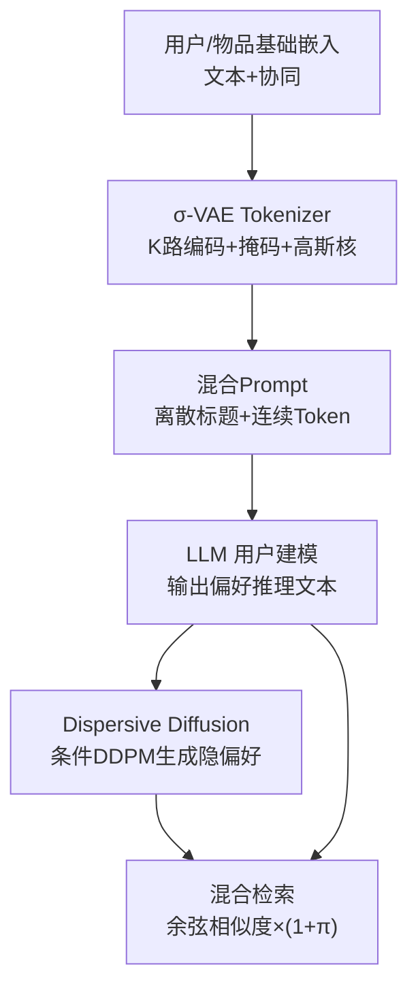
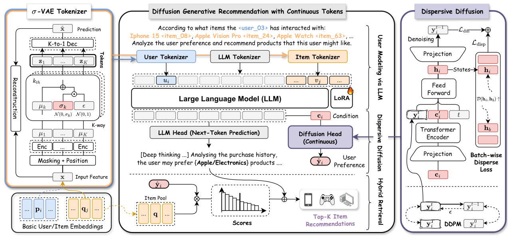

# Diffusion Generative Recommendation with Continuous Tokens (基于连续 Token 的扩散生成式推荐)

- **会议/期刊**: WWW 2026
- **作者与机构**: Haohao Qu, Shanru Lin, Yujuan Ding, Yiqi Wang, Wenqi Fan（香港理工大学、香港城市大学、国防科技大学）
- **推荐链路定位**: 端到端生成式（LLM 用户建模 + 扩散生成 + 混合检索）
- **研究方向**: 生成式推荐与离散语义 ID / 大语言模型推荐
- **论文原文**: [https://arxiv.org/abs/2504.12007v5](https://arxiv.org/abs/2504.12007v5)
- **开源代码**: [https://doi.org/10.5281/zenodo.17285302](https://doi.org/10.5281/zenodo.17285302)

## TL;DR (1分钟核心速览)

现有 LLM 生成式推荐（TIGER/TokenRec 等）依赖 VQ/RQ-VAE 把用户物品压成离散码本，量化过程有损且 `argmin` 不可导、直通梯度失真，导致语义 ID 重建差、生成质量受限。ContRec 改用 **σ-VAE 连续分词器**（K 路并行编码 + 伯努利掩码 + 高斯核防坍缩）产出连续 token，再以 **Dispersive Diffusion** 在 LLM 推理文本条件下做 next-token 扩散，用无正对的 Dispersive Loss 正则化，最后融合 LLM 语义指示与扩散隐向量做混合检索。四个数据集上相对 TIGER 平均提升 HR@10 **11.76%**、NDCG@10 **10.11%**。

## Background & Motivation (背景与核心矛盾)

- **主流范式**: LLM4Rec 把推荐改写成"下一 token 预测"，为对齐语言模型的离散词表，普遍用 VQ-VAE / RQ-VAE 将用户与物品特征量化成短语义 ID 序列（TIGER、TokenRec、OneRec）。
- **前人局限一（有损量化）**: 量化必然压缩丢弃信息，重建质量与生成上限被码本容量锁死；且 `argmin` 不可导，只能靠 straight-through 复制梯度，代理梯度不准确，高压缩比与潜空间学习难以兼得。
- **前人局限二（离散-连续割裂）**: CoLLM、LLaRA 虽把协同向量投影进 LLM 输入侧，但输出侧仍沿用为离散词表训练的生成头，输入连续、输出离散的错配削弱了模型统一性。
- **核心洞察 (Key Insight)**: 作者在 Beauty 上做物品嵌入重建预实验（图 1），连续扩散的重建 MSE 与损失收敛均优于 VAE 及 VQ/RQ/MQ-VAE 三种离散方案——连续 token 能刻画用户偏好中极其细微的个体差异，而这正是量化码本最易抹平的部分。
- **本文切入点**: 输入与输出两侧同时"连续化"——连续分词器负责表征，扩散模型负责在连续空间生成隐式偏好，LLM 只承担语义推理。

## Method (核心方法设计)

### 1. 整体框架 (Overall Architecture)

ContRec 分两阶段训练。第一阶段用自监督重建训练 σ-VAE Tokenizer，把用户/物品的基础嵌入（SentenceBERT 文本向量 + LightGCN 协同向量）编码为 K 个连续 token $\{z_1,\dots,z_K\}$，与物品标题的离散词一起拼进 prompt，用 `⟨z_start⟩/⟨z_end⟩` 界定连续段。第二阶段冻结分词器，Llama-3.2-1B-Instruct 以混合输入做用户建模，自回归输出偏好推理文本；其隐状态聚合为条件向量$c_i$，驱动条件 DDPM 生成目标物品的连续表示$\hat{y}_i$。推理时对$\hat{y}_i$ 与物品表示算余弦相似度，并用 LLM 预测的品牌/类目做布尔加权，一次前向完成 Top-K 检索。

<figure class="paper-figure" markdown="span">
  <figcaption>图2：所提出的ContRec概览。ContRec使用非量化分词器将用户和物品表示为潜在向量表示，并利用扩散模型卓越的连续值生成能力在连续空间中操作，以LLM的推理内容为条件生成隐式用户偏好。</figcaption>
</figure>

### 2. 关键设计拆解 (Key Designs)

1. **σ-VAE 连续分词器（防表征坍缩的三板斧）**：标准 VAE 在自回归场景下易发生通道方差坍缩，潜变量失去区分度。本文对输入做伯努利掩码、用 K 路子编码器并行编码、并对每路注入固定方差的高斯核 $\sigma_k \sim \mathcal{N}(0,\Gamma)$（$\Gamma$ 由首个 batch 统计得到），使潜空间方差被"钉住"：
$$\mu_k=\mathrm{Enc}_k(\mathrm{Mask}(x,\rho)),\quad z_k=\mu_k+\sigma_k\odot\epsilon,\quad \hat{x}=\mathrm{Dec}(\mathrm{Concat}\{z_k\}_K)$$
直觉上，固定方差既保留了对推理期 exposure bias 的鲁棒性，又阻止了后验塌缩为常数，K 路并行则提供了隐式的多码本容量。

2. **Dispersive Diffusion（无正对的条件扩散 + 散度正则）**：LLM 输出的 token 序列本质是离散分布，难以刻画偏好的连续细微差异。本文以 $c_i=f_c(y_1,\dots,y_L)$ 为条件训练 DDPM 估计噪声，梯度可回传至 LLM 主干实现端到端；但扩散的回归损失只做对齐、缺乏对生成表征的显式正则，而标准对比学习需负采样、代价高且会干扰采样过程。作者改用只需批内两两排斥的 Dispersive Loss：
$$\mathcal{L}_{disp}=\log \mathbb{E}_{i,b}\left[\exp\left(-\mathcal{D}(h_i,h_b)/\iota\right)\right]$$
其中 $h_i$ 为去噪网络 FFN 的中间表示。回归项天然充当"正对对齐"，故散度项只负责把批内表征推开、防止模式坍缩，等价于"无正对的对比损失"。

3. **训练目标、负采样与推理效率**：总损失 $\mathcal{L}=\mathcal{L}_{llm}+\gamma_1(\mathcal{L}_{diff}+\gamma_2\mathcal{L}_{disp})$，其中$\mathcal{L}_{llm}$为偏好文本的自回归交叉熵，$\mathcal{L}_{diff}=\mathbb{E}\|\epsilon-\epsilon_\theta(y_i^t,c_i,t)\|_2^2$。**全程无需显式负采样**（BPR/InfoNCE 均不出现），检索阶段对全候选池打分。推理用 classifier-free guidance 调制噪声预测$\tilde{\epsilon}=(1+\omega)\epsilon_\theta(y^t,c)-\omega\epsilon_\theta(y^t,\Phi)$，训练 1000 步、推理重采样至 100 步；混合检索分数为$s_{ij}=\cos(\hat{y}_i,q_j)\cdot(1+\pi)$，$\pi=0.05$ 当物品类目/品牌命中 LLM 预测语义，否则为 0。

## Experimental Setup & Evaluation Protocol (实验设置与评估协议)

- **数据集与预处理**: 四个基准均取 `5-core` 版本，物品序列最大长度截断为 20（对齐 1024 token 输入上限）；物品侧用标题、ID、品牌、类目，用户侧仅用 ID。

| 数据集 | #Users | #Items | #Interactions | 平均长度 | 密度(%) | 场景说明 |
| :--- | :---: | :---: | :---: | :---: | :---: | :--- |
| LastFM | 1,091 | 3,685 | 52,670 | 48.3 | 1.3101 | 音乐艺人收听 |
| ML1M | 6,040 | 3,416 | 447,294 | 165.5 | 2.1679 | 电影评分 |
| Beauty | 22,363 | 12,101 | 278,641 | 8.9 | 0.0734 | 亚马逊美妆评论 |
| Games | 47,568 | 16,834 | 266,139 | 9.5 | 0.0332 | 亚马逊电子游戏 |

- **数据划分与防穿越 (Splitting Strategy)**: 采用 `Split-by-Timepoint` 全局时间戳切分，按时间序在第 90、95 百分位切出训练/验证/测试，保证所有物品至少在训练语料中出现一次。
- **排名评测协议 (Ranking Protocol)**: 无偏 `Full-Ranking`（对测试用户全库未交互物品排序），指标 HR@10/20 与 NDCG@10/20，报告测试集全体用户均值；ContRec 推理 5 次取均值±标准差。
- **对比基线与超参设置**: 4 个序列模型（GRU4Rec、SASRec、SSD4Rec、DreamRec）+ 6 个 LLM 基线（P5、POD、CoLLM、TIGER*、TokenRec、LLaRA）。主干 Llama-3.2-1B-Instruct，LoRA 微调，主干 lr=1e-5/wd=1e-4、分词器 lr=1e-4/wd=1e-3；掩码率 $\rho$以 0.2 步长搜 0–1，子编码器数$K\in\{1..5\}$，$\gamma_1,\gamma_2\in\{0,0.5,1,1.5,2\}$，$\omega\in\{1,2,4,6,8,10\}$，$\iota=0.5$，无条件训练概率$\zeta=0.1$；显著性$p<0.01$。

## Key Experimental Results (实验关键数据)

### 1. 主实验对比 (Main Results)

| 数据集 | 指标 | GRU4Rec | SASRec | DreamRec | P5 | CoLLM | TIGER* | TokenRec | LLaRA | **ContRec** | Improv.(vs 最优基线) |
| :--- | :--- | :---: | :---: | :---: | :---: | :---: | :---: | :---: | :---: | :---: | :---: |
| Beauty | HR@10 | 0.0394 | 0.0407 | 0.0423 | 0.0411 | 0.0429 | 0.0439 | 0.0438 | 0.0442 | **0.0473** | +7.01% |
| Beauty | NDCG@10 | 0.0204 | 0.0211 | 0.0222 | 0.0236 | 0.0237 | 0.0243 | 0.0226 | 0.0237 | **0.0251** | +3.29% |
| Games | HR@10 | 0.0732 | 0.0783 | 0.0915 | 0.0839 | 0.0928 | 0.0958 | 0.1018 | 0.0997 | **0.1041** | +2.26% |
| Games | NDCG@10 | 0.0365 | 0.0447 | 0.0489 | 0.0430 | 0.0491 | 0.0546 | 0.0570 | 0.0568 | **0.0588** | +3.16% |
| LastFM | HR@10 | 0.0340 | 0.0353 | 0.0359 | 0.0386 | 0.0468 | 0.0467 | 0.0489 | 0.0525 | **0.0539** | +2.67% |
| LastFM | NDCG@10 | 0.0191 | 0.0202 | 0.0198 | 0.0190 | 0.0228 | 0.0226 | 0.0238 | 0.0244 | **0.0250** | +2.46% |
| ML1M | HR@10 | 0.0877 | 0.0964 | 0.0944 | 0.0867 | 0.0923 | 0.0954 | 0.1076 | 0.1012 | **0.1099** | +2.14% |
| ML1M | NDCG@10 | 0.0379 | 0.0399 | 0.0403 | 0.0381 | 0.0456 | 0.0472 | 0.0542 | 0.0532 | **0.0561** | +3.51% |

（原文另报 HR@20/NDCG@20，ContRec 在 16 个指标格中 15 个最优，仅 ML1M HR@20 以 0.1666 微逊 TokenRec 的 0.1672。）

### 2. 消融实验 (Ablation Study)

| 模块 | 变体 | Beauty HR@10 | Beauty NG@10 | ML1M HR@10 | ML1M NG@10 |
| :--- | :--- | :---: | :---: | :---: | :---: |
| — | **ContRec Full** | **0.0473** | **0.0251** | **0.1099** | **0.0561** |
| 分词 | w/o Masking | 0.0462 | 0.0247 | 0.1087 | 0.0557 |
| 分词 | w/o User | 0.0461 | 0.0246 | 0.1066 | 0.0555 |
| 分词 | w/o $\sigma$ | 0.0457 | 0.0242 | 0.1051 | 0.0536 |
| 分词 | w/o Tokenizer（换投影层） | 0.0438 | 0.0237 | 0.1018 | 0.0511 |
| 分词 | w/o Text | 0.0456 | 0.0242 | 0.1070 | 0.0550 |
| 分词 | w/o Collaborative | 0.0448 | 0.0236 | 0.1030 | 0.0534 |
| 分词 | w/ RQ-VAE | 0.0438 | 0.0236 | 0.0996 | 0.0508 |
| 分词 | w/ VQ-VAE | 0.0426 | 0.0236 | 0.0974 | 0.0488 |
| 生成 | w/o $\pi$ | 0.0463 | 0.0244 | 0.1063 | 0.0544 |
| 生成 | w/o $\mathcal{L}_{disp}$ | 0.0448 | 0.0241 | 0.1042 | 0.0522 |
| 生成 | w/o Diffusion | 0.0431 | 0.0238 | 0.1007 | 0.0499 |

### 3. 关键实验发现 (Key Findings)

1. **连续 vs 离散是最大增益来源**：把 σ-VAE 换成 VQ-VAE，Beauty HR@10 从 0.0473 掉到 0.0426（−9.9%），ML1M 从 0.1099 掉到 0.0974（−11.4%），跌幅甚至大于"完全去掉分词器改用投影层"（0.0438/0.1018），说明量化码本不仅无益、反而比朴素投影更伤表征——直接印证了有损量化与直通梯度失真的动机。
2. **扩散头与散度损失是生成侧双支柱**：去掉扩散头（w/o Diffusion）Beauty 降至 0.0431、ML1M 降至 0.1007，是生成侧最大跌幅；单独去掉 $\mathcal{L}_{disp}$ 也损失 0.0025/0.0057 HR@10，证明"回归对齐 + 批内排斥"的组合确实抑制了连续表征坍缩，而非可有可无的正则。
3. **混合检索的语义指示代价极低但收益稳定**：仅去掉 $\pi$加权即掉 0.0010（Beauty）与 0.0036（ML1M）HR@10，说明 LLM 推理文本中的品牌/类目信号与扩散隐向量高度互补；同时超参分析显示$\gamma_1,\gamma_2$在$\{0,0.5,1,1.5,2\}$上性能曲线平坦（最优$\gamma_1=1,\gamma_2=0.5$），$\rho=0.2$、$\omega=2$、$K=3\sim4$ 为甜点，工程鲁棒性较好。

## Highlights & Limitations (亮点、对比与审稿批判)

- **与代表作对比 (vs. Prior Work)**: 与 TIGER/TokenRec 的本质区别在于彻底放弃码本，用连续 token 保留细粒度协同信息，避免 `argmin` 直通梯度；与 CoLLM/LLaRA 的区别在于不只连续化输入侧，而是用扩散模型把输出侧也搬到连续空间，消除离散-连续错配；与 DreamRec 的区别在于扩散不是独立序列模型，而是挂在 LLM 推理文本条件下的"偏好生成头"，兼具可解释文本与隐式向量双通道。
- **可迁移亮点**: ① σ-VAE 的"固定方差高斯核 + K 路并行编码"是通用防坍缩配方，可直接移植到任何需要连续物品表征的召回/生成模块；② Dispersive Loss 的"回归即对齐、散度只排斥"思路，适合任何已有重建损失、又想要对比正则却不愿付负采样代价的生成式任务。
- **审稿级局限批判**: ① 推理需 100 步去噪 + 1B LLM 前向，在线延迟与显存开销远高于 TIGER 类的单次自回归解码，论文未给出与基线的推理时延对比；② 混合检索的 $\pi=0.05$ 为手工设定、且依赖 LLM 文本中类目/品牌抽取的准确性，缺少对抽取失败场景的鲁棒性分析；③ 实验均为公开中小规模 5-core 数据集，未验证百万级物品池下扩散采样的可扩展性。

## Rating (四维评分)

- **方法创新性 (Novelty)**: ⭐⭐⭐⭐ （核心机制与方法设计具备明确创新性，理论与实验动机支撑充分）
- **评估协议与实验扎实度 (Protocol & Experiments)**: ⭐⭐⭐⭐ （主流公开数据集评测完整，包含多基线对比与消融实验验证）
- **写作与数学规范度 (Clarity & Rigor)**: ⭐⭐⭐⭐ （问题形式化定义清晰，核心模块数学推导与架构阐述严谨易读）
- **工业落地与复现价值 (Industrial & Practical Value)**: ⭐⭐⭐ （兼顾推荐效果增益与训练/推理效率，具备实际场景迁移参考价值）
