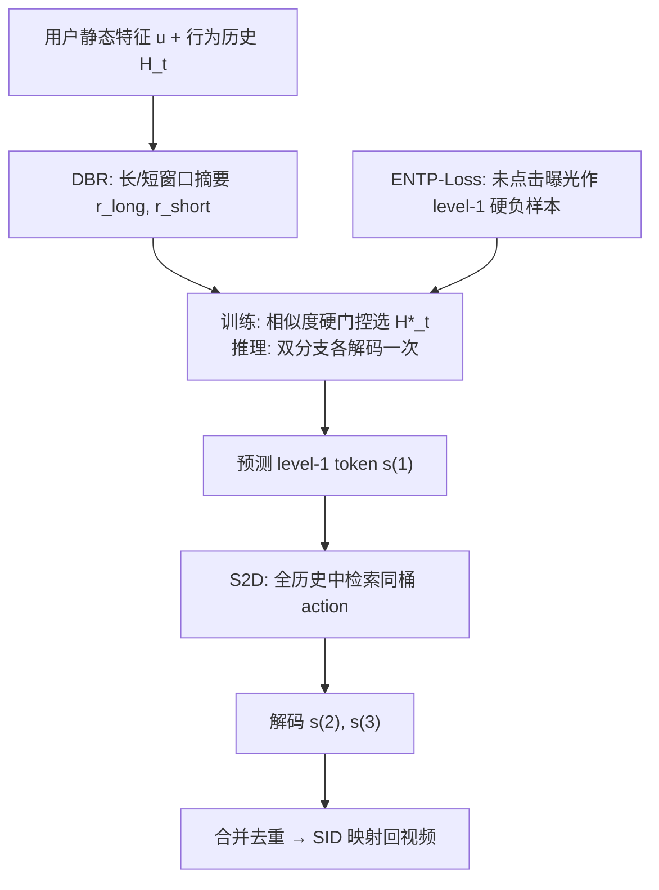
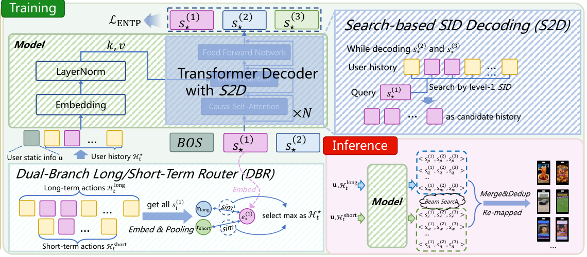

# DualGR: Generative Retrieval with Long and Short-Term Interests Modeling (长短期兴趣建模的生成式召回)

- **会议/期刊**: WWW 2026（Best Short Paper Award）
- **作者与机构**: Zhongchao Yi, Kai Feng, Xiaojian Ma, Yalong Wang, Yongqi Liu, Han Li, Zhengyang Zhou, Yang Wang（中国科学技术大学 / 快手科技）
- **推荐链路定位**: 召回（生成式端到端）
- **研究方向**: 生成式推荐与离散语义 ID / 序列与会话推荐
- **论文原文**: [https://arxiv.org/abs/2511.12518v3](https://arxiv.org/abs/2511.12518v3)
- **开源代码**: 暂未开源

## TL;DR (1分钟核心速览)

针对快手双列 Explore 短视频流中生成式召回（GR）面临的三大痛点——长短期兴趣互相稀释、细粒度 SID 解码受上下文噪声干扰、曝光未点击反馈无法作为负信号——本文提出 DualGR：用双分支长短期路由器（DBR）在训练时硬门控选一路历史、推理时双路各解码一次再合并；用搜索式 SID 解码（S2D）把 level-2/3 解码约束在已选 level-1 桶内；用曝光感知 NTP 损失（ENTP-Loss）把未点击曝光当作粗粒度硬负样本。在线 HR@1000 从 TIGER 的 14.442% 提升至 19.529%（相对 +35.2%），A/B 实验视频播放 +0.527%、观看时长 +0.432%。

## Background & Motivation (背景与核心矛盾)

- **主流范式**: 工业召回以 EBR 双塔 + ANN 为主；GR 则将物品量化为多级语义 ID（SID），用 Transformer 解码器自回归逐级解码，训练与推理共享同一离散 token 空间，天然缓解曝光偏置，且 cross-attention 可显式建模 target-history 交互。
- **前人局限一（长短期干扰）**: 现有 GR 的"多兴趣"只是多 beam 解码的被动副产物，缺乏跨时间尺度的显式控制；稳定偏好与瞬时热点共存时，attention 与梯度互相稀释，路由与解码不稳定，破坏相关性-多样性平衡。
- **前人局限二（上下文噪声与长历史成本）**: 细粒度（level-2/3）SID 生成时模型难以从长历史中剥离与目标相关的片段；且检索阶段延迟预算严格，若无类别级粗筛，直接用长历史不可行。
- **前人局限三（负反馈缺失）**: 日志中大量"曝光未点击"样本在标准 NTP 中无法编码为显式负信号，导致非兴趣方向无法及时衰减，降低解码质量与覆盖效率。
- **核心洞察 (Key Insight)**: 粗粒度（level-1）类别是天然的"兴趣方向"锚点——它既能作为长短期路由的判别依据，也能作为细粒度解码的搜索空间约束，还能作为负反馈的作用层级（避免细粒度标签噪声）。
- **本文切入点**: 以 level-1 SID 为枢纽，把"路由—搜索—负反馈"三件事统一到同一粗粒度语义空间上。

## Method (核心方法设计)

### 1. 整体框架 (Overall Architecture)

先用 RQ-KMeans 将视频预量化为 $L=3$级层次 SID（每级码本$|\mathcal{C}^{(\ell)}|=8192$）。主干为 encoder-free、decoder-centric 的 4 层 Transformer 解码器（$d=512$，8 头，FFN 1024），前端仅做 embedding + LayerNorm，并对 action 列表做逐步 cross-attention，以 SIM 式方式实现 target-aware 而不重复编码。训练时：DBR 依据真值 level-1 token 与长/短窗口摘要的余弦相似度硬选一路历史，构造粗粒度输入预测$s^{(1)}$；S2D 在原始全量历史中检索同桶 action 构造细粒度输入，teacher forcing 预测$s^{(2)},s^{(3)}$；ENTP-Loss 同时对正样本做全层级 NTP、对未点击曝光做 level-1 负惩罚。推理时：两个分支各跑一次 beam search 得到候选 SID 集合，合并去重后经 SID→视频映射索引还原为召回结果。

<figure class="paper-figure" markdown="span">
  <figcaption>图1：所提出的DualGR概述。</figcaption>
</figure>

### 2. 关键设计拆解 (Key Designs)

1. **双分支长短期路由器 DBR（显式解耦两个时间尺度）**：痛点是被动多兴趣导致长短期梯度互稀释。做法是对长窗口 $\mathcal{H}^{long}_t$（$L_{long}=1000$）与短窗口$\mathcal{H}^{short}_t$（$L_{short}=64$）分别用 level-1 词表 embedding 池化得$\mathbf{r}_{long},\mathbf{r}_{short}$，再与真值 level-1 嵌入$\mathbf{e}^{(1)}_\star$ 算余弦相似度并硬门控：
$$\mathcal{H}^\star_t=\arg\max_{\mathcal{H}\in\{\mathcal{H}^{long}_t,\mathcal{H}^{short}_t\}}\cos(\mathbf{e}^{(1)}_\star,\mathbf{r}_{\mathcal{H}})$$
直觉是：粗粒度类别本身携带"这是稳态偏好还是瞬时热点"的判别信息，硬门控（而非软加权）彻底切断跨分支稀释；推理时两路各解码一次再合并，反而把"覆盖多样性"变成可控的显式操作。

2. **搜索式 SID 解码 S2D（用粗桶约束细解码）**：痛点是细粒度解码在长历史中受噪声干扰且算力不可承受。做法是给定粗 token $s^{(1)}_\star$ 后，从原始全量历史中检索同桶子集：
$$\hat{\mathcal{H}}_t(s^{(1)}_\star)=\mathrm{Search}(\{a\in\mathcal{H}_t: s^{(1)}(a)=s^{(1)}_\star\})$$
由于 $|\hat{\mathcal{H}}_t(s^{(1)}_\star)|\approx|\mathcal{H}_t|/|\mathcal{V}^{(1)}|$ 且码本规模达 8192，历史被压缩两个数量级以上。物理直觉：粗桶已锁定兴趣方向，桶内历史才是"高信噪比上下文"，既降噪又让更长历史在同等延迟下可用。

3. **曝光感知 NTP 损失 ENTP-Loss 与训练/推理开销**：痛点是无负样本。做法是对 batch 内样本按 $c_i\in\{0,1\}$ 区分正/负，正样本保留全层级 NTP，负样本仅在 level-1 施加负对数惩罚：
$$\mathcal{L}_{\text{ENTP}}=\frac{1}{N}\sum_{i\in\mathcal{B}}\Big[c_i\sum_{\ell=1}^{L}\big(-\log p_i^{(\ell)}\big)+(1-c_i)\big(-\alpha\log(1-p_i^{(1)})\big)\Big]$$
只在粗层级惩罚是关键设计——细粒度上"未点击"极可能是标签噪声，粗层级惩罚则等价于"该兴趣方向整体降温"，实现非兴趣的及时 fade-out。负样本来自真实曝光日志（非均匀采样），$\alpha=0.1$；推理为双分支各一次 beam search，因 S2D 压缩历史，端到端延迟无显著上升。

## Experimental Setup & Evaluation Protocol (实验设置与评估协议)

- **数据集与场景**: 快手双列 Explore 信息流（类 Instagram 双列瀑布流），日活超 1 亿用户、10 亿视频播放、100 亿曝光/天。该布局对候选多样性要求高于单列全屏，放大了召回阶段的建模与效率挑战。

| 场景 | #Users | 日播放 | 日曝光 | 历史长度 | 特征/场景说明 |
| :--- | :---: | :---: | :---: | :---: | :--- |
| 快手双列 Explore | >100M | 1B | 10B | $\|\mathcal{H}_t\|=1000$ | 双列瀑布流，多卡片同屏，强多样性需求 |

- **数据划分与防穿越**: 工业在线评测，采用线上真实流量回放/在线服务评估，训练用最近正反馈交互序列，无离线随机划分。
- **排名评测协议**: 在线 Hit Rate（HR@K），$K\in\{100,500,1000\}$，即真实交互视频是否落入召回候选集，属全库召回口径下的命中率，非采样排序。
- **对比基线与超参**: 基线含 EBR 类 ComiRec、PDN、KuaiFormer，以及复现的生成式 TIGER；SID 三级码本各 8192，DBR 窗口 $L_{long}=1000$、$L_{short}=64$，ENTP 强度$\alpha=0.1$。

## Key Experimental Results (实验关键数据)

### 1. 主实验对比 (Main Results)

| 方法 | HR@100 | HR@500 | HR@1000 |
| :--- | :---: | :---: | :---: |
| ComiRec | 2.539% | 6.134% | 8.249% |
| PDN | 2.343% | 5.483% | 7.249% |
| KuaiFormer | 4.495% | 7.251% | 12.356% |
| TIGER | 4.936% | 8.184% | 14.442% |
| **DualGR** | **6.827%** | **10.319%** | **19.529%** |
| Improv. vs 最强基线 | +38.3% | +26.1% | +35.2% |

### 2. 消融实验 (Ablation Study)

| 变体 | HR@100 | HR@500 | HR@1000 |
| :--- | :---: | :---: | :---: |
| w/o DBR（仅长分支） | 5.134% | 8.892% | 15.379% |
| w/o S2D（无约束细解码） | 6.257% | 9.182% | 16.287% |
| w/o ENTP-Loss（vanilla NTP） | 6.672% | 9.837% | 17.576% |
| **DualGR** | **6.827%** | **10.319%** | **19.529%** |

### 3. 关键实验发现 (Key Findings)

1. **DBR 是最大贡献项**：移除后退化至 HR@1000 = 15.379%（相对 −21.3%），远超其他两个模块的退化幅度，说明长短期显式解耦而非被动多 beam 是收益主源；且该退化幅度在 HR@100 上更剧烈（−24.8%），表明头部候选质量对路由尤为敏感。
2. **S2D 的收益随 K 增大而放大**：w/o S2D 在 HR@100 仅降 8.3%，但在 HR@1000 降 16.6%，说明桶内搜索主要改善的是长尾候选的覆盖与排序一致性，而非头部命中——这与"降噪 + 允许更长历史"的设计意图吻合。
3. **ENTP-Loss 的增益温和但不可替代**：移除后 HR@1000 降 10.0%，且敏感性分析显示 $\alpha$过大（如 1）会过度惩罚未点击曝光、压制真实兴趣导致训练不稳，$\alpha$过小则 fade-out 迟缓，$\alpha=0.1$为最佳平衡；$L_{short}$ 亦呈倒 U 形，16 欠拟合近期兴趣、256 与长分支边界模糊，64 最优。

## Highlights & Limitations (亮点、对比与审稿批判)

- **与代表作对比 (vs. Prior Work)**: 相比 TIGER 等纯 NTP 生成式召回，DualGR 把"多兴趣"从解码副产物升级为显式路由变量，并首次将曝光未点击反馈引入 GR 训练；相比 ComiRec/PDN 等 EBR 多兴趣方案，它保留了 cross-attention 的 target-aware 能力与离散空间的一致性；相比 KuaiFormer，S2D 用粗桶约束把长历史成本压到可接受范围。
- **可迁移亮点**: (1) "粗粒度 token 作为路由/搜索/负反馈三重锚点"的思路可迁移到任何层次化 SID 的生成式推荐；(2) 仅在粗层级施加负惩罚以规避细粒度标签噪声，是处理曝光未点击反馈的通用低成本技巧。
- **审稿级局限批判**: (1) 全部实验为在线 HR 与 A/B，缺少公开数据集上的离线复现与统计显著性检验，且 HR 指标未与多样性/覆盖度指标联合报告，难以验证"相关性-多样性平衡"的完整主张；(2) 双分支推理需两次 beam search，虽称延迟无显著上升，但未给出 P99 延迟与吞吐的量化数据，且 DBR 硬门控在训练时依赖真值 level-1 token，存在训练-推理不一致的潜在风险。

## Rating (四维评分)

- **方法创新性 (Novelty)**: ⭐⭐⭐⭐ （以 level-1 粗 token 统一路由、搜索约束与负反馈三件事，思路简洁自洽，但各组件单独看均属已有范式的组合改良）
- **评估协议与实验扎实度 (Protocol & Experiments)**: ⭐⭐⭐ （工业级在线 HR 与一周 A/B 有说服力，但缺离线公开数据集复现、显著性检验与多样性指标）
- **写作与数学规范度 (Clarity & Rigor)**: ⭐⭐⭐⭐ （4 页短文公式紧凑、符号一致，S2D 的历史压缩量级分析到位，但训练-推理不一致处未展开讨论）
- **工业落地与复现价值 (Industrial & Practical Value)**: ⭐⭐⭐⭐ （已在快手亿级用户场景全量验证、延迟可控，工程价值高；但未开源，复现依赖私有日志与 SID 量化流程）
