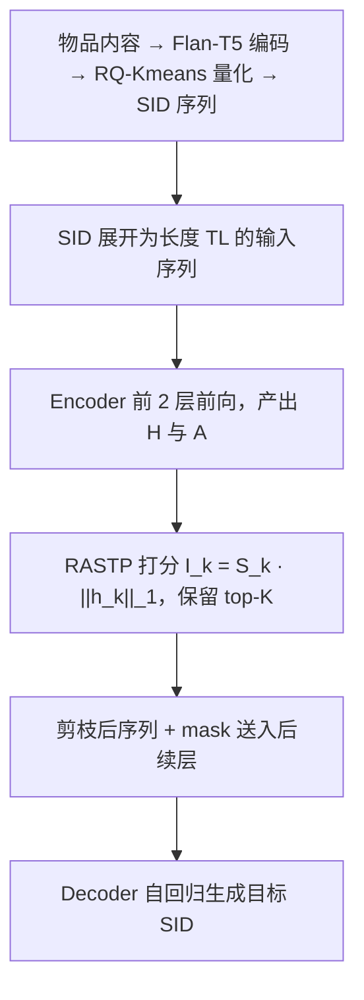
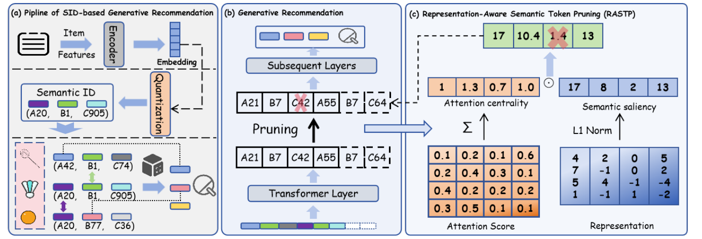

# RASTP: Representation-Aware Semantic Token Pruning for Generative Recommendation with Semantic Identifiers (表征感知的语义Token剪枝生成式推荐)

- **会议/期刊**: WWW 2026 (Short Paper)
- **作者与机构**: Tianyu Zhan, Kairui Fu, Zheqi Lv, Shengyu Zhang (浙江大学)
- **推荐链路定位**: 端到端生成式（训练侧加速）
- **研究方向**: 生成式推荐与离散语义ID
- **论文原文**: [https://arxiv.org/abs/2511.16943v2](https://arxiv.org/abs/2511.16943v2)
- **开源代码**: [https://github.com/Yuzt-zju/RASTP](https://github.com/Yuzt-zju/RASTP)

## TL;DR (1分钟核心速览)

SID 生成式推荐把每个物品展开为 $L$个语义码字，输入序列长度膨胀$L$倍，成为工业日更训练的算力瓶颈；现有加速工作只优化 Attention 算子与 KV Cache，从未动过"输入序列本身"。RASTP 提出在 Transformer 中间层按"语义显著性$\times$ 注意力中心性"给每个 token 打分，动态剪掉低信息量 SID token。在 Amazon Beauty/Sports/Toys 三个 5-core 数据集、Leave-One-Out 全库排序协议下，训练时间降低 **26.7%**，Recall@5/NDCG@5 在 Beauty 与 Toys 上反而小幅提升（如 Beauty R@5 0.0426→0.0441）。

## Background & Motivation (背景与核心矛盾)

- **主流范式**: TIGER 起，GR 用 RQ-Kmeans/RQ-VAE 将物品内容编码为层级 SID 序列，再由 T5/Qwen 类 Transformer 自回归逐 token 生成目标物品的 SID。
- **前人局限**: ① 加速研究集中在 Attention 计算与 KV Cache 复用（如稀疏注意力、缓存压缩），属于"算子层"优化；② 但序列长度 $TL$才是复杂度的第一决定因素，SID 展开使每个历史物品占$L$ 个位置，大量 token 在上下文化后已被更强 token 吸收，属于纯冗余计算。
- **核心洞察 (Key Insight)**: 用户决策只依赖物品的少数判别性语义维度；经过若干层上下文交互后，部分 token 的表征已可由信息量更大的 token 代表，其表征范数小、被关注度低——这两条信号可联合刻画"该 token 是否值得继续算"。
- **本文切入点**: 不做算子级优化，而是直接在输入序列上做**表征感知的动态 token 剪枝**，把"算得少"换成"算得精"。

## Method (核心方法设计)

### 1. 整体框架 (Overall Architecture)

物品先经 Flan-T5-XL 编码为稠密向量 $\mathbf{h}_i$，再由 RQ-Kmeans 量化为$L$级 SID 序列；用户历史按 SID 展开为长度$TL$的 token 序列送入 4+4 层 Encoder-Decoder。RASTP 作为一个即插即用模块挂在**第 2 层 Encoder 之后**：利用该层前向传播已产出的注意力权重$\mathbf{A}$与隐表征$\mathbf{H}$计算 token 重要性，保留 top-$\lfloor\rho TL\rfloor$ 个 token 并按原时序重排，随后把剪枝后的表征与 mask 送入后续层继续训练。打分与剪枝复用同一次前向，几乎零额外开销。

<figure class="paper-figure" markdown="span">
  <figcaption>图1：RASTP概述。(a) 基于SID的生成式推荐（GR）工作流程。(b)和(c) RASTP在GR框架中的详细集成。</figcaption>
</figure>

### 2. 关键设计拆解 (Key Designs)

1. **语义显著性（Semantic Saliency）**：用上下文化表征的 $\ell_1$范数衡量 token 承载的语义信息量，$\|\mathbf{h}_k\|_1=\sum_{i=1}^{d}|\mathbf{h}_k^{(i)}|$。直觉是：被上下文反复"写入"信息的 token 表征幅值更大，而幅值趋近于零的 token 已被其他 token 覆盖，属于可丢弃的冗余位。选$\ell_1$而非$\ell_2$是因为它对稀疏、单维主导的表征更敏感（消融中$\ell_2$ 基线明显落后）。

2. **注意力中心性（Attention Centrality）**：统计 token $k$在所有 head、所有 query 位置上累计收到的注意力权重$S_k=\sum_{h=1}^{H}\sum_{q=1}^{TL}\mathbf{A}_{b,h,q,k}$。它刻画的是"全局被引用度"——一个 token 若从不被任何位置关注，说明它对后续预测无因果贡献。最终重要性为两信号的乘积：

$$I_k = S_k \cdot \|\mathbf{h}_k\|_1$$

乘积而非加权和的设计意味着**双阈值隐式生效**：只有既语义丰富又被广泛关注的 token 才能入选，避免"高范数但无人问津"的孤立 token 或"被关注但内容空洞"的占位 token 混入。

3. **剪枝时机、目标函数与推理开销**：训练目标仍是标准逐 token 交叉熵 $\mathcal{L}_{\text{rec}}=\sum_{i=1}^{L}-\log P_\theta(c_i\mid c_{<i})$，RASTP 不引入任何额外损失或可学习参数，属于纯结构干预。剪枝层位置是关键超参：第 1 层后剪枝提速 38.22% 但性能明显下滑（过早丢弃尚未被吸收的信息）；第 2 层后剪枝取得 26.7% 提速与性能持平的最优折中；更靠后的层性能相当但提速收益锐减。推理阶段可完全关闭剪枝，因此**不改变线上 serving 的生成质量与延迟**，收益纯粹体现在训练侧。

## Experimental Setup & Evaluation Protocol (实验设置与评估协议)

- **数据集与预处理**: Amazon 三个类目，均做 `5-core` 过滤：

| 数据集 | #Users | #Items | #Interactions | 稀疏度/密度 | 特征/场景说明 |
| :--- | :---: | :---: | :---: | :---: | :--- |
| Beauty | 未在正文给出 | 未在正文给出 | 未在正文给出 | — | 美妆，文本特征（标题/类目/描述/价格） |
| Sports | 未在正文给出 | 未在正文给出 | 未在正文给出 | — | 运动户外 |
| Toys | 未在正文给出 | 未在正文给出 | 未在正文给出 | — | 玩具 |

> 注：短文正文未列数据集统计表，仅说明采用 5-core 版本，具体规模需查阅开源仓库。

- **数据划分与防穿越 (Splitting Strategy)**: `Leave-One-Out`——每个用户最后一条交互作测试、倒数第二条作验证、其余全部训练。
- **排名评测协议 (Ranking Protocol)**: 报告 Recall@$\{5,10\}$与 NDCG@$\{5,10\}$，以验证集 Recall@5 最优的 checkpoint 上报测试结果；短文未显式声明是 Full-Ranking 还是 Sampled Ranking（这是本文评估描述的一处缺口）。
- **对比基线与超参设置**: 主实验为"同架构开/关 RASTP"的受控对比（5 个随机种子取均值±标准差）；剪枝策略对比含 Max Pooling、Average Pooling、$\ell_2$-norm 选择三种基线。骨干为 T5 Encoder-Decoder，8 层（4 enc + 4 dec），$d=128$，6 heads，MLP dim 1024，序列长度 120，batch 32，lr$1\times10^{-3}$，dropout 0.15，SID 为 3 级码本，A100-40GB。

## Key Experimental Results (实验关键数据)

### 1. 主实验对比 (Main Results)

| 数据集 | 指标 | w/o RASTP | w/ RASTP | 变化 |
| :--- | :--- | :---: | :---: | :---: |
| Beauty | Recall@5 | 0.0426±0.0013 | **0.0441±0.0010** | +3.52% |
| Beauty | Recall@10 | 0.0645±0.0019 | **0.0656±0.0011** | +1.71% |
| Beauty | NDCG@5 | 0.0282±0.0014 | **0.0289±0.0011** | +2.48% |
| Beauty | NDCG@10 | 0.0353±0.0013 | **0.0358±0.0010** | +1.42% |
| Sports | Recall@5 | **0.0196±0.0007** | 0.0187±0.0007 | −4.59% |
| Sports | Recall@10 | **0.0289±0.0008** | 0.0278±0.0014 | −3.81% |
| Sports | NDCG@5 | **0.0128±0.0005** | 0.0123±0.0006 | −3.91% |
| Sports | NDCG@10 | **0.0158±0.0005** | 0.0153±0.0008 | −3.16% |
| Toys | Recall@5 | 0.0345±0.0010 | **0.0351±0.0014** | +1.74% |
| Toys | Recall@10 | 0.0499±0.0008 | **0.0504±0.0012** | +1.00% |
| Toys | NDCG@5 | 0.0238±0.0009 | **0.0240±0.0011** | +0.84% |
| Toys | NDCG@10 | 0.0287±0.0006 | **0.0289±0.0010** | +0.70% |
| **训练时间** | — | 1.00× | **0.733×** | **−26.7%** |

### 2. 消融实验 (Ablation Study)

| 配置 | 剪枝策略/位置 | 训练提速 | 推荐性能 |
| :--- | :--- | :---: | :--- |
| w/o RASTP | 不剪枝 | 1.00× | 基线 |
| Max Pooling | 池化压缩 | 高 | 显著下降（细粒度语义丢失） |
| Average Pooling | 池化压缩 | 高 | 显著下降 |
| $\ell_2$-norm 选择 | 仅表征范数 | 高 | 优于池化，仍低于 RASTP |
| RASTP @ Layer 1 | 双信号打分 | **38.22%** | 明显下降 |
| **RASTP @ Layer 2** | 双信号打分 | **26.7%** | **持平或略升（默认配置）** |
| RASTP @ 更后层 | 双信号打分 | 显著低于 26.7% | 与 Layer 2 相当 |

### 3. 关键实验发现 (Key Findings)

1. **剪枝不是"以精度换速度"，而是"去噪"**：Beauty 上 Recall@5 提升 3.52%、Toys 上四项指标全面小幅上涨，说明被剪掉的 token 中混有语义噪声，移除后表征质量反而提升；但 Sports 上四项指标一致下降约 3–4.6%，表明该数据集语义分布更分散、冗余度更低，剪枝存在数据依赖性风险。
2. **双信号缺一不可**：仅用 $\ell_2$ 范数（等价于只保留语义显著性）在所有指标上均落后于 RASTP，验证了注意力中心性提供的"全局被引用度"是独立且必要的判别信号；而 Max/Avg Pooling 的崩塌则说明**保留离散 token 的时序结构**比压缩成定长向量更重要。
3. **剪枝时机比剪枝比例更敏感**：Layer 1 剪枝提速 38.22% 却性能明显下滑，Layer 2 是"信息已被充分吸收、冗余已成形"的临界点；更后层性能不再提升但提速收益递减，说明冗余主要在浅层形成，深层剪枝性价比低。

## Highlights & Limitations (亮点、对比与审稿批判)

- **与代表作对比 (vs. Prior Work)**: 与 TIGER 等 SID 生成式推荐工作相比，本文不改动建模范式，只做训练侧结构干预，正交可叠加；与稀疏注意力 / KV Cache 压缩类加速方法相比，那些方法优化"如何算注意力"，RASTP 优化"算多少个 token"，从序列长度这一更上游的复杂度源头切入，且无需修改算子实现。
- **可迁移亮点**: ① "表征范数 $\times$ 注意力累计权重"的乘积式重要性打分是一个极轻量、免训练的 token 选择器，可直接迁移到长序列会话推荐、多模态 token 融合等任何 Transformer 序列膨胀场景；② "中间层剪枝优于首层与末层"的经验结论对长序列建模的层级设计有普适参考价值。
- **审稿级局限批判**: ① 评估协议描述不完整——未声明 Full-Ranking 还是 Sampled Ranking，也未给出数据集规模统计，绝对指标数值偏低（Recall@5 均在 0.02–0.04 量级），横向可比性受限；② 剪枝比例 $\rho$ 与剪枝层位置均需人工调参，且 Sports 上的性能回退说明缺少自适应机制（作者亦在结论中承认 layer-wise adaptive pruning 为未来工作）；③ 仅报告训练时间收益，未给出显存占用、吞吐（samples/s）与推理侧实测数据，工业价值论证尚不充分。

## Rating (四维评分)

- **方法创新性 (Novelty)**: ⭐⭐⭐ （切入点新颖——从输入序列而非注意力算子入手，但双信号打分本身较为朴素，缺乏理论或谱分析支撑）
- **评估协议与实验扎实度 (Protocol & Experiments)**: ⭐⭐⭐ （5 seed 均值±方差规范、剪枝策略与剪枝层两组消融完整，但数据集统计缺失、排序协议未声明、无 SOTA 基线横向对比）
- **写作与数学规范度 (Clarity & Rigor)**: ⭐⭐⭐⭐ （4 页短文公式精简、符号一致、动机—观察—方法的逻辑链清晰，复杂度分析略欠）
- **工业落地与复现价值 (Industrial & Practical Value)**: ⭐⭐⭐⭐ （代码已开源、模块即插即用零额外参数、26.7% 训练提速对日更场景直接可用，但缺显存与吞吐实测）

