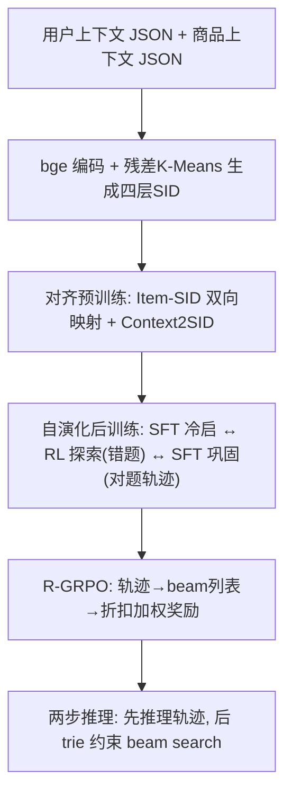
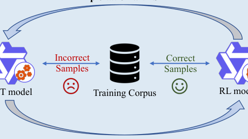

# Towards Context-aware Reasoning-enhanced Generative Searching in E-commerce (面向电商场景的上下文感知推理增强生成式搜索)

- **会议/期刊**: WWW 2026
- **作者与机构**: Zhiding Liu, Ben Chen, Mingyue Cheng, Enhong Chen, Li Li (USTC), Chenyi Lei, Wenwu Ou, Han Li, Kun Gai (快手)
- **推荐链路定位**: 端到端生成式召回/排序
- **研究方向**: 生成式推荐与离散语义ID / 大语言模型推荐
- **论文原文**: [https://arxiv.org/abs/2510.16925v4](https://arxiv.org/abs/2510.16925v4)
- **开源代码**: 暂未开源

## TL;DR (1分钟核心速览)

电商搜索中查询词噪声大、用户时空/历史/画像等隐式上下文难以被匹配式或现有生成式模型充分吸收。本文提出 CRS：把异构用户与商品上下文统一序列化为结构化 JSON 文本，商品用残差 K-Means 生成四层语义 ID (SID) 并注册为特殊 token；再用 SFT 与 RL 交替的"自演化后训练"在无人工推理轨迹下激发慢思考；并指出 GRPO 在排序场景存在目标错位与奖励估计偏差，提出按 beam 列表加权、以 $1/(1+\log n)$ 折扣的 R-GRPO。在快手电商日志三个数据集上，Full-Ranking 协议下 All-100K 的 HR@10 相对最强基线提升 6.24%，Fashion-27K 提升达 38.18%。

## Background & Motivation (背景与核心矛盾)

- **主流范式**: 匹配式方法（BM25/BGE/Qwen3-Embedding 双塔语义召回）与生成式方法（GENRE/DSI/LTRGR 将商品转为语义 ID 后自回归生成）两条主线。
- **前人局限**: 其一，匹配式方法基本把每条 query 孤立处理，几乎不建模历史点击/未点击、时空与画像等上下文，query 表达残缺时无法还原真实意图；其二，生成式方法虽引入 SID 与多模态/协同信号，但仍缺乏对"复杂上下文—候选商品"关联的显式推理，且推理轨迹监督在电商场景几乎不可得。
- **核心洞察 (Key Insight)**: 直接蒸馏大模型推理轨迹存在两类偏差——**数据先验偏差**（通用 LLM 不掌握动态商品库，必须把目标商品塞进 prompt，造成泄漏与训练/推理分布错位）与**模型容量偏差**（小模型模仿大模型轨迹脆弱、泛化差）；因此推理能力应"自举"而非"模仿"。
- **本文切入点**: 用统一文本底座让 LLM 直接吃上下文，用 SFT↔RL 交替自演化替代人工轨迹，并把 RL 的 rollout 从"单点 top-1"改造为"列表级排序"以对齐排序目标。

## Method (核心方法设计)

### 1. 整体框架 (Overall Architecture)

输入侧将用户上下文（画像、按时间排序的历史 query/点击/未点击商品、当前 query 的时空元数据）与商品上下文（标题、品牌、类目、价格、GMV）序列化为结构化 JSON；商品经 bge-small-zh 编码后做残差 K-Means 量化得到四 token SID 并注册为词表特殊 token。随后经"上下文对齐预训练 → SFT 冷启 → RL 探索 → SFT 巩固"的多轮自演化闭环训练，推理时先产出推理轨迹、再在前缀 trie 约束下 beam search 生成 SID。

<figure class="paper-figure" markdown="span">
  <figcaption>图 1：面向电商搜索推荐的 CRS 框架概览。(a) 首先进行上下文表示与对齐，将复杂的用户与商品上下文统一为结构化 JSON 格式，并引入预训练阶段使 LLM 主干与电商搜索上下文对齐。(b) 为应对推理轨迹监督稀缺的挑战，提出一种新的自演化后训练范式，通过 RL 探索与……交替进行，更好地激发模型的上下文感知推理能力。</figcaption>
</figure>

### 2. 关键设计拆解 (Key Designs)

1. **统一文本上下文 + 残差 K-Means 语义 ID**：痛点是用手工特征/异构 embedding 融合上下文会引入特征工程偏差，且 RQ-VAE 存在码本坍缩。本文改用免训练的残差 K-Means 逐层量化：第 $l$层做$C^l=\mathrm{KMeans}(E^l,N)$，取$s_i^l=\arg\min_k\|e_i^l-c_k^l\|_2^2$，残差$e_i^{l+1}=e_i^l-c_{s_i^l}^l$ 送入下一层，三层码本加一层去重层拼成唯一四 token SID。直觉：逐层减残差天然保证码本全覆盖、无坍缩，且同前缀商品语义相近，为 beam search 提供结构先验。
2. **自演化后训练 (Self-evolving Post-training)**：痛点是电商无高质量推理轨迹、蒸馏又有双重偏差。每轮迭代先在全量训练集上跑当前 SFT 模型，只挑**做错的样本**做 RL 探索（借鉴 DAPO 过滤），再对 RL 后模型**做对的样本及其自生成轨迹**做 SFT 巩固：$\mathcal{D}_{rl}^i=\mathrm{Sample}(\mathrm{Incorrect}(\mathcal{D}_{train},\mathcal{M}_{sft}^i))$，$\mathcal{M}_{rl}^i=\mathrm{RL}(\mathcal{D}_{rl}^i,\mathcal{M}_{sft}^i)$，$\mathcal{D}_{sft}^i=\mathrm{Correct}(\mathcal{D}_{train},\mathcal{M}_{rl}^i)$。直觉：错题驱动探索、对题轨迹固化能力，形成无需人工标注的能力自举飞轮。
3. **R-GRPO 去偏强化学习**：痛点是 GRPO 只优化单条轨迹的 top-1，两条都答错的轨迹拿到相同奖励，丢失"真目标排得更靠前"的排序信息。本文将 rollout 解耦为"生成 $G$条推理轨迹 + 每条独立 beam search 出$K$个候选"，对每条轨迹取最高奖励项为$o_i^*$，并用折扣加权汇总整张列表：$r_i^*=\frac{1}{W}\sum_{n=1}^{K}\frac{r_i^n}{1+\log n}$，$W=\sum_{n=1}^{K}\frac{1}{1+\log n}$，再代入标准 GRPO 的组内标准化优势$A_i$与 KL 正则。奖励由结构奖励（缺 `<think>` 标签记$-1$）、长度奖励$\min(1,\mathrm{len}(ans)/L)$、SID 逐层部分匹配奖励$\sum_{i=1}^{K}w_i\mathbb{I}(\mathrm{SID}_i^{pred}=\mathrm{SID}_i^{target})$ 与 SID 有效性奖励相加构成。直觉：位置折扣把"排得更高"转化为可学习信号，缓解排序目标与 token 似然目标的错位。

## Experimental Setup & Evaluation Protocol (实验设置与评估协议)

- **数据集与预处理**: 取自快手电商真实搜索日志，按目标商品随机采样用户，每人保留最近 10 条交互；无公开数据集具备所需非匿名上下文，故自建三个基准：

| 数据集 | #Users | #Items | #Interactions(Query) | 稀疏度/密度 | 特征/场景说明 |
| :--- | :---: | :---: | :---: | :---: | :--- |
| All-100K | 99,683 | 1,072,791 | 362,859 条唯一 query（人均 6.55） | 极稀疏 | 全类目，含画像/时空/点击与未点击 |
| All-50K | 49,967 | 632,196 | 202,436 条唯一 query（人均 6.54） | 极稀疏 | 全类目子采样 |
| Fashion-27K | 27,219 | 323,481 | 103,812 条唯一 query（人均 6.77） | 极稀疏 | 时尚类目，同类商品高度相似、细粒度区分难 |

- **数据划分与防穿越 (Splitting Strategy)**: 按用户划分训练/评估集（user-level split），每位用户以目标商品对应的最后一次搜索为评估样本，历史交互仅取评估前 10 条，避免未来交互泄漏。
- **排名评测协议 (Ranking Protocol)**: 采用 `Full-Ranking` 式生成式全库排序——所有生成式模型共用同一前缀 trie 约束 beam search，保证候选空间一致；指标为 HR@$\{1,5,10\}$与 NDCG@$\{1,5,10\}$。
- **对比基线与超参设置**: 匹配式 TF-IDF/BM25/BGE(bge-small-zh-v1.5)/Qwen3-Embedding-0.6B；生成式 GENRE/DSI/LTRGR（mT5-base 骨干）与 LatentR3（Qwen3-0.6B，含上下文输入）。SID 统一 3 层码本，层大小 512/256/256；CRS 骨干 Qwen3-0.6B，另测 1.7B/4B 规模；Adam 优化至收敛。

## Key Experimental Results (实验关键数据)

### 1. 主实验对比 (Main Results)

| 数据集 | 指标 | BM25 | BGE | DSI | LTRGR | LatentR3 | **CRS** | Improv.% |
| :--- | :--- | :---: | :---: | :---: | :---: | :---: | :---: | :---: |
| All-100K | HR@1 | 0.0411 | 0.0482 | 0.0736 | 0.0702 | 0.0891 | **0.0919** | 3.14 |
| All-100K | HR@10 | 0.1930 | 0.2301 | 0.2303 | 0.2229 | 0.2419 | **0.2570** | 6.24 |
| All-100K | NDCG@10 | 0.1071 | 0.1256 | 0.1438 | 0.1372 | 0.1612 | **0.1678** | 4.09 |
| All-50K | HR@1 | 0.0548 | 0.0560 | 0.0656 | 0.0676 | 0.0810 | **0.0880** | 8.64 |
| All-50K | HR@10 | 0.2297 | 0.2330 | 0.2197 | 0.2182 | 0.2243 | **0.2498** | 6.07 |
| All-50K | NDCG@10 | 0.1322 | 0.1436 | 0.1340 | 0.1317 | 0.1460 | **0.1617** | 10.75 |
| Fashion-27K | HR@1 | 0.0312 | 0.0345 | 0.0437 | 0.0389 | 0.0485 | **0.0713** | 47.01 |
| Fashion-27K | HR@10 | 0.1153 | 0.1120 | 0.1223 | 0.1190 | 0.1058 | **0.1690** | 38.18 |
| Fashion-27K | NDCG@10 | 0.0677 | 0.0692 | 0.0787 | 0.0741 | 0.0744 | **0.1152** | 46.38 |

### 2. 消融实验 (Ablation Study)

R-GRPO vs. 原始 GRPO（All-50K，三轮 RL 迭代）：

| 模型轮次 | 指标 | GRPO | R-GRPO | Imp.(%) |
| :--- | :--- | :---: | :---: | :---: |
| $\mathcal{M}_{rl}^0$ | HR@1 | 0.0746 | **0.0766** | 2.68 |
| $\mathcal{M}_{rl}^0$ | NDCG@10 | 0.1379 | **0.1390** | 0.80 |
| $\mathcal{M}_{rl}^1$ | HR@1 | 0.0828 | **0.0838** | 1.21 |
| $\mathcal{M}_{rl}^1$ | NDCG@10 | 0.1491 | **0.1508** | 1.14 |
| $\mathcal{M}_{rl}^2$ | HR@1 | 0.0851 | **0.0863** | 1.41 |
| $\mathcal{M}_{rl}^2$ | NDCG@10 | 0.1539 | **0.1568** | 1.88 |

骨干规模消融（Fashion-27K）：0.6B → 1.7B 时 HR@1 提升 3.37%、NDCG@10 提升 1.74%；1.7B → 4B 时 HR@1 提升 5.47%、HR@5 提升 7.43%，性能随容量单调上升。

### 3. 关键实验发现 (Key Findings)

1. **细粒度类目是推理增益的主战场**：Fashion-27K 上 HR@1 相对提升 47.01%、NDCG@10 提升 46.38%，远超 All-100K 的 3–6%，说明同类高相似商品无法靠 query–item 表面相关性区分时，显式上下文推理才真正兑现价值。
2. **R-GRPO 的收益随训练轮次放大**：第 0 轮 HR@1 仅 +2.68%，到第 2 轮 NDCG@10 提升升至 1.88%，表明列表级折扣奖励在模型具备基础推理能力后更能发挥排序区分作用，而非一次性增益。
3. **冷启动用户反而受益最大**：按历史 query 数分桶（$\le 5$/ 6–8 /$\ge 9$），BGE 三桶几乎持平（对上下文不敏感），而 CRS 在最少历史交互组上相对提升 8.55%，说明结构化推理能从有限上下文中推断隐式意图，而非依赖行为量堆叠。

## Highlights & Limitations (亮点、对比与审稿批判)

- **与代表作对比 (vs. Prior Work)**: 相比 DSI/LTRGR 仅把搜索当序列生成、把排序损失外挂到生成目标上，CRS 把排序信息直接注入 RL 的 rollout 与奖励估计；相比 LatentR3 的隐式潜空间推理，CRS 走显式慢思考并解决"无轨迹监督"这一根本约束；相比 RQ-VAE 类 SID 构建，残差 K-Means 免训练且无码本坍缩。
- **可迁移亮点**: ①"错题做 RL、对题轨迹做 SFT"的自演化数据筛选策略可平移到任何缺乏推理标注的生成式推荐任务；②把 beam 列表按 $1/(1+\log n)$ 折扣聚合为单一奖励的 R-GRPO 改造，可即插即用地替换任意 GRPO 变体的 rollout 层。
- **审稿级局限批判**: ①推理需先自回归生成完整思维链再 beam search，0.6B 以上骨干的在线时延与算力开销论文未给出量化，工业部署成本存疑；②三数据集均来自单一平台快手且为自建日志，缺乏公开数据集与跨平台验证，SID 码本层大小等超参的敏感性分析亦缺失。

## Rating (四维评分)

- **方法创新性 (Novelty)**: ⭐⭐⭐⭐ （统一文本上下文 + 免训练残差 K-Means SID + 自演化 SFT/RL 飞轮 + 列表级去偏 R-GRPO，四者组合完整且针对电商搜索的真实痛点）
- **评估协议与实验扎实度 (Protocol & Experiments)**: ⭐⭐⭐⭐ （三规模真实日志、统一 trie 保证公平 beam search、含冷启动分桶与骨干规模分析，但缺公开数据集与显著性检验）
- **写作与数学规范度 (Clarity & Rigor)**: ⭐⭐⭐⭐ （R-GRPO 的偏差分析与公式推导清晰，奖励设计逐项给出；部分符号如 $K$ 在码本层数与 beam 宽度间复用，略有歧义）
- **工业落地与复现价值 (Industrial & Practical Value)**: ⭐⭐⭐ （来自快手真实场景、SID 构建免训练易落地，但代码未开源且思维链推理的线上时延未披露）
