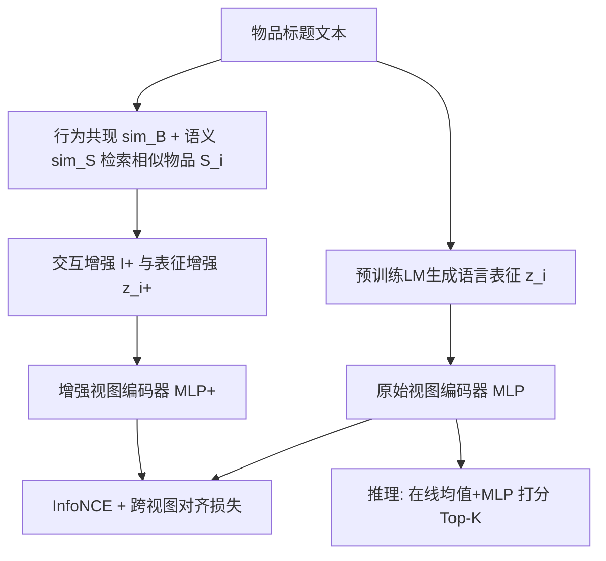
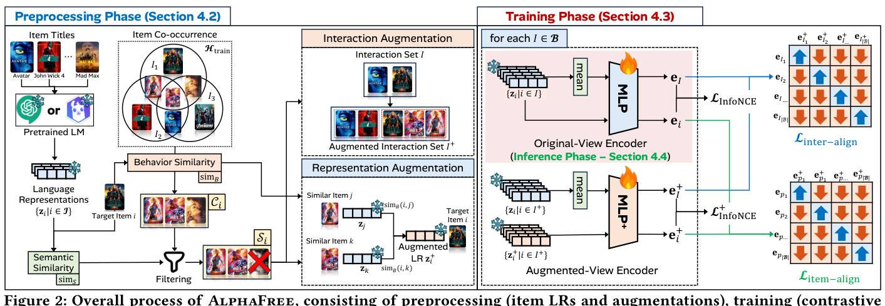

# AlphaFree: Recommendation Free from Users, IDs, and GNNs (摆脱用户、ID与GNN的推荐)

- **会议/期刊**: WWW 2026
- **作者与机构**: Minseo Jeon, Junwoo Jung, Daewon Gwak, Jinhong Jung (崇实大学 Soongsil University)
- **推荐链路定位**: 召回 (Top-K Item Retrieval)
- **研究方向**: 大语言模型推荐 / 自监督对比学习与交互去噪
- **论文原文**: [https://arxiv.org/abs/2603.02653v1](https://arxiv.org/abs/2603.02653v1)
- **开源代码**: [https://github.com/minseojeonn/AlphaFree](https://github.com/minseojeonn/AlphaFree)

## TL;DR (1分钟核心速览)

现有推荐系统深陷三大"路径依赖"：存储用户嵌入（内存随用户数线性膨胀）、用原始ID初始化特征（无语义、难泛化）、依赖GNN传播高阶协同信号（过平滑、需存图）。AlphaFree 同时斩断这三条依赖：用预训练语言模型生成物品语言表征（LR）替代ID，用交互集均值+MLP在线推断用户偏好替代用户嵌入，用"行为+语义相似物品增强 + 双视图对比对齐"替代GNN。在7个真实数据集、user-wise holdout（4:3:3）协议下，Recall@20/NDCG@20 较最优LR基线最高提升 5.37%/5.71%，较非LR基线最高提升约 42%，训练GPU内存较AlphaRec降低最高 69%，冷启动场景提升 26–38%。

## Background & Motivation (背景与核心矛盾)

- **主流范式**: 推荐建模长期遵循三条"事实标准"——存用户嵌入（MF-BPR/NCF）、用原始ID初始化特征（几乎所有方法）、用GNN在user-item图上传播高阶协同信号（LightGCN/XSimGCL/AlphaRec）。
- **前人局限**: ① 用户嵌入内存随用户数线性增长，在电商等用户密集域成本巨大，且稀疏/噪声交互下不可靠；② ID特征无语义，对未见实体泛化差；③ GNN需同时保存用户嵌入与图结构，且高度节点因过度邻域平均导致过平滑，表达能力受限。
- **部分解法的缺口**: FISM/SLIM 无用户无GNN但仍依赖ID且难捕获高阶信号；RLMRec/AlphaRec 引入语言表征实现ID-free，却仍存用户嵌入（AlphaRec还依赖GNN），在高维LR（$d_{LR}=3072$）下内存爆炸，Beauty/Health 直接 OOM。
- **核心洞察 (Key Insight)**: 物品语言表征本身已蕴含协同信号（AlphaRec实证），因此"高阶CF"未必需要GNN——可通过"相似物品增强 + 对比对齐"在表征层面注入。
- **本文切入点**: 同时移除用户、ID、GNN三重依赖，仅用两层MLP即可达到甚至超越SOTA。

## Method (核心方法设计)

### 1. 整体框架 (Overall Architecture)

AlphaFree 分三阶段。**预处理**（仅一次）：用预训练LM对每个物品标题生成语言表征 $\mathbf{z}_i$，并基于训练交互集计算行为相似度（共现）与语义相似度（点积），为每个物品检索"行为候选 + 语义过滤"后的相似物品集$\mathcal{S}_i$，据此构造增强交互集$I^+$与增强表征$\mathbf{z}_i^+$。**训练**：原始视图编码器与增强视图编码器（各为两层MLP）分别对交互集与物品编码，通过 InfoNCE 推荐损失 + 跨视图对齐损失联合优化。**推理**：仅保留原始视图编码器，对查询交互集$I_q$ 在线均值池化+MLP 得到用户表征，与全库物品表征做余弦相似度排序，无需任何增强与GNN。

<figure class="paper-figure" markdown="span">
  <figcaption>图 2：AlphaFree 的整体流程，包括预处理（物品 LR 与增强）、训练（原始视图与增强视图的对比对齐）和推理（仅使用原始视图编码器）。符号见表 4。</figcaption>
</figure>

### 2. 关键设计拆解 (Key Designs)

1. **行为-语义双重过滤的相似物品检索（GNN-free 的核心）**：纯共现 top-$K_c$候选含噪声，纯语义阈值又过松/过紧。做法是先取行为相似度 top-$K_c$候选集$\mathcal{C}_i$，再以语义相似度均值$\mu_i$ 为阈值过滤：
$$\mathcal{S}_i=\{j\in\mathcal{C}_i\mid \text{sim}_S(i,j)\geq\mu_i\},\quad \mu_i=\tfrac{1}{|\mathcal{I}|}\textstyle\sum_{j}\text{sim}_S(i,j)$$
直觉：共现保证协同相关性，均值阈值自适应地剔除语义弱相关项，比固定25%/75%分位更平衡（图3）。

2. **交互级 + 表征级双增强**：交互增强 $I^+=I\cup\bigcup_{i\in I}\mathcal{S}_i$ 在集合层面注入未观测的高阶协同；表征增强按行为相似度加权聚合相似物品LR：
$$\mathbf{z}_i^+=\frac{\sum_{j\in\mathcal{S}_i}\text{sim}_B(i,j)\cdot\mathbf{z}_j}{\sum_{j\in\mathcal{S}_i}\text{sim}_B(i,j)}$$
两者分别从"数据"与"特征"两个层面替代GNN的消息传递，避免过平滑。

3. **双视图对比对齐与训练目标**：原始视图捕获消费上下文但缺高阶信号，增强视图提供高阶信号但可能过强，故用CLIP式对称对齐（交互级 + 物品级）融合互补信息。总损失：
$$\mathcal{L}_{final}=\mathcal{L}_{rec}+\lambda_{align}\cdot\mathcal{L}_{align},\quad \mathcal{L}_{rec}=\mathcal{L}_{InfoNCE}+\mathcal{L}_{InfoNCE}^+$$
其中 $\mathcal{L}_{align}=\mathcal{L}_{inter\text{-}align}+\mathcal{L}_{item\text{-}align}$，均为双向对称 InfoNCE。负采样采用批内/全库均匀采样（$N_I$从$\mathcal{I}\setminus I$抽），温度$\tau_r,\tau_a$可调。推理仅用原始视图MLP，复杂度$O(d_{LR}dn+n\log K)$，线性于物品数。

## Experimental Setup & Evaluation Protocol (实验设置与评估协议)

- **数据集与预处理**: 7个Amazon/Steam真实数据集，无5-core过滤说明，统计如下：

| 数据集 | #Users | #Items | #Interactions | 稀疏度/密度 | 场景说明 |
| :--- | :---: | :---: | :---: | :---: | :--- |
| Movie | 26,073 | 12,464 | 875,906 | 0.27% | 电影 |
| Book | 71,306 | 40,523 | 2,206,865 | 0.08% | 图书 |
| Video | 94,762 | 25,612 | 814,586 | 0.03% | 视频游戏 |
| Baby | 150,777 | 36,013 | 1,241,083 | 0.02% | 母婴 |
| Steam | 334,730 | 15,068 | 4,216,781 | 0.08% | 游戏平台 |
| Beauty | 729,576 | 207,649 | 6,624,441 | 0.004% | 美妆 |
| Health | 796,054 | 184,346 | 7,176,552 | 0.005% | 健康 |

- **数据划分与防穿越**: 主实验采用 **user-wise holdout 随机划分 4:3:3**（每用户交互随机切分）；冷启动实验按用户 8:1:1 划分，测试时从新用户交互中采样10%（至少1条）构成 $I_q$，其余为 ground truth。
- **排名评测协议**: 报告 Recall@20 与 NDCG@20，未明确说明是否 Full-Ranking（从方法设计看为全库打分排序），5次随机种子取平均。
- **对比基线与超参**: 非LR基线 MF-BPR、FISM-BPR、LightGCN、XSimGCL；LR基线 RLMRec、AlphaRec。LR维度 $d_{LR}=3072$（text-embedding-3-large），MLP隐层$d$可调，$\lambda_{align}$、$K_c$在验证集调优，显著性$p\leq0.05$。

## Key Experimental Results (实验关键数据)

### 1. 主实验对比 (Main Results)

Recall@20 / NDCG@20（user-wise holdout 4:3:3，节选代表性数据集）：

| 模型 | UF/IF/GF | Movie R@20 | Book R@20 | Video R@20 | Baby R@20 | Steam R@20 | Beauty R@20 | Health R@20 |
| :--- | :---: | :---: | :---: | :---: | :---: | :---: | :---: | :---: |
| MF-BPR | ✗/✗/✓ | 0.0580 | 0.0436 | 0.0177 | 0.0150 | 0.1610 | 0.0063 | 0.0091 |
| FISM-BPR | ✓/✗/✓ | 0.0861 | 0.0623 | 0.0392 | 0.0150 | 0.1801 | 0.0079 | 0.0104 |
| LightGCN | ✗/✗/✗ | 0.0860 | 0.0712 | 0.0732 | 0.0359 | 0.2013 | 0.0201 | 0.0250 |
| XSimGCL | ✗/✗/✗ | 0.0967 | 0.0818 | 0.0897 | 0.0390 | 0.2245 | 0.0253 | 0.0299 |
| RLMRec | ✗/✓/✗ | 0.1046 | 0.0905 | o.o.t. | o.o.t. | o.o.t. | o.o.t. | o.o.t. |
| AlphaRec | ✗/✓/✗ | 0.1219 | 0.0991 | 0.1088 | 0.0391 | 0.2360 | o.o.m. | o.o.m. |
| **AlphaFree** | ✓/✓/✓ | **0.1267** | **0.1014** | **0.1111** | **0.0412** | **0.2402** | **0.0361** | **0.0325** |
| Improv. vs best LR | | +3.94%* | +2.32%* | +2.11%* | +5.37%* | +1.78%* | — | — |
| Improv. vs best non-LR | | +31.0%* | +24.0%* | +23.8%* | +5.58%* | +6.99%* | +42.7%* | +8.70%* |

（NDCG@20 趋势一致，AlphaFree 较最优LR最高 +5.71%，较非LR最高 +42.86%。RLMRec 预处理超50h记为 o.o.t.，AlphaRec 在 Beauty/Health 显存溢出记为 o.o.m.。）

### 2. 消融实验 (Ablation Study)

| 变体 | Book R@20 | Baby R@20 | Steam R@20 |
| :--- | :---: | :---: | :---: |
| w/o semantic filtering | 下降 | 下降 | 下降 |
| w/o inter-align | 下降 | 下降 | 下降 |
| w/o item-align | 下降 | 下降 | 下降 |
| w/o all-align ($\lambda_{align}=0$) | 下降最多 | 下降最多 | 下降最多 |
| **AlphaFree (full)** | **最优** | **最优** | **最优** |

（原文图7以柱状图呈现，各组件移除均导致性能下降，全模型一致最优。）

### 3. 关键实验发现 (Key Findings)

1. **无用户设计是内存与可扩展性的胜负手**：AlphaFree 训练显存较 AlphaRec 最高降 69%，推理再降最高 41%；AlphaRec 在 Beauty/Health（$d_{LR}=3072$）直接 OOM，RLMRec 预处理超50h，而 AlphaFree 全部数据集可跑通——用户嵌入的线性内存开销是高维LR场景的致命瓶颈。
2. **无GNN设计在重度用户上优势放大**：按交互数分桶（1–20/21–40/41–60/61+），AlphaFree 相对 AlphaRec 的提升随 $|I|$ 增大而扩大，61+ 组提升最显著（最高约50%），印证GNN对高度节点过平滑、而增强+对齐方案避免了邻域过度平均。
3. **无用户+无ID带来强冷启动泛化**：新用户场景下 AlphaFree 较 AlphaRec 在 Video/Baby 上 Recall@20 提升 25.90%/38.65%，NDCG@20 提升 25.71%/35.95%，说明在线推断偏好 + 语义表征对稀疏新用户远比学习固定用户嵌入稳健。

## Highlights & Limitations (亮点、对比与审稿批判)

- **与代表作对比 (vs. Prior Work)**: 相较 FISM（无用户无GNN但依赖ID、无高阶信号），AlphaFree 用LR+增强补足高阶协同；相较 LightGCN/XSimGCL（GNN捕获高阶但存用户、过平滑），以增强+对齐在表征层替代消息传递；相较 AlphaRec（ID-free但存用户且依赖GNN、高维OOM），同时移除用户与GNN，内存与冷启动双赢。
- **可迁移亮点**: ① "行为top-K候选 + 语义均值阈值"的双重过滤检索，可低成本迁移到任何需要相似物品构造的对比学习推荐；② 训练用双视图、推理仅用原始视图的"对齐后丢弃增强分支"范式，兼顾表达力与推理效率。
- **审稿级局限批判**: ① 预处理阶段相似度计算为 $O(mn+n^2)$，非严格线性，大规模物品库需近似kNN优化，且LM生成LR本身耗时；② 主实验未明确 Full-Ranking 协议与负采样比例，跨方法可比性存疑；③$K_c$与$\lambda_{align}$在不同密度数据集上最优值差异大（Movie 最优$K_c=5$，Baby 偏好更大$K_c$），超参敏感、调优成本高。

## Rating (四维评分)

- **方法创新性 (Novelty)**: ⭐⭐⭐⭐ （"三无"设计系统性地拆解推荐建模路径依赖，增强+对齐替代GNN的思路简洁且有实证支撑，但各组件单独并非全新）
- **评估协议与实验扎实度 (Protocol & Experiments)**: ⭐⭐⭐⭐ （7数据集+冷启动+分桶+内存+消融+案例齐全，5种子+显著性检验，唯排名协议与负采样细节披露不足）
- **写作与数学规范度 (Clarity & Rigor)**: ⭐⭐⭐⭐ （三阶段流程清晰、复杂度定理与证明完整，公式规范；部分符号表置于附录略增阅读成本）
- **工业落地与复现价值 (Industrial & Practical Value)**: ⭐⭐⭐⭐⭐ （代码开源、仅两层MLP、推理线性于物品数、内存大幅下降，对高维LR与用户密集场景落地价值突出）

