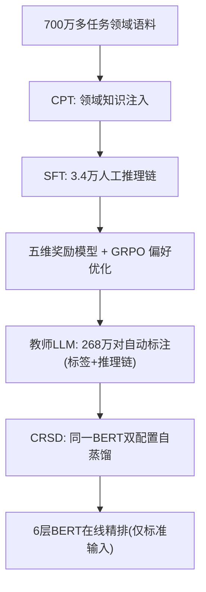
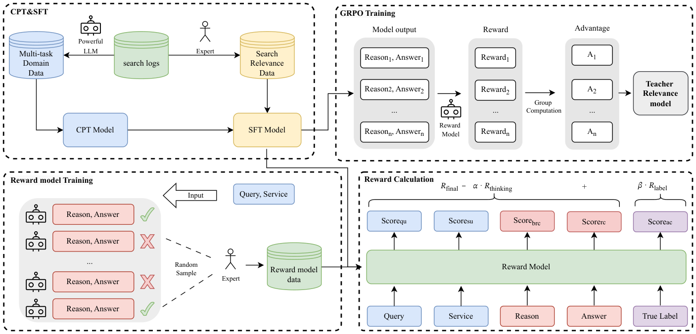

# From Reasoning LLMs to BERT: A Two-Stage Distillation Framework for Search Relevance (从推理大模型到BERT：面向搜索相关性的两阶段蒸馏框架)

- **会议/期刊**: WWW 2026 (Industry Track)
- **作者与机构**: Runze Xia, Yupeng Ji, Yuxi Zhou, Haodong Liu, Teng Zhang (美团)；Piji Li (南京航空航天大学)
- **推荐链路定位**: 精排（搜索广告 query-service 相关性判别）
- **研究方向**: 大语言模型推荐 (LLM4Rec) / CTR 预估与特征交叉
- **论文原文**: [https://arxiv.org/abs/2510.11056v3](https://arxiv.org/abs/2510.11056v3)
- **开源代码**: 暂未开源

## TL;DR (1分钟核心速览)

电商搜索相关性精排要求毫秒级延迟，无法直接部署推理 LLM；而 BERT 类判别模型缺乏深层语义推理能力（如"皮肤焕新"与"面部水疗"的等价判断）。本文提出两阶段框架：先用 CPT→SFT→多维奖励 GRPO 三步打造领域自适应推理教师，自动为 268 万 query-service 对标注标签与推理链；再用**对比推理自蒸馏 (CRSD)** 将同一 BERT 在"带推理输入"与"标准输入"下的行为建模为师生关系，用 InfoNCE 对齐 [CLS] 表征，使 6 层 BERT 在推理时无需推理链即可内化推理能力。离线 Macro F1 达 0.7076（保留教师 98.6% 性能），线上 A/B 中 AdCTR +0.91%、AdCVR +1.06%。

## Background & Motivation (背景与核心矛盾)

- **主流范式**: 工业搜索精排普遍采用 BERT 类 encoder-only 交叉编码器做 query-service 相关性三分类（不相关/中等/相关），以换取毫秒级吞吐。
- **前人局限**: ① 判别模型只学表层语义匹配，缺乏世界知识与多步逻辑，面对"表述不同但业务等价"的样本系统性误判；② 直接蒸馏推理 LLM 面临**架构异构**（decoder-only vs. encoder-only 表征空间不可直接对齐）与**只模仿输出、不迁移过程**两大障碍。
- **核心洞察 (Key Insight)**: 通用 LLM（Qwen3-8B、DeepSeek-R1）零样本/少样本在该任务上 Accuracy 仅 0.51–0.62，说明**领域知识缺失比推理能力缺失更致命**；同时，若同一模型在"见过推理链"时能判得更准，则可通过自蒸馏把这一状态"压"进标准输入的参数中。
- **本文切入点**: 先造一个懂业务的推理教师保证标注质量，再用"同模型双输入配置"绕开跨架构对齐难题。

## Method (核心方法设计)

### 1. 整体框架 (Overall Architecture)

第一阶段构建教师 $M_t$：以 Qwen3-8B 为底座，先在 700 万多任务领域语料（query 理解、service 理解、双向生成、pointwise/pairwise/setwise 相关性共 7 类任务）上做 CPT 注入平台知识；再在 3.4 万条人工标注推理链上 SFT 激发推理格式；最后用五维奖励模型 + GRPO 做偏好优化，产出可靠推理路径。该教师为 268 万搜索日志对自动打标（标签 + 推理链）。第二阶段训练 6 层中文 BERT 学生 $M_s$：通过 CRSD 将"标准输入"与"推理增强输入"两种配置构成师生对，用批内对比对齐 + 双路分类损失联合优化，推理时仅需标准输入。

<figure class="paper-figure" markdown="span">
  <figcaption>图1：面向领域自适应推理LLM的三阶段训练流程概览，包括持续预训练（CPT）、监督微调（SFT）和偏好优化。</figcaption>
</figure>

### 2. 关键设计拆解 (Key Designs)

1. **多维加权奖励的 GRPO 偏好优化**：仅用答案正确性做奖励存在信号稀疏与 reward hacking（答对但推理错）。本文将奖励模型拆为五维专家打分（Query 理解、Service 理解、业务规则合规、推理一致性、答案正确，各 0–4 分），聚合成过程奖励与标签奖励：
$$R_{\text{final}} = \alpha \cdot R_{\text{thinking}} + \beta \cdot R_{\text{label}}$$
其中 $R_{\text{thinking}}$ 为前四维均值。奖励模型与专家一致率达 89.77%，稠密信号迫使策略不仅答对、还要"按对的方式想"。

2. **对比推理自蒸馏 (CRSD)**：跨架构对齐的痛点在于外部句向量编码器与 BERT 语义空间错位，监督是"间接"的。CRSD 改为**同模型自对齐**：教师配置输入 `<query, service, reason>` 得 $\text{cls}^r_i$，学生配置输入 `<query, service>` 得 $\text{cls}_i$，批内以同样本为正对、跨样本为负对做 InfoNCE：
$$\mathcal{L}_{\text{align}} = -\sum_{i=1}^{N}\log\frac{\exp(\text{sim}(\text{cls}_i,\text{cls}^r_i)/\tau)}{\sum_{j=1}^{N}\exp(\text{sim}(\text{cls}_i,\text{cls}^r_j)/\tau)}$$
直觉：强迫标准输入下的表征"靠近自己看过推理链时的表征、远离他人的表征"，从而把推理逻辑压入参数而非依赖显式文本。

3. **训练目标与推理效率**：总损失 $\mathcal{L}_{\text{CRSD}} = \mathcal{L}_{\text{sce}} + \gamma \mathcal{L}_{\text{tce}} + \delta \mathcal{L}_{\text{align}}$，$\gamma=\delta=0.01$（小权重防止过度依赖长推理文本、防止对齐压过分类）。教师配置最大长度 150、学生 64；推理阶段仅走学生配置，延迟与原始 6 层 BERT 完全一致，无额外开销。

## Experimental Setup & Evaluation Protocol (实验设置与评估协议)

- **数据集与预处理**: 工业私有数据，无公开统计表，关键规模如下：

| 数据用途 | 规模 | 说明 |
| :--- | :---: | :--- |
| CPT 多任务语料 | 700 万 | 7 类任务，多 LLM 自动标注 |
| SFT / GRPO 人工标注 | 34,002 / 11,634 | 同分布互斥子集 |
| 蒸馏数据 | 268 万 query-service 对 | 教师自动标注，标签分布 16.2%/11.7%/72.1% |
| 人工评测集 | 约 12,000 | 交叉校验的三分类金标 |

- **数据划分与防穿越 (Splitting Strategy)**: 采用**独立人工标注测试集**划分；SFT 与 GRPO 子集互斥，确保偏好优化在未见同分布样本上验证泛化性。
- **排名评测协议 (Ranking Protocol)**: 任务为三分类相关性判别而非全库排序，指标为 Accuracy、Macro F1、Weighted F1；显著性用 McNemar 检验（$p<10^{-8}$）。
- **对比基线与超参设置**: 教师侧对比 Qwen3-8B / DeepSeek-R1 的 zero/few-shot 与 SFT、CPT+SFT、GRPO 变体；蒸馏侧对比标准数据蒸馏、BGE-M3 句向量对齐基线。学生为 6 层中文 BERT，学习率 5e-5、批大小 4096、训练 5000 步。

## Key Experimental Results (实验关键数据)

### 1. 主实验对比 (Main Results)

教师模型各阶段（表 3 精选）：

| 方法 | Accuracy | Macro F1 | Weight F1 |
| :--- | :---: | :---: | :---: |
| Qwen3-8B (Zero-shot) | 0.5480 | 0.3955 | 0.5748 |
| DeepSeek-R1 (Few-shot) | 0.6197 | 0.4696 | 0.6638 |
| SFT Baseline | 0.7708 | 0.6980 | 0.7485 |
| CPT+SFT | 0.7762 | 0.7032 | 0.7538 |
| + GRPO ($R_{\text{label}}$) | 0.7812 | 0.7101 | 0.7634 |
| **+ GRPO (Weighted)** | **0.7873** | **0.7174** | **0.7701** |

蒸馏阶段（表 4）：

| 方法 | Accuracy | Macro F1 | Weight F1 |
| :--- | :---: | :---: | :---: |
| Baseline (数据蒸馏) | 0.7645 | 0.6945 | 0.7461 |
| Baseline Reasoning Distill. | 0.7678 | 0.6959 | 0.7486 |
| CRSD + $\mathcal{L}_{\text{align}}$ | 0.7707 | 0.6993 | 0.7522 |
| **CRSD Full (ours)** | **0.7761** | **0.7076** | **0.7583** |

线上 A/B（两周，实验组 10% vs. 基线 30% 流量）：

| 指标 | AdCTR | AdCVR | GTV | UVCTR | PVCTR |
| :--- | :---: | :---: | :---: | :---: | :---: |
| 相对提升 | **+0.91%** | **+1.06%** | +0.40% | +0.11% | +0.18% |

### 2. 消融实验 (Ablation Study)

| 配置 | Accuracy | Macro F1 | Weight F1 |
| :--- | :---: | :---: | :---: |
| CRSD Full | **0.7761** | **0.7076** | **0.7583** |
| w/o Reasoning Path | 0.7639 | 0.6947 | 0.7463 |
| w/ Random Reasoning | 0.7624 | 0.6918 | 0.7440 |

### 3. 关键实验发现 (Key Findings)

1. **领域知识是教师质量的第一杠杆**：通用 LLM 最好仅 0.6197 Accuracy，而 CPT 一步就把 Macro F1 从 0.6980 拉到 0.7032，说明平台术语与业务规则无法靠通用世界知识弥补。
2. **稠密过程奖励优于稀疏结果奖励**：加权 GRPO 相比仅标签奖励再涨 Macro F1 0.7101→0.7174，验证"答对且想对"的奖励设计确实抑制了 reward hacking。
3. **推理链的语义内容而非长度是增益来源**：去掉推理路径后性能回落到基线（0.6947），喂随机推理链甚至低于基线（0.6918），证明 CRSD 的收益来自真实逻辑对齐而非输入变长或结构伪影；最终学生保留教师 98.6% 的 Macro F1，线上坏案例率下降 30.5 个百分点。

## Highlights, Limitations & Rating (亮点、对比与审稿评价)

- **与代表作对比 (vs. Prior Work)**: 相比 Agrawal 等用外部句向量编码器对齐推理路径的做法，CRSD 消除了跨模型语义空间错位，且不依赖额外编码器；相比 Shang 等在 Walmart 的 LLM 蒸馏实践，本文额外解决了教师本身的领域适配问题；相比 DisRanker 的 pointwise+margin-MSE 蒸馏，本文迁移的是"过程"而非仅分数分布。
- **可迁移亮点**: ① "同模型双输入配置"是绕开异构架构对齐的通用技巧，可迁移到任何"富输入训练、贫输入推理"的场景（如多模态缺失、长上下文压缩）；② 五维奖励分解 + 加权 GRPO 可直接复用于其他需要可解释中间过程的判别任务。
- **审稿级局限批判**: ① 全部实验基于美团私有数据，缺乏公开基准复现，教师三步流程（700 万 CPT + 人工标注 + RL）成本高昂，中小团队难以复制；② 超参 $\gamma,\delta$ 固定为 0.01 未做敏感性分析，且三分类标签分布严重不均衡（相关类占 72.1%），Macro F1 提升幅度有限（相对基线约 +1.9%），泛化到多级细粒度相关性尚待验证。
- **四维评分**: 创新性 ⭐⭐⭐⭐ | 实验扎实度 ⭐⭐⭐⭐ | 方法清晰度 ⭐⭐⭐⭐⭐ | 落地价值 ⭐⭐⭐⭐⭐

