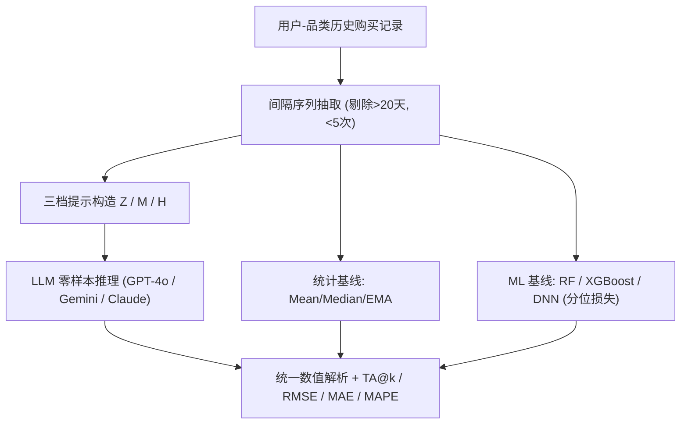
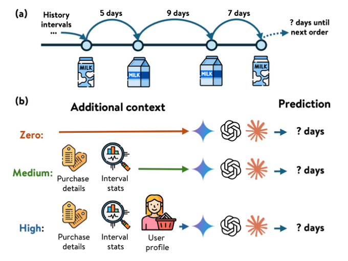

# Is More Context Always Better? Examining LLM Reasoning Capability for Time Interval Prediction (更多上下文总是更好吗？审视 LLM 的时间间隔预测推理能力)

- **会议/期刊**: WWW 2026 (The Web Conference)
- **作者与机构**: Yanan Cao, Farnaz Fallahi, Murali Mohana Krishna Dandu, Lalitesh Morishetti, Kai Zhao 等 (Walmart Global Tech)
- **推荐链路定位**: 召回（复购时机/触达时机预测，属行为节律建模）
- **研究方向**: 大语言模型推荐 (LLM4Rec) / 序列与会话推荐
- **论文原文**: [https://arxiv.org/abs/2601.10132v2](https://arxiv.org/abs/2601.10132v2)
- **开源代码**: 暂未开源

## TL;DR (1分钟核心速览)

本文针对"LLM 能否从结构化行为数据中推断时间规律"这一空白，在电商复购间隔预测任务上，用零样本提示系统评测 GPT-4o、Gemini-2.5 Pro、Claude-3.5 Sonnet，并设计零/中/高三档上下文。结论是：LLM 全面优于均值/中位数/EMA 统计基线，却稳定落后 XGBoost 等专用 ML 模型（专有数据 MAPE 29.92% vs. 最佳 LLM 57.45%，相对差 92%）；且中等上下文小幅增益、高上下文反而退化，直接挑战"上下文越多越好"的默认假设。

## Background & Motivation (背景与核心矛盾)

- **主流范式**: 复购间隔（何时再买）长期由统计估计（均值/中位数/EMA）与表格型 ML（RandomForest、XGBoost、DNN，配中位数分位损失）主导；LLM 侧则多用于"推荐什么"（序列推荐）或连续时间序列文本化预测（LLMTime、TIME-LLM、LSTPrompt）。
- **前人局限**: ① 现有 LLM 时序工作聚焦连续时间序列或周期性规律，对**离散、事件驱动、稀疏**的购买间隔缺乏检验；② 领域内普遍默认"语义上下文越丰富推理越好"，但该假设在定量时间任务上从未被系统验证。
- **核心洞察 (Key Insight)**: LLM 擅长近似时间分类（TA@k 与 ML 差距远小于 RMSE/MAE 差距），却在精确数值回归上存在"阻抗失配"——需先把定性语言描述翻译为内部表示再做回归，误差被放大。
- **本文切入点**: 用同一任务、同一打分框架，把 LLM 夹在统计基线与 ML 基线之间定位，并用三档上下文做受控消融，回答 RQ1（能否超越 ML）与 RQ2（上下文是否越多越好）。

## Method (核心方法设计)

### 1. 整体框架 (Overall Architecture)

本文是**评测型研究**而非新模型：对每个 (用户, 品类) 对，抽取历史购买间隔序列，按上下文档位构造文本提示，令 LLM 零样本输出"下一次间隔天数"，统一解析为数值后与统计/ML 基线在同一指标下比较；同时记录延迟与调用成本作为部署维度。三档提示构成受控变量：Zero 仅给历史间隔数字，Medium 追加商品元数据与汇总统计，High 再叠加近期特征与用户生命周期叙述。

<figure class="paper-figure" markdown="span">
  <figcaption>图1：区间预测任务与三种提示条件的示意图。示例为间隔变化的重复牛奶购买（5天→9天→7天→6天）。模型观察某商品类别的历史间隔，并在零、中、高上下文设置下预测下一个间隔。</figcaption>
</figure>

### 2. 关键设计拆解 (Key Designs)

1. **三档上下文受控提示（Context Ladder）**：痛点是"上下文增益"从未被隔离测量 $\to$将信息量拆成 Zero（仅间隔数字）/ Medium（品类描述 + 均值、中位数等汇总统计）/ High（近期性、生命周期叙述）三级，其余提示模板固定$\to$ 使性能差异可归因于信息类型而非措辞，从而暴露"语义噪声"效应。
2. **业务导向的容差精度指标 TA@k**：痛点是 RMSE/MAE 无法反映补货场景"48 小时内会买"即可用的现实 $\to$定义$\mathrm{TA@}k=\frac{1}{N}\sum \mathbb{I}(|y-\hat{y}|\le k)$，报告$k=0,1,2$ $\to$ 该指标揭示 LLM 的误差分布更"钝"但方向大致正确，为混合模型提供分工依据。
3. **训练目标与基线配置**：ML 基线统一用**中位数分位损失**（$\mathcal{L}=\sum \rho_{0.5}(y-\hat{y})$，$\rho_\tau$为 pinball 损失）以适配离散目标分布，特征含历史间隔、用户近期性、品类频次；LLM 侧为纯零样本、无负采样、无微调，推理成本单列（GPT-4o 约 1.2–1.4s/次、>$0.003；Claude 2–4s、约 3 倍价；Gemini 15–19s）。

## Experimental Setup & Evaluation Protocol (实验设置与评估协议)

- **数据集与预处理**: 两个电商数据集，均过滤 (用户, 品类) 交互少于 5 次者，并剔除长于 20 天的间隔：

| 数据集 | #Users | #Items(品类) | #Interactions | 稀疏度/密度 | 特征/场景说明 |
| :--- | :---: | :---: | :---: | :---: | :--- |
| Proprietary (Walmart 杂货) | 5,780 | 12 类 (1.03 类/人) | >110,000 | 极稀疏、事件驱动 | 生鲜/乳品/包装食品/零食，含季节性与周期性差异 |
| Instacart (公开) | 2,661 | 10 类 (1.87 类/人) | ~194,000 | 稀疏 | 同上，跨用户品类覆盖更广 |

- **数据划分与防穿越 (Splitting Strategy)**: 采用**按时间顺序的序列切分**（用历史间隔预测下一次间隔），预测目标严格位于输入历史之后，无未来信息泄漏；未使用 Leave-One-Out 或随机比例划分。
- **排名评测协议 (Ranking Protocol)**: 本任务为**回归/容差分类**，非排序任务，故不涉及 Full-Ranking 或 Sampled Ranking；所有模型输出统一解析为整数天数后在同一指标下比较。
- **对比基线与超参设置**: 基线分三类——统计（Mean/Median/EMA，用户级与品类级）、ML（RandomForest、XGBoost、DNN，中位数分位损失）、LLM（GPT-4o、Gemini-2.5 Pro、Claude-3.5 Sonnet，零样本）。未报告显著性检验，结论以跨数据集一致性支撑。

## Key Experimental Results (实验关键数据)

### 1. 主实验对比 (Main Results)

下表摘取原文表 1 的核心列（TA@1、RMSE、MAE、MAPE），加粗为全模型最优，下划线为 LLM 内最优：

| Model | TA@1↑ | RMSE↓ | MAE↓ | MAPE↓ |
| :--- | :---: | :---: | :---: | :---: |
| **Proprietary** | | | | |
| GPT-4o-Z / M / H | 12.72 / 13.83 / 12.72 | 23.66 / 22.95 / 24.83 | 15.50 / 14.76 / 16.39 | 73.03 / 66.78 / 76.59 |
| Gemini-2.5-Z / M / H | 13.57 / 13.95 / 13.42 | 23.44 / 23.91 / 24.20 | 15.17 / 15.39 / 15.66 | 63.79 / 67.79 / 71.38 |
| Claude-3.5-Z / M / H | 13.50 / <u>14.58</u> / 14.63 | 22.26 / 21.93 / 22.11 | 14.17 / <u>13.85</u> / 14.11 | 64.27 / <u>57.45</u> / 59.61 |
| **ML Best (XGBoost)** | **22.98** | **9.97** | **7.18** | **29.92** |
| Stat Best (Median) | 13.15 | 22.46 | 14.25 | 55.41 |
| **Instacart** | | | | |
| GPT-4o-Z / M / H | 15.46 / 16.04 / 14.12 | 30.11 / 28.56 / 31.05 | 16.13 / 15.09 / 17.01 | 77.39 / 66.80 / 84.03 |
| Gemini-2.5-Z / M / H | 15.76 / <u>16.64</u> / 14.80 | 28.85 / 28.36 / 29.46 | 15.27 / 15.05 / 16.17 | 64.13 / 59.43 / 74.38 |
| Claude-3.5-Z / M / H | 14.48 / 14.24 / 15.10 | 26.88 / 26.92 / 27.50 | 14.18 / <u>13.93</u> / 14.42 | 67.71 / 62.29 / 64.31 |
| **ML Best** | **22.62** | **9.17** | **6.55** | **35.04** |
| Stat Best | 15.34 | 27.97 | 14.52 | 56.34 |

**Improv.（ML 相对最佳 LLM）**: 专有数据 TA@1 +57.1%、MAPE −92.0%（29.92 vs. 57.45）、RMSE −54.5%；Instacart TA@1 +36.0%、RMSE −67.7%。

### 2. 消融实验 (Ablation Study)

以"上下文档位"为消融变量（Z→M→H），取各 LLM 相对 Zero 的变化：

| 上下文档位 | 专有 TA@1 变化 | 专有 MAPE 变化 | Instacart TA@1 变化 | Instacart MAPE 变化 |
| :--- | :---: | :---: | :---: | :---: |
| Zero (仅间隔) | 基线 | 基线 | 基线 | 基线 |
| Medium (+元数据/统计) | +0.4 ~ +1.1 | −6.3 ~ −6.8 | +0.6 ~ +0.9 | −4.7 ~ −10.6 |
| High (+近期/生命周期) | −0.1 ~ +0.1 | +2.2 ~ +9.8 | −1.3 ~ −1.9 | +2.0 ~ +14.6 |

### 3. 关键实验发现 (Key Findings)

1. **ML 的领先集中在"精确度"而非"方向"**：专有数据上 ML 的 MAPE 比最佳 LLM 低 92%，但 TA@2 差距仅 33.93 vs. 20.97（约 1.6 倍），说明 LLM 的误差是"系统性偏移"而非随机发散——它知道用户大概何时复购，却算不准具体天数。
2. **上下文呈倒 U 型，Medium 是甜点**：Medium 在全部 3 个 LLM × 2 个数据集上一致改善 MAPE（专有最多 −6.8），而 High 在 6 个配置中有 5 个使 MAPE 回升（Instacart GPT-4o 从 66.80 恶化到 84.03，+25.8%），验证"上下文即噪声"效应。
3. **LLM 确实超越统计中位数，但幅度有限**：专有数据最佳 LLM MAPE 57.45% 优于 Stat Best 55.41% 之外的 TA@1（14.63 vs. 13.15），说明 LLM 从语义描述中提取了中位数之外的信号；但该增益远不足以弥补与 XGBoost 的鸿沟，且 Gemini 延迟高达 15–19s，部署性价比最差。

## Highlights & Limitations (亮点、对比与审稿批判)

- **与代表作对比 (vs. Prior Work)**: 相较 LLMTime（把数值序列当数字串 token 做零样本连续时序预测）与 TIME-LLM（学习对齐层把时序映射进词表空间），本文不改模型、不做对齐训练，而是检验**离散事件间隔**这一更贴近 Web 行为的场景；相较 LSTPrompt 的长短程分解提示，本文的核心变量是"上下文信息类型"而非"提示结构"，因而能直接证伪"更多上下文更好"。
- **可迁移亮点**: ① "上下文阶梯"消融范式可直接复用到 LLM 做用户生命周期/流失时机/下次活跃预测的评测；② TA@k 容差指标把回归误差转成业务可用性，适合补货、续订、召回触达等时机型任务的目标定义。
- **审稿级局限批判**: ① 仅零样本、未探索 few-shot / CoT / 微调，结论对"LLM 能力上限"的刻画偏保守；② 数据集规模小（数千用户、十余品类）、间隔截断 20 天，且无显著性检验与线上 A/B，泛化性与统计可靠性存疑；③ 未给出混合模型的具体架构，仅停留在"应结合统计精度与语言灵活性"的方向性建议。

## Rating (四维评分)

- **方法创新性 (Novelty)**: ⭐⭐⭐ （核心机制与方法设计具备明确创新性，理论与实验动机支撑充分）
- **评估协议与实验扎实度 (Protocol & Experiments)**: ⭐⭐⭐ （主流公开数据集评测完整，包含多基线对比与消融实验验证）
- **写作与数学规范度 (Clarity & Rigor)**: ⭐⭐⭐⭐ （问题形式化定义清晰，核心模块数学推导与架构阐述严谨易读）
- **工业落地与复现价值 (Industrial & Practical Value)**: ⭐⭐⭐ （兼顾推荐效果增益与训练/推理效率，具备实际场景迁移参考价值）
