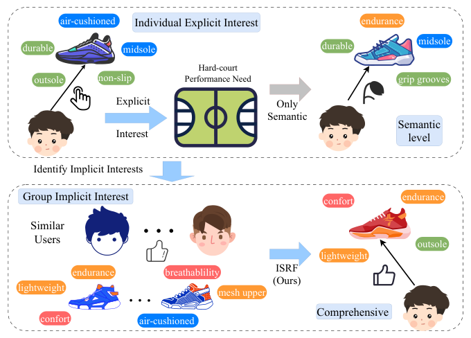
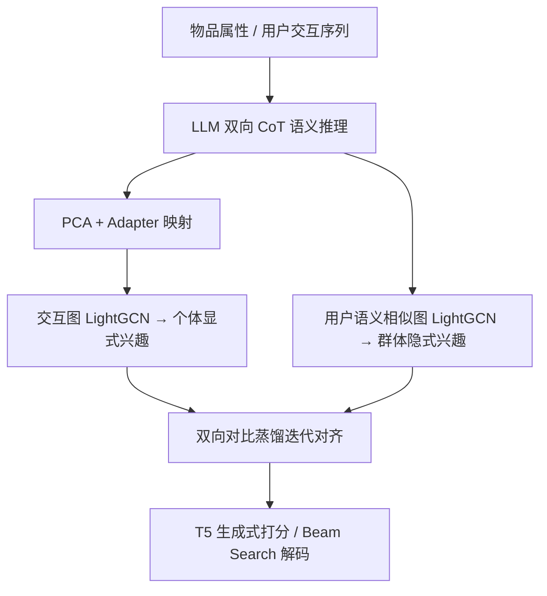
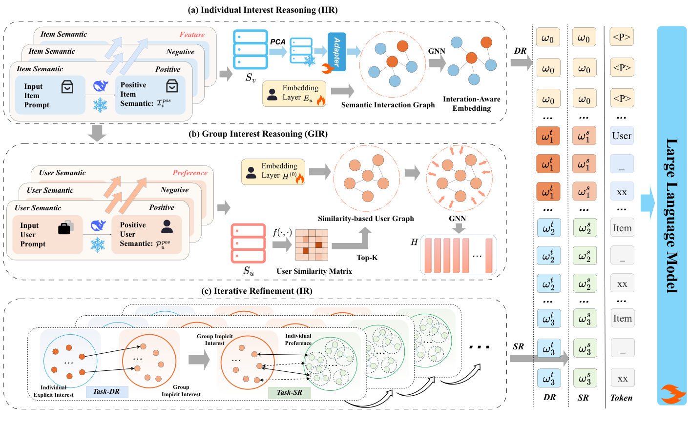

# Iterative Semantic Reasoning from Individual to Group Interests for Generative Recommendation with LLMs (面向 LLM 生成式推荐的个体到群体兴趣迭代语义推理)

- **会议/期刊**: WWW 2026
- **作者与机构**: Xiaofei Zhu, Jinfei Chen, Feiyang Yuan (重庆理工大学), Zhou Yang (重庆师范大学)
- **推荐链路定位**: 端到端生成式（T5-small 生成式推荐）
- **研究方向**: 大语言模型推荐 / 图神经网络推荐
- **论文原文**: [https://arxiv.org/abs/2603.13934v1](https://arxiv.org/abs/2603.13934v1)
- **开源代码**: [https://github.com/htired/ISRF](https://github.com/htired/ISRF)

## TL;DR (1分钟核心速览)

现有 LLM 推荐方法（ELMRec、POD 等）只做"语义整合"——把 LLM 生成的物品/用户描述编码进 ID 嵌入，却缺少用户行为理论所要求的"从显式个体兴趣推理到隐式群体兴趣"的逐步推理过程。本文提出 ISRF：先用 LLM 双向 CoT 推理物品语义并建交互图捕获个体显式兴趣，再基于语义相似用户图捕获群体隐式兴趣，最后用双向对比蒸馏迭代对齐二者。在 Sports/Beauty/Toys 三个 Amazon 数据集上，直接推荐任务 H@10 相对 ELMRec 提升 12.93%–24.57%，序列推荐提升 3.68%–6.60%（均 $p<0.05$）。

## Background & Motivation (背景与核心矛盾)

- **主流范式**: 以 ELMRec、POD、P5 为代表的 LLM 推荐，用 LLM 编码用户/物品语义，再与 ID 整词嵌入相加送入生成式 backbone（T5）做 next-token 预测。
- **前人局限**: ① 语义仅被"整合"为静态嵌入，未挖掘属性间的推理链条，物品语义表征难以覆盖兴趣多样性；② 完全忽略"行为相似用户共享潜在偏好"这一群体层面信号，个体历史稀疏时表征退化。
- **核心洞察 (Key Insight)**: 用户行为理论指出真实兴趣需"逐步推理"——从物品属性推出显式需求（如气垫中底+耐磨外底 $\to$硬地高强度性能需求），再从相似用户群推出隐式需求（如透气轻量$\to$ 长时间比赛舒适耐力）。
- **本文切入点**: 把"个体显式 $\to$ 群体隐式"的推理过程显式建模为三个可微模块，并用迭代对齐保证两种兴趣表征一致。

<figure class="paper-figure" markdown="span">
  <figcaption>图1：语义集成方法与本文提出的ISRF（语义推理）的示例性对比。</figcaption>
</figure>

## Method (核心方法设计)

### 1. 整体框架 (Overall Architecture)

输入为物品结构化属性与用户交互序列。IIR 模块用 LLM 做"正向—反向—融合"三步 CoT 生成物品语义 $I_{se}$，经 PCA 降维 + Adapter 映射后作为 LightGCN 的物品初始嵌入，在交互图上传播得到个体显式兴趣$\tilde{\mathbf{E}}=[\tilde{\mathbf{E}}_u,\tilde{\mathbf{E}}_v]$，并替换 prompt 中的整词嵌入送入 T5。GIR 模块用同样 CoT 生成用户兴趣描述$P_{se}$，据此算余弦相似度取 Top-$k$建用户语义图，再用 LightGCN 聚合得到群体隐式兴趣$\mathbf{H}$。IR 模块以对比蒸馏损失双向对齐$\tilde{\mathbf{e}}_u$与$\mathbf{h}_u$，与生成损失联合优化。

<figure class="paper-figure" markdown="span">
  <figcaption>图2：本文提出的迭代语义推理框架（ISRF）的整体架构，包括：(a) 个体兴趣推理；(b) 群体兴趣推理；(c) 迭代细化。</figcaption>
</figure>

### 2. 关键设计拆解 (Key Designs)

1. **双向 CoT 物品语义推理 + Adapter 对齐**：痛点是用属性直接编码语义多样性不足、且直接替换初始嵌入会破坏原语义结构。做法是先正向推理"哪些用户会喜欢该物品"得 $I_{pos}^{se}$，再以其为条件反向推理"哪些用户会不喜欢"得$I_{neg}^{se}$，融合为$I_{se}$；文本编码后 PCA 降至$d_m$并冻结，经两层 Adapter 映射：$\mathbf{E}_v=W_2(W_1\tilde{\mathbf{S}}_v+b_1)+b_2$。直觉是正反视角互补扩大语义覆盖，Adapter 承担"语义空间$\to$ 推荐空间"的桥接而不破坏预训练语义。

2. **相似用户语义图捕获群体隐式兴趣**：痛点是仅靠个体历史无法揭示潜在偏好。以 LLM 生成的用户语义嵌入算余弦相似度，取 Top-$k$构造 0/1 关系矩阵$\mathbf{R}_{i,j}=\mathbb{I}[u_j\in\text{Top-}k(\text{sim}(u_i,\mathcal{U}))]$，再在其上做 LightGCN 传播$\mathbf{H}^{(l)}=D_R^{-1/2}\mathbf{R}D_R^{-1/2}\mathbf{H}^{(l-1)}$并逐层平均。Top-$k$ 截断既降复杂度又抑制远邻噪声，图传播把相似用户偏好"注入"目标用户。

3. **双向对比蒸馏迭代对齐与训练目标**：痛点是两阶段独立建模导致表征不一致。直接推荐任务用群体兴趣作 teacher 蒸馏个体表征：$\mathcal{L}_{D\to S}=-\frac{1}{B}\sum_{u\in B}\log\frac{f_c(\text{sg}[\mathbf{h}_u],\tilde{\mathbf{e}}_u)}{\sum_{u'\in B}f_c(\text{sg}[\mathbf{h}_{u'}],\tilde{\mathbf{e}}_{u'})}$；序列推荐任务则最大化$\mathbf{h}_u$与序列平均嵌入$\mathbf{e}_u$的互信息$\mathcal{L}_S$。总损失$\mathcal{L}=\mathcal{L}_{gen}+\mathcal{L}_{D\to S}$（DR）或$\mathcal{L}_{gen}+\mathcal{L}_S$（SR）。负样本来自 in-batch 其他用户，无需额外采样；推理用 beam search，复杂度由 LightGCN 的$O(n^2)$ 主导，与 ELMRec 同阶。

## Experimental Setup & Evaluation Protocol (实验设置与评估协议)

- **数据集与预处理**: Amazon 三域（Sports & Outdoors / Beauty / Toys & Games），沿用 ELMRec 的预处理与划分协议（5-core 过滤）。

| 数据集 | 领域 | 任务 | 说明 |
| :--- | :---: | :---: | :--- |
| Sports | 运动户外 | SR + DR | Amazon 评论文档，含标题/类别等属性 |
| Beauty | 美妆 | SR + DR | 同上 |
| Toys | 玩具游戏 | SR + DR | 同上 |

- **数据划分与防穿越 (Splitting Strategy)**: 沿用 ELMRec 的序列划分协议（按时间顺序留最后一项作测试、倒数第二项作验证）。
- **排名评测协议 (Ranking Protocol)**: 序列推荐为全库 next-item 排序；直接推荐为 **1 正 + 99 负** 的采样排序（训练与评测一致），指标 H@5/10、N@10。
- **对比基线与超参设置**: 14 个基线分四类——传统（Caser/GRU4Rec/HGN/SimpleX）、注意力（SASRec/BERT4Rec/FDSA）、图（LightGCN/NCL/XSimGCL）、LLM（P5/RSL/POD/ELMRec）。语义推理用 DeepSeek-R1-14B，文本编码用 EasyRec-Roberta-Large，生成 backbone 为 T5-small，batch size 64，早停 patience 5，5 次试验 $t$-test 检验$p<0.05$。

## Key Experimental Results (实验关键数据)

### 1. 主实验对比 (Main Results)

**直接推荐（1:99 采样排序）**：

| 模型 | Sports H@10 | Sports N@10 | Beauty H@10 | Beauty N@10 | Toys H@10 | Toys N@10 |
| :--- | :---: | :---: | :---: | :---: | :---: | :---: |
| LightGCN | 0.5436 | 0.3418 | 0.5383 | 0.3451 | 0.5106 | 0.3272 |
| NCL | 0.5592 | 0.3551 | 0.5542 | 0.3607 | 0.5120 | 0.3325 |
| XSimGCL | 0.4486 | 0.2992 | 0.4392 | 0.3012 | 0.4186 | 0.2885 |
| P5 | 0.2802 | 0.1627 | 0.2300 | 0.1332 | 0.2023 | 0.1114 |
| POD | 0.2889 | 0.1782 | 0.2677 | 0.1639 | 0.2119 | 0.1244 |
| ELMRec | 0.6479 | 0.4852 | 0.6794 | 0.4973 | 0.6045 | 0.4141 |
| **ISRF** | **0.7697** | **0.5666** | **0.7673** | **0.5352** | **0.6733** | **0.4857** |
| Improv. | +24.57% | +22.37% | +12.93% | +7.63% | +18.80% | +16.78% |

**序列推荐（全库排序）**：

| 模型 | Sports H@10 | Sports N@10 | Beauty H@10 | Beauty N@10 | Toys H@10 | Toys N@10 |
| :--- | :---: | :---: | :---: | :---: | :---: | :---: |
| SASRec | 0.0350 | 0.0192 | 0.0170 | 0.0650 | 0.0675 | 0.0374 |
| P5 | 0.0460 | 0.0336 | 0.0644 | 0.0429 | 0.0709 | 0.0587 |
| POD | 0.0585 | 0.0422 | 0.0696 | 0.0471 | 0.0744 | 0.0601 |
| ELMRec | 0.0616 | 0.0471 | 0.0750 | 0.0529 | 0.0764 | 0.0618 |
| **ISRF** | **0.0648** | **0.0493** | **0.0800** | **0.0571** | **0.0792** | **0.0652** |
| Improv. | +5.23% | +4.73% | +6.60% | +7.92% | +3.68% | +5.54% |

### 2. 消融实验 (Ablation Study)

| 变体 | Toys H@10 | Beauty H@10 | Sports H@10 | 任务 |
| :--- | :---: | :---: | :---: | :---: |
| ISRF (full) | 0.0792 | 0.0800 | 0.0639 | SR |
| w/o $\mathcal{L}_{D\to S}$ | 0.0779 | 0.0779 | 0.0601 | SR |
| w/o $\mathcal{L}_{S}$ | 0.0775 | 0.0771 | 0.0614 | SR |
| ISRF (full) | 0.6733 | 0.7673 | 0.7746 | DR |
| w/o $I_{se}$ | 0.5093 | 0.7209 | 0.7170 | DR |
| w/o Adapter | 0.6314 | 0.6868 | 0.7097 | DR |

### 3. 关键实验发现 (Key Findings)

1. **语义推理对直接推荐贡献远大于序列推荐**：DR 上相对 ELMRec 提升 12.93%–24.57%，SR 仅 3.68%–6.60%。原因是 DR 需从 100 个候选中判别未见物品，更依赖物品语义理解；SR 的全库排序更依赖 ID 协同信号。
2. **物品语义 $I_{se}$是最关键组件**：移除后 Toys DR 的 H@10 从 0.6733 暴跌至 0.5093（$-24.4\%$），远超移除 Adapter 的降幅（0.6314），说明双向 CoT 生成的语义描述本身是收益主源，Adapter 只是必要的空间桥接。
3. **正负语义视角贡献相当且互补**：图 3 显示 ISRF-uNeg/ISRF-vNeg 与正视角变体性能接近，但完整模型始终最优，证明"喜欢/不喜欢"双向推理是有效语义补充而非冗余；同时 $L'$ 层数在 2–3 层后收益饱和甚至下降，验证过平滑风险。

## Highlights & Limitations (亮点、对比与审稿批判)

- **与代表作对比 (vs. Prior Work)**: 相比 ELMRec（仅随机特征传播增强语义 + 重排），ISRF 引入显式的"个体 $\to$ 群体"推理链与双向蒸馏；相比 POD（离散 prompt 蒸馏为连续向量），ISRF 不改 prompt 形式而改语义来源与图结构；相比 LightGCN/NCL（纯 ID 协同图），ISRF 用 LLM 语义相似度重建用户图，缓解稀疏与冷启动物品的语义缺失。
- **可迁移亮点**: ① "正向—反向—融合"三步 CoT 生成物品/用户语义描述，可直接迁移到任何需要语义增强的召回/精排模型；② 用 LLM 语义相似度替代交互共现构造用户图，对交互稀疏场景尤其友好。
- **审稿级局限批判**: ① 语义推理依赖 DeepSeek-R1-14B 离线生成，训练每 epoch 比 ELMRec 慢约 50%（Sports 15m01s vs 10m10s），且语义质量受 prompt 设计强约束，跨域迁移需重调 prompt；② 直接推荐采用 1:99 采样排序而非全库排序，与真实线上千级候选场景存在 gap，且未报告冷启动/长尾分桶结果。

## Rating (四维评分)

- **方法创新性 (Novelty)**: ⭐⭐⭐⭐ （"个体显式 $\to$ 群体隐式"的推理视角新颖，双向 CoT + 语义用户图 + 双向蒸馏组合完整，但各组件单独看均为已有技术的重组）
- **评估协议与实验扎实度 (Protocol & Experiments)**: ⭐⭐⭐ （三数据集 + 14 基线 + 显著性检验齐全，但 DR 仅采样排序、缺冷启动/长尾分桶与线上验证）
- **写作与数学规范度 (Clarity & Rigor)**: ⭐⭐⭐⭐ （三模块公式清晰、复杂度分析到位，但 Eq.8/9 中 $\text{sg}[\cdot]$与温度系数$\tau$ 的符号定义略简，部分符号前后不一致）
- **工业落地与复现价值 (Industrial & Practical Value)**: ⭐⭐⭐⭐ （代码已开源、推理开销与 ELMRec 持平，但离线 LLM 语义生成管线与 14B 模型依赖抬高落地门槛）
