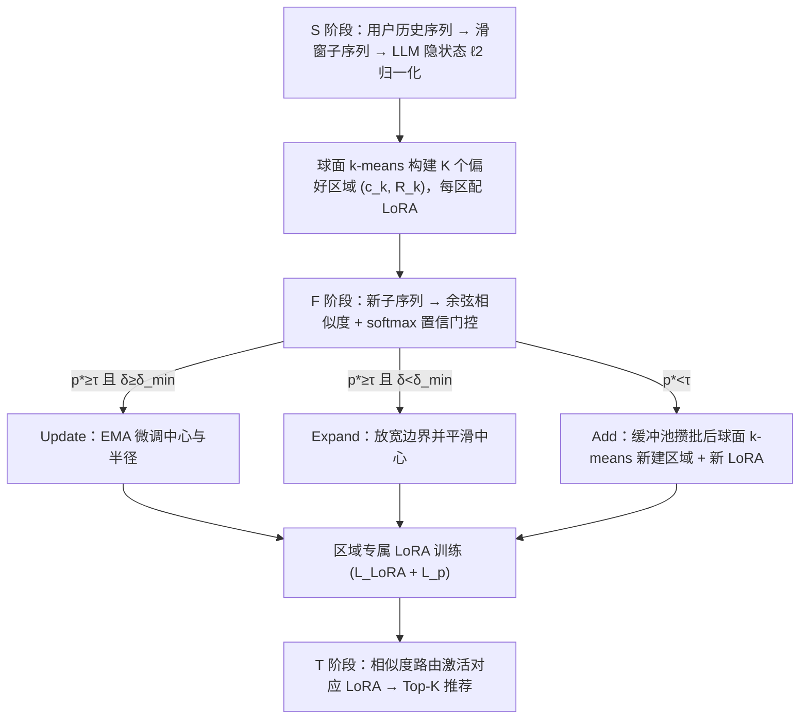
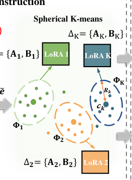

# RAIE: Region-Aware Incremental Preference Editing with LoRA for LLM-based Recommendation (面向 LLM 推荐的区域感知增量偏好编辑)

- **会议/期刊**: WWW 2026
- **作者与机构**: Jin Zeng, Yupeng Qi, Ziyu Lyu 等（中山大学深圳校区网络空间安全学院；厦门大学；深圳北理莫斯科大学；中央财经大学；北京师范大学）
- **推荐链路定位**: 端到端生成式（LLM 序列推荐 + 增量微调）
- **研究方向**: 大语言模型推荐 / 序列与会话推荐
- **论文原文**: [https://arxiv.org/abs/2603.00638v2](https://arxiv.org/abs/2603.00638v2)
- **开源代码**: [https://github.com/fengaogao/RAIE](https://github.com/fengaogao/RAIE)

## TL;DR (1分钟核心速览)

真实交互是非平稳的，用户偏好随时间漂移，而现有 LLM 推荐更新策略陷入两难：全局微调会扰动无关行为，逐点编辑又抓不住成片的偏好迁移，且反复编辑引发灾难性遗忘。RAIE 冻结主干，在表征空间用球面 k-means 把历史交互切成语义一致的"偏好区域"，每区挂一个专属 LoRA，新序列经置信门控触发 Update/Expand/Add 三种局部编辑，推理时按相似度路由激活对应适配器。在 MovieLens-10M 与 Yelp 的 S→F→T 时间切片协议下，Test 阶段 Recall@10 相对最强基线最高提升约 51%（BERT4Rec 上 0.0870 vs 0.0573），同时 Set-up 阶段遗忘显著受抑。

## Background & Motivation (背景与核心矛盾)

- **主流范式**: LLM 推荐分三派——特征增强、生成式推荐、Agent 推荐；适配漂移则依赖周期性全量重训或 PEFT（LoRA/adapter）增量微调。
- **前人局限**: ① 更新粒度失衡——单一全局 adapter 会扰动与目标无关的稳定偏好，而逐点编辑（如 E-BPR 修正错分样本对）只记住离散交互、无法刻画成片偏好迁移；② 增量不稳定——多 adapter 方案（LSAT 双 LoRA、MoLE 专家混合）按任务级启发式路由，参数更新与用户兴趣演化弱对齐，重复编辑相互干扰导致灾难性遗忘。
- **核心洞察 (Key Insight)**: 偏好漂移是**局部**的——用户在某些兴趣上保持稳定、仅在另一些兴趣上漂移（图 1 中 mystery→horror 主导、comedy 短期抬升）。因此应把交互组织成兴趣组，只对发生漂移的组做局部适配。
- **本文切入点**: 将"知识编辑"思想从事实/离散交互层面迁移到**连续偏好子空间**，以"偏好区域"为可编辑单元，区域级路由 + 区域级更新双管齐下。

## Method (核心方法设计)

### 1. 整体框架 (Overall Architecture)

RAIE 是即插即用框架，主干 LLM $\mathcal{M}_\theta$全程冻结，按 S（建立）→F（增量微调）→T（推理测试）三阶段运转。S 阶段用滑窗切分子序列、取 LLM 末层末 token 隐状态并$\ell_2$归一化，再对全体子序列做球面 k-means 得到$K$个偏好区域$\Phi=\{(c_k,R_k)\}_{k=1}^{K}$（中心 + 有效半径），每区映射一个独立 LoRA。F 阶段新序列先算与各区域中心的余弦相似度并经 softmax 得置信度，按阈值$\tau$与置信间隔$\delta_{\min}$ 触发 Update/Expand/Add 编辑，随后仅用该区数据训练其 LoRA。T 阶段将测试序列路由到最相似区域，挂载对应适配器完成 next-item 打分。

<figure class="paper-figure" markdown="span">
  <figcaption>图2：我们提出的RAIE的整体架构。它分别由三个核心模块组成。a) 建立阶段（S）的知识区域构建；b) 增量学习微调阶段（F）的区域感知编辑与LoRA适配；以及推理测试阶段（T）的区域感知路由。</figcaption>
</figure>

### 2. 关键设计拆解 (Key Designs)

1. **球面 k-means 偏好区域构建（把"用户"换成"兴趣组"作为编辑单元）**：长序列混杂多意图，直接整段建模难以刻画细粒度偏好。作者对归一化表征 $\tilde{\mathbf{e}}=\mathbf{e}/\|\mathbf{e}\|_2$做球面聚类，目标为$\max_{\{C_k,c_k\}}\sum_{k=1}^{K}\sum_{\tilde{\mathbf{e}}\in C_k}c_k^{\top}\tilde{\mathbf{e}}\ \ \text{s.t.}\ \|c_k\|_2=1$，半径$R_k$取区域内距离的$q=0.9$ 分位数以量化内聚度。直觉：球面约束使余弦相似度即几何邻近度，区域天然对应"一类兴趣"，为后续局部编辑提供可解释的物理边界。

2. **置信门控的三算子区域编辑（用"编辑"替代"重训"）**：新表征 $\tilde{\mathbf{e}}$与中心算$Score_k=c_k^{\top}\tilde{\mathbf{e}}$并 softmax 得$p_k$，令$p^\star=p_{\hat{k}}$、$\delta=p^\star-\max_{j\neq\hat{k}}p_j$，则
$$\text{Act}(\tilde{\mathbf{e}})=\begin{cases}\text{update}, & p^\star\ge\tau,\ \delta\ge\delta_{\min}\\ \text{expand}, & p^\star\ge\tau,\ \delta<\delta_{\min}\\ \text{add}, & p^\star<\tau\end{cases}$$
Update 用 EMA 平滑更新 $R_{\hat{k}}\leftarrow(1-\beta)R_{\hat{k}}+\beta\arccos(c_{\hat{k}}^{\top}\tilde{\mathbf{e}})$与中心；Expand 以扩张率$\lambda$放宽半径（上限$R_{\max}$）并平滑中心；Add 将样本入缓冲池、攒批后重新聚类新建区域。直觉：高置信且边界清晰→原地精修；高置信但边界模糊→温和外扩；低置信→新兴趣萌芽，需开新区。EMA 保证编辑稳定、不因单条噪声序列剧烈跳变。

3. **区域专属 LoRA 训练与重叠惩罚（隔离干扰 + 防区域塌缩）**：每区 LoRA 仅在 $S_k=S_k^{(S)}\cup S_k^{(F)}$ 上训练，损失为
$$\mathcal{L}=\mathcal{L}_{\text{LoRA}}+\mathcal{L}_{p},\quad \mathcal{L}_{p}=\lambda_{\text{sep}}\sum_{i<j}\big[(R_i+R_j-\|c_i-c_j\|_2)_+\big]^2$$
其中 $\mathcal{L}_{\text{LoRA}}$为 next-item 自回归负对数似然。$\mathcal{L}_p$ 惩罚区域球体相交，防止区域退化重叠导致路由歧义。训练采用原始数据混合比 0.7 缓解小样本过拟合；推理仅需一次前向路由 + 单适配器激活，无额外负采样开销。

## Experimental Setup & Evaluation Protocol (实验设置与评估协议)

- **数据集与预处理**: 隐式反馈二值化（评分 $\ge 4$ 为正），MovieLens-10M 用 `5-core`、Yelp 用 `10-core` 过滤，按用户时间戳排序成序列。

| 数据集 | 阶段 | #Users | #Items | #Interactions | 说明 |
| :--- | :---: | :---: | :---: | :---: | :--- |
| MovieLens-10M | S / F / T | 43,021 / 18,168 / 14,450 | 4,784 / 8,305 / 9,264 | 2.50M / 1.50M / 1.00M | 电影，稠密 |
| Yelp | S / F / T | 41,072 / 39,631 / 30,274 | 28,404 / 29,657 / 27,437 | 0.70M / 0.42M / 0.28M | 商户，稀疏噪声大 |

- **数据划分与防穿越 (Splitting Strategy)**: 全局时间戳分位切分，$q_S=0.5$、$q_F=0.8$映射为$t_S,t_F$，用户交互切成 S（$t<t_S$）/F（$t_S\le t<t_F$）/T（$t\ge t_F$）三段；段内右对齐滑窗构造样本，跨段窗口一律丢弃以防泄漏。
- **排名评测协议 (Ranking Protocol)**: 报告 Recall@10 与 NDCG@10，S 段衡量知识保持（遗忘程度），T 段衡量对未来交互的适应性；未明确说明是否 Full-Ranking，按 LLM 生成式打分惯例为候选集内 softmax 排序。
- **对比基线与超参设置**: 主干含 BERT4Rec / SASRec / TiSASRec / OpenP5 四种；插件基线含 LoRA、LoRA+Replay、LoRA+LwF、LSAT、MoLE、E-BPR。LoRA 秩 $r=8$、缩放$\alpha=16$、dropout 0.05，学习率$5\times10^{-4}$，S 阶段 5 epoch、F 阶段 3 epoch。

## Key Experimental Results (实验关键数据)

### 1. 主实验对比 (Main Results)

MovieLens-10M 上 T 段结果（Recall@10 / NDCG@10，节选代表性基线）：

| Backbone | 方法 | S. R@10 | S. N@10 | T. R@10 | T. N@10 |
| :--- | :--- | :---: | :---: | :---: | :---: |
| BERT4Rec | Base | 0.1311 | 0.0670 | 0.0440 | 0.0216 |
| BERT4Rec | +LoRA | 0.1103 | 0.0558 | 0.0569 | 0.0286 |
| BERT4Rec | +LoRA+LwF | 0.1116 | 0.0563 | 0.0573 | 0.0288 |
| BERT4Rec | +LSAT | 0.1579 | 0.0816 | 0.0561 | 0.0279 |
| BERT4Rec | +MoLE | 0.1618 | 0.0837 | 0.0467 | 0.0229 |
| BERT4Rec | +E-BPR | 0.1310 | 0.0669 | 0.0440 | 0.0215 |
| BERT4Rec | **+RAIE** | **0.1795** | **0.0957** | **0.0870** | **0.0453** |
| OpenP5 | +LoRA+LwF | 0.2456 | 0.1488 | 0.0890 | 0.0477 |
| OpenP5 | +E-BPR | 0.2556 | 0.1503 | 0.0867 | 0.0463 |
| OpenP5 | **+RAIE** | **0.2768** | **0.1686** | **0.0935** | **0.0486** |

- BERT4Rec 上 T.R@10 相对最强基线（LoRA+LwF 0.0573）提升 **+51.8%**，S.R@10 亦从 0.1116 升至 0.1795，实现"保持与适应"双赢。
- OpenP5 上 T.R@10 相对 E-BPR 提升 **+7.8%**，S.R@10 提升 **+8.3%**。
- Yelp 上 BERT4Rec+RAIE 的 T.R@10 达 0.0195（vs LSAT 0.0176），S.R@10 0.0257 与最优持平，验证稀疏场景鲁棒性。

### 2. 消融实验 (Ablation Study)

| 变体 | MovieLens-10M T.R@10 | Yelp T.R@10 | 结论 |
| :--- | :---: | :---: | :--- |
| Full RAIE | 最优 | 最优 | 双模块协同最佳 |
| w/o KR（单全局 adapter） | 明显下降 | 明显下降 | 多区域隔离是基础 |
| w/o KE（禁用区域编辑） | 下降最大 | 下降最大 | 编辑机制贡献最大 |
| w/o All | 大幅下降 | 大幅下降 | 两模块缺一不可 |

### 3. 关键实验发现 (Key Findings)

1. **区域编辑是性能主引擎**：消融中 w/o KE 掉点最严重，说明"按漂移方向改写区域几何"比"多挂几个 adapter"更关键——单纯 LoRA 全局微调虽提升 T 段（0.0440→0.0569），却把 S 段从 0.1311 打到 0.1103，正是粒度失衡的直接证据。
2. **区域数 $K$存在甜点且数据集相关**：MovieLens-10M 最优$K=3$、Yelp 最优$K=5$；$K$ 过小欠拟合多兴趣，过大则每区信息稀释、噪声上升，性能回落，说明区域粒度需与数据兴趣多样性匹配。
3. **编辑保持全局划分、仅做局部几何微调**：图 5 可视化显示编辑后中心位移温和、边界主要在交界处外扩，MovieLens 位移大而面积变化中等、Yelp 位移小而面积变化大，可分性 $S$ 略降意味着区域过渡更平滑而非重新分区，与推荐增益一致且具可解释性。

## Highlights & Limitations (亮点、对比与审稿批判)

- **与代表作对比 (vs. Prior Work)**: 相比 LSAT/MoLE 的"任务级启发式路由 + 全局/专家混合更新"，RAIE 的路由由偏好表征几何驱动、更新严格限定在漂移区域；相比 E-BPR 的"逐点修正错分样本对"，RAIE 编辑的是连续偏好子空间而非离散记录，因而在 T 段泛化显著更强（BERT4Rec 上 0.0870 vs 0.0440）；相比 Replay/LwF 需回放旧数据或蒸馏约束，RAIE 靠区域隔离天然抗遗忘，存储与计算更轻。
- **可迁移亮点**: ① "球面聚类 + 置信门控三算子"可作为通用增量适配模板迁移到 CTR/多场景模型的热更新；② 区域重叠惩罚 $\mathcal{L}_p$ 是防止多 adapter 路由歧义的低成本正则，可直接复用到 MoE-LoRA 类结构。
- **审稿级局限批判**: ① 区域数 $K$固定且对性能敏感（$K=3$vs$5$ 跨数据集不一致），球面 k-means 需离线全量聚类，Add 操作攒批重建也带来额外延迟，在线高频漂移场景的实时性存疑；② 仅在两个公开数据集、单一时间切片粒度下验证，缺少线上 A/B 与更细粒度多阶段漂移测试，且未报告 Full-Ranking 协议下的全库排序开销。

## Rating (四维评分)

- **方法创新性 (Novelty)**: ⭐⭐⭐⭐ （把知识编辑从事实层迁移到连续偏好子空间，"区域即编辑单元"的建模视角新颖，但球面 k-means + LoRA 路由的组合本身偏工程集成）
- **评估协议与实验扎实度 (Protocol & Experiments)**: ⭐⭐⭐⭐ （S→F→T 时间切片协议设计合理、四主干 × 六插件对比充分、含消融与敏感性分析，但缺 Full-Ranking 说明与线上验证）
- **写作与数学规范度 (Clarity & Rigor)**: ⭐⭐⭐⭐ （三算子公式与算法伪代码清晰、符号统一，区域重叠惩罚推导简洁，复杂度分析略欠）
- **工业落地与复现价值 (Industrial & Practical Value)**: ⭐⭐⭐⭐ （主干冻结、即插即用、代码已开源，存储随区域数线性增长可控，但固定 $K$ 与离线聚类限制其在超大规模动态场景的直接部署）
