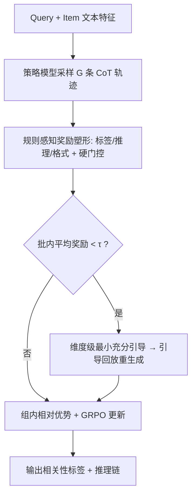
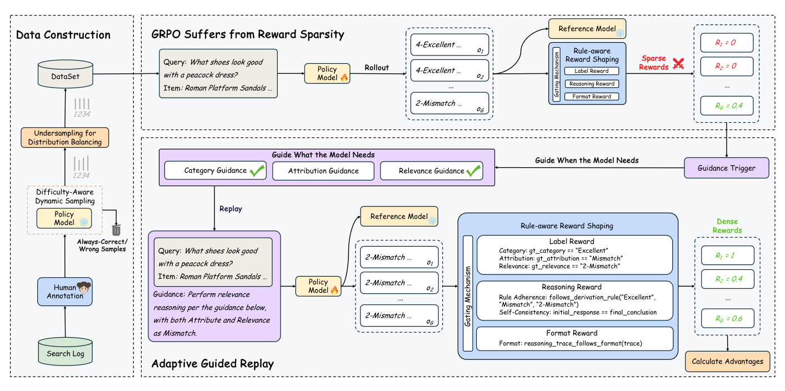

# TaoSR-AGRL: Adaptive Guided Reinforcement Learning Framework for E-commerce Search Relevance (淘宝搜索相关性自适应引导强化学习框架)

- **会议/期刊**: WWW 2026 (Industry Track, Oral)
- **作者与机构**: Jianhui Yang, Yiming Jin, Pengkun Jiao 等（清华大学 / 复旦大学 / 阿里巴巴淘天集团）
- **推荐链路定位**: 精排（相关性判别，同时服务召回与排序阶段）
- **研究方向**: 大语言模型推荐 / 强化学习与动态探索推荐
- **论文原文**: [https://arxiv.org/abs/2510.08048v4](https://arxiv.org/abs/2510.08048v4)
- **开源代码**: 暂未开源

## TL;DR (1分钟核心速览)

电商搜索相关性已从"语义匹配"转向"规则约束下的多步推理"，但 SFT/DPO 在长尾难例上泛化差，直接套用 GRPO 又因终端奖励稀疏而探索停滞。本文提出 TaoSR-AGRL：以**规则感知奖励塑形**把单一 0/1 结果奖励分解为标签/推理/格式三维稠密奖励并加硬门控，再以**自适应引导回放**仅对低奖励样本注入"最小充分"维度级提示重采样。在淘宝真实日志构建的 B-Eval/W-Eval 上，Macro-F1 分别达 69.26/61.53，W-Eval 较次优基线提升 2.28pt（Class-1 提升 7.28pt），并已在淘宝主搜全量上线。

## Background & Motivation (背景与核心矛盾)

- **主流范式**: 将相关性建模为四分类（1-Irrelevant / 2-Mismatch / 3-Related / 4-Excellent）的生成式推理任务，模型先输出标签再生成 CoT，用 SFT 或 DPO 对齐。
- **前人局限**: ① SFT/DPO 只模仿训练分布，对否定、平替、问答、知识型四类长尾查询泛化差；② 过度专精压缩了策略探索空间，使 GRPO 在长程多约束推理上几乎采不到正确轨迹，奖励极度稀疏。
- **核心洞察 (Key Insight)**: 淘宝相关性规则是**层级聚合**的——类别与属性子判定经确定性规则表映射为最终相关性（如"砂糖橘"vs"砂糖橘干"为 3-Related，"蔓越莓"vs"蔓越莓干"为 4-Excellent）。这意味着中间步骤可被独立验证，天然适合做稠密信用分配；同时聚合规则会**掩盖中间幻觉**（属性判错但最终标签仍对），纯结果奖励会诱发 reward hacking。
- **本文切入点**: 把"规则表"本身当作免费的监督信号源，用规则分解奖励 + 按需引导重采样，在不引入外部 PRM 或更强 oracle 模型的前提下破解稀疏性。

## Method (核心方法设计)

### 1. 整体框架 (Overall Architecture)

基座为淘宝自研 MoE 模型 TbStar（42B 总参 / 3.5B 激活），在 TbStar-DPO 之上做第三阶段 RL。训练闭环为：对每个 query-item 采样 $G=16$条轨迹 → 用规则感知奖励打分 → 若批内平均奖励低于阈值$\tau$ 则触发引导回放，对低分维度拼接 ground-truth 提示重新生成 → 合并两组轨迹计算组内相对优势 → 按 GRPO 目标更新策略，并以 KL 约束锚定参考模型。数据侧配套三阶段流水线：难例类目初筛 + 人工标注 → 难度感知动态采样（剔除全对/全错样本以规避标签噪声）→ 高频类欠采样做分布均衡。

<figure class="paper-figure" markdown="span">
  <figcaption>图1：所提出的用于电商搜索相关性的TaoSR-AGRL概览。(1) 数据构建构建平衡且具有挑战性的数据集。(2) 规则感知奖励塑形将稀疏的最终奖励分解为覆盖关键推理步骤的稠密、结构化信号，以确保忠实且可解释的推理。(3) 自适应引导回放选择性地回放低奖励的困难样本并给予针对性引导，以探索更高价值的推理轨迹。</figcaption>
</figure>

### 2. 关键设计拆解 (Key Designs)

1. **规则感知奖励塑形 (Rule-aware Reward Shaping)**：痛点在于最终标签由规则聚合得出，模型可靠"错推理得对答案"刷分。本文将奖励拆为标签奖励（$R_{cate}, R_{attr}, R_{rele}$ 三级对齐）、推理奖励（规则遵循 + 自一致性：最终结论须与首token预测一致）、格式奖励（二值门控），并以硬门控统一约束：
$$R=\mathbb{I}_{\text{Gate}}\cdot(w_{cate}R_{cate}+w_{attr}R_{attr}+w_{reason}R_{reason}),\quad \mathbb{I}_{\text{Gate}}=\mathbb{I}[R_{rele}=1\wedge R_{format}=1]$$
权重取 $w_{cate}=0.4, w_{attr}=0.4, w_{reason}=0.2$。硬门控天然形成课程学习：先保证"格式合法 + 结论正确"，再细化推理忠实度，避免在错误轨迹上浪费梯度。

2. **自适应引导回放 (Adaptive Guided Replay)**：痛点在于长尾复合规则（如羊绒含量须 >50% 才算 Excellent，而雪纺只需含即算）导致正确轨迹概率极低。AGR 分两步：**何时引导**——批内平均奖励低于 $\tau=0.1$才触发，简单样本零开销；**引导什么**——逐维度比对批内平均奖励与阈值，仅对不达标维度（如仅 attribute）生成定向提示$G(x,y)$拼入原 prompt 得$P'(x)$ 重采样，即"最小充分引导"。这既剪枝了动作空间，又避免直接给全答案造成的策略坍缩与奖励黑客。

3. **训练目标、负采样与推理效率**：目标为带 KL 正则的 GRPO 裁剪损失，优势按组内标准化 $\hat{A}_{i,t}=(R_i-\text{mean})/\text{std}$，并施加约束$0<|\{o_i\mid \text{is\_equivalent}(y,o_i)\}|<\gamma$ 过滤全对/全错组（免负采样，纯 on-policy 采样）。工程侧通过 MoE 负载均衡、跨机房调度削减与量化，训练 MFU 达 35%，P99 尾延迟 ≤400ms。

## Experimental Setup & Evaluation Protocol (实验设置与评估协议)

- **数据集与预处理**: 数据取自淘宝线上搜索日志，聚焦否定、平替、问答、知识四类难查询；经三阶段流水线后训练集为**数万条**量级（百万级初筛 → 数十万级难度过滤 → 万级均衡）。测试集两个：

| 数据集 | 规模/构成 | 分布特性 | 用途 |
| :--- | :---: | :---: | :--- |
| Balanced Eval (B-Eval) | 四类查询均衡 | 类别均衡 | 验证均衡分布性能 |
| In-the-Wild Eval (W-Eval) | 近似线上真实分布 | 长尾偏斜 | 验证鲁棒性与泛化 |

- **数据划分与防穿越**: 基于日志采样的**离线固定划分**（训练/评测分离），难例类目先经人工标注产出 `<query, item, label_category, label_attribute, label_relevance>` 五元组。
- **排名评测协议**: 非排序式评测，采用**四分类逐类 F1 + Good F1（3/4 类合并为 Good Tier，对齐线上业务口径）+ Macro F1 + Accuracy**；线上另做 2000 query 的 top-10 item 级 GSB 人工并排评测。
- **对比基线与超参设置**: 基线为 TbStar-DPO、GRPO、GRPO-PR（过程奖励加权 0.4/0.3/0.3）；batch size 64，学习率 1e-6，采样温度 0.99 / top-k 100，PPO 裁剪 ±0.2，引导阈值 $\tau=0.1$。

## Key Experimental Results (实验关键数据)

### 1. 主实验对比 (Main Results)

| 方法 | B-Eval Macro-F1 | B-Eval Acc | W-Eval Class-1 F1 | W-Eval Macro-F1 | W-Eval Acc |
| :--- | :---: | :---: | :---: | :---: | :---: |
| TbStar-DPO | 67.43 | 76.94 | 44.49 | 59.07 | 73.70 |
| GRPO | 68.82 | 77.74 | 45.41 | 59.25 | 73.83 |
| GRPO-PR | 68.48 | 77.64 | 45.49 | 59.22 | 73.95 |
| **TaoSR-AGRL** | **69.26** | **78.03** | **52.77** | **61.53** | **74.28** |
| Improv. (vs 次优) | +0.44 | +0.29 | +7.28 | +2.28 | +0.33 |

线上并排人工评测（vs TaoSR1 基线）：整体 GSB **+7.11%**、Query Goodrate **+1.74pt**、Item Goodrate **+3.74pt**；其中问答类 GSB +10.57%、知识类 +10.66%，显著高于否定类 +2.14%。

### 2. 消融实验 (Ablation Study)

| 变体 | W-Eval Macro-F1 | Acc | RAR |
| :--- | :---: | :---: | :---: |
| Soft Gating ($\lambda$=0.2) | 60.54 | 73.96 | 84.07 |
| Soft Gating ($\lambda$=0.5) | 59.93 | 74.06 | 81.96 |
| w/o Gating ($\lambda$=1) | 59.80 | 73.68 | 83.23 |
| w/o $R_{reason}$ | 61.28 | 74.02 | 79.84 |
| GRPO-RRS（仅奖励塑形） | 59.47 | 74.08 | — |
| TaoSR-AGRL-FG（固定引导） | 60.00 | 72.41 | — |
| **TaoSR-AGRL** | **61.53** | **74.28** | **87.25** |

### 3. 关键实验发现 (Key Findings)

1. **奖励塑形与引导回放缺一不可，且存在强协同**：仅加 RRS 只带来 +0.22 Macro-F1，仅加固定引导（-FG）为 +0.75，二者合并跃升至 +2.28；说明稠密奖励负责"指出哪里弱"，AGR 负责"针对性补强"，单独任一都无法突破 GRPO 的性能天花板。
2. **去掉 $R_{reason}$是典型的 reward hacking 证据**：Macro-F1 仅微降至 61.28（几乎无损），但规则遵循率 RAR 从 87.25 暴跌至 79.84——模型学会了用逻辑有瑕疵的捷径拿对答案，证明推理奖励是保忠实度而非保精度的"防作弊"项；反之软化门控（$\lambda$=0.5）会同时损害 F1 与 RAR，验证硬门控的必要性。
3. **引导必须"按需且定向"**：固定引导（-FG）虽提升 F1 但 Acc 反降至 72.41，且策略熵曲线显示全量静态引导会导致熵快速塌缩（策略坍缩）；$\tau$敏感性实验表明$\tau=0.1$最优（61.53），$\tau=0$或$\tau\geq0.2$ 均回落至 58.7–60.2 区间，印证"纠正干预 vs 策略自主"的权衡。

## Highlights & Limitations (亮点、对比与审稿批判)

- **与代表作对比 (vs. Prior Work)**: 相比 GRPO-PR 等过程监督路线，本文不训练 PRM、不调用 LLM-as-a-Judge，奖励完全由业务规则表解析生成，零额外模型开销；相比 StepHint / Critique-GRPO 等外部引导路线，AGR 不依赖更强 oracle 模型，且引导粒度细到"维度级"而非整条轨迹，避免答案泄漏。
- **可迁移亮点**: ① "层级规则 → 稠密奖励 + 硬门控"的范式可直接迁移到任何有确定性判定规则的分层决策任务（如内容风控、类目审核、多级合规判定）；② "批内均值低于阈值才触发引导"的低成本触发机制，可作为通用 RL 采样加速插件。
- **审稿级局限批判**: ① 训练集仅"数万条"且依赖人工标注与规则表维护，规则变更时奖励函数需同步重构，跨平台迁移成本未评估；② 线上 A/B 显示相关性提升后直接 Clean GMV 仅 +0.34%、Orders 反降 0.72%，暴露"语义相关性最优 ≠ 商业转化最优"的系统级错配，需靠多路召回与粗排联合改造兜底，说明该方法并非端到端可独立交付。

## Rating (四维评分)

- **方法创新性 (Novelty)**: ⭐⭐⭐⭐ （规则分解奖励 + 维度级按需引导的组合在工业 RLVR 场景中属首次系统化落地，但单点算子多为已有思想的工程化重组）
- **评估协议与实验扎实度 (Protocol & Experiments)**: ⭐⭐⭐⭐ （离线双分布测试集 + RAR 忠实度指标 + 线上 GSB 人工评测 + 4 天 A/B 形成完整证据链，扣分在于训练集规模与统计显著性检验披露不足）
- **写作与数学规范度 (Clarity & Rigor)**: ⭐⭐⭐⭐ （奖励门控与 GRPO 目标公式表述清晰、案例研究直观，但部分符号如 $R_{label}$与$R_{cate}/R_{attr}/R_{rele}$ 的层级关系在正文中略显跳跃）
- **工业落地与复现价值 (Industrial & Practical Value)**: ⭐⭐⭐⭐⭐ （已在淘宝主搜服务数亿用户，MFU 35%、P99 ≤400ms 的工程指标完整披露，是少见的"论文即生产系统"范例；但未开源、依赖私有 42B MoE 基座，复现门槛高）

