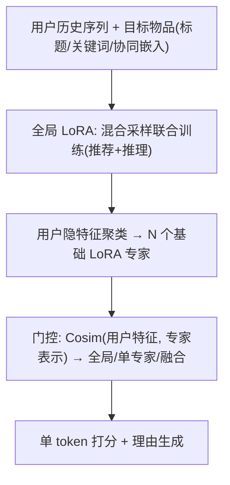
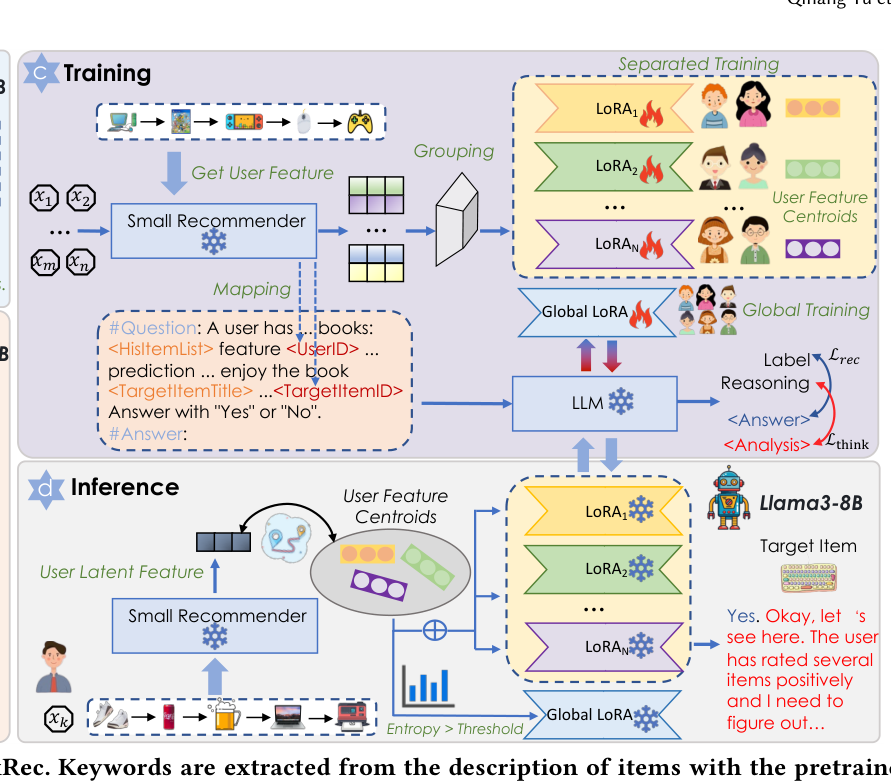

# ThinkRec: Thinking-based Recommendation via LLM (基于思维链的大语言模型推荐)

- **会议/期刊**: WWW 2026
- **作者与机构**: Qihang Yu, Kairui Fu, Zheqi Lv, Shengyu Zhang, Fei Wu 等（浙江大学；蚂蚁集团；上海人工智能实验室）
- **推荐链路定位**: 精排（排序阶段单 token 打分）
- **研究方向**: 大语言模型推荐 / 序列推荐
- **论文原文**: [https://arxiv.org/abs/2505.15091v4](https://arxiv.org/abs/2505.15091v4)
- **开源代码**: [https://github.com/Yu-Qi-hang/ThinkRec](https://github.com/Yu-Qi-hang/ThinkRec)

## TL;DR (1分钟核心速览)

现有 LLM4Rec 方法本质是"System 1"式直觉匹配：仅凭点击历史找相似物品，忽略深层行为逻辑（如同为科幻却因哲学主题被用户厌恶）。ThinkRec 提出"思维激活"机制——用强推理模型 QwQ-32B 合成推理链、以关键词摘要增强物品元数据，并通过混合采样联合训练推荐与推理目标；再以用户隐特征聚类训练多个 LoRA 专家、按余弦相似度实例级融合。在 ML1M/Yelp/Book 三数据集上，AUC 平均相对 SOTA 提升 7.96%，生成理由的 METEOR 提升 56.54%。

## Background & Motivation (背景与核心矛盾)

- **主流范式**: LLM4Rec 分三派——物品打分（Prompt4NR）、物品生成（TIGER 类语义 ID）、混合建模（TALLRec/CoLLM 指令微调），但均把 LLM 当作静态打分器或选择器。
- **前人局限**: ① 仅靠点击历史做浅层相似匹配，无法推理"为什么喜欢"，导致同质但主题相悖的误推荐；② 推荐数据分布高度异构，单一全局模型在统一建模时抹平用户个性偏好，稀释显著信号。
- **核心洞察 (Key Insight)**: 推荐数据缺乏激活 LLM 推理能力的目标与语料；而盲目强化"思考"又会退化为简单 next-token 预测。必须同时解决"如何激活思考"与"如何多样化地思考"两个问题。
- **本文切入点**: 用推理蒸馏把 CoT 能力内化进推荐模型（System 1 → System 2），再用实例级专家融合降低单个专家的推理难度。

## Method (核心方法设计)

### 1. 整体框架 (Overall Architecture)

输入为用户历史交互序列（含正/负反馈）、目标物品的标题+关键词摘要+协同嵌入，模型先经全局 LoRA 学习通用推理，再按用户隐特征聚类微调出 N 个基础 LoRA 专家；推理时由门控网络依据用户特征与专家表示的相似度决定走全局、单专家还是加权融合路径，最终约束输出为单 token（Yes/No）完成批量打分，同时可生成可解释理由。

<figure class="paper-figure" markdown="span">
  <figcaption>图 2：所提出的 ThinkRec 概览。使用预训练的 PolyLM-Qwen-7B 从物品描述中提取关键词。推理数据由推理模型基于训练数据样本合成。全局 LoRA 使用全部数据训练，基础 LoRA 在其上按用户特征分组的数据进行调优。所使用的 LoRA（融合或单一）由用户特征与 LoRA 表示之间的相似度决定。</figcaption>
</figure>

### 2. 关键设计拆解 (Key Designs)

1. **思维激活机制（Thinking Activation）**：痛点在于原始元数据冗长含噪、且推荐数据无推理标注。做法是用 PolyLM-Qwen-7B 抽取至多 10 个关键词增强物品语义，再用 QwQ-32B 对数千训练样本反复采样直至预测正确、保留最后一次解释作为推理链 $r_{u,t}$；训练时对推理样本与推荐样本混合采样，损失按实例类型加权：
$\mathcal{L}=\alpha\mathcal{L}_{rec}+\beta\mathcal{L}_{think}$（推理实例）或$\eta\mathcal{L}_{rec}+\gamma\mathcal{L}_{think}$（推荐实例），其中$\mathcal{L}_{rec}=\mathrm{BCE}(\hat{l},l)$，$\hat{l}$ 取 "Yes" token 位置的 logit。直觉：让模型在同一表征空间内同时学会"排序"与"讲清为什么"，推理链成为连接推荐任务与语言任务的桥梁。

2. **实例级专家融合（Instance-wise Expert Fusion）**：痛点在于统一建模抹平异构偏好。做法是用 MF/LightGCN/SASRec 的用户嵌入做无监督聚类得 $N$组，在全局 LoRA 上仅微调最后 8 层得到基础专家；门控权重为$w_u=\mathrm{Softmax}(\mathrm{Cosim}(e_u^s,E)/\tau)$，并按熵$H(w_u)$ 与最大权重分流：
$\mathrm{LoRA}_u=\begin{cases}\mathrm{LoRA}_{global}, & H(w_u)>0.95\log N\\ \mathrm{LoRA}_{\arg\max(w_u)}, & \max(w_u)>0.5+0.6/N\\ \sum_n w_{un}\mathrm{LoRA}_n, & \text{otherwise}\end{cases}$
直觉：高熵用户偏好平均→用全局专家防过拟合；低熵用户偏好集中→直接指派单专家；中间地带才做软融合，兼顾个性化与泛化。

3. **训练目标、负采样与推理效率**：采用分阶段训练——先全量数据训全局 LoRA 与协同模型，再分组微调专家，最后冻结 LoRA 训练协同嵌入投影器 $proj_\phi(\cdot)$。推理时仅需一次前向（融合 LoRA 为小矩阵加权和），LoRA 额外参数 <1.5%，延迟增加 <10%。

## Experimental Setup & Evaluation Protocol (实验设置与评估协议)

- **数据集与预处理**（过滤交互数 <20 的用户/物品）：

| 数据集 | #Users | #Items | #Train | #Valid | #Test | 场景说明 |
| :--- | :---: | :---: | :---: | :---: | :---: | :--- |
| ML1M | 5,945 | 3,687 | 33,891 | 10,401 | 7,331 | 电影评分，阈值 3 二值化 |
| Yelp | 40,617 | 60,014 | 1,637,168 | 144,929 | 144,929 | 商户评论，阈值 3 |
| Book | 22,686 | 47,059 | 650,865 | 56,262 | 56,262 | 亚马逊图书，阈值 4 |

- **数据划分与防穿越**: 全局时间戳切分（ML1M 取近 20 月、Yelp 取 2010–2022、Book 取 2017 年），前段训练、后段验证/测试，明确规避数据泄漏。
- **排名评测协议**: 采用 AUC、UAUC（用户级 AUC）、NDCG@5、MAP@5；生成质量用 METEOR 与 BLEURT。未采用全库 Full-Ranking，属逐样本二分类打分协议。
- **对比基线与超参**: 传统方法 MF/LightGCN/SASRec/gSASRec，LLM 方法 Prompt4NR/TALLRec/CoLLM（统一迁移至 Llama3-8B + LoRA 公平对比），AdamW 优化，超参网格搜索。

## Key Experimental Results (实验关键数据)

### 1. 主实验对比 (Main Results)

| 数据集 | 方法 | AUC | UAUC | NDCG@5 | MAP@5 |
| :--- | :--- | :---: | :---: | :---: | :---: |
| ML1M | CoLLM (前 SOTA) | 0.7141 | 0.6672 | 0.7585 | 0.4647 |
| ML1M | **ThinkRec** | **0.7764** | **0.6775** | **0.7747** | **0.4774** |
| ML1M | Improv. | +8.72% | +1.54% | +2.14% | +2.73% |
| Yelp | CoLLM | 0.6373 | 0.5961 | 0.8420 | 0.2734 |
| Yelp | **ThinkRec** | **0.6955** | **0.6065** | **0.8585** | **0.2826** |
| Yelp | Improv. | +9.13% | +1.74% | +1.96% | +3.37% |
| Book | CoLLM | 0.7830 | 0.5672 | 0.6917 | 0.2968 |
| Book | **ThinkRec** | **0.8302** | **0.5705** | 0.6858 | 0.2977 |
| Book | Improv. | +6.03% | +0.58% | -0.85% | +0.30% |

生成理由质量：METEOR 平均相对提升 56.54%，BLEURT 提升 23.35%（如 ML1M 上 METEOR 0.0333 vs TALLRec 0.0275）。

### 2. 消融实验 (Ablation Study)

| 变体 | ML1M UAUC | Yelp UAUC | Book UAUC | Book MAP@5 |
| :--- | :---: | :---: | :---: | :---: |
| w/o both | 0.6658 | 0.5904 | 0.5017 | 0.2613 |
| w/o think | 0.6599 | 0.5865 | 0.4692 | 0.2548 |
| w/o experts | 0.6765 | 0.5999 | 0.5631 | 0.2939 |
| **ThinkRec** | **0.6775** | **0.6065** | **0.5705** | **0.2977** |

### 3. 关键实验发现 (Key Findings)

1. **思维与专家互为前提**：Book 上去掉 thinking 后 UAUC 跌至 0.4692，甚至低于两者全去掉的 0.5017——无推理监督时推荐退化为二分类，多专家反而过拟合浅层交互；只有推理提供语义空间后，分组专家才能泛化。
2. **专家数存在"先升后降"拐点**：2–3 个专家最优，继续分裂使子组样本不足而过拟合；AUC 随专家数单调下降，揭示"全局一致性 vs 局部特异性"的张力。
3. **分组质量决定收益**：以 MF/LightGCN/SASRec 嵌入分组时，组间 Cohen's d 越大性能越好，说明语义解耦越充分、专家互补性越强；跨域迁移（ML1M→Yelp/Book）保留 >90% 性能，验证推理路径可迁移。

## Highlights & Limitations (亮点、对比与审稿批判)

- **与代表作对比 (vs. Prior Work)**: 相比 TALLRec 的纯指令微调与 CoLLM 的协同嵌入拼接，ThinkRec 首次把推理蒸馏引入推荐并显式建模"为什么"；相比 RecMind/MACRec 的 Agent 式多步规划，它以参数内化方式实现单次前向推理，部署成本低得多。
- **可迁移亮点**: ① "强模型合成推理链 + 混合采样加权损失"的蒸馏范式可迁移至 CTR/多任务场景；② 基于熵与最大权重的门控分流策略，是 MoE 类推荐中低成本防过拟合的通用技巧。
- **审稿级局限批判**: ① 评估采用逐样本二分类 AUC/UAUC，未做全库 Full-Ranking，与真实排序场景存在差距，且 Book 上 NDCG@5 反被 CoLLM 超越；② 推理链依赖 QwQ-32B 反复采样至正确，合成成本与标签泄漏风险未量化，专家数、分组特征等超参对数据分布敏感。

## Rating (四维评分)

- **方法创新性 (Novelty)**: ⭐⭐⭐⭐ （System 1→System 2 的范式迁移清晰，推理蒸馏+实例级 LoRA 融合组合新颖，但各组件单独看均有先例）
- **评估协议与实验扎实度 (Protocol & Experiments)**: ⭐⭐⭐⭐ （三数据集+时间切分防泄漏+消融/跨域/效率分析完整，但缺全库排序与线上 A/B）
- **写作与数学规范度 (Clarity & Rigor)**: ⭐⭐⭐⭐ （公式与门控阈值定义明确，分阶段训练流程清晰，部分符号如 $\sigma/\mu$ 表述略含糊）
- **工业落地与复现价值 (Industrial & Practical Value)**: ⭐⭐⭐⭐ （代码开源，LoRA 增量 <1.5%、延迟 <10%，单次前向即可批量打分，工程友好）
