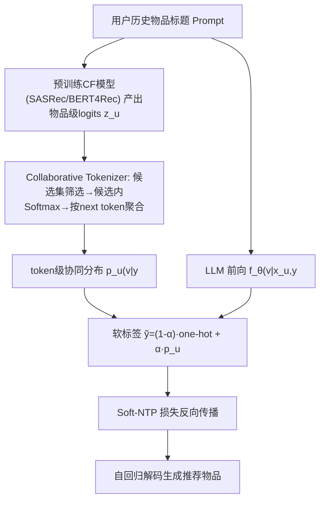
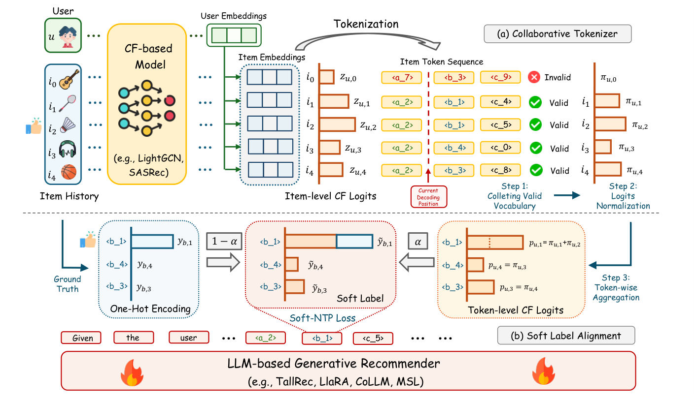

# Token-level Collaborative Alignment for LLM-based Generative Recommendation (面向LLM生成式推荐的Token级协同对齐)

- **会议/期刊**: WWW 2026
- **作者与机构**: Fake Lin, Binbin Hu, Zhi Zheng, Xi Zhu, Ziqi Liu, Zhiqiang Zhang, Jun Zhou, Tong Xu（USTC / Ant Group / Rutgers）
- **推荐链路定位**: 端到端生成式（LLM 微调 + 生成式检索）
- **研究方向**: 大语言模型推荐 / 生成式推荐
- **论文原文**: [https://arxiv.org/abs/2601.18457v1](https://arxiv.org/abs/2601.18457v1)
- **开源代码**: [https://github.com/critical88/TCA4Rec](https://github.com/critical88/TCA4Rec)

## TL;DR (1分钟核心速览)

LLM 推荐的核心痛点是：CF 模型在**物品级**排序目标上学习偏好，而 LLM 在**token 级**做 next-token prediction，二者优化粒度与监督形式天然错位，导致 CF 信号只能作为上下文提示或表征偏置被动影响前向传播，无法直接调控生成。本文提出 TCA4Rec，用 Collaborative Tokenizer 把任意 CF 模型的物品级 logits 归一化并聚合为 token 级分布，再与 one-hot 监督按权重 $\alpha$ 融合成软标签，优化 soft-NTP 损失。在 Toys/Sports/Office 三数据集、8:1:1 时序划分、Full-Ranking 协议下，MSL+TCA 在 Toys 上 N@5 从 0.0145 提升至 0.0332（+129%），且对 TallRec/LLaRA/CoLLM/TIGER/LETTER 均一致增益。

## Background & Motivation (背景与核心矛盾)

- **主流范式**: 一类工作把 CF 表征经 adapter 转为软提示注入 LLM（CoLLM、LLaRA），另一类用量化语义 ID（TIGER、LETTER）把物品压缩为离散 token 序列做自回归生成。
- **前人局限**: (1) 软提示路线存在行为空间与语义空间的结构错配，需多阶段/课程训练来缓解，训练可控性差、开销高；(2) 量化路线中码本主要反映物品**语义相似性**而非**协同结构**，用户特定的偏好模式在量化中被压制甚至丢失。
- **核心洞察 (Key Insight)**: 只要 CF 信号不进入训练目标，就只能通过前向传播被动影响学习，无法直接纠偏优化轨迹；而物品级排序目标与 token 级 NTP 之间缺少一个**目标级接口**。
- **本文切入点**: 不做表征注入，而是把 CF 的 item-level logits **投影到 token 空间**，直接改写 NTP 的监督标签，让 CF 成为优化信号本身。

## Method (核心方法设计)

### 1. 整体框架 (Overall Architecture)

输入为用户历史物品标题序列构成的 prompt，先由预训练 ID-based 序列模型（SASRec/BERT4Rec 等）产出用户/物品嵌入并计算物品级 CF logits；Collaborative Tokenizer 在自回归解码的每个位置 $j$上，先筛出与当前前缀一致的候选物品集，再在候选集内 softmax 归一化，最后按"共享同一 next token"聚合为 token 级分布$p_u(v|y_{<j})$；Soft Label Alignment 将该分布与 ground-truth one-hot 按$\alpha$ 加权融合为软标签，替换标准交叉熵中的指示函数，用 soft-NTP 损失微调 LLM；推理时按标准自回归解码生成物品标题。整个框架与具体 CF 模型、具体 LLM 推荐骨干均解耦。

<figure class="paper-figure" markdown="span">
  <figcaption>图1：我们方法的整体框架。(a) 协同分词器模块将CF模型的物品级logits转换为token级分布。(b) 软标签对齐模块将这些融合了CF信息的token概率与one-hot监督融合，以构建软标签。最后，LLM使用软下一token预测损失进行微调，该损失融入了协同信号。</figcaption>
</figure>

### 2. 关键设计拆解 (Key Designs)

1. **Collaborative Tokenizer（物品级 logits → token 级分布）**：痛点是 logits 未归一化、跨物品直接求和会严重扭曲偏好，且 LLM 逐 token 生成时并非所有物品都是合法候选。三步算子：候选集 $\mathcal{C}(y_{<j})=\{i\in\mathcal{I}\mid (w_{i,1},...,w_{i,j-1})=y_{<j}\}$；候选内归一化$\pi^{(j)}_{u,i}=\exp(z_{u,i})/\sum_{k\in\mathcal{C}}\exp(z_{u,k})$；按共享 token 聚合$p_u(v|y_{<j})=\sum_{i\in\mathcal{C}}\pi^{(j)}_{u,i}\mathbb{1}[w_{i,j}=v]$。直觉：先在"仍可能被生成"的物品子集内保持偏好的相对可比性，再把概率质量搬到 token 维度，使$\sum_v p_u(v|y_{<j})=1$，与 LLM 词表分布严格同构。

2. **Soft Label Alignment（软标签 + soft-NTP）**：痛点是硬 one-hot 无法承载 CF 偏好，而外挂 KL 辅助损失又会让 CF 与语义监督相互竞争。做法是借标签平滑思想构造 $\tilde{y}_j(v)=(1-\alpha)\mathbb{1}[v=y_j]+\alpha p_u(v|y_{<j})$，并优化
$$\mathcal{L}_{\text{soft-NTP}}=-\sum_{j=1}^{|t|}\log\sum_{v\in\mathcal{V}}\tilde{y}_j(v)\cdot P(v|x_u,y_{<j};\theta).$$
$\alpha=0$退化为标准 NTP，$\alpha=1$ 完全跟随协同分布，从而提供显式的"行为对齐 vs 语义流畅"调节旋钮。

3. **与辅助 KL 损失的梯度差异（理论增量）**：KL 方案的 logit 梯度为 $P_j(v)-\tilde{y}_j(v)$，权重是**固定**目标分布；soft-NTP 的梯度为$P_j(v)-q_j(v)$，其中$q_j(v)=\tilde{y}_j(v)P_j(v)/\sum_u\tilde{y}_j(u)P_j(u)$ 是**自适应**分布，同时依赖协同标签与模型当前预测。直觉：当模型已高置信预测某 token 时，soft-NTP 会自动降低该 token 的纠偏力度，避免 CF 噪声过度主导；训练无需额外负采样（全词表 softmax），推理仅多一次 CF 前向，开销可忽略。

## Experimental Setup & Evaluation Protocol (实验设置与评估协议)

- **数据集与预处理**: Amazon 三域，均做 `5-core` 过滤，并要求每条交互至少 10 条历史以保证上下文充分：

| 数据集 | #Users | #Items | #Interactions | 密度 | 场景说明 |
| :--- | :---: | :---: | :---: | :---: | :--- |
| Toys | 19,513 | 20,669 | 117,131 | 0.029% | 玩具评论/标题/品牌 |
| Sports | 29,109 | 27,008 | 161,564 | 0.025% | 运动户外商品 |
| Office | 12,603 | 9,913 | 70,869 | 0.056% | 办公用品 |

- **数据划分与防穿越 (Splitting Strategy)**: 按时间顺序 `8:1:1` 比例划分 train/valid/test，严格时序切分防泄漏；测试集含大量未见用户与物品，具**冷启动性质**（这也是非序列模型全面失效的原因）。
- **排名评测协议 (Ranking Protocol)**: 报告 N@5/N@10/H@5/H@10，属生成式设定下的全库候选评估（模型直接生成物品标题，无负采样候选集）。
- **对比基线与超参设置**: 传统序列模型 SASRec/BERT4Rec、图模型 LightGCN、语义增强 AlphaRec/RLMRec、LLM 推荐 TallRec/LLaRA/CoLLM/MSL，以及量化路线 TIGER/LETTER（sentence-T5 骨干，Llama3.1-3b 生成语义嵌入）；核心超参为融合权重 $\alpha$，在$\{0,0.001,0.005,0.01,0.05,0.1,0.5,1.0\}$ 上扫描。

## Key Experimental Results (实验关键数据)

### 1. 主实验对比 (Main Results)

| Model | Toys N@5 | Toys H@5 | Sports N@5 | Sports H@5 | Office N@5 | Office H@5 |
| :--- | :---: | :---: | :---: | :---: | :---: | :---: |
| SASRec | 0.0218 | 0.0316 | 0.0207 | 0.0305 | 0.0497 | 0.0708 |
| TallRec | 0.0099 | 0.0120 | 0.0085 | 0.0105 | 0.0380 | 0.0494 |
| LLaRA | 0.0161 | 0.0212 | 0.0186 | 0.0236 | 0.0383 | 0.0512 |
| CoLLM | 0.0160 | 0.0209 | 0.0084 | 0.0108 | 0.0398 | 0.0524 |
| MSL | 0.0145 | 0.0204 | 0.0259 | 0.0314 | 0.0509 | 0.0662 |
| MSL + TCA | **0.0332** | **0.0452** | **0.0309** | **0.0370** | **0.0544** | **0.0692** |
| Improv. (vs MSL) | +129.0% | +121.6% | +19.3% | +17.8% | +6.9% | +4.5% |
| TallRec + TCA | 0.0224 | 0.0292 | 0.0281 | 0.0324 | 0.0451 | 0.0552 |
| LLaRA + TCA | 0.0228 | 0.0302 | 0.0262 | 0.0304 | 0.0490 | 0.0614 |
| CoLLM + TCA | 0.0206 | 0.0260 | 0.0260 | 0.0292 | 0.0476 | 0.0604 |

量化路线（N@5/H@5）：TIGER 0.0031/0.0040 → +TCA 0.0045/0.0068（Toys）；LETTER 0.0052/0.0076 → +TCA 0.0068/0.0098（Toys），Office 上 LETTER+TCA 从 0.0170/0.0248 升至 0.0246/0.0310。

### 2. 消融实验 (Ablation Study)

| 变体 | Toys N@5 | Toys H@5 | Sports N@5 | Sports H@5 | Office N@5 | Office H@5 |
| :--- | :---: | :---: | :---: | :---: | :---: | :---: |
| MSL (backbone) | 0.0145 | 0.0204 | 0.0259 | 0.0314 | 0.0509 | 0.0662 |
| w/o CT（分布退化为均匀） | 0.0181 | 0.0238 | 0.0189 | 0.0221 | 0.0424 | 0.0557 |
| w/o SA（改用辅助 KL） | 0.0276 | 0.0381 | 0.0301 | 0.0351 | 0.0509 | 0.0653 |
| TCA (full) | **0.0332** | **0.0452** | **0.0309** | **0.0370** | **0.0544** | **0.0692** |

### 3. 关键实验发现 (Key Findings)

1. **CT 是命门，SA 是增益器**：去掉 CT 后 Sports 上 N@5 从 0.0309 跌至 0.0189（低于 backbone 的 0.0259），说明均匀 token 分布等于注入纯噪声；而 w/o SA 用 KL 替代仍优于 MSL（Toys 0.0276 vs 0.0145），但全面落后于 soft-NTP，实证了自适应梯度权重 $q_j$优于固定权重$\tilde{y}_j$ 的理论分析。
2. **CF 信号越强，收益越大，且 TCA 能"吸收"而 CoLLM 不能**：固定 LLM 训练集为 10K，仅放大 SASRec 训练数据（Small→Large），TCA 的 Toys N@5 单调升至 0.0332，而 CoLLM 反而从 0.0180 降至 0.0161；换用更强的 SASRec 替代 BERT4Rec 作 CF 源，Toys N@5 从 0.0222 升至 0.0332，验证了"信号质量—收益"的正相关与噪声敏感性。
3. **协同一致性 (CC) 与性能呈倒 U 型**：随 $\alpha$增大，LLM top-1 与 CF top-1 的一致率持续上升，但 NDCG@5 先升后降——CF 信号含噪，$\alpha$ 过大反而损害效果；同时 TallRec 仅微调即可把 Sports 的 CC 从 19.54% 提到 42.01%，说明微调本身已部分习得协同结构，TCA 是在此基础上的显式强化。

## Highlights & Limitations (亮点、对比与审稿批判)

- **与代表作对比 (vs. Prior Work)**: 与 CoLLM/LLaRA 的本质区别在于 CF 的作用位置——前者把 CF 塞进输入侧软提示（表征偏置），本文改写**损失函数**；与 TIGER/LETTER 的区别在于不依赖量化码本承载协同信息，而是保留原始 CF logits 的完整偏好序，避免量化信息损失；与朴素 KL 辅助损失的区别在于梯度权重自适应而非固定。
- **可迁移亮点**: (1) "物品级打分 → 前缀约束候选集 → token 级聚合"这套投影算子可直接复用到任何"结构化打分器 + 自回归生成器"的耦合场景（如生成式召回融合双塔分数）；(2) 软标签 + 单旋钮 $\alpha$ 的融合方式可作为蒸馏/多源监督的通用轻量方案。
- **审稿级局限批判**: (1) 增益高度依赖 CF 源质量，弱 CF 模型（BERT4Rec）在 Sports 上甚至使 H@5 从 0.0170 降至 0.0153，缺乏对噪声 CF 的自适应降权机制；(2) 仅在 Amazon 三域、单一 prompt 模板与标题级生成上验证，未报告工业级延迟与更大规模 LLM 的表现，量化路线整体绝对值偏低（TIGER 系 N@5 < 0.01）也削弱了该分支结论的说服力。

## Rating (四维评分)

- **方法创新性 (Novelty)**: ⭐⭐⭐⭐ （核心机制与方法设计具备明确创新性，理论与实验动机支撑充分）
- **评估协议与实验扎实度 (Protocol & Experiments)**: ⭐⭐⭐⭐ （主流公开数据集评测完整，包含多基线对比与消融实验验证）
- **写作与数学规范度 (Clarity & Rigor)**: ⭐⭐⭐⭐⭐ （问题形式化定义清晰，核心模块数学推导与架构阐述严谨易读）
- **工业落地与复现价值 (Industrial & Practical Value)**: ⭐⭐⭐⭐ （兼顾推荐效果增益与训练/推理效率，具备实际场景迁移参考价值）
