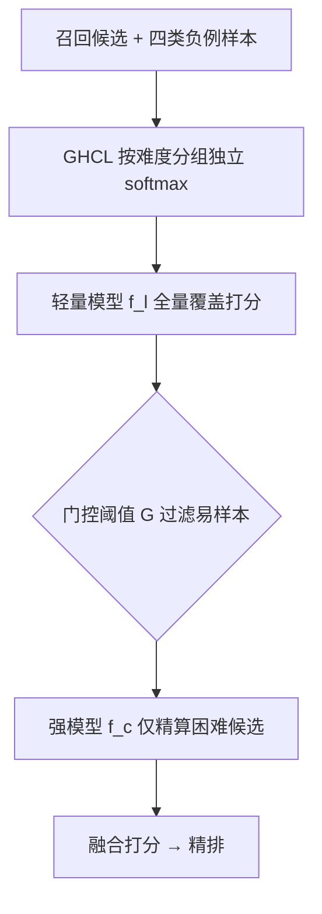
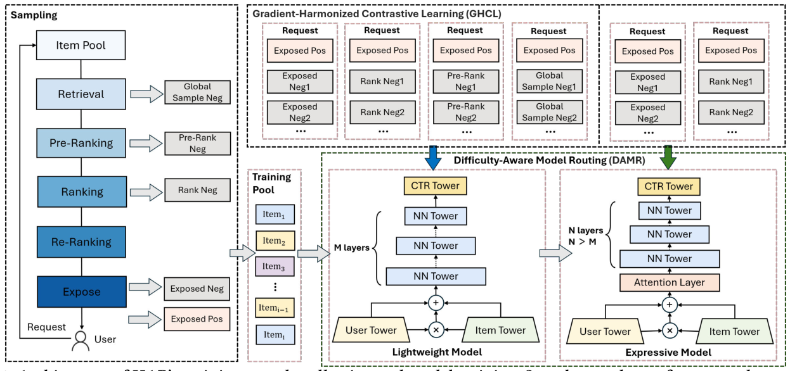

# Not All Candidates are Created Equal: A Heterogeneity-Aware Approach to Pre-ranking in Recommender Systems (并非所有候选生而平等：推荐系统粗排的异构感知方法)

- **会议/期刊**: WWW 2026
- **作者与机构**: Pengfei Tong, Siyuan Chen, Chenwei Zhang, Bo Wang, Qi Pi, Pixun Li, Zuotao Liu（字节跳动 / 今日头条）
- **推荐链路定位**: 粗排（Pre-ranking，召回与精排之间的级联过滤）
- **研究方向**: 多任务学习与列表级重排 / CTR 预估与特征交叉
- **论文原文**: [arXiv:2603.03770v1](https://arxiv.org/abs/2603.03770v1)
- **开源代码**: [Toutiao-Rec/HAP](https://github.com/Toutiao-Rec/HAP)（数据集 [ToutiaoRec](https://github.com/Toutiao-Rec/ToutiaoRec)）

## TL;DR (1分钟核心速览)

粗排训练样本混杂了召回随机负例、粗排/精排低排名负例与曝光未点击负例，难度差异极大。本文从 BCE 与 InfoNCE 的梯度公式出发，证明难负例的梯度范数呈指数级主导（EN 梯度范数 1.101 vs GN 0.060），造成梯度冲突与易样本欠利用；同时统一放大模型容量对易样本收益极低。为此提出 HAP：用 GHCL 将负例按难度分组、各自独立做 softmax 归一以压缩难易梯度比，再用 DAMR 让轻量模型覆盖全量候选、强模型只精算困难候选。在自建 ToutiaoRec 全链路数据集上，THard AUC 从 HCCP 的 0.7917 提升至 0.8023（+1.34%），线上 9 个月部署带来 +0.4% 使用时长、+0.05% 活跃天数，且 CPU 开销下降 6%。

## Background & Motivation (背景与核心矛盾)

- **主流范式**: 粗排位于召回与精排之间，需在毫秒级内把数千候选压到数百。为缓解样本选择偏差（SSB），近期工作（HCCP 等）不断把上游未曝光负例、下游低排名负例并入训练集，并同步放大模型容量以对齐精排。
- **前人局限一（数据侧）**: 无差别混合异构负例后，难负例（曝光未点击 EN、精排低排名 RN）logit 更高、梯度更大，且与易样本梯度余弦相似度仅 0.237–0.496，方向相互冲突，训练被难样本绑架、易样本几乎不贡献梯度。
- **前人局限二（算力侧）**: 盲目放大模型对所有候选一视同仁地增加算力，但图 3 显示轻量模型在易样本上与重型模型 AUC 几乎持平，仅在困难样本上急剧退化——算力被大量浪费在"一眼可判"的候选上。
- **核心洞察 (Key Insight)**: 候选的"难度"是天然的分层信号，优化冲突与算力错配本质同源，都应"按难度分流"处理，而非用一套损失、一套模型统一对待。
- **本文切入点**: 损失层面按难度分组解耦梯度（GHCL），架构层面按难度路由算力（DAMR），二者共享同一难度划分，形成统一框架。

## Method (核心方法设计)

### 1. 整体框架 (Overall Architecture)

HAP 以单次请求为单位组织 list-wise 样本，将负例划分为四类：全局随机负例 GN（最易）、粗排低排名负例 PRN（较易）、精排低排名负例 RN（较难）、曝光未点击负例 EN（最难）。训练阶段，轻量模型 $f_l$在全部四类负例上以 GHCL 分组损失学习，获得覆盖全难度谱的表征；强模型$f_c$仅在 EN+RN 困难负例上训练，专注细粒度判别。两模型共享一个全局 BCE 辅助损失以利用无点击请求。线上推理时构成两级级联：$f_l$先对召回全量候选打分并过滤易样本，仅将得分最高的前$G$个候选送入$f_c$ 精算，最终融合排序输出。

<figure class="paper-figure" markdown="span">
  <figcaption>图2：HAP的训练样本收集与模型训练架构。样本取自完整请求，包括曝光正样本和负样本，以及来自召回、粗排和精排阶段的负样本。HAP采用DAMR架构：轻量模型通过GHCL从所有样本类型中学习，对召回候选打分并过滤简单样本，而表达力强的模型则使用更深的基于注意力的网络仅在困难样本上训练。</figcaption>
</figure>

### 2. 关键设计拆解 (Key Designs)

1. **GHCL 梯度协调对比损失（解耦难易梯度耦合）**：原始 InfoNCE 中难负例梯度 $G^{\text{ORG}}_{hk}=e^{s^-_{hk}}/(e^{s_p}+\sum_j e^{s^-_j})$与易负例梯度之比为$R^{\text{ORG}}=e^{s^-_{hk}-s^-_{ek}}$，因难负例得分更高而指数级放大。GHCL 将负例拆为困难组$\mathcal{N}_{hard}=\{\text{EN},\text{RN}\}$与容易组$\mathcal{N}_{easy}=\{\text{PRN},\text{GN}\}$，各自独立归一：
$$\mathcal{L}_{\text{GHCL}}=\underbrace{\mathcal{L}_{\text{RN}}+\mathcal{L}_{\text{EN}}}_{\mathcal{L}_{hard}}+\underbrace{\mathcal{L}_{\text{GN}}+\mathcal{L}_{\text{PRN}}}_{\mathcal{L}_{easy}},\quad \mathcal{L}_{t}=-\log\frac{e^{s_p}}{e^{s_p}+\sum_{j\in\mathcal{N}_t}e^{s^-_j}}$$
此时梯度比变为 $R^{\text{GHCL}}=R^{\text{ORG}}\cdot C$，其中修正因子$C=\frac{e^{s_p}+\sum_{j\in\mathcal{N}_{easy}}e^{s^-_j}}{e^{s_p}+\sum_{j\in\mathcal{N}_{hard}}e^{s^-_j}}<1$，从而把难负例的梯度支配压回可控区间，同时保留全难度分布覆盖。

2. **DAMR 难度感知模型路由（算力按需分配）**：轻量模型损失为 $\mathcal{L}_{light}=\sum_{t}\lambda_t\mathcal{L}_t,\ t\in\{\text{EN},\text{RN},\text{PRN},\text{GN}\}$，强模型损失仅保留$\mathcal{L}_{complex}=\lambda_{\text{RN}}\mathcal{L}_{\text{RN}}+\lambda_{\text{EN}}\mathcal{L}_{\text{EN}}$。直觉是：易样本只需粗粒度特征即可判别，困难样本才需要注意力深层交互；强模型只在困难分布上训练，避免被易样本稀释，反而在 THard 上超过统一大模型。

3. **训练目标与推理效率**：总损失 $\mathcal{L}_{total}=\mathcal{L}_{light}+\mathcal{L}_{complex}+\alpha\cdot\mathcal{L}_{global}$，其中$\mathcal{L}_{global}$为 batch 级 BCE，用于回收无点击请求样本。负例为四类显式构造（非 in-batch 采样），无需额外难负例挖掘。推理时强模型只处理约 30% 候选（门控$G=550$），整体 FLOPs 与延迟反而低于单阶段大模型。

## Experimental Setup & Evaluation Protocol (实验设置与评估协议)

- **数据集与预处理**: 自建并开源 ToutiaoRec，采样今日头条 3 天 7000 万请求、共 3.13 亿请求，含 29 类匿名特征与全链路排名信息；负例构造为 GN（与曝光正例 1:2）、RN（精排 50 名后 10 个）、PRN（粗排 200 名后 10 个）。

| 数据集 | #Requests | #Items | 负例类型 | 划分方式 | 特征/场景说明 |
| :--- | :---: | :---: | :---: | :---: | :--- |
| ToutiaoRec | 3.13 亿 | 全曝光+采样负例 | GN/PRN/RN/EN | 时间戳 80%/20% | 资讯信息流，全阶段排名标注 |

- **数据划分与防穿越 (Splitting Strategy)**: 按请求时间戳全局切分，前 80% 训练、后 20% 评估，符合线上生产时序。
- **排名评测协议 (Ranking Protocol)**: 采用分难度测试集 AUC，包括单类型集 T_EN/T_RN/T_PRN/T_GN 与聚合集 T_Hard（EN+RN）、T_Easy（PRN+GN）；评估时模拟 DAMR 路由，困难负例由强模型打分、易负例由轻量模型打分，正例统一为点击项。
- **对比基线与超参设置**: 基线为 DSSM、COLD、COPR、HCCP，均配置约 6.2M 参数以保证公平；HAP 为 1.8M+6.2M，HAP_lite 为 1.8M+4.4M。TensorFlow 实现，序列长度 45、batch 1350，RMSPropV2、学习率 0.01，3000 CPU 核训练约 12 小时。

## Key Experimental Results (实验关键数据)

### 1. 主实验对比 (Main Results)

| Model | T_EN | T_RN | T_PRN | T_GN | T_Hard | T_Easy |
| :--- | :---: | :---: | :---: | :---: | :---: | :---: |
| DSSM | 0.6901 | 0.8247 | 0.9008 | 0.9785 | 0.7527 | 0.9257 |
| COLD | 0.6936 | 0.8303 | 0.9038 | 0.9803 | 0.7601 | 0.9261 |
| COPR | 0.7221 | 0.8533 | 0.9172 | 0.9871 | 0.7824 | 0.9402 |
| HCCP | 0.7244 | 0.8653 | 0.9218 | 0.9874 | 0.7917 | 0.9441 |
| **HAP** | **0.7377** | **0.8693** | **0.9236** | **0.9878** | **0.8023** | **0.9468** |
| HAP_lite | 0.7331 | 0.8666 | 0.9225 | 0.9872 | 0.7998 | 0.9452 |
| **Improv. (vs HCCP)** | +1.84% | +0.46% | +0.20% | +0.04% | **+1.34%** | +0.29% |

### 2. 消融实验 (Ablation Study)

| 配置 | T_EN | T_RN | T_PRN | T_GN | T_Hard | T_Easy |
| :--- | :---: | :---: | :---: | :---: | :---: | :---: |
| BCE_Mix（无差别混合） | 0.7232 | 0.8626 | 0.9173 | 0.9826 | 0.7875 | 0.9371 |
| InfoNCE_Mix（原始 InfoNCE） | 0.7234 | 0.8634 | 0.9233 | 0.9872 | 0.7882 | 0.9430 |
| **GHCL** | **0.7261** | **0.8662** | **0.9295** | **0.9898** | **0.7938** | **0.9488** |
| HAP w/o GHCL (1.8M) | — | — | — | — | 0.795（↓0.45%） | — |
| HAP w/o GHCL (6.2M) | — | — | — | — | 0.795（↓0.45%） | — |

线上 A/B（60 天日志，门控 $G=550$）：

| Model | T_Hard | CTR 增益 | FLOPs (10⁶) | 延迟 (ms) | 成本比 |
| :--- | :---: | :---: | :---: | :---: | :---: |
| Unified Large Model | 0.8158 | +0.55% | 70 | 225 | +15% |
| **HAP** | **0.8197** | **+3.22%** | 89 | 203 | **−6%** |

### 3. 关键实验发现 (Key Findings)

- **难度越高收益越大**：HAP 在 T_EN 上相对 HCCP 提升 +1.84%、T_Hard 提升 +1.34%，而 T_GN 仅 +0.04%，说明 GHCL 的收益精准落在梯度冲突最严重的困难样本区，与理论分析中"难负例梯度支配"的病灶完全对应。
- **分组归一优于无差别混合**：同为多负例训练，InfoNCE_Mix 在 T_Hard 为 0.7882，GHCL 提升至 0.7938；而单负例训练虽在对应测试集最优（如 BCE_EN 在 T_EN 达 0.7591），却在其他类型上出现明显跷跷板式崩塌，验证了"全难度覆盖 + 组内解耦"的必要性。
- **路由带来效果与成本双赢**：HAP 参数量（1.8M+6.2M）大于统一大模型（6.2M），但因强模型只处理约 30% 候选，FLOPs 与延迟反而更低，线上成本比 −6%，且 T_Hard 反超统一大模型（0.8197 vs 0.8158），证明"专精困难样本"本身即是一种正则化。

## Highlights & Limitations (亮点、对比与审稿批判)

- **与代表作对比 (vs. Prior Work)**: HCCP 通过跨阶段样本协调扩大覆盖，但把所有负例塞进同一 softmax，未处理梯度耦合；COPR 对齐粗排与精排输出，本质是提升模型表达而非优化动力学；COLD/FSCD 走特征选择与剪枝路线，对易样本收益有限。HAP 的差异在于把"难度"显式建模为可分组、可路由的一等公民。
- **可迁移亮点**: ① GHCL 的"分组独立 softmax + 修正因子"可直接移植到任何使用 InfoNCE 的多源负例召回/粗排任务；② DAMR 的"轻量全量 + 强模型困难子集"级联范式，对算力受限场景的模型扩容决策具有普适参考价值。
- **审稿级局限批判**: ① 难度划分依赖离线排名阈值（Rank 50 / Prerank 200）等人工超参，跨业务迁移时需重新标定，论文未给出自适应确定方法；② 离线评估在静态测试集上模拟路由，与线上动态负载存在偏差，且门控阈值 $G$ 的选取依赖在线 A/B 试错，缺乏理论最优性保证。

## Rating (四维评分)

- **方法创新性 (Novelty)**: ⭐⭐⭐⭐ （从 BCE/InfoNCE 梯度公式严格推导出难负例指数级支配，并给出修正因子 $C<1$ 的闭式证明，理论支撑扎实，但分组思想本身不算全新）
- **评估协议与实验扎实度 (Protocol & Experiments)**: ⭐⭐⭐⭐ （自建全链路工业数据集并开源，分难度测试集设计细致，离线+线上 9 个月 A/B 双重验证，唯缺多业务数据集泛化实验）
- **写作与数学规范度 (Clarity & Rigor)**: ⭐⭐⭐⭐ （梯度比推导链条清晰，公式与表格组织紧凑；部分符号如 $\lambda_t$ 取值未在正文给出，需查附录）
- **工业落地与复现价值 (Industrial & Practical Value)**: ⭐⭐⭐⭐⭐ （真实生产部署 9 个月、成本降 6% 且效果正向，代码与数据集双开源，是粗排方向少有的高复现价值工作）

