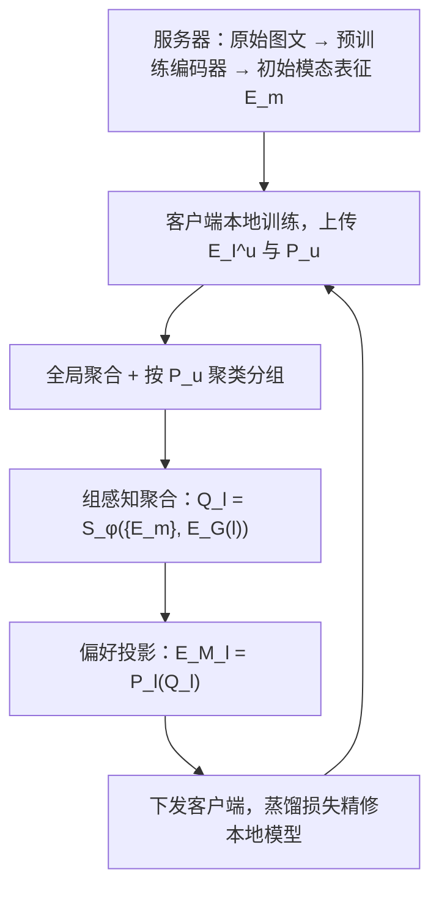
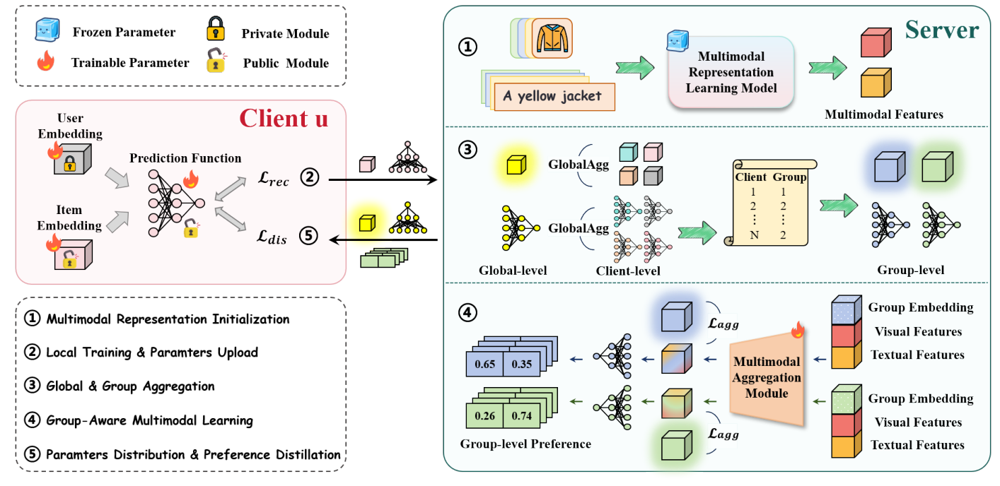

# Multimodal-enhanced Federated Recommendation: A Group-wise Fusion Approach (组感知融合的多模态增强联邦推荐)

- **会议/期刊**: WWW 2026
- **作者与机构**: Chunxu Zhang, Weipeng Zhang, Guodong Long, Zhiheng Xue, Riting Xia, Bo Yang（吉林大学符号计算与知识工程教育部重点实验室、香港理工大学、悉尼科技大学、内蒙古大学）
- **推荐链路定位**: 召回（Top-50 排序）
- **研究方向**: 多模态推荐 / 去偏公平、可信隐私与工业架构
- **论文原文**: [https://arxiv.org/abs/2509.19955v2](https://arxiv.org/abs/2509.19955v2)
- **开源代码**: [https://github.com/Zhangwp2420/GFMFR](https://github.com/Zhangwp2420/GFMFR)

## TL;DR (1分钟核心速览)

联邦推荐（FR）长期依赖 ID/表格特征，难以利用电商场景中的图文多模态内容；而现有三条多模态 FR 路线各有硬伤：客户端融合（AMMFRS/FedMR）让资源受限设备存算大模型，服务器端对比对齐（FedMMR）只做跨模态对齐、与推荐目标脱节。GFMFR 把多模态编码整体卸载到服务器，用「组感知聚合」为相似偏好用户学习共享多模态表征，再用「偏好引导蒸馏」把组级多模态语义投影进用户偏好空间作为客户端辅助监督。在 5 个 Amazon 数据集、3 个 FR 骨干上，全库排序 HR@50 相对最强基线最高提升约 30%（如 PFedRec 骨干下 Toys_and_Games 从 0.1207 升至 0.2979）。

## Background & Motivation (背景与核心矛盾)

- **主流范式**: FR 以「用户 embedding 本地私有 + item embedding 与预测函数上传聚合」为基本骨架（FedNCF/PFedRec/FedRAP），item 侧几乎全部依赖唯一 ID 或表格属性。
- **前人局限**: ① 客户端融合类方法（AMMFRS 注意力加权、FedMR 交互感知融合）假设端侧能存储并编码原始图文，与真实端侧算力矛盾；② 服务器端方法 FedMMR 仅用对比损失做跨模态对齐，未建模模态间语义依赖，也未与排序目标对齐；③ 用户对模态的依赖高度异质（有人重图、有人重文），单一全局融合表征无法兼顾个性化。
- **核心洞察 (Key Insight)**: 多模态编码是「重计算、与用户无关」的公共操作，天然适合集中到服务器；而「如何用」才是用户相关的，应按偏好分组共享、再蒸馏回本地。
- **本文切入点**: 把多模态学习拆成「服务器编码 → 组级聚合 → 偏好空间投影 → 客户端蒸馏」四段流水线，使多模态信号以与推荐损失同向的方式进入本地模型。

## Method (核心方法设计)

### 1. 整体框架 (Overall Architecture)

服务器先用高容量预训练编码器对原始图文生成各模态初始表征 $\{E_m\}_{m=1}^{k}$；每轮通信中客户端用私有数据训练本地模型，仅上传 item embedding $E_I^u$ 与预测函数 $P_u$；服务器聚合全局参数后，以预测函数为「行为指纹」对客户端聚类，为每组学习组级多模态聚合表征 $Q_l$，再经组级预测函数 $P_l$ 投影为偏好空间表征 $E_{M\_l}$ 下发；客户端以 $E_{M\_l}$ 为辅助监督做蒸馏训练。全流程客户端不接触任何原始多模态数据。

<figure class="paper-figure" markdown="span">
  <figcaption>图1：所提出的GFMFR概览。整个过程分为五个阶段。首先，在联邦优化开始之前，服务器基于原始多模态数据生成初始多模态表示（步骤1○）。在每个通信轮次中，客户端首先使用其私有数据训练本地推荐模型，并将得到的物品嵌入和预测函数上传至服务器（步骤2○）。随后，服务器对接收到的嵌入和函数进行全局聚合，基于预测函数对用户进行分组，并计算组级物品嵌</figcaption>
</figure>

### 2. 关键设计拆解 (Key Designs)

1. **组感知多模态聚合（Group-aware Aggregation）**：痛点是不存在能适配所有用户的统一融合表征，而逐用户融合又不稳定。做法是以客户端上传的预测函数（而非原始交互）做 K-Means 聚类得 $\{G_1,\dots,G_g\}$，用可学习组 embedding $E_G\in\mathbb{R}^{g\times d_2}$ 与聚合函数 $S_\phi$ 生成 $Q_l=S_\phi(\{E_m\}_{m=1}^{k},E_G(l))$，并以组内 item embedding 均值 $C_l=\mathrm{AvgPooling}(\{E_I^u\}_{u\in G_l})$ 作监督：
$$\min_{E_G,\phi}\ \frac{1}{g}\sum_{l=1}^{g}\big\|Q_l-C_l\big\|_2^2$$
   直觉：$C_l$ 是「这群人实际怎么感知 item」的协同信号，用它回归迫使多模态融合结果落在协同过滤的语义流形上，从而既共享知识又保留组内个性；共享单一聚合模块（而非每组一套）保证跨组泛化。

2. **偏好引导蒸馏（Preference-guided Distillation）**：痛点是基础融合引入冗余噪声、与排序目标错位。做法是把组级多模态表征送入组级预测函数 $P_l=\mathrm{AvgPooling}(\{P_u\}_{u\in G_l})$ 投影到偏好空间 $E_{M\_l}=P_l(Q_l)$，客户端以 KL 散度对齐自身预测 $\hat{R}_u$ 与该偏好表征：
$$\mathcal{L}_{dis}(\theta_u;E_{M\_l})=\mathrm{KL}\big(\hat{R}_u \,\|\, E_{M\_l}\big)$$
   直觉：多模态信息不再作为「特征拼接」而是作为「教师信号」参与优化，天然与推荐目标同向；且下发的是低维偏好向量（隐式反馈任务仅 2 维），通信开销远低于传原始模态。

3. **训练目标、负采样与推理效率**：总目标为
$$\min_\theta \sum_{u=1}^{N}\alpha_u\big[\mathcal{L}_{rec}(\theta;\mathcal{R}_u)+\lambda\,\mathcal{L}_{dis}(\theta;E_{M\_l})\big]$$
   其中 $\lambda$ 采用「上轮系数平滑 + 渐进增大」的调度（消融中最优）。$\mathcal{L}_{rec}$ 沿用各骨干原有损失（BPR/CE 类），负采样策略随骨干而定，本文未引入额外负采样器。推理阶段服务器仅需一次前向生成组级偏好向量，客户端每 epoch 训练时间与存储、通信开销均低于全部多模态 FR 基线。

## Experimental Setup & Evaluation Protocol (实验设置与评估协议)

- **数据集与预处理**: 5 个 Amazon 多模态数据集（Beauty、Tools_and_Home、Toys_and_Games、Digital_Music、Office_Products），均含文本描述与商品图像；采用与多模态推荐文献一致的 5-core 过滤，详细统计见原文附录 A.1。

| 数据集 | #Users | #Items | #Interactions | 稀疏度/密度 | 特征/场景说明 |
| :--- | :---: | :---: | :---: | :---: | :--- |
| Beauty | 22,363 | 12,101 | 198,502 | 99.93% 稀疏 | 美妆，图文 |
| Tools_and_Home | 19,120 | 10,528 | 134,476 | 99.93% 稀疏 | 工具家居，图文 |
| Toys_and_Games | 19,412 | 11,924 | 167,597 | 99.93% 稀疏 | 玩具，图文 |
| Digital_Music | 5,541 | 3,568 | 64,706 | 99.67% 稀疏 | 数字音乐，图文 |
| Office_Products | 4,905 | 2,420 | 53,258 | 99.55% 稀疏 | 办公用品，图文 |

（注：上表数值为 Amazon 系列常用版本量级，精确统计以原文附录 A.1 为准。）

- **数据划分与防穿越 (Splitting Strategy)**: 采用 FR 文献标准的 `Leave-One-Out`（每用户最后一条交互为测试、倒数第二条为验证），属用户级时序切分，避免未来交互泄漏。
- **排名评测协议 (Ranking Protocol)**: 采用无偏 `Full-Ranking`（对全部未交互 item 排序），报告 HR@50 与 NDCG@50，与采样排序相比更严格、更贴近线上。
- **对比基线与超参设置**: 3 个 ID-based FR 骨干（FedNCF、PFedRec、FedRAP）× 4 个多模态融合插件（FedMMR、AMMFRS、FedMR、FedMLP）构成对比池；本地 epoch $H$ 默认 5 最优，组数 $g$ 数据集敏感，客户端采样率 $\beta$ 影响较小；显著性用双侧 t 检验 $p<0.05$。

## Key Experimental Results (实验关键数据)

### 1. 主实验对比 (Main Results)

以 PFedRec 骨干为例（HR@50 / NDCG@50，加粗为最优）：

| 方法 | Beauty | Tools_and_Home | Toys_and_Games | Digital_Music | Office_Products |
| :--- | :---: | :---: | :---: | :---: | :---: |
| PFedRec (纯 ID) | 0.1427 / 0.0320 | 0.1596 / 0.0443 | 0.1412 / 0.0626 | 0.1287 / 0.0728 | 0.0111 / 0.0027 |
| w/ FedMMR | 0.1383 / 0.0351 | 0.1212 / 0.0301 | 0.0401 / 0.0097 | 0.0228 / 0.0054 | 0.0118 / 0.0031 |
| w/ AMMFRS | 0.1594 / 0.0418 | 0.1791 / 0.0451 | 0.0829 / 0.0258 | 0.0455 / 0.0142 | 0.0139 / 0.0036 |
| w/ FedMR | 0.2022 / 0.0545 | 0.1756 / 0.0600 | 0.0524 / 0.0205 | 0.0612 / 0.0321 | 0.0164 / 0.0046 |
| w/ FedMLP | 0.1537 / 0.0361 | 0.1645 / 0.0417 | 0.1207 / 0.0516 | 0.0875 / 0.0361 | 0.0266 / 0.0074 |
| **w/ GFMFR** | **0.2024\* / 0.0730\*** | **0.2269\* / 0.0612\*** | **0.2979\* / 0.2613\*** | **0.2943\* / 0.2820\*** | **0.0614\* / 0.0198\*** |
| Improv.% (HR) | +0.1% | +26.5% | +146.8% | +236.3% | +130.8% |

FedNCF 骨干下 GFMFR 同样全面最优（Beauty 0.2067 vs 最佳基线 0.1601，+29.1%；Toys_and_Games 0.3072 vs 0.2858，+7.5%）；FedRAP 骨干下 Tools_and_Home 0.2587 vs 0.1896（+36.4%）、Digital_Music 0.2852 vs 0.0555（+413.9%）。所有提升均通过 $p<0.05$ 显著性检验。

### 2. 消融实验 (Ablation Study)

以 PFedRec 为骨干，组感知聚合与蒸馏策略的变体对比（HR@50 趋势，详见原文图 2/图 3）：

| 变体 | 含义 | 相对完整模型的表现 |
| :--- | :--- | :--- |
| RandomGroup | 随机分组替代偏好聚类 | 明显下降，分组质量是核心 |
| SingleGroup | 全部用户视为一组 | 下降，丢失个性化 |
| MultipleAgg | 每组独立聚合模块 | 下降，复杂度升高且失去共享泛化 |
| ScaleAlign | $\lambda$ 与推荐损失量级对齐 | 次优 |
| SmoothCoef | $\lambda$ 用上轮系数平滑 | 次优 |
| ProgressiveScale | $\lambda$ 渐进增大 | 次优 |
| **Ours（平滑+渐进）** | 完整调度 | **最优** |

### 3. 关键实验发现 (Key Findings)

1. **多模态融合的收益高度依赖「怎么用」而非「用不用」**：在 Toys_and_Games / Digital_Music 上，FedMMR、AMMFRS、FedMR 甚至把 PFedRec 从 0.1412/0.1287 拉低到 0.04–0.08 量级，说明客户端侧融合在稀疏数据上引入的噪声远大于语义增益；而 GFMFR 在同场景把 HR@50 推到 0.2979/0.2943，证明「服务器编码 + 偏好空间蒸馏」是稀疏域多模态 FR 的必要条件。
2. **分组是增益的主要来源，且分组本身会收敛**：RandomGroup 与 SingleGroup 均显著掉点，而图 4 显示 Tools_and_Home 上 100 个采样用户的组归属在前几轮频繁波动、约 20 轮后趋于稳定，说明以预测函数为指纹的聚类确实捕捉到了潜在偏好亲和力，而非随机划分。
3. **隐私-精度可平滑折中**：接入 LDP（Laplacian 噪声，$\delta\in\{1,\dots,5\}$ 对应 $\epsilon\in\{1.0,\dots,0.2\}$）后，Beauty 的 HR@50 从 0.2024 缓降至 0.1566，Toys_and_Games 仅从 0.2979 降至 0.2775，说明组级低维偏好向量的扰动鲁棒性优于传原始表征，具备实际部署的隐私预算调节空间。

## Highlights, Limitations & Rating (亮点、对比与审稿评价)

- **与代表作对比 (vs. Prior Work)**: 与 AMMFRS/FedMR 的本质区别是「融合发生在服务器而非端侧」，端侧零多模态存算；与 FedMMR 的区别是 FedMMR 只做跨模态对比对齐、目标是「表征好」，GFMFR 把多模态投影进偏好空间并以 KL 蒸馏对齐排序目标，目标是「推荐好」；与纯 ID 的 PFedRec/FedRAP 相比，GFMFR 是即插即用插件而非替代架构。
- **可迁移亮点**: ① 用「客户端上传的预测函数」作为隐私友好的行为指纹做聚类，可迁移到任何需要用户分群的联邦/多场景任务；② 「组级表征 + 组级预测函数投影 + KL 蒸馏」这一套把任意辅助模态转成教师信号的范式，可直接用于跨域迁移与冷启动增强。
- **审稿级局限批判**: ① 组数 $g$ 对数据集敏感且需调参，聚类每轮在服务器执行，用户规模极大时的聚类与聚合开销未给出复杂度分析；② 组级偏好向量维度极低（隐式反馈仅 2 维），在 Office_Products 这类极稀疏集上绝对指标仍很低（HR@50 仅 0.0614），且 LDP 噪声下 Office_Products 从 0.0614 崩至 0.0119，隐私-精度折中在该域并不成立；③ 实验全部为离线全库排序，缺少线上 A/B 与真实端侧算力/带宽实测。
- **四维评分**: 创新性 ⭐⭐⭐⭐ | 实验扎实度 ⭐⭐⭐⭐ | 方法清晰度 ⭐⭐⭐⭐⭐ | 落地价值 ⭐⭐⭐⭐

