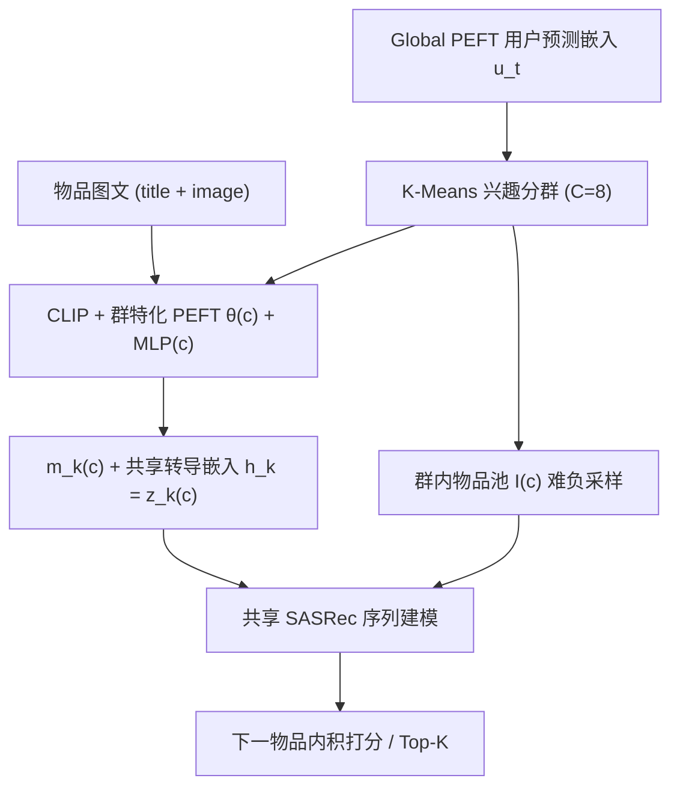
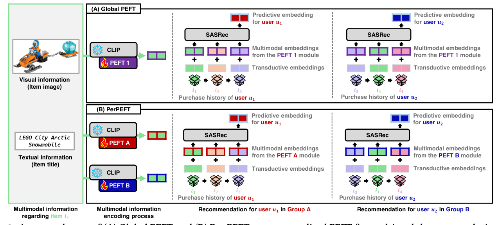

# Personalized Parameter-Efficient Fine-Tuning of Foundation Models for Multimodal Recommendation (面向多模态推荐的基础模型个性化参数高效微调)

- **会议/期刊**: WWW 2026 (The Web Conference)
- **作者与机构**: Sunwoo Kim, Hyunjin Hwang, Kijung Shin (KAIST)
- **推荐链路定位**: 召回（序列化物品编码 + 下一物品预测）
- **研究方向**: 多模态推荐 / 序列推荐
- **论文原文**: [https://arxiv.org/abs/2602.09445v1](https://arxiv.org/abs/2602.09445v1)
- **开源代码**: [https://github.com/kswoo97/PerPEFT](https://github.com/kswoo97/PerPEFT)

## TL;DR (1分钟核心速览)

现有多模态推荐用 CLIP + PEFT 编码物品，但**物品表征是"用户盲"的**——同一物品对所有用户只产生一个嵌入，而不同兴趣用户实际关注物品的不同侧面（高尔夫包对高尔夫迷是"Golf"，对露营者则是"Travel/Bag"）。本文提出 PerPEFT：先用 Global PEFT 的用户预测嵌入做 K-Means 兴趣分群，为每群挂载独立 PEFT 模块与投影 MLP，使同一物品按群编码出不同多模态嵌入；再引入**群内难负采样**强化群特化。在 4 个 Amazon 域、Leave-One-Out + Full-Ranking 协议下，NDCG@20 最高相对最强基线提升 15.3%，且可插拔 LoRA/(IA)³/IISAN，参数量仅 CLIP 的 1.3%。

## Background & Motivation (背景与核心矛盾)

- **主流范式**: 用 CLIP 等预训练多模态基础模型编码物品图文，再以 PEFT（LoRA/(IA)³/IISAN）低成本适配到推荐任务，接 SASRec 做序列下一物品预测。
- **前人局限**: ① 无论是否 PEFT，物品嵌入都是**全局共享、与用户无关**的，无法表达"不同用户看物品的不同方面"；② 现有用户级/群组级个性化只加可学习 user/group embedding，属于"打分侧偏置"，并未改变基础模型对物品的**注意力分配**。
- **核心洞察 (Key Insight)**: 用户兴趣差异本质上是**物品侧面 (item aspect) 的注意力差异**。若把 PEFT 模块按兴趣群拆分，各模块只在自己群的样本上训练，梯度会自然把 CLIP 的注意力推向该群关心的 token/区域（图 1、图 6 的注意力可视化与 JSD 定量分析均证实：跨群注意力 JSD 显著大于同群不同随机种子间的 JSD）。
- **本文切入点**: 把"个性化"从嵌入层下沉到 **PEFT 模块层**——群特化 PEFT 即"群特化的物品编码器"。

## Method (核心方法设计)

### 1. 整体框架 (Overall Architecture)

两阶段流水线：**阶段一**训练 Global PEFT（单 PEFT 模块 + 投影 MLP + 可学习转导嵌入 $\mathbf{h}_k$ + SASRec），取每个用户的末位预测嵌入 $\mathbf{u}_t$ 作为兴趣表征，K-Means 聚成 $C=8$ 个不相交用户群；**阶段二**为每群复制一份 PEFT 模块 $\theta^{(c)}$ 与投影 MLP$^{(c)}$（用 Global PEFT 参数初始化），转导嵌入与 SASRec 保持全局共享，各群仅用本群用户样本、本群物品池负采样训练 20 epoch。推理时按用户所属群取对应物品嵌入集，喂入 SASRec 打分。

<figure class="paper-figure" markdown="span">
  <figcaption>图 2：(A) Global PEFT 与 (B) PerPEFT（我们用于多模态推荐的个性化 PEFT）的示例。每个物品的多模态信息由附带 PEFT 模块的多模态基础模型 CLIP 编码。与对用户 𝑢1 和 𝑢2 使用同一 PEFT 模块的 Global PEFT 不同，PerPEFT 根据推断出的兴趣群体使用不同的 PEFT 模块。随后，我们通过将多模态嵌入与转导嵌入相加来构成每个物品嵌入。为生成对用户的推荐，我们按与用户相同的顺序构建物品嵌入序列。</figcaption>
</figure>

### 2. 关键设计拆解 (Key Designs)

1. **群特化 PEFT 编码（Per-Group Item Encoder）**：痛点是 Global PEFT 下 $f_\theta$ 对所有用户输出同一 $\mathbf{m}_k$。本文改为对 $u_t\in\mathcal{U}^{(c)}$ 使用 $\theta^{(c)}$、MLP$^{(c)}$：
$$\mathbf{m}_k^{(c)}=\mathrm{MLP}^{(c)}\big([\mathbf{x}_k^{(c)}\,\|\,\mathbf{y}_k^{(c)}]\big),\quad \mathbf{z}_k^{(c)}=\mathbf{h}_k+\mathbf{m}_k^{(c)}$$
直觉：不同群的正样本分布不同，独立模块被迫学习"本群购买决策最相关的物品侧面"，等价于给 CLIP 加了群条件的注意力先验。仅 PEFT 与投影 MLP 分群，转导嵌入与 SASRec 共享——消融显示全拆分反而参数爆炸且无收益。

2. **群内难负采样（Group-Specific Negative Sampling）**：痛点是若沿用全局物品集 $\mathcal{I}$ 采负样本，大量负样本从不出现在本群正样本中，模型可"轻松降 loss"而不学群特化侧面（消融中该变体甚至不如 Global PEFT）。改为从本群物品池 $\mathcal{I}^{(c)}$（本群用户至少购买过一次的物品）采样：
$$\mathcal{L}_t^{(pers)}=\sum_{p=1}^{n-1}\Big[\log\sigma\big((\mathbf{z}_{a_p}^{(c)})^\top \mathbf{z}_{t,p}^{(c)\prime}\big)-\log\sigma\big((\mathbf{z}_{t,(p+1)}^{(c)})^\top \mathbf{z}_{t,p}^{(c)\prime}\big)\Big],\ \ i_{a_p}\subset\mathcal{I}^{(c)}$$
直觉：负样本与正样本同处一个语义子空间，梯度必须依赖细粒度侧面（如"露营食品" vs "露营装备"）才能区分，从而逼出群内细粒度兴趣。

3. **训练目标、批构造与推理开销**：总损失即上式 BCE（含负采样），无额外正则；mini-batch **按群内用户组批**，使一批内物品只需用该群模块编码一次，训练时间与 Global PEFT 接近（图 4）。参数量：PEFT 模块 ≈368K + 投影 ≈540K + 转导嵌入 470K–1M + SASRec ≈13K，合计约为 CLIP (151M) 的 **1.3%**；显存仅多 0.8 GB。推理侧物品嵌入按群离线预计算（成本 ×C，一次性），已见用户推理时延与 Global PEFT 相同，未见用户需先分群，约 2×。

## Experimental Setup & Evaluation Protocol (实验设置与评估协议)

- **数据集与预处理**: Amazon Reviews 2023 四个域，先按比例下采样用户（>1M 域取 20%，否则 40%），再做 **5-core** 过滤（用户与物品均 ≥5 次购买），序列截断至最近 10 个物品：

| 数据集 | #Users | #Items | Avg. Seq. Len. | 密度 | 场景说明 |
| :--- | :---: | :---: | :---: | :---: | :--- |
| Sports & Outdoors | 25,363 | 15,701 | 7.60 | 0.0005 | 运动/露营/高尔夫装备 |
| Toys & Games | 19,026 | 14,718 | 8.53 | 0.0006 | 乐高/桌游/主机游戏 |
| Beauty & Personal Care | 45,490 | 31,151 | 9.54 | 0.0003 | 美妆个护 |
| Arts, Crafts & Sewing | 24,511 | 18,884 | 9.43 | 0.0005 | 手工/缝纫/绘画 |

- **数据划分与防穿越**: `Leave-One-Out`——每用户最近一次购买为测试、次近为验证，其余为训练序列；超参在验证集上选，测试时输入 = 训练序列 + 验证物品。
- **排名评测协议**: **Full-Ranking（全库未交互物品排序）**，指标 Hit-Ratio@{20,30} 与 NDCG@{20,30}，三次随机初始化取均值与标准差。
- **对比基线与超参**: 7 个基线分 5 类——w/o MM (纯 SASRec)、Frozen MM（CLIP 冻结）、Global PEFT、User-level 1/2（用户嵌入作序列元素 / 用户-物品拼接）、Group-level 1/2（群嵌入两种用法）；PEFT 骨干为 LoRA（rank=4）、(IA)³、IISAN（adapter 隐维 32）；嵌入维 $d=32$、dropout 0.3、2 层 4 头 SASRec、batch=16、AdamW，学习率 $\{10^{-4},5\times10^{-5},10^{-5}\}$；群数固定 $C=8$。

## Key Experimental Results (实验关键数据)

### 1. 主实验对比 (Main Results)

以最强 PEFT 骨干 (IA)³ 为例（×100，H@20 / N@20）：

| 方法 | Sports H@20 | Sports N@20 | Toys H@20 | Toys N@20 | Beauty H@20 | Beauty N@20 | Arts H@20 | Arts N@20 |
| :--- | :---: | :---: | :---: | :---: | :---: | :---: | :---: | :---: |
| w/o MM | 2.79 | 1.08 | 2.27 | 0.91 | 2.60 | 1.12 | 3.91 | 1.48 |
| Frozen MM | 4.11 | 1.71 | 3.24 | 1.31 | 3.60 | 1.45 | 4.87 | 1.89 |
| Global PEFT | 4.55 | 1.90 | 4.58 | 1.89 | 4.25 | 1.73 | 6.24 | 2.59 |
| User-level 1 | 4.45 | 1.89 | 4.41 | 1.82 | 4.25 | 1.76 | 6.09 | 2.49 |
| User-level 2 | 4.39 | 1.81 | 3.95 | 1.69 | 3.64 | 1.62 | 5.68 | 2.32 |
| Group-level 2 | 4.58 | 1.93 | 4.36 | 1.87 | 4.14 | 1.71 | 6.17 | 2.52 |
| **PerPEFT** | **4.82** | **2.01** | **4.81** | **2.01** | **4.33** | **1.78** | **6.56** | **2.67** |
| Improv.% (vs 最强基线) | +5.2% | +4.1% | +5.0% | +6.3% | +1.9% | +1.1% | +5.1% | +3.1% |

LoRA 骨干下 Arts 域 N@20 由 2.45 升至 **2.76（+12.7%）**，H@20 由 6.05 升至 6.62；论文报告的最强增益为 Arts 域 NDCG@20 **+15.3%**（对应 IISAN/其他设置）。整体 48 个设置中 **44 个最优**。附录另证：优于非序列多模态模型 LATTICE/BM³，且换 LightGCN 骨干仍稳定增益（Arts N@20 1.97→2.22）。

### 2. 消融实验 (Ablation Study)

LoRA 骨干，H@20 / N@20：

| 变体 | Sports | Toys | Beauty | Arts |
| :--- | :---: | :---: | :---: | :---: |
| w/o textual modality | 3.87 / 1.62 | 3.85 / 1.58 | 4.00 / 1.61 | 4.95 / 2.01 |
| w/o visual modality | 4.80 / 1.99 | 4.48 / 1.81 | 4.19 / 1.68 | 6.68 / 2.74 |
| w/o group-specific negatives | 4.31 / 1.84 | 4.30 / 1.77 | 3.91 / 1.61 | 6.19 / 2.50 |
| Large Global PEFT（等参数量） | 4.51 / 1.86 | 4.00 / 1.67 | 4.01 / 1.65 | 5.94 / 2.41 |
| Random grouping | 4.09 / 1.71 | 3.65 / 1.48 | 3.82 / 1.50 | 5.43 / 2.17 |
| **PerPEFT** | **4.82 / 2.05** | **4.79 / 1.97** | **4.27 / 1.74** | **6.62 / 2.76** |

### 3. 关键实验发现 (Key Findings)

1. **"分群"本身比"加参数"重要得多**：等参数量的 Large Global PEFT 在 Toys 上 N@20 仅 1.67，远低于 PerPEFT 的 1.97；而随机分群更差（1.48），说明收益来自**兴趣对齐的分群**而非模块数量或容量。
2. **群内难负采样是不可省的增益源**：去掉后 Sports N@20 从 2.05 掉到 1.84（−10.2%），Beauty 从 1.74 掉到 1.61；作者指出沿用全局负采样时 PerPEFT 甚至打不过 Global PEFT，印证"正负样本空间错配"假设。
3. **文本模态是主承载、视觉是补充**：去掉文本使 Sports N@20 崩至 1.62（−21%），去掉视觉仅降至 1.99；但 Arts 域去视觉反而略升（2.74 vs 2.76 基本持平），说明图像信息在部分品类冗余，双模态并非处处等权。

## Highlights, Limitations & Rating (亮点、对比与审稿评价)

- **与代表作对比 (vs. Prior Work)**: 与 **IISAN**（PEFT 用于多模态推荐，但全局共享一个 adapter）相比，本文把 adapter 变成"群条件编码器"，是正交增强（IISAN 上仍 +5% 左右）；与 **User-level / Group-level 个性化**（只在打分侧加 embedding）相比，本文改变的是基础模型对物品的注意力分配，故在所有设置上均胜出；与 **LATTICE/BM³** 等非序列多模态模型相比，序列建模 + 群特化编码双重占优。
- **可迁移亮点**: ① "先用全局模型产出用户表征 → 聚类 → 每群复制轻量适配器"的两阶段范式，可低成本移植到任何"基础模型 + PEFT"的推荐场景（如 LLM4Rec 的 LoRA 分群）；② 群内负采样这一"负样本池与正样本池对齐"的技巧，对任何多兴趣/多域联合训练都适用。
- **审稿级局限批判**: ① **硬分群**假设用户只属一个兴趣群，多兴趣用户（如既玩高尔夫又露营）无法表达，且未见用户需额外分群步骤使推理约 2×；② 依赖图文双模态完整，缺失模态场景未处理；③ 群数 $C=8$ 为逐数据集调优所得（4/16 均更差），跨域迁移时需重新搜索，且缺乏理论刻画 PEFT 如何改变 CLIP 表征。
- **四维评分**: 创新性 ⭐⭐⭐⭐ | 实验扎实度 ⭐⭐⭐⭐ | 方法清晰度 ⭐⭐⭐⭐⭐ | 落地价值 ⭐⭐⭐⭐

