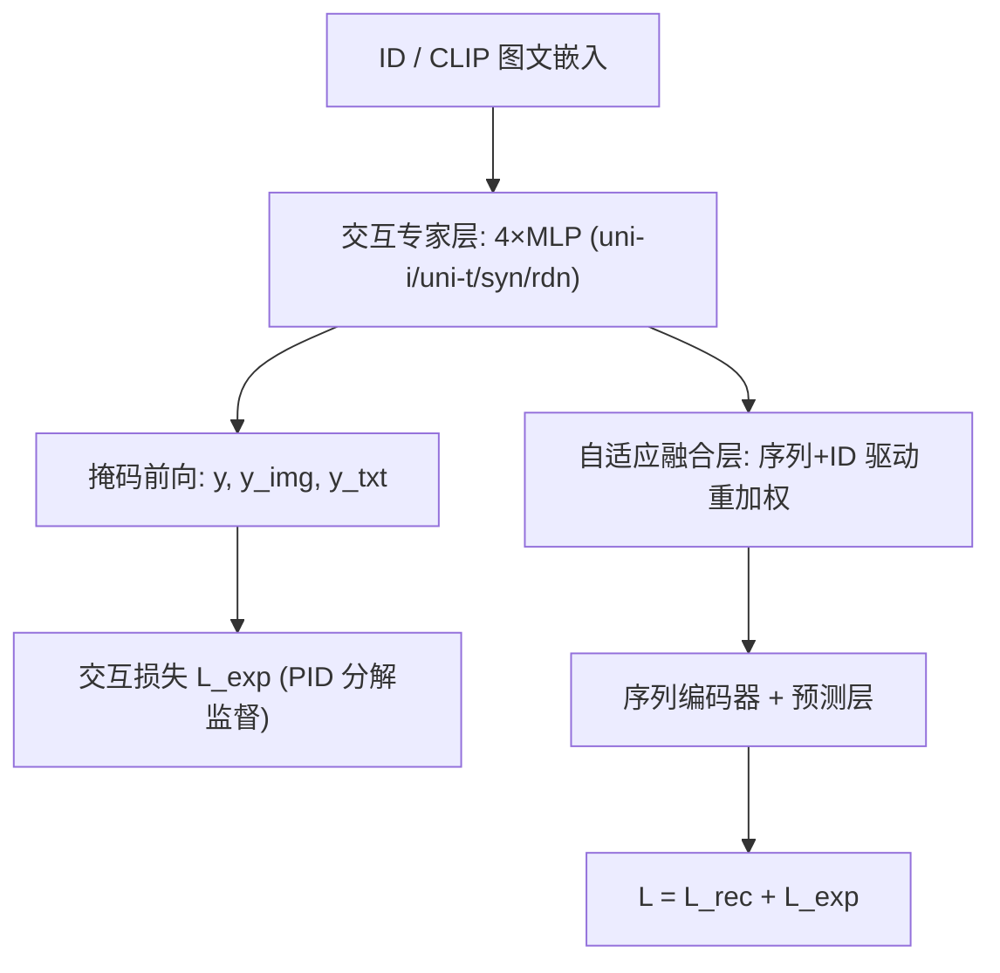
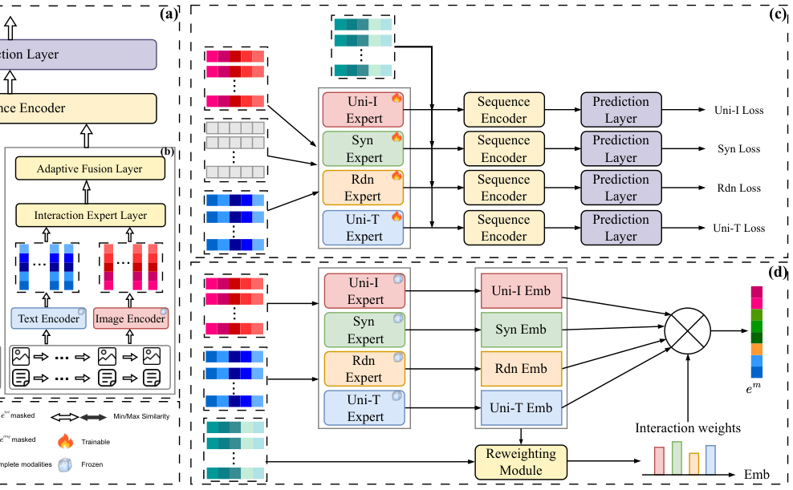

# PRISM: Personalized Recommendation via Information Synergy Module (基于信息协同模块的个性化推荐)

- **会议/期刊**: WWW 2026 (Full Paper)
- **作者与机构**: Xinyi Zhang (Imperial College London)、Yutong Li (UCL)、Peijie Sun / Letian Sha (南京邮电大学)、Zhongxuan Han (浙江大学)
- **推荐链路定位**: 召回（序列下一物品预测）
- **研究方向**: 多模态推荐 / 序列推荐
- **论文原文**: [https://arxiv.org/abs/2601.10944v1](https://arxiv.org/abs/2601.10944v1)
- **开源代码**: [https://github.com/YutongLi2024/PRISM](https://github.com/YutongLi2024/PRISM)

## TL;DR (1分钟核心速览)

现有多模态序列推荐要么把模态做全对齐（稀释模态独有信息），要么只做"模态独有 vs 模态共享"的二分分解，**系统性忽略了只有两模态同时在场才涌现的协同信息（synergy）**，且融合权重对所有用户固定。PRISM 用 4 个 MoE 专家 + 定制三元组/余弦交互损失实现唯一-冗余-协同的细粒度分解，再用用户序列驱动的 MLP 重加权模块做个性化融合。作为即插即用模块接入 SASRec/STOSA/InDiRec，在 4 个数据集 Leave-One-Out 全库排序下，PRISM+InDiRec 于 Yelp 上 N@10 相对最强基线 REARM 提升 **10.91%**。

## Background & Motivation (背景与核心矛盾)

- **主流范式**: MSR 的融合路线分两支——对比学习做跨模态对齐（UniSRec、MMSBR），或专用编码器/正交约束把特征拆成"模态独有 + 模态共享"（PAMD、DGMRec、REARM）；自适应融合则用 attention/gating 在**模态粒度**上调整权重（TedRec、HM4SR）。
- **前人局限 1**: 刚性二分范式把协同信息要么忽略、要么误判为噪声。以红酒为例：瓶型/酒标（图独有）、产区/葡萄配比（文独有）、颜色/品类（冗余）都可单模态获得，但"礼品性/收藏性"必须图文协同才能推断——REARM 的 t-SNE 只有 3 个簇，无协同簇。
- **前人局限 2**: 融合权重在全体用户上固定，或仅在整模态粒度加权，无法刻画"某用户重外观、某用户重产区、某用户重收藏价值"的意图差异，且粗粒度权重不可解释。
- **核心洞察 (Key Insight)**: 多模态信息可按 Partial Information Decomposition (PID) 严格拆为 uniqueness / redundancy / synergy 三分量；关键在于**用"掩码单模态后的预测偏移"作为监督信号**来定义每个分量，而非依赖表征空间的正交约束。
- **本文切入点**: 把 PID 三分量落成 4 个融合专家 + 4 条交互损失，再叠加序列级个性化重加权，做成与骨干解耦的插件。

## Method (核心方法设计)

### 1. 整体框架 (Overall Architecture)

物品经冻结 CLIP 编码得 $e_{img}, e_{txt}$，与 ID 嵌入$e_{id}$一同送入交互专家层：4 个 MLP 专家$E_j\ (j\in\{\text{uni-i},\text{uni-t},\text{syn},\text{rdn}\})$各自输出融合表征$e_j$，分别接序列编码器与预测层。训练时对每个专家额外跑两次"随机向量掩码单模态"的前向，得到$y^{img}, y^{txt}$，与完整模态预测$y$构成锚-正-负三元组，由 4 条交互损失驱动专家分化。推理阶段仅保留完整模态前向，4 个专家输出经自适应融合层按用户序列打分加权得$e_m$，再走骨干预测。总损失为骨干原生损失 + 交互损失。

<figure class="paper-figure" markdown="span">
  <figcaption>图2：所提出的PRISM的整体架构。</figcaption>
</figure>

### 2. 关键设计拆解 (Key Designs)

1. **交互专家层与掩码式 PID 监督（把"协同"变成可监督量）**：痛点是协同信息无标签、不可直接观测。做法是用随机向量 $r$替换某一模态嵌入（比置零/均值更能抑制残差泄漏），得到$y^{img}=P_j(S_j(E_j(e_{img},r),e_{id}))$与$y^{txt}$。四类专家据此配不同锚-正-负：唯一性专家用 Triplet，$\mathcal{L}_{\text{uni-i}}=\max(0, m + d(y,y^{img}) - d(y,y^{txt}))$；协同专家要求$y$同时远离两个单模态扰动，$\mathcal{L}_{\text{syn}}=\tfrac12[\text{CosSim}(y,y^{img})+\text{CosSim}(y,y^{txt})]$；冗余专家反之拉近三者，$\mathcal{L}_{\text{rdn}}=1-\tfrac12[\cdot]$。直觉：**"掩掉一个模态后预测变了多少"正是该模态贡献的因果代理**，协同量即"两模态都在时才出现、缺一即消失"的增量。

2. **自适应融合层（用户意图粒度的重加权）**：痛点是既有方法只在模态粒度加权，无法区分"独有/协同/冗余"。将四个专家嵌入与 $e_{id}$拼接过轻量 MLP 得权重$w_j=\mathcal{W}(e_{\text{uni-i}},e_{\text{uni-t}},e_{\text{syn}},e_{\text{rdn}},e_{id})$，融合为$e_m=\sum_j w_j e_j$。$e_{id}$ 承载序列协同信号，充当用户偏好代理，使权重随序列上下文变化；权重本身即解释性输出（案例中协同权重升至 40.27%）。

3. **训练目标、负采样与推理效率**：$\mathcal{L}=\mathcal{L}_{rec}+\mathcal{L}_{exp}$，其中$\mathcal{L}_{rec}$直接继承骨干原生损失（SASRec 用 BCE、STOSA 用 BPR），负采样策略随骨干不变，PRISM 不引入额外负采样。$\mathcal{L}_{exp}$四项权重$\lambda$独立可调（默认搜索区间 0.01–1.0）。推理时掩码分支全部丢弃，仅多出 4 个 MLP 前向，时间/空间复杂度随专家数$N_{exp}=4$ 线性增长，与标准多模态融合同量级。

## Experimental Setup & Evaluation Protocol (实验设置与评估协议)

- **数据集与预处理**: 全部采用标准 `5-core` 过滤（用户与物品交互数均 ≥5）：

| 数据集 | #Users | #Items | #Interactions | 密度 | 平均序列长 |
| :--- | :---: | :---: | :---: | :---: | :---: |
| Home | 66,519 | 28,238 | 551,682 | 0.03% | 8.3 |
| Beauty | 22,363 | 12,102 | 198,502 | 0.07% | 8.9 |
| Sports | 35,598 | 18,358 | 296,337 | 0.05% | 8.3 |
| Yelp | 287,116 | 148,523 | 4,392,169 | 0.01% | 15.1 |

- **数据划分与防穿越**: `Leave-One-Out`——每用户序列末位作测试、倒数第二位作验证、其余训练。
- **排名评测协议**: 全库未交互物品排序（Full-Ranking），指标 Recall@{10,20} 与 NDCG@{10,20}；5 次随机种子取均值，paired t-test $p<0.05$ 显著性。
- **对比基线与超参**: 三类基线共 15 个——传统序列（SASRec/BERT4Rec/LightGCN/STOSA/DiffuRec/InDiRec）、多模态融合（VBPR/UniSRec/MMMLP/MMSBR/TedRec/HM4SR）、独有-冗余分解（PAMD/DGMRec/REARM）。图文编码器为冻结 CLIP-ViT-B-32，实现基于 RecBole 2.0，单卡 RTX 4090。

## Key Experimental Results (实验关键数据)

### 1. 主实验对比 (Main Results)

| 模型 | Home R@10 | Home N@10 | Beauty R@10 | Sports N@10 | Yelp R@10 | Yelp N@10 | Yelp N@20 |
| :--- | :---: | :---: | :---: | :---: | :---: | :---: | :---: |
| SASRec | 0.0168 | 0.0081 | 0.0534 | 0.0332 | 0.0233 | 0.0123 | 0.0152 |
| STOSA | 0.0169 | 0.0098 | 0.0648 | 0.0385 | 0.0238 | 0.0128 | 0.0161 |
| InDiRec | 0.0330 | 0.0202 | 0.0941 | 0.0660 | 0.0372 | 0.0262 | 0.0301 |
| MMMLP | 0.0237 | 0.0145 | 0.0725 | 0.0501 | 0.0279 | 0.0146 | 0.0161 |
| TedRec | 0.0305 | 0.0174 | 0.0927 | 0.0631 | 0.0351 | 0.0215 | 0.0261 |
| HM4SR | 0.0333 | 0.0191 | 0.0930 | 0.0651 | 0.0381 | 0.0249 | 0.0296 |
| DGMRec | 0.0327 | 0.0210 | 0.0943 | 0.0665 | 0.0371 | 0.0269 | 0.0310 |
| REARM | 0.0331 | 0.0206 | **0.0954** | 0.0659 | 0.0380 | 0.0275 | 0.0317 |
| **PRISM+InDiRec** | **0.0364** | **0.0235** | 0.1012 | **0.0711** | **0.0422** | **0.0305** | **0.0352** |
| vs. Vanilla | +10.30% | +16.34% | +7.55% | +7.73% | +13.44% | +16.41% | +16.94% |
| vs. Best | +9.31% | +11.90% | +6.08% | +6.92% | +10.76% | +10.91% | +11.04% |

插件通用性：PRISM+SASRec 在 Home 上 N@10 相对原版 +43.21%，PRISM+STOSA 在 Home 上 N@10 提升达 **+71.43%**（0.0098→0.0168），说明骨干越弱、多模态协同增益越显著。

### 2. 消融实验 (Ablation Study)

Yelp 数据集，PRISM+InDiRec：

| 变体 | R@10 | R@20 | N@10 | N@20 |
| :--- | :---: | :---: | :---: | :---: |
| PRISM (完整) | **0.0422** | **0.0622** | **0.0305** | **0.0352** |
| w/o $E_{\text{uni-i}}$ | 0.0376 | 0.0582 | 0.0271 | 0.0320 |
| w/o $E_{\text{uni-t}}$ | 0.0361 | 0.0570 | 0.0257 | 0.0300 |
| w/o $E_{\text{syn}}$ | 0.0381 | 0.0571 | 0.0269 | 0.0301 |
| w/o $E_{\text{rdn}}$ | 0.0391 | 0.0594 | 0.0277 | 0.0325 |
| w/o AFL | 0.0386 | 0.0589 | 0.0278 | 0.0327 |

### 3. 关键实验发现 (Key Findings)

1. **协同专家是"真增量"而非装饰**：去掉 $E_{\text{syn}}$ 后 N@10 从 0.0305 掉到 0.0269（−11.8%），跌幅仅次于文本唯一性专家，证明协同信号无法由单模态信号线性替代；而 t-SNE 上 PRISM 出现第 4 个"图文共现但不重叠"的协同簇，REARM 仅 3 簇，从表征层面佐证了分解的有效性。
2. **文本主导、冗余最弱**：w/o $E_{\text{uni-t}}$跌幅最大（N@10 −15.7%），w/o$E_{\text{rdn}}$跌幅最小（−9.2%），说明 Yelp 场景下文本语义比视觉更直接承载用户意图，冗余信息主要起稳定器作用——这也与超参分析中$\lambda_{\text{rdn}}$ 曲线最平坦（0.5 附近最优、越界几乎不退化）相互印证。
3. **个性化重加权不可省且可解释**：w/o AFL 使 N@10 降至 0.0278（−8.9%），与去掉单个专家的损失同量级；案例研究中引入偏好引导后协同权重升至 40.27%，Ground Truth 物品排名显著上移，说明"权重即解释"不是事后附会而是决策路径本身。

## Highlights & Limitations (亮点、对比与审稿批判)

- **与代表作对比 (vs. Prior Work)**: 相比 REARM/DGMRec 的"独有-共享"二分 + 正交/图约束，PRISM 首次把 PID 的第三项 synergy 显式建模并给出可监督损失；相比 HM4SR 的层级 MoE 在模态粒度融合，PRISM 的专家按**信息类型**而非模态划分，重加权粒度更细；相比 TedRec 的频域去冗余，PRISM 的掩码三元组监督直接作用于预测空间，与骨干损失天然兼容。
- **可迁移亮点**: ①"随机向量掩码 + 预测偏移"可作为任意多源特征（行为域、场景域、跨域）贡献度的通用因果代理监督；②把 $e_{id}$ 作为用户偏好代理注入重加权 MLP，是低成本实现"序列感知个性化融合"的轻量范式。
- **审稿级局限批判**: ①仅覆盖图文两模态，扩展到音频/视频时专家数与掩码前向数（$1+M$）线性膨胀，训练开销需重新评估；②掩码用随机向量$r$的分布与尺度未做敏感性分析，若$r$与真实模态分布偏差过大会污染$y^{img}/y^{txt}$的语义；③四个$\lambda$需网格搜索（0.01–1.0 六档），且最优值在数据集间不一致（$\lambda_{\text{uni-i}}$最优 0.2、$\lambda_{\text{uni-t}}$ 最优 0.05），跨域迁移成本偏高；④评估仅限离线 Leave-One-Out，缺少线上 A/B 与冷启动分桶验证。

## Rating (四维评分)

- **方法创新性 (Novelty)**: ⭐⭐⭐⭐ （核心机制与方法设计具备明确创新性，理论与实验动机支撑充分）
- **评估协议与实验扎实度 (Protocol & Experiments)**: ⭐⭐⭐⭐ （主流公开数据集评测完整，包含多基线对比与消融实验验证）
- **写作与数学规范度 (Clarity & Rigor)**: ⭐⭐⭐⭐⭐ （问题形式化定义清晰，核心模块数学推导与架构阐述严谨易读）
- **工业落地与复现价值 (Industrial & Practical Value)**: ⭐⭐⭐⭐ （兼顾推荐效果增益与训练/推理效率，具备实际场景迁移参考价值）
