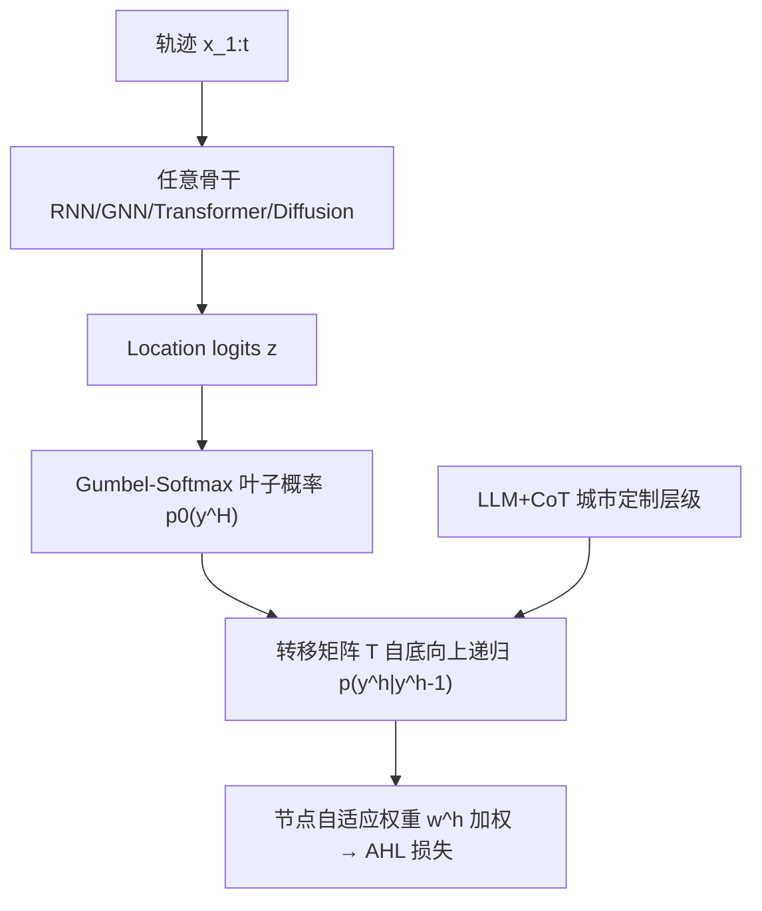
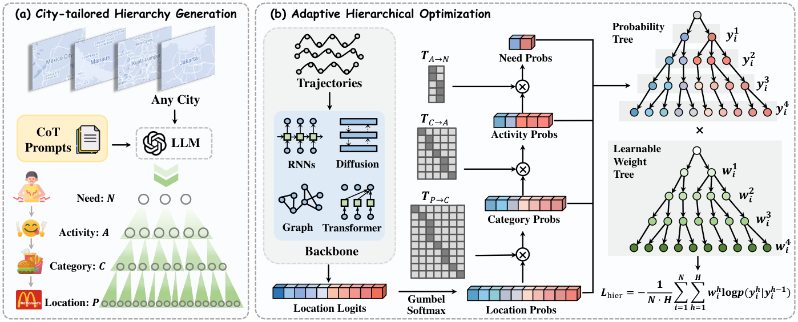

# Adaptive Location Hierarchy Learning for Long-Tailed Mobility Prediction (面向长尾移动性预测的自适应位置层级学习)

- **会议/期刊**: WWW 2026
- **作者与机构**: Yu Wang, Junshu Dai, Yuchen Ying, Hanyang Yuan, Zunlei Feng, Tongya Zheng, Mingli Song（浙江大学；杭州城市学院）
- **推荐链路定位**: 精排（Next-POI 打分排序）
- **研究方向**: 时空轨迹与 POI 本地生活推荐 / 冷启动与长尾推荐
- **论文原文**: [https://arxiv.org/abs/2505.19965v2](https://arxiv.org/abs/2505.19965v2)
- **开源代码**: [https://github.com/Star607/ALOHA](https://github.com/Star607/ALOHA)

## TL;DR (1分钟核心速览)

Next-POI 预测受位置访问频次长尾分布困扰，现有 RNN/GNN/Transformer/Diffusion 骨干均偏向头部位置；唯一显式处理长尾的 LoTNext 与图结构强耦合、无法跨架构迁移。ALOHA 提出首个**架构无关插件**：用 LLM+CoT 自动生成 `Need→Activity→Category→Location` 四级城市定制层级，再由 Gumbel-Softmax 把任意骨干的 location logits 转成概率树，配合节点级自适应权重构成层级损失。在 6 个 Foursquare/Gowalla 城市、4 类骨干上一致最优，M@1 相对提升最高 16.59%（CA/GFlash），且每轨迹额外开销仅约 0.1ms。

## Background & Motivation (背景与核心矛盾)

- **主流范式**: 移动性预测按场景分化出 RNN（局部转移）、GNN（时空图关联）、Transformer（全局依赖）、Diffusion（不确定性生成）四类骨干，各自在序列建模上已相当成熟。
- **前人局限**: ① 绝大多数骨干直接优化 location 级交叉熵，长尾位置（后 80% 位置）梯度被头部淹没，预测偏向热门 POI，损害准确性与推荐多样性；② 唯一显式处理长尾的 LoTNext 依赖图结构，换骨干即失效，且需额外图采样开销。
- **核心洞察 (Key Insight)**: 借用 Maslow 需求理论——人的移动是"需求驱动活动、活动落在类别、类别对应具体位置"的因果链，因此**头部与尾部位置在粗粒度语义上共享大量知识**；把这种共享语义作为辅助监督，可在不触碰骨干结构的前提下重平衡优化。
- **本文切入点**: 将长尾缓解"解耦"为一个外挂插件：层级由 LLM 离线构建（零骨干侵入），损失在 logits 上直接计算（零额外分类器参数）。

## Method (核心方法设计)

### 1. 整体框架 (Overall Architecture)

输入用户轨迹 $x_{1:t}$，任意骨干输出 location 级 logits$z$；ALOHA 先用 Gumbel-Softmax 把$z$扰动为叶子节点概率$p_0(y^H)$，再沿预构建的转移矩阵自底向上递归得到 Need/Activity/Category 各级概率，最后对四级条件概率加权求和构成 Adaptive Hierarchical Loss 反传。层级本身由 LLM+CoT 离线一次性生成并可跨城市复用，推理阶段仅需一次矩阵乘，不引入任何新网络参数。

<figure class="paper-figure" markdown="span">
  <figcaption>图1：我们提出的 ALOHA 框架。(a) 城市定制层级生成：使用带 CoT 提示的 LLM 为任意城市自动构建层级，仅需极少人工验证即可保证可靠性。(b) 自适应层级优化：基于构建的层级，通过 Gumbel-Softmax 将任意预测架构的 logits 转换为概率树，节点级自适应权重产生自适应层级损失。</figcaption>
</figure>

### 2. 关键设计拆解 (Key Designs)

1. **LLM+CoT 城市定制层级构建（零侵入的语义先验）**：痛点在于不同城市 POI 类别定义差异大（241~330 类），人工映射不可扩展。做法是用 GPT-4o-mini 配 CoT 提示推断 `Category→Activity`（10 类，对齐 Foursquare 分类）与 `Activity→Need`（3 类：生理/安全/社交）转移矩阵，`Location→Category` 直接从轨迹统计；矩阵元素取 $\{0,1\}$ 且行和为 1。有效性直觉：把"哪些冷门 POI 与热门 POI 属于同一活动动机"这一先验显式化，使尾部位置能借同组头部位置的梯度获得监督。

2. **Gumbel 扰动 + 概率树递归（探索语义近邻）**：痛点在于 argmax 式优化让模型只盯高概率头节点。做法是对 logits 注入 Gumbel 噪声后 softmax：
$$p_0(y^H_{t+1})=\frac{\exp((z_i+g_i)/\tau)}{\sum_j \exp((z_j+g_j)/\tau)},\quad g_i=-\log(-\log a_i)$$
再由 $p_0(y^{h-1})=T^{h\to h-1}p_0(y^h)$与链式法则$p(y^H)=\prod_{h=1}^{H}p(y^h|y^{h-1})$ 得到各级条件概率。Gumbel 是稳定分布族，加噪不改变原分布形状，因此"探索"不会牺牲收敛性——这是它优于 Focal/CB 等硬重加权插件的关键。

3. **节点自适应权重与 AHL 损失（抑制粒度竞争）**：痛点在于粗粒度层类别少、易主导梯度（granularity competition）。做法是给每级每样本一个可学习权重 $w^h_i$（Softplus 保正，初始化$\{1,0.75,0.5,0.25\}$ 由细到粗递减）：
$$\mathcal{L}_{hier}=-\frac{1}{N\cdot H}\sum_{i=1}^{N}\sum_{h=1}^{H} w^h_i \log p(y^h_i|y^{h-1}_i)$$
梯度分析显示 $\partial \ell_{hier}/\partial z_j = p_0(y^H_i)\cdot A - w^H_i$，其中$A$含级间权重差$(w^{h+1}_i-w^h_i)/S^h_i$——**级间权重必须不均等**才能维持表征多样性，等权会退化为普通 CE。训练无需负采样（全库 softmax），推理仅多一次$O(N)$ 的矩阵乘。

## Experimental Setup & Evaluation Protocol (实验设置与评估协议)

- **数据集与预处理**: Foursquare + Gowalla 六城，过滤规则为**位置访问 <15 次、用户 check-in <100 次剔除**，按 24 小时间隔切分轨迹：

| 数据集 | #Users | #Items(Loc.) | #Interactions | 稀疏度/密度 | 特征/场景说明 |
| :--- | :---: | :---: | :---: | :---: | :--- |
| JKT (雅加达) | 2,827 | 7,240 | 240,914 | 1.18% | 308 类，40,733 轨迹 |
| KLP (吉隆坡) | 1,528 | 3,836 | 139,391 | 2.38% | 259 类，24,015 轨迹 |
| CA (加州) | 1,267 | 4,171 | 94,856 | 1.79% | 260 类，13,217 轨迹 |
| MAO / MOW / SPB | 1,036 / 3,234 / 992 | 3,180 / 8,963 / 3,077 | 123,861 / 316,576 / 99,832 | 3.76% / 1.09% / 3.27% | 241 / 330 / 253 类 |

- **数据划分与防穿越 (Splitting Strategy)**: 按用户时间序 **8:1:1 比例划分**；训练集未出现、仅在验证/测试出现的位置与用户在评测时剔除（严格防穿越）。
- **排名评测协议 (Ranking Protocol)**: **Full-Ranking 全库排序**（对全部 $|\mathcal{P}|$个位置打分），指标 MRR@k 与 NDCG@k，$k\in\{1,5,10\}$；头/尾按 Pareto 原则以访问频次前 20% 切分。
- **对比基线与超参设置**: 4 类骨干（Graph-Flashback / STHGCN / MCLP / Diff-POI）× 6 个插件（Focal、CB、IB、LA、BLV 五个 CV 长尾插件 + 本文），外加框架级基线 MELT、LoTNext；层级构建用 GPT-4o-mini 与 GLM-4.5 双模型交叉验证。

## Key Experimental Results (实验关键数据)

### 1. 主实验对比 (Main Results)

JKT / KLP / CA 三城代表性结果（M@1 与 N@10，加粗为最优）：

| 骨干 + 插件 | JKT M@1 | JKT N@10 | KLP M@1 | KLP N@10 | CA M@1 | CA N@10 |
| :--- | :---: | :---: | :---: | :---: | :---: | :---: |
| GFlash (RNN) | 0.1916 | 0.3452 | 0.1729 | 0.3221 | 0.1801 | 0.3520 |
| + Focal | 0.1955 | 0.3435 | 0.1853 | 0.3252 | 0.1754 | 0.3469 |
| + CB | 0.1645 | 0.2947 | 0.1502 | 0.2700 | 0.1727 | 0.3315 |
| + BLV | 0.1874 | 0.3437 | 0.1881 | 0.3305 | 0.1893 | 0.3554 |
| **+ Ours** | **0.2113** | **0.3557** | **0.2045** | **0.3414** | **0.2207** | **0.3900** |
| Improv. | +8.08% | +3.04% | +8.72% | +3.30% | **+16.59%** | +9.74% |
| STHGCN (GNN) | 0.1976 | 0.3365 | 0.1961 | 0.3312 | 0.2031 | 0.3695 |
| **+ Ours** | **0.2097** | **0.3487** | **0.2065** | **0.3431** | **0.2207** | **0.3792** |
| Improv. | +6.12% | +3.32% | +5.30% | +1.90% | +4.85% | +1.31% |
| MCLP (Transformer) | 0.1968 | 0.3400 | 0.1833 | 0.3174 | 0.1939 | 0.3551 |
| **+ Ours** | **0.2079** | **0.3507** | **0.1993** | **0.3295** | **0.2225** | **0.3830** |
| Improv. | +6.02% | +4.25% | +5.73% | +3.42% | +5.70% | +6.74% |
| Diff-POI (Diffusion) | 0.1234 | 0.2273 | 0.1250 | 0.2170 | 0.1339 | 0.2354 |
| **+ Ours** | **0.1429** | **0.2364** | **0.1410** | **0.2341** | **0.1496** | **0.2458** |
| Improv. | +10.86% | +1.85% | +12.80% | +5.74% | +4.54% | +4.42% |
| MELT (RecSys 框架) | 0.1388 | 0.2936 | 0.1139 | 0.2573 | 0.1241 | 0.2631 |
| LoTNext (移动性框架) | 0.1834 | 0.3157 | 0.1861 | 0.3003 | 0.2041 | 0.3583 |

### 2. 消融实验 (Ablation Study)

STHGCN 骨干，JKT / KLP 的 M@1：

| 变体 | JKT M@1 | KLP M@1 | 说明 |
| :--- | :---: | :---: | :--- |
| **Ours (完整)** | **0.2097** | **0.2065** | 四级层级 + Gumbel + 自适应权重 |
| w/o Exploitation | 最低 | — | 去掉层级仅留 Gumbel，JKT 掉幅最大 |
| w/o N | 下降 | 下降 | 去掉 Need 层 |
| w/o N&A | 更大下降 | 更大下降 | 去掉 Need+Activity，验证四级必要性 |
| w/o Exploration | 下降 | 下降 | 去掉 Gumbel + 自适应权重 |
| w/o Gumbel | 下降 | **最大降幅** | KLP 上探索机制最关键 |
| w/o Adaptive | 小幅下降 | 小幅下降 | 降幅略小于 w/o Gumbel |

### 3. 关键实验发现 (Key Findings)

1. **插件优于"换骨干"**：CA 上轻量 GFlash+ALOHA（M@1=0.2207）反超无插件的最强骨干 STHGCN（0.2031），说明长尾偏置的修复收益大于骨干容量差异；而 CV 长尾插件普遍不稳，Diff-POI+IB 在 JKT 上 M@1 暴跌 33.23%，因其为类别少、静态 i.i.d. 的视觉数据设计，在时空序列上过度校正。
2. **尾部提升不以头部为代价**：JKT 上头/尾分组对比显示尾部组提升显著、头部组 M@k 基本持平且 N@k 略优；层级距离在 Need/Activity/Category 三级分别缩短 3.3%/2.5%/3.4%，证明收益来自粗粒度语义理解而非简单重加权。案例中真实标签为仅 27 次访问的尾部位置，ALOHA 排第 1，STHGCN 未进前 3；CW（本文对/基线错）95 次 vs WC 24 次。
3. **层级构建廉价且鲁棒**：Category→Activity 映射人工修正率 <2.60%（GPT-4o-mini 与 GLM-4.5 双模型一致），单城构建耗时 3~6 分钟、成本 <$1；随机破坏 10% 映射后 JKT M@1 仍为 0.2003~0.2118（干净版 0.2097），自适应权重有效吸收噪声；每轨迹额外耗时约 0.1ms（0.628→0.735ms），远低于 BLV 的 4.978ms。

## Highlights & Limitations (亮点、对比与审稿批判)

- **与代表作对比 (vs. Prior Work)**: 相比 LoTNext（图耦合、不可迁移），ALOHA 完全解耦骨干，四类架构通吃且无需图采样；相比 Focal/CB/LA/BLV 等 CV 长尾插件（静态类别重加权、忽略时空依赖、常负迁移），ALOHA 用语义层级 + 稳定分布扰动实现"软重平衡"；相比 MELT（RecSys 迁移），其未建模空间语义，KLP 上 M@1 落后 LoTNext 达 24.32%。
- **可迁移亮点**: ① "LLM 离线建层级 + 在线仅矩阵乘"的模式可低成本移植到电商品类树、内容标签体系等任意具备天然分类学的长尾推荐场景；② 用 Gumbel 稳定分布做"不破坏收敛性的探索"这一思路，可直接替换对比学习中的硬负采样增广。
- **审稿级局限批判**: ① 层级质量仍依赖 LLM 对本地 POI 类别的语义判断，Need 层仅 3 类且 Activity→Need 修正率高达 10~20%，粗粒度先验偏粗；② 实验全部为离线 Full-Ranking，缺少线上 A/B 与延迟敏感场景验证，且未与 LLM4Rec 类生成式 POI 预测方法对比。

## Rating (四维评分)

- **方法创新性 (Novelty)**: ⭐⭐⭐⭐ （核心机制与方法设计具备明确创新性，理论与实验动机支撑充分）
- **评估协议与实验扎实度 (Protocol & Experiments)**: ⭐⭐⭐⭐⭐ （主流公开数据集评测完整，包含多基线对比与消融实验验证）
- **写作与数学规范度 (Clarity & Rigor)**: ⭐⭐⭐⭐⭐ （问题形式化定义清晰，核心模块数学推导与架构阐述严谨易读）
- **工业落地与复现价值 (Industrial & Practical Value)**: ⭐⭐⭐⭐ （兼顾推荐效果增益与训练/推理效率，具备实际场景迁移参考价值）
